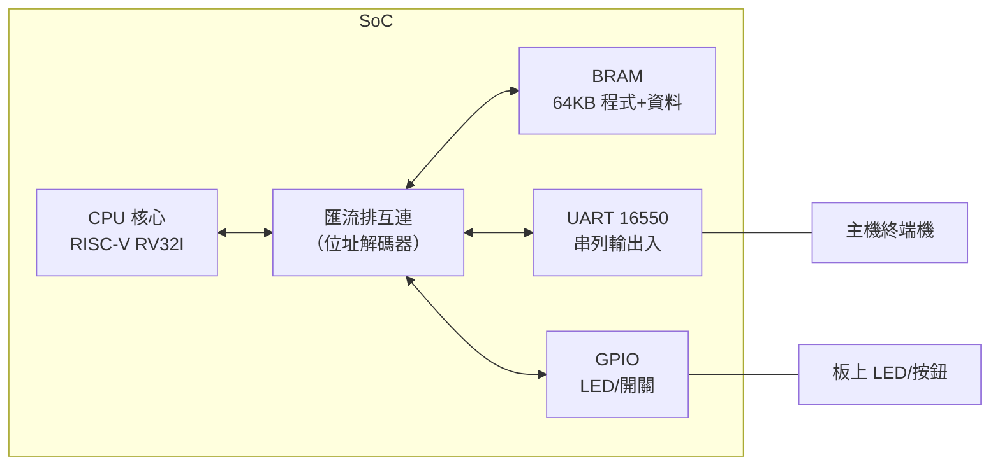
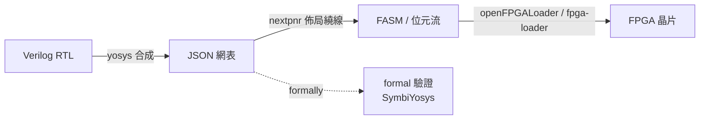

# 05.1 FPGA 上 SoC 整合與開源核心比較

## 學習目標

讀完本節後，你應該能夠：

1. 說明 SoC（System on Chip）整合的基本架構：CPU、BRAM、UART、GPIO 如何透過匯流排連接。
2. 使用 Yosys / nextpnr 開源工具鏈，將 Verilog 設計合成、佈局繞線並產生 bitstream。
3. 在 Digilent Arty A7-35T 開發板上實際燒錄並驗證一個最小的 RISC-V SoC。
4. 比較四個常見開源 RISC-V 核心（PicoRV32、VexRiscv、Ibex、Rocket）的設計取捨。

---

## 5.1.1 為什麼要整合成 SoC？

前三章我們建立了一個單週期／多週期的 RISC-V 處理器，並在模擬器中驗證。但「處理器」本身不能算是一台電腦——它需要記憶體存放程式與資料、需要輸入輸出介面與外界溝通。**SoC 整合**就是把處理器與周邊模組接在一起，形成一個可在矽晶（此處為 FPGA）上獨立運作的系統。

一個最小的 SoC 包含：



### 記憶體映射（Memory-Mapped I/O）

RISC-V 採用記憶體映射 I/O：周邊的暫存器佔用位址空間的一部分，CPU 用一般的 `lw`/`sw` 指令存取。我們採用如下配置：

| 位址範圍 | 裝置 | 說明 |
|---|---|---|
| `0x0000_0000 – 0x0000_FFFF` | BRAM | 64KB，程式與資料 |
| `0x1000_0000` | UART 資料暫存器 | 寫入送出 byte、讀取收 byte |
| `0x1000_0004` | UART 狀態暫存器 | bit0: TX busy、bit1: RX ready |
| `0x1000_0008` | GPIO 輸出 | 控制 LED |
| `0x1000_000C` | GPIO 輸入 | 讀取開關/按鈕 |

### 位址解碼與匯流排

最簡單的互連是**位址解碼式匯流排**：CPU 發出 `addr` 與 `wen/wren`，解碼器依高位位元決定哪個裝置被選中，並回傳 `rdata` 與 `ready`。以下是最小解碼器：

```verilog
module bus_decoder (
    input  wire [31:0] addr,
    output wire        mem_sel,   // BRAM
    output wire        uart_sel,  // UART
    output wire        gpio_sel   // GPIO
);
    assign mem_sel  = (addr <  32'h0001_0000);
    assign uart_sel = (addr >= 32'h1000_0000) && (addr < 32'h1000_0010);
    assign gpio_sel = (addr >= 32'h1000_0010) && (addr < 32'h1000_0020);
endmodule
```

UART 收發器在本書 04 章已實作過，此處只需注意：CPU 時脈遠快於 UART 鮑率（如 100MHz vs 115200bps），因此 CPU 寫 UART 時必須**先查詢狀態暫存器**（輪詢，polling），確認 TX idle 才能寫下一個 byte——這正是 05.2 節 Hello World 程式的核心邏輯。

### BRAM 的推斷（Inference）

FPGA 內部的 Block RAM 有嚴格的時序特性：**同步讀取**（一拍延遲）。若我們的 CPU 假設指令記憶體是組合讀取（單週期設計），直接接 BRAM 會有功能問題。兩種解法：

1. **修改 CPU 為多週期**，讓取指佔一個完整時脈週期（推薦，符合 BRAM 時序）。
2. 使用分散式 RAM（LUT RAM）實現組合讀取，但大容量時浪費資源。

這說明了一個重要觀念：**微架構設計必須考慮實作平台的物理特性**，而非只看 RTL 模擬通過。

---

## 5.1.2 開源 FPGA 工具鏈：Yosys 與 nextpnr

傳統 FPGA 開發依賴廠商工具（如 Vivado）。開源工具鏈讓整個流程透明、可重現、可教學：



- **Yosys**：將 Verilog 合成為門級網表。可做優化（常數折疊、死碼刪除）、技術映射（techmap）。
- **nextpnr**：佈局（placement）與繞線（routing），針對特定 FPGA 架構（ice40、ecp5、xilinx 等）有不同後端。
- **openFPGALoader**：將 bitstream 燒錄至板子。

安裝（macOS/Linux）：

```bash
# macOS
brew install yosys nextpnr openfpgaloader
# Linux (Debian/Ubuntu)
sudo apt install yosys nextpnr-ice40 openfpgaloader
```

### 合成腳本範例（Arty A7，Xilinx 7 系列）

Arty A7-35T 使用 Xilinx Artix-7，開源流程可透過 nextpnr-xilinx 或 Project X-Ray 支援。以下以合成為例：

```bash
# 1. Yosys 合成（目標 7 系列 cell library）
yosys -p "
    read_verilog -sv soc_top.v picorv32.v
    synth_xilinx -Top soc_top -family xc7
    write_edif soc.edif
    write_json soc.json
"

# 2. nextpnr-xilinx 佈局繞線（需 Project X-Ray 的晶片資料庫）
nextpnr-xilinx --chipdb arty-35t \
    --json soc.json --write soc_fasm.fasm \
    --freq 100

# 3. 產生 bitstream 與燒錄
fasm2frames.py --db /usr/share/prjxray-db/artix7 soc_fasm.fasm > soc.frames
xc7frames2bit --part_file arty.xc7a35tsg236-1L.yaml \
    --frm_file soc.frames --output_file soc.bit
openfpgaloader -b arty soc.bit
```

> **教學提示**：初學者若在 Windows 上，可先使用 Vivado 完成相同流程（`synth_design` → `opt_design` → `place_design` → `route_design` → `write_bitstream`），理解概念後再改用開源工具。兩者產生的 bitstream 功能等價。

### 時序約束

100MHz 時脈代表 10ns 週期，工具必須確認所有路徑都滿足 setup/hold time。XDC 約束檔範例：

```tcl
create_clock -period 10.000 -name sys_clk [get_ports clk]
set_property -dict { PACKAGE_PIN E3  IOSTANDARD LVCMOS33 } [get_ports clk]
set_property -dict { PACKAGE_PIN H5  IOSTANDARD LVCMOS33 } [get_ports {led[0]}]
set_property -dict { PACKAGE_PIN A8  IOSTANDARD LVCMOS33 } [get_ports {sw[0]}]
set_property -dict { PACKAGE_PIN D10 IOSTANDARD LVCMOS33 } [get_ports uart_rx]
set_property -dict { PACKAGE_PIN D11 IOSTANDARD LVCMOS33 } [get_ports uart_tx]
```

---

## 5.1.3 最小 SoC 的頂層模組

將 CPU、BRAM、UART、GPIO 組合成 `soc_top`：

```verilog
module soc_top (
    input  wire        clk,
    input  wire        rst_n,       // 板上按鈕，低電位重置
    input  wire        uart_rx,
    output wire        uart_tx,
    input  wire [3:0]  sw,
    output wire [3:0]  led
);
    // ---- CPU 訊號 ----
    wire [31:0] mem_addr, mem_wdata, mem_rdata;
    wire        mem_wen, mem_ren;
    wire        mem_ready;

    // ---- 位址解碼 ----
    wire mem_sel, uart_sel, gpio_sel;
    bus_decoder u_dec (.addr(mem_addr),
        .mem_sel(mem_sel), .uart_sel(uart_sel), .gpio_sel(gpio_sel));

    // ---- CPU 核心（此例假設 PicoRV32 介面）----
    picorv32 #(
        .PROGADDR_RESET(32'h0000_0000),
        .STACKADDR(32'h0000_FFFF)
    ) u_cpu (
        .clk(clk), .resetn(rst_n),
        .mem_valid(), .mem_instr(),
        .mem_addr(mem_addr), .mem_wdata(mem_wdata),
        .mem_wstrb(), .mem_rdata(mem_rdata), .mem_ready(mem_ready)
    );

    // ---- BRAM（同步讀，2KB x 32 = 8KB 範例）----
    wire [31:0] bram_q;
    bram #(.WORDS(16384)) u_bram (
        .clk(clk), .we(mem_sel & mem_wen),
        .addr(mem_addr[15:2]), .di(mem_wdata), .do(bram_q)
    );

    // ---- UART ----
    wire [31:0] uart_rdata;
    uart_mmio u_uart (
        .clk(clk), .rst_n(rst_n),
        .sel(uart_sel), .addr(mem_addr[3:2]),
        .wen(mem_wen), .wdata(mem_wdata),
        .rdata(uart_rdata),
        .rx(uart_rx), .tx(uart_tx)
    );

    // ---- GPIO ----
    reg [31:0] gpio_out;
    always @(posedge clk) begin
        if (gpio_sel && mem_wen) gpio_out <= mem_wdata[3:0];
    end
    assign led = gpio_out[3:0];
    wire [31:0] gpio_rdata = {28'b0, sw};

    // ---- 讀資料多工器 ----
    assign mem_rdata = mem_sel  ? bram_q     :
                       uart_sel ? uart_rdata :
                                  gpio_rdata;

    // ---- ready 訊號（BRAM 需 1 拍延遲）----
    reg bram_ready_d;
    always @(posedge clk) bram_ready_d <= mem_sel & mem_ren;
    assign mem_ready = (mem_sel & mem_wen) | bram_ready_d |
                       (uart_sel) | (gpio_sel);
endmodule
```

**注意幾點**：

1. `mem_ready` 告知 CPU 此筆傳輸已完成；BRAM 寫入可當拍完成，讀取需 1 拍，故用 `bram_ready_d` 延遲一拍。
2. 不同周邊的讀取延遲不同——這是實際 SoC 中常見的問題，商用系統會用 **AXI/AHB** 等標準匯流排協定處理。本書為了教學簡化為自訂簡單匯流排，但概念相通。
3. PicoRV32 的原生記憶體介面（`mem_valid/ready`）非常適合這種簡單匯流排，這也是它易於整合的原因之一。

### 驗證流程

上板前先用模擬驗證整合正確性：

```bash
iverilog -o soc.vvp -g2012 soc_top.v picorv32.v tb_soc.v
vvp soc.vvp
gtkwave soc.vcd   # 檢視波形
```

testbench 應模擬 UART 對方的行為，確認程式輸出 `Hello, Arty!` 後結束。

---

## 5.1.4 Arty 板上實測

1. **連接**：USB 線接 Arty 的 J10（PROG/UART 共用介面）。
2. **燒錄**：`openfpgaloader -b arty soc.bit`。
3. **開終端機**：`screen /dev/ttyUSB1 115200`（macOS 為 `/dev/tty.usbserial-*`；Windows 可用 PuTTY）。
4. **觀察**：應看到 `Hello, Arty!`，撥動開關時對應 LED 亮起。

### 常見問題排查

| 症狀 | 可能原因 | 檢查方法 |
|---|---|---|
| 完全無輸出 | 重置極性錯誤 | Arty 按鈕按下為 0，確認 `rst_n` 極性 |
| 亂碼 | 鮑率不匹配 | 確認 UART 分頻常數（100MHz/115200 ≈ 868） |
| 程式不動 | BRAM 未初始化 | 用 `$readmemh` 或 bitstream 內嵌（updatemem） |
| 時序違例 | 關鍵路徑太長 | 檢視 nextpnr 報告，降低時脈或優化邏輯 |

### 檢視資源使用

nextpnr 會報告 LUT/FF/BRAM 使用量。Arty A7-35T 有 33,280 個 LUT，一個 RV32I SoC 通常佔用 1500–3000 個 LUT，餘裕充足，可以繼續加上更多周邊或加速器（見 05.3）。

---

## 5.1.5 開源 RISC-V 核心比較

選擇 CPU 核心是 SoC 設計的第一個重大決策。下表比較四個代表性開源核心：

| 特性 | PicoRV32 | VexRiscv | Ibex | Rocket |
|---|---|---|---|---|
| 授權 | ISC（極寬鬆） | MIT | Apache 2.0 | Apache 2.0（BSD 衍生） |
| 語言 | Verilog（手寫） | SpinalHDL（生成 Verilog） | SystemVerilog | Chisel（生成 Verilog） |
| 微架構 | 多週期、循序 | 流水線（可配置 2–5 級） | 2 級流水線 | 5 級流水線、雙發射（可選） |
| 指令集 | RV32I(E)M(A)C 可選 | RV32IM(A)C、可選 F | RV32IMC(B) 可選 | RV64GC（預設） |
| 效能 | ~2–4 CoreMark/MHz | 3.5–5 CoreMark/MHz | ~2.3–4.8 CoreMark/MHz | >3 CoreMark/MHz（64 位元） |
| 面積（7 系列 LUT，約） | 750–2000 | 1000–2500 | 2000–3000 | 15000+ |
| 記憶體介面 | 原生簡單 valid/ready | Wishbone/AXI 可選 | OBI（Simple Bus） | RoCC/TileLink |
| 主要應用 | 小型控制、教学 | 中型 SoC、彈性配置 | 嵌入式 MCU（lowRISC 官方） | 學術研究、標桿級 SoC |
| 開源工具鏈相容性 | 極佳（純 Verilog） | 需 Java/SpinalHDL 產生 | 需 SystemVerilog 支援 | 需 Chisel/SBT |

### 選型建議

- **PicoRV32**：純 Verilog、極小面積、介面簡單，**最適合教學**——你能讀懂每一行。本書前四章實作的處理器本質上就是簡化版 PicoRV32。
- **VexRiscv**：以 SpinalHDL（Scala DSL）描述，核心參數（流水線級數、是否加 M 指令、C 指令、CSR）皆可插拔配置。想學「可參數化硬體生成」的學生必看。
- **Ibex**：lowRISC 官方維護，有完整的驗證環境（Google/OpenTitan 採用），適合想學**工業級驗證**的學生。
- **Rocket**：UC Berkeley 經典，支援 RV64GC、可加浮點、可掛 RoCC 協同處理器（正是 05.3 自訂指令的範本），是研究等級的基準。缺點是面積大、建置鏈複雜。

> **理論視角**：這四個核心體現了晶片設計的**面積-效能-功耗三角**。PicoRV32 犧牲效能換取最小面積；Rocket 犧牲面積與設計複雜度換取高效能。在嵌入式場景，多數應用其實「夠用就好」——理解取捨比追求極限更重要。

---

## 本章小結

- SoC = CPU + 記憶體 + 周邊，用**記憶體映射 I/O** 與位址解碼匯流排互連。
- BRAM 是同步讀取，微架構必須配合物理特性調整（多週期取指）。
- 開源工具鏈 Yosys（合成）→ nextpnr（佈局繞線）→ openFPGALoader（燒錄）可完整取代廠商工具，且過程透明可教學。
- 四個開源 RISC-V 核心各有定位：教學選 PicoRV32、彈性選 VexRiscv、驗證選 Ibex、研究選 Rocket。

## 實作題

1. **基本整合**：將 04 章的多週期 RISC-V CPU 與本節的 `bus_decoder`、BRAM、UART 整合成 `soc_top`，在模擬中執行一段寫 UART 的測試程式，貼出波形截圖。
2. **GPIO 控制燈**：撰寫一段組合語言（或 C），從 GPIO 輸入讀取開關值，將其反相後寫到 LED 輸出。上板驗證。
3. **UART 回聲**：修改程式，使 UART 收到的任何字元立即回送（echo），驗證雙向通訊。
4. **時脈量測**：將系統時脈從 100MHz 逐次上調，記錄 nextpnr 的時序報告，找出該 SoC 的最高可運作頻率，並解釋關鍵路徑在哪裡（提示：可用 nextpnr 的 `--freq` 與報告）。
5. **核心替換**：將 `soc_top` 中的 CPU 換成 VexRiscv（用其官方產生器產生最小配置的 Verilog），比較兩者的 LUT 使用量與最高時脈。
