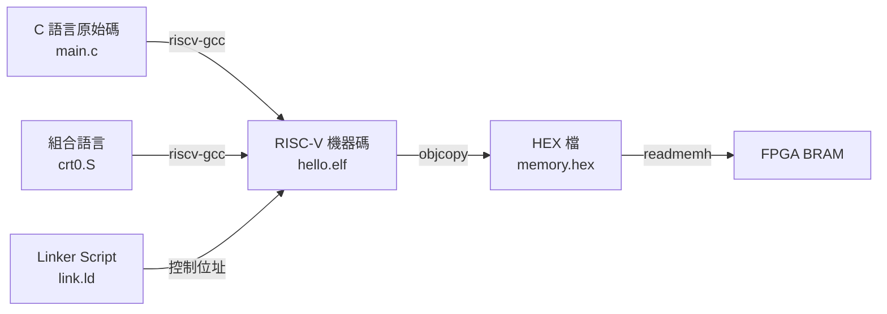

# 05.2 裸機程式設計與交叉編譯

## 學習目標

讀完本節後，你應該能夠：

1. 解釋為什麼嵌入式系統需要「交叉編譯」，以及裸機（bare-metal）與一般應用程式的差別。
2. 使用 `riscv64-unknown-elf-gcc` 編譯出不含任何作業系統相依性的可執行檔。
3. 撰寫 linker script 控制程式碼與資料在記憶體中的位址配置。
4. 撰寫 `crt0.S` 啟動碼，完成從重置向量到 C 語言 `main()` 之間的必要初始化。
5. 完成「Hello World 透過 UART 輸出」的完整端到端流程，並在 FPGA SoC 上執行。

---

## 5.2.1 交叉編譯與裸機的概念

### 什麼是交叉編譯？

你的開發機（x86_64 或 Apple Silicon Mac）與目標機（RISC-V 32 位元 SoC）指令集不同。在開發機上產生**目標機可執行的程式碼**，就是**交叉編譯**（cross compilation）：



### 什麼是裸機（bare-metal）？

一般桌上型程式依賴作業系統：載入器負責把程式放進記憶體、C 標準庫的 `printf` 透過系統呼叫寫到終端機。裸機程式**沒有 OS**——CPU 重置後直接執行你的第一條指令，所有底層工作（初始化堆疊、清 BSS、設定 UART）都要自己來。

這也是為什麼裸機程式設計是理解「軟硬體介面」的最佳練習：你被迫面對**程式到底放在記憶體哪裡、堆疊長什麼樣、CPU 重置後從哪裡開始跑**這些平時被抽象層隱藏的細節——正是計算機結構課程的核心。

### 安裝工具鏈

```bash
# macOS
brew tap riscv-software-src/riscv
brew install riscv-tools
# 或直接安裝 gcc 工具鏈
brew install riscv64-elf-gcc

# Linux (Ubuntu)
sudo apt install gcc-riscv64-unknown-elf

# 官方預編譯版（推薦，含所有工具）
# https://github.com/riscv-collab/riscv-gnu-toolchain/releases
```

確認安裝：

```bash
riscv64-unknown-elf-gcc --version
riscv64-unknown-elf-objdump --version
```

---

## 5.2.2 Hello World：C 語言部分

### UART 驅動（memory-mapped I/O）

依 05.1 的位址映射：

```c
// uart.h
#ifndef UART_H
#define UART_H
#include <stdint.h>

#define UART_BASE   0x10000000u
#define UART_DATA   (*(volatile uint32_t *)(UART_BASE + 0x0))
#define UART_STATUS (*(volatile uint32_t *)(UART_BASE + 0x4))
#define UART_TX_BUSY (1u << 0)

static inline void uart_putc(char c) {
    while (UART_STATUS & UART_TX_BUSY)
        ;                       // 輪詢等待 TX idle
    UART_DATA = (uint32_t)(unsigned char)c;
}

static inline void uart_puts(const char *s) {
    while (*s)
        uart_putc(*s++);
}

#endif
```

關鍵點：

- `volatile` 告訴編譯器此位址的讀寫**不可被優化掉**，因為它對應實際硬體，每次存取都有副作用。
- 輪詢式（polling）驅動最簡單，缺點是浪費 CPU 時間；更進階可用中斷驅動（第 06 章主題）。

### 主程式

```c
// main.c
#include "uart.h"

int main(void) {
    uart_puts("Hello, RISC-V World!\r\n");
    uart_puts("This is a bare-metal program.\r\n");
    while (1)              // 裸機程式不能 return！
        ;
    return 0;              // never reached
}
```

注意最後的 `while(1)`：沒有 OS 可以返回，若 `main` 返回，CPU 會繼續執行後面未定義的記憶體內容，行為不可預測。

---

## 5.2.3 Linker Script：程式的地圖

### 為什麼需要自訂 linker script？

預設的 linker script 假設程式會被 OS 載入到特定虛擬位址。裸機程式必須明確告訴 linker：

- 程式碼（`.text`）從哪個位址開始（必須是 CPU 重置後的取指位址，即 05.1 的 `PROGADDR_RESET`）。
- 資料（`.data`）、未初始化資料（`.bss`）、堆疊（stack）、堆（heap）各自放哪。

### 完整的 linker script

```ld
/* link.ld */
OUTPUT_ARCH(riscv)
ENTRY(_start)

MEMORY
{
  RAM (rwx) : ORIGIN = 0x00000000, LENGTH = 64K
}

SECTIONS
{
  .text : {
    KEEP(*(.text.init))     /* crt0.S 必須放在最前面 */
    *(.text .text.*)
  } > RAM

  .rodata : ALIGN(4) {
    *(.rodata .rodata.*)
  } > RAM

  .data : ALIGN(4) {
    __global_pointer$ = . + 0x800;  /* GP-relative 定址最佳化 */
    *(.sdata .sdata.*)
    *(.data .data.*)
  } > RAM

  .bss : ALIGN(4) {
    __bss_start = .;
    *(.sbss .sbss.*)
    *(.bss .bss.*)
    *(COMMON)
    __bss_end = .;
  } > RAM

  . = ALIGN(16);
  __heap_start = .;         /* 堆從 bss 之後開始 */
  . = ORIGIN(RAM) + LENGTH(RAM) - 4096;
  __stack_top = .;          /* 堆疊頂端：BRAM 最後 4KB 前 */
}
```

解讀：

- `ENTRY(_start)`：ELF 的進入點符號（供除錯器與 objdump 參考；真正影響硬體的是重置位址）。
- `KEEP(*(.text.init))`：防止 linker 把 crt0.S 的程式碼當垃圾移除，並確保它位於 `.text` 最開頭（即位址 0）。
- `__global_pointer$`：RISC-V 的 gp 相對定址最佳化，`-msmall-data-limit` 會用到，可大幅縮小程式碼。
- `__bss_start`/`__bss_end`：crt0 要用這兩個符號把 BSS 清零。
- `__stack_top`：crt0 要把 sp 指向這裡。

---

## 5.2.4 crt0.S：啟動碼

### 為什麼需要啟動碼？

C 語言執行有幾個隱含前提：

1. **sp 暫存器指向合法堆疊**——否則函式呼叫立即崩潰。
2. **BSS 區已清零**——C 語言保證未初始化的全域變數為 0。
3. **已初始化的資料在正確位置**——`.data` 中的初始值必須能被 `lw` 讀到。

這些都不是 C 語言能自己完成的，所以必須用組合語言寫一段**啟動碼**（crt0 = C runtime zero）。

### 完整的 crt0.S

```asm
# crt0.S
    .section .text.init
    .globl _start
_start:
    # 1. 關閉所有中斷（本 SoC 暫無中斷控制器，保險起見）
    csrw    mie, zero
    csrw    mstatus, zero

    # 2. 設定全域指標 gp（用於 gp-relative 定址）
.option push
.option norelax          # 否則 linker 會把這行優化成 mv gp, gp
    la      gp, __global_pointer$
.option pop

    # 3. 設定堆疊指標
    la      sp, __stack_top

    # 4. 清除 BSS 區（C 語言規定未初始化全域變數 = 0）
    la      t0, __bss_start
    la      t1, __bss_end
1:  bgeu    t0, t1, 2f
    sw      zero, 0(t0)
    addi    t0, t0, 4
    j       1b
2:
    # 5. 呼叫 main
    call    main

    # 6. main 不應返回；若返回就進入無窮迴圈
3:  wfi                 # wait for interrupt（或用 j 3b）
    j       3b
```

逐段解釋：

| 段落 | 作用 | 若省略的後果 |
|---|---|---|
| `csrw mie/mstatus` | 清除中斷使能與 MIE 位元 | 若 SoC 有殘留中斷使能會誤觸發 |
| `la gp` + `norelax` | 設定 gp，`.option norelax` 防止 linker 優化掉這行 | `sdata` 存取會算錯位址 |
| `la sp, __stack_top` | 設堆疊 | 第一個 `call` 就寫到未知記憶體 |
| 清 BSS | 未初始化全域變數歸零 | 未初始化全域變數值為隨機 |
| `call main` | 進入 C 世界 | — |

> **深入理解 `call main`**：RISC-V 的 `call` 展開為 `auipc + jalr`，可跳到 ±2GB 範圍。若程式全在低位 BRAM，其實 `jal main` 就夠，但用 `call` 更穩健（未來程式搬到 0x8000_0000 的 DRAM 時也不會壞）。

---

## 5.2.5 完整編譯流程

### Makefile

```makefile
CROSS   = riscv64-unknown-elf-
CFLAGS  = -march=rv32im -mabi=ilp32 -mcmodel=medany \
          -O2 -Wall -ffreestanding -nostdlib \
          -msmall-data-limit=8
LDFLAGS = -T link.ld -Wl,--gc-sections

all: hello.hex

hello.elf: crt0.S main.c uart.h
	$(CROSS)gcc $(CFLAGS) crt0.S main.c -o hello.elf \
	    $(LDFLAGS) -Wl,-Map=hello.map

hello.hex: hello.elf
	$(CROSS)objcopy -O verilog --verilog-data-width=4 \
	    hello.elf hello.hex

disasm: hello.elf
	$(CROSS)objdump -d hello.elf > hello.lst

clean:
	rm -f *.elf *.hex *.map *.lst
```

重要旗標：

- `-march=rv32im -mabi=ilp32`：目標 32 位元 RISC-V，I+M 指令集（若你的 CPU 沒有 M 擴充，改成 `rv32i` 並加 `-mdivide-traps` 或軟體除法）。
- `-ffreestanding`：告訴編譯器這是獨立環境，不依賴標準庫的完整語意。
- `-nostdlib`：不連結 C 標準庫（`printf` 等不可用；需要時可自行提供最小實作或用 newlib-nano + `-specs=nano.specs`，但必須實作 `_write` 等系統呼叫樁）。
- `-ffunction-sections -fdata-sections` + `--gc-sections`：讓 linker 移除未使用的函式，縮小程式。

### 產生 HEX 給 BRAM

`objcopy -O verilog` 產生 @800 開頭格式的 hex 檔。若我們的 BRAM 以 word（32-bit）定址，需配合 `--verilog-data-width=4` 並確認位址對齊。另一個常見做法是 `binary` 格式再轉換：

```bash
riscv64-unknown-elf-objcopy -O binary hello.elf hello.bin
xxd -e -g4 hello.bin | awk '{print $4}' > hello.hex   # 每行一個 32-bit word
```

### 檢查產物

```bash
riscv64-unknown-elf-objdump -d hello.elf | head -30
riscv64-unknown-elf-readelf -h hello.elf   # 看 Entry point
riscv64-unknown-elf-size hello.elf          # 看 text/data/bss 大小
```

預期的開頭反組譯（位址 0 開始）：

```
00000000 <_start>:
   0:   30047073        csrw    mstatus, zero
   4:   30401073        csrw    mie, zero
   ...
```

---

## 5.2.6 把程式放進 FPGA：三種方法

### 方法一：$readmemh（最簡單，本書採用）

BRAM 模組加入初始化：

```verilog
module bram #(parameter WORDS = 16384) (
    input  wire        clk,
    input  wire        we,
    input  wire [13:0] addr,
    input  wire [31:0] di,
    output reg  [31:0] do
);
    reg [31:0] mem [0:WORDS-1];
    initial $readmemh("hello.hex", mem);

    always @(posedge clk) begin
        if (we) mem[addr] <= di;
        do <= mem[addr];    // 同步讀
    end
endmodule
```

缺點：改程式需重新合成（數分鐘）。適合初學與小程式。

### 方法二：updatemem（Xilinx，免重合成）

先合成一個含「空 BRAM」的 bitstream，之後只替換 BRAM 內容：

```bash
updatemem -meminfo mem.mmi -bit soc.bit -data hello.mem -proc dummy -out soc_prog.bit
```

需準備 `.mmi` 描述 BRAM 在 bitstream 中的位置，略複雜但迭代速度快得多。

### 方法三：韌體載入器（bootloader）

SoC 先跑一段固定韌體，透過 UART 接收新程式寫入 RAM 後跳過去。這是真實系統的做法（如 U-Boot），留作進階習題。

### 實測

```bash
make                  # 編譯出 hello.hex
yosys -p "read_verilog soc_top.v picorv32.v bram.v uart_mmio.v; synth_xilinx -Top soc_top -family xc7; write_json soc.json"
nextpnr-xilinx --chipdb arty-35t --json soc.json --write soc.fasm --freq 100
# （產生 bitstream 的後續步驟見 05.1）
openfpgaloader -b arty soc.bit
screen /dev/ttyUSB1 115200
```

終端機輸出：

```
Hello, RISC-V World!
This is a bare-metal program.
```

恭喜——你從 Verilog 一路到 C 語言，完成了一台「真正」的電腦。

---

## 本章小結

- 交叉編譯是因為開發機與目標機指令集不同；裸機程式沒有 OS，一切初始化自己來。
- Linker script 是「程式的地圖」：決定 `.text`/`.data`/`.bss`/堆疊的位址，`ENTRY` 與 `.text.init` 的位置必須對應硬體重置位址。
- `crt0.S` 完成 C 語言的隱含前提：設 sp、設 gp、清 BSS，然後 `call main`。
- 關鍵編譯旗標：`-march=rv32i(m)`、`-ffreestanding`、`-nostdlib`、自訂 `-T link.ld`。
- 程式進 BRAM 的三種方式：`$readmemh`（簡單）、updatemem（免重合成）、bootloader（真實系統做法）。

## 實作題

1. **修改訊息**：在 `main.c` 中加入你的學號與姓名，透過 UART 輸出；用 `objdump` 觀察字串常數被放進哪個 section（提示：`.rodata`）。
2. **觀察啟動碼**：故意移除 crt0.S 中「清 BSS」的迴圈，宣告一個未初始化的全域陣列並印出其內容，觀察是否為非零垃圾值；解釋原因。
3. **堆疊成長實驗**：寫一個深度遞迴函式（如計算費氏數），用 `objdump` 觀察 `sp` 的變化範圍，並估算每層遞迴消耗多少堆疊；若超過 4KB 會發生什麼事？
4. **自製 printf**：實作一個極簡 `my_printf(const char *fmt, ...)`，至少支援 `%d`、`%x`、`%s`、`%c`，需要用 `<stdarg.h>` 的 `va_list`；用它重寫 Hello World。
5. **Bootloader**：撰寫一段載入器韌體：透過 UART 以 XMODEM 或簡單行協定接收 hex 資料，寫入 BRAM 的 0x1000 起始處，然後用 `jalr` 跳過去執行。驗證你可以「不用重新合成」就更新程式。
