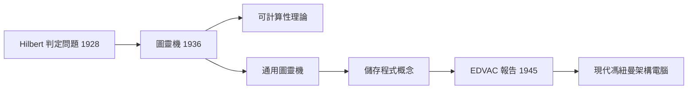

# 1.1 1936：圖靈機與可計算性

## 學習目標

1. 說明圖靈機的基本組成與運作方式。
2. 理解「可計算性」問題的起源：Hilbert 的 Entscheidungsproblem。
3. 掌握圖靈機如何定義「演算法可執行」的極限。
4. 認識通用圖靈機（Universal Turing Machine）與現代儲存程式電腦的思想連結。

## 前言：電腦誕生前的數學危機

在 1930 年代，「計算」這件事還沒有一個嚴格的數學定義。人們會說「用一連串機械化的步驟求解」，但沒有人能精確地說明：什麼叫做「機械化的步驟」？什麼問題是任何方法都算不出來的？

這個問題源自數學基礎的危機。1928 年，Hilbert 提出 **Entscheidungsproblem**（判定問題）：是否存在一個通用的機械程序，能對任何一個數學命題自動判定其真偽？若有，整個數學就可以被「自動化」；若無，則數學存在機器永遠無法跨越的邊界。

1936 年，年僅 24 歲的英國數學家 Alan Turing 發表了《論可計算數及其在判定問題上的應用》（*On Computable Numbers, with an Application to the Entscheidungsproblem*）。他給出了一份答案，而這份答案中用來定義「計算」的抽象機器——**圖靈機**——最終成為一切現代電腦的理論原型。

## 圖靈機的定義

Turing 的洞見是：一個人用紙筆做計算時，本質上只在做幾件極簡單的事——

1. 看著紙上某個位置目前的符號；
2. 依照當下的「心智狀態」，決定寫下/擦除什麼、往左或往右移動、以及進入哪個新的心智狀態。

將這個過程形式化，就得到圖靈機。它由以下部分組成：

- **紙帶（Tape）**：無限長的一維格子，每格可存放一個符號。
- **讀寫頭（Head）**：對準某一格，可讀取或寫入符號，並左右移動。
- **狀態暫存器（State）**：記錄機器目前的狀態，其中有唯一的起始狀態與若干停機狀態。
- **轉移函數（Transition Function）**：

$$
\delta(q, a) = (q', b, D)
$$

表示：當機器處於狀態 $q$、讀到符號 $a$ 時，寫入符號 $b$、轉移到狀態 $q'$、並朝方向 $D \in \{L, R\}$ 移動。

以一個「二進位加一」的圖靈機為例（假設紙帶上從左到右為高位到低位）：

```text
狀態集合：{q0, q1}
轉移規則：
  q0 讀到 1 → 寫 1，左移，停在 q0   （掃過低位）
  q0 讀到 0 → 寫 1，右移，停在 q1   （該位進位成功）
  q0 讀到空白 → 寫 1，右移，停在 q1 （最高位進位）
  q1 讀到任何符號 → 原樣寫回，左移，停在 q1（回頭檢查）
```

初值 `1011`（十進位 11）的執行過程：

```text
[1 0 1 1] q0 指向最右
 1 0 1 [1] → 寫1左移
 1 0 [1] 1 → 寫1左移
 1 [0] 1 1 → 寫1，改為 1 0 1→ 變 1100，停機
```

結果為 `1100`，即十進位 12。這個例子說明：**再複雜的計算，都可以拆解成「讀、寫、移動、換狀態」四種原子動作**。

## 可計算性：計算的邊界

Turing 證明了幾個影響深遠的結果：

1. **Church–Turing 論題**：所有「直覺上可有效計算」的函數，恰好就是圖靈機可計算的函數。計算這個概念從此有了公認的數學定義。
2. **停機問題不可判定**：不存在任何圖靈機，能對任意的「（程式 $M$，輸入 $w$）」判定 $M$ 是否會停機。證明採用對角化技巧——假設判定器 $H$ 存在，則可構造一個與 $H$ 行為相反的機器 $D$，把 $D$ 餵給自己時立刻導出矛盾：

```text
假設 H(M, w) 能判定 M 對輸入 w 是否停機。
構造 D(M)：
  若 H(M, M) = 「會停機」 → D 進入無窮迴圈
  若 H(M, M) = 「不會停機」→ D 立即停機
令 D 輸入 D：
  若 D(D) 會停機 ⇒ H 說它不會停機 ⇒ 矛盾
```

3. **Entscheidungsproblem 無解**：判定問題可歸約到停機問題，故同樣不可判定。Hilbert 的夢想就此終結——但也正因為知道了「不可計算」的邊界在哪裡，工程師才能放心地把邊界之內的問題交給機器。

## 通用圖靈機：儲存程式思想的原點

傳統的圖靈機是「一台機器做一件事」：機器欲改變功能，就得改變轉移規則（相當於改造硬體）。Turing 的天才之處在於指出：**轉移規則本身可以用符號編碼，寫在紙帶上**。於是存在一台固定的「通用圖靈機」（UTM），它讀入「編碼後的機器描述 $\langle M\rangle$ 與輸入 $w$」，模擬 $M$ 在 $w$ 上的行為：

$$
U(\langle M \rangle, w) = M(w)
$$

這是劃時代的一步：**硬體固定，功能由「資料形式存在的程式」決定**。今日電腦上執行的每一個程式，本質上都是 UTM 思想的具體化。九年後 Von Neumann 提出的儲存程式架構，正是把「程式與資料同儲於記憶體」從紙帶搬到實際機器上（見 1.2 節）。

## 圖靈機在計算機結構中的意義

對本書而言，圖靈機的價值不在於真的建造一台無限紙帶機器，而在於它提供了三項理論基石：

| 概念 | 圖靈機中的對應 | 現代電腦中的對應 |
|------|----------------|------------------|
| 記憶體 | 無限紙帶 | 主記憶體、磁碟 |
| 程式 | 轉移函數 $\delta$ 或紙帶上的編碼 | 儲存於記憶體的指令序列 |
| 控制單元 | 狀態暫存器與讀寫頭 | CPU 的 PC 與控制邏輯 |



同時，可計算性理論劃下了硬體無法逾越的天花板：無論 CPU 多快、記憶體多大，停機問題、Hilbert 第十問題（丟番圖方程可解性）等問題永遠不可判定。計算機結構設計師追求的是**在可計算的範圍內算得更快、更省**，這正是本書後續各章（管線、快取、平行處理）的主旋律。

## 本章小結

- 1936 年 Turing 為回應 Hilbert 的判定問題，提出了圖靈機，首次給「計算」下了嚴格定義。
- 圖靈機由紙帶、讀寫頭、狀態暫存器與轉移函數組成，僅用「讀、寫、移動、換狀態」即可表達一切有效計算。
- 停機問題不可判定，Entscheidungsproblem 無解；可計算性劃出了機器的理論邊界。
- 通用圖靈機證明「機器的規則可存為符號」，直接預示了儲存程式概念，是 1945 年馮紐曼架構的思想源頭。

## 習題

1. 請設計一台圖靈機，將紙帶上的一串 `1` 全部改為 `0`，並說明其轉移函數。
2. 以二進位「減一」為例，寫出圖靈機的狀態集合與轉移規則，並以 `1010` 為輸入逐步追蹤。
3. 說明為何「判定任意程式是否會輸出 42」的問題可歸約到停機問題。
4. 通用圖靈機的輸入是 $\langle M\rangle$ 與 $w$。請解釋為何 $\langle M\rangle$ 必須是有限長度的字串，以及這對可計算函數的數量有何推論。
5. 有人聲稱「量子電腦能計算圖靈機算不出的問題」。請以 Church–Turing 論題的立場評述此主張，並說明量子計算實際改變的是什麼。
