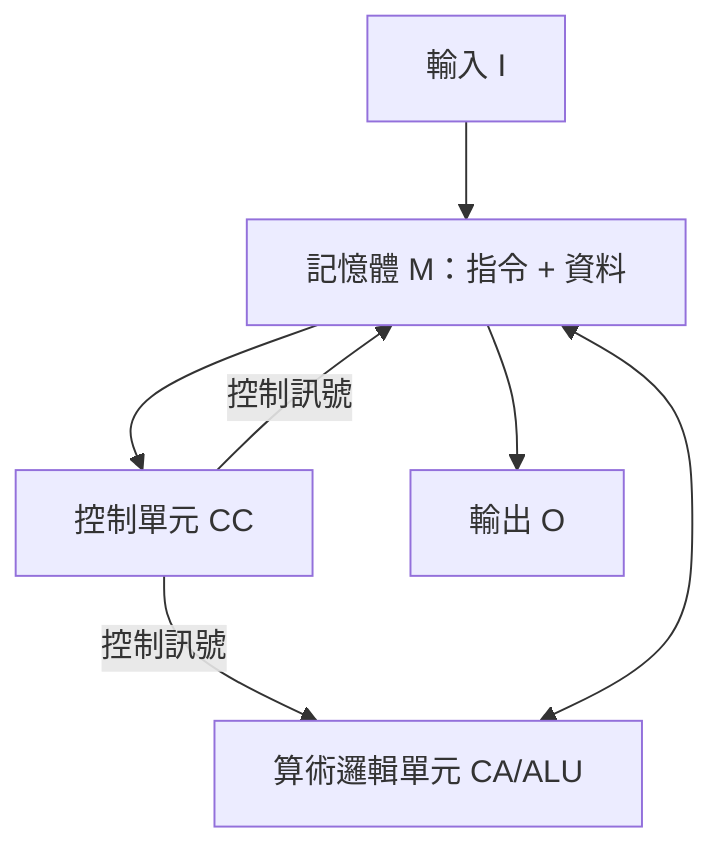

# 1.2 1945：馮紐曼架構與儲存程式概念

## 學習目標

1. 說明 ENIAC 的程式設計瓶頸，以及它如何催生儲存程式概念。
2. 描述馮紐曼架構五大單元與指令執行的取址—執行週期。
3. 理解 EDVAC 報告的歷史地位與 von Neumann 對可計算性理論的繼承。
4. 認識馮紐曼瓶頸及其在現代結構中的演化解法。

## 前言：從戰爭需求到 ENIAC 的困境

1936 年 Turing 用通用圖靈機證明：**一台固定結構的機器，可以藉由改變紙帶上的編碼程式來執行任意計算**。理論上「萬能機器」已經存在，但 1940 年代初的實際電腦仍做不到這一點。

第二次世界大戰提供了強大的推力：彈道計算、密碼分析、原子彈的流體力學模擬，都需要大量重複的數值計算。美國賓州大學 Moore 電機學院為陸軍彈道研究實驗室建造的 **ENIAC**（1945 年完工）是此時代的巅峰：約 17,468 支真空管、重 27 噸、每秒可執行約 5,000 次加法。

但 ENIAC 有致命的結構缺陷：**它沒有儲存程式的記憶體**。程式是「設定」出來的——用插線板（plugboard）接線、撥動 3,000 多個開關，把各個累加器與單元手動連成所需的資料流。改一個程式要花費數天甚至數週的接線與除錯，而真正執行可能只需幾秒。機器是萬能的（就硬體而言），但「程式」被鎖死在實體線路中——通用圖靈機的理想在硬體上尚未實現。

## 儲存程式概念與 EDVAC 報告

1944 年，數學家 John von Neumann 以顧問身分加入 ENIAC 的後續計畫。他立刻意識到問題的核心：程式應當與資料一樣，**以數字形式存放在記憶體中**，讓機器像讀取資料一樣讀取下一道指令。這就是**儲存程式（stored-program）**概念。

1945 年 6 月，von Neumann 撰寫了《EDVAC 報告書的第一份草案》（*First Draft of a Report on the EDVAC*），為繼任機器 EDVAC（Electronic Discrete Variable Automatic Computer）提出完整架構。這份 101 頁的文件成為電腦史上影響最深遠的文獻：它把電腦定義為五個單元構成的邏輯組織。

值得注意的是思想傳承：von Neumann 對可計算性理論並不陌生——他早在 1920 年代就研究過 Hilbert 綱領，1935 年前後也曾接觸 Turing 的工作。儲存程式概念正是通用圖靈機「程式即符號、機器讀符號而動」的工程化身。EDVAC 報告將這個數學理想落到了真空管與延遲線記憶體上。

## 馮紐曼架構的五大單元

EDVAC 報告將機器劃分為：

1. **中央算術單元（CA）**：執行算術與邏輯運算，即今日的 ALU。
2. **中央控制單元（CC）**：解讀指令、指揮其他單元，即今日的控制單元（CU）。CA 與 CC 合稱 **CPU**。
3. **記憶體（M）**：同時儲存指令與資料，以位置（位址）定址。
4. **輸入（I）**。
5. **輸出（O）**。



### 指令的取址—執行週期

儲存程式機器的靈魂是**指令週期（fetch–decode–execute cycle）**。程式計數器（PC）記住下一道指令的位址，控制單元反覆執行：

```text
while (true) {
    IR ← Memory[PC]        // 擷取：取出指令
    PC ← PC + 1            // 指向下一道指令
    decode(IR)             // 解碼：判斷運算碼與運算元
    execute(IR)            // 執行：ALU 運算、記憶體存取或改寫 PC
}
```

關鍵在於最後一步：**分支指令（branch）藉由改寫 PC 而改變控制流**。因為指令只是記憶體中的數字，機器可以「計算出下一道指令的位址」——這正是圖靈機中「機器讀自己的編碼」的具體呈現，也是迴圈、副程式乃至作業系統得以存在的根基。

一個簡單的累加範例（示意指令集）：

```text
位址  內容            語意
0     LOAD  100       AC ← M[100]
1     ADD   101       AC ← AC + M[101]
2     STORE 102       M[102] ← AC
3     JZ    0         若 AC == 0 則 PC ← 0
100   數字 7
101   數字 5
102   （結果存放處）
```

## 馮紐曼瓶頸與繼承者

指令與資料共用同一條通往記憶體的路徑，是這個架構最著名（也最受批評）的特徵。CPU 每秒能執行數億道指令，但記憶體一次只能送出一個字組——這條單行道被 Backus 稱為**馮紐曼瓶頸（von Neumann bottleneck）**。本書後續的快取記憶體（第 5 章）、管線（第 6 章）與多層記憶體階層，本質上都是為了繞過或掩蓋這個瓶頸而生。

另一方面，工程界對「指令與資料是否必須共用記憶體」有過分流：哈佛架構（Harvard Architecture，如哈佛 Mark I 與現代微控制器的指令快取/資料快取分離）將兩者分道儲存。現代 CPU 實際上是「改良哈佛」：主記憶體統一（儲存程式），CPU 內部的 L1 快取則指令、資料分離以兼得兩者之長。

歷史安排上還有一點必須誠實面對：儲存程式概念是 ENIAC 團隊（Mauchly、Eckert 等）集體演進的成果，von Neumann 是將其理論化、系統化寫成報告的人；報告只署了他一人之名，也埋下日後專利糾紛（Mauchly 與 Eckert 的 ENIAC 專利於 1973 年被撤銷）的遠因。EDVAC 之後，儲存程式機器陸續問世：英國曼徹斯特 Baby（1948）、EDSAC（1949）、以及 EDVAC 本身（1951），架構自此定型並沿用至今——你手上的手機，邏輯上仍是一台馮紐曼機器。

## 本章小結

- ENIAC 靠插線與開關「設定」程式，改程式需時數天；戰爭驅動的計算需求使這個瓶頸不可容忍。
- 儲存程式概念主張指令與資料同以數字形式存於記憶體，是通用圖靈機思想的工程實現。
- 1945 年 EDVAC 報告確立五大單元（CA、CC、M、I、O）與取址—解碼—執行週期，定義了沿用至今的電腦組織。
- 分支指令改寫 PC，使機器能「計算控制流」，這是儲存程式架構威力的核心。
- 指令與資料共用路徑造成馮紐曼瓶頸；快取、管線與哈佛式分離快取是現代解方。

## 習題

1. 比較 ENIAC 的插線程式設計與儲存程式方式：改寫一個計算 10 項費氏數列的程式，兩者分別需要什麼樣的人工介入？
2. 畫出五大單元圖，並以「從記憶體取兩數相加存回」為例，標出每一步資料與控制訊號的流向。
3. 說明 JZ（條件分支）指令如何在取址—執行週期中改寫 PC，並解釋為何沒有它就不可能有迴圈。
4. 馮紐曼瓶頸指的是什麼？說明為何「L1 指令快取與資料快取分離」能緩解此瓶頸，而主記憶體仍保持統一。
5. 通用圖靈機以 $\langle M\rangle$ 編碼模擬任意機器；儲存程式電腦以記憶體中的程式執行任意計算。請寫出兩者的對應關係（紙帶↔？、轉移規則↔？、讀寫頭↔？）。
