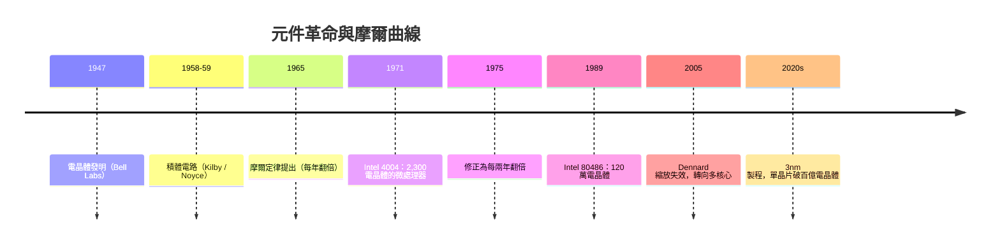

# 1.3 1965：摩爾定律與積體電路革命

## 學習目標

1. 說明從真空管、電晶體到積體電路的元件演進及其驅動力。
2. 陳述摩爾定律的原始內容、修正版本與其「自我實現」的產業性質。
3. 以 Dennard 縮放定律解釋時脈成長與 2005 年後轉向多核心的原因。
4. 理解微處理器（4004）的誕生如何把計算機結構带入單晶片時代，以及摩爾定律趨緩對現代結構設計的影響。

## 前言：三個世代的開關

數位電腦的本質是開關的組合。第一代電腦用**真空管**：ENIAC 的 17,468 支真空管平均每天燒壞數支，功耗 150 千瓦，占地 167 平方公尺。1947 年 Bell 實驗室的 Bardeen、Brattain 與 Shockley 發明**電晶體**，以固態半導體取代玻璃管：體積小數個數量級、無燈絲壽命問題、功耗低千倍。第二代電腦（如 IBM 7090, 1959）因此得以小型化、商業化。

但電晶體仍是**逐一焊接的分立元件**——設計一台百萬電晶體的機器，就要人手焊接百萬個接點。1958 年，Texas Instruments 的 Jack Kilby 與 1959 年 Fairchild 的 Robert Noyce 先後提出**積體電路（IC）**：將多個電晶體、電阻、電容製作在同一片矽晶圓上，連線也以光刻一次成型。Kilby 用鍺、Noyce 用矽並以平面製程解決互連問題；今日一切晶片都是 Noyce 路線的後裔。IC 消滅了手工接線，使電晶體數量的增長從「勞力問題」變成「光刻解析度問題」。

## 摩爾定律的內容與本質

1965 年，Fairchild 的 Gordon Moore 為《Electronics》雜誌撰文預測。他觀察 1959–1965 年間單一晶片上的元件數，**每年翻倍**，並推測未來十年可達 65,000 個元件。1975 年他修正為**每兩年翻倍**；業界常口語化為「每 18 個月效能翻倍」（後者是 Intel 的 David House 加入時脈提升後的綜合估計）。此現象背後的機制是光刻縮小特徵尺寸：線寬縮小為 $1/s$ ，電晶體面積約縮為 $1/s^2$ ，故每一世代（約 2–3 年）密度提升 4 倍。

必須強調：摩爾定律**不是物理定律**，而是對一條學習曲線的觀察與預言。它之所以成真，部分是因為整個半導體產業把它當作路線圖（ITRS 製程藍圖）來規劃投資與產品時程——這是罕見的「自我實現的預言」。其經濟內涵是：**單一電晶體的成本隨時間近乎指數下降**，因此同樣價格能買到的運算能力持續翻倍。



## Dennard 縮放與時脈時代的終結

摩爾定律談「密度」；另一條定律談「功耗」。1974 年 IBM 的 Robert Dennard 指出：當電晶體等比縮小時，電壓與電流同步下降，使得**功率密度保持常數**——晶片變小變密，卻不必變得更燙。Dennard 縮放與摩爾定律相乘，給出黃金三十年的免費午餐：電晶體變多、時脈變高（從 1970 年代的 MHz 到 2000 年代初的 3 GHz）、功耗卻大致不變。

免費午餐在約 2005 年結束：電壓無法再跟隨尺寸下降（漏電流隨之惡化），功率密度開始隨密度上升。若繼續拉高時脈，晶片將熱到無法冷卻——Pentium 4 的時脈競賽即止步於此。產業的回應是**多核心**：不再把電晶體用於讓單一核心更快，而是複製多個較慢但省電的核心，把「更快」的責任轉嫁給軟體的平行化。這正是 Amdahl 定律（第 8 章）成為結構設計核心課題的轉折點。

## 微處理器：結構理論的最終歸宿

1971 年，Intel 以日本計算機公司 Busicom 的訂單為契機，由 Ted Hoff、Federico Faggin 等人完成 **Intel 4004**：把一整顆 CPU（控制單元 + ALU + 暫存器）做在單一晶片上，2,300 個電晶體，時脈 740 kHz。這是馮紐曼五大單元中 CA 與 CC 的單晶片化——1945 年 EDVAC 報告的邏輯組織，26 年後被壓進 12 mm² 的矽。

```text
世代演進（單晶片電晶體數）：
  4004   (1971)     2,300
  8086   (1978)    29,000
  80486  (1989) 1,200,000
  Pentium4 (2000) 42,000,000
  M2 Ultra (2023) 134,000,000,000
```

微處理器的意義遠超「更小的電腦」：當一顆 CPU 成本降至數美元，電腦便從機構設備變成消費性商品，嵌入式系統、個人電腦、智慧型手機逐一登場。而摩爾定律供應的電晶體紅利，則被結構學家以快取、管線、超标量、亂序執行、SIMD、多核心層層兌換——本書第 4 章之後的每一個主題，都是這場紅利分配的技術手段。

## 摩爾定律的盡頭與現代課題

2010 年代後，特徵尺寸逼近原子尺度（矽晶格常數約 0.5 nm），光刻成本指數上升，每電晶體成本的下降曲線趨於平緩——「摩爾定律已死」的爭論年年上演。現實的走向是**質變而非量變**：

- **結構創新**：3D 堆疊（HBM 記憶體、3D V-Cache）、晶片組合（chiplet）、先進封裝，把摩爾紅利從平面轉到立體。
- **領域專用架構（DSA）**：GPU、TPU、NPU 針對特定計算换取數個數量級的效率——Hennessy 與 Patterson 稱之為「新的黃金時代」。
- **異質整合**：同一 SoC 內混合高效能核、效率核、繪圖與 AI 單元，以軟硬協同設計榨取能效。

回顧本章的因果鏈：Hilbert 提問 → Turing 定義可計算（1936）→ UTM 預示儲存程式 → ENIAC 的插線困境 → EDVAC 報告（1945）→ 電晶體取代真空管 → IC 消滅手工接線 → 摩爾定律（1965）→ 微處理器（1971）→ Dennard 縮放終結 → 多核心與 DSA。理論劃定可能、戰爭提供動機、元件革命供應工具，而摩爾定律供應紅利——今日結構工程師的任務，是在紅利趨緩之後，用組織與平行性繼續把可計算的問題算得更快。

## 本章小結

- 元件三代演進：真空管（易壞、耗電）→ 電晶體（1947，固態開關）→ 積體電路（1958–59，消滅手工接線）。
- 摩爾定律（1965）預言晶片元件數每年（後修正為每兩年）翻倍；它是經濟學習曲線與產業路線圖，而非物理定律。
- Dennard 縮放使密度與時脈同步成長而功耗不變；約 2005 年失效後，產業轉向多核心與平行計算。
- Intel 4004（1971）把馮紐曼架構的 CPU 單晶片化，開啟微處理器與個人計算時代。
- 摩爾定律趨緩後，3D 堆疊、chiplet 與領域專用架構成為延續效能成長的新戰場。

## 習題

1. 計算：若元件數自 1971 年（2,300 顆）起每兩年翻倍，2023 年理論值為何？與 M2 Ultra 的 1,340 億顆比較，並解釋差異的可能原因。
2. 說明積體電路為何使「電晶體數量成長」從勞力問題轉為光刻問題。
3. Dennard 縮放失效後，為何提高時脈不再可行？請以功率密度與漏電流說明。
4. 「摩爾定律是自我實現的預言」——請從產業投資與 ITRS 路線圖的角度，用 200 字評述此說法。
5. 依本節因果鏈，寫出從「Turing 1936 論文」到「你手上的手機」之間至少六個關鍵事件，並說明相鄰兩事件之間的驅動關係。
