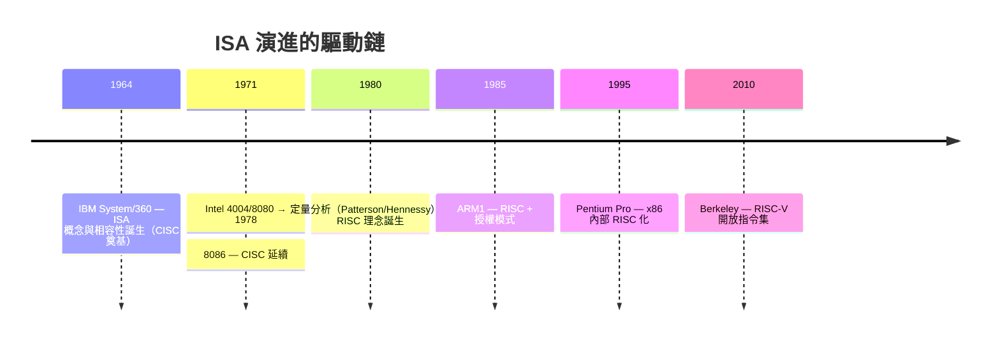

# 2.2 1980：RISC 與 CISC 的指令集設計之爭

## 學習目標

1. 理解指令集架構（ISA）作為軟硬體介面的定義與意涵。
2. 說明 IBM System/360 與 x86 等 CISC 架構的設計動機與歷史脈絡。
3. 解釋 1980 年代定量分析如何催生 RISC 理念（Patterson 與 Hennessy）。
4. 比較 MIPS、SPARC、ARM 等第一代 RISC 架構的異同與商業命運。
5. 理解 x86 與 RISC 兩陣營最終在微架構層次的「殊途同歸」，以及 RISC-V 開放指令集誕生的驅動原因。

---

## 2.2.1 指令集架構：軟硬體之間的合約

處理器硬體與編譯器軟體之間，需要一份明確的「合約」，約定：有哪些指令、操作哪些資料型態、幾個暫存器、記憶體如何定址、例外如何處理。這份合約就是**指令集架構（Instruction Set Architecture, ISA）**。ISA 與處理器實作（微架構，microarchitecture）必須分開：同一份 ISA 可以有快慢不同的實作（如 Intel Core i3 與 i9 都執行 x86），這正是 IBM 在 1964 年就領悟到的關鍵。

ISA 設計的核心張力只有一個：**一條指令該做多少事？** 這個問題的兩端，就是 CISC 與 RISC。

## 2.2.2 CISC 的誕生：記憶體昂貴的年代

1964 年，IBM 推出 **System/360**，這是電腦史上最重大的決策之一。在此之前，每一代新機器都有新的指令集，舊軟體全部報廢。IBM 押下 50 億美元（超過當年曼哈頓計畫），宣布一個家族的低階到高階機器**共用同一個指令集**——軟體投資從此可以延續。「相容性」第一次成為設計的第一原則，ISA 成為廠商最重要的長期資產。

System/360 也是 CISC（Complex Instruction Set Computer）的典範，其設計選擇被 1970 年代的 Intel 8086（x86 的祖先）完整繼承：

- **指令長度可變**（x86 為 1–15 位元組）：省記憶體。
- **豐富的定址模式**：如「基底 + 索引 + 位移」一次算好位址。
- **指令直接操作記憶體**：如 `ADD [mem], reg` 一條指令完成「載入、相加、存回」。
- **指令多且複雜**：字串處理、十進位運算、甚至有專為 COBOL 設計的指令。

這些選擇在當年完全合理：1970 年代初，記憶體以「千位元組」計價且極昂貴，DRAM 尚未普及，程式大小直接等於金錢；同時編譯器技術幼稚，工程師多用組合語言寫程式，讓硬體多做一點、組語程式短一點，是對的。**CISC 是「硬體替軟體分勞」的哲學**。

但代價在硬體端：可變長度指令難以解碼、指令執行時間不一、控制單元要用微程式（microcode）驅動——把複雜指令翻譯成一連串內部微操作。到了 1980 年，這個代價開始被重新檢視。

## 2.2.3 定量分析的革命：RISC 理念的誕生

1970 年代末至 80 年代初，兩件事改變了遊戲規則：

1. **編譯器成熟了**。最佳化編譯器（如 UNIX 系統的 C 編譯器）產生的程式碼品質超越手寫組語，程式語言從組語轉向 C。
2. **半導體進步，記憶體相對變便宜**，但**處理器效能成為戰場**；同時晶片上可用的電晶體仍然有限（幾萬到幾十萬顆），必須問：這些電晶體花在哪裡最划算？

一群研究者開始用**定量方法**回答。David Patterson（UC Berkeley）與 John Hennessy（Stanford）領導的團隊測量了真實程式的指令行為，得到幾個顛覆直覺的結論：

- **簡單指令主宰執行**：典型程式中，載入/儲存、加減、分支等簡單指令佔動態執行指令數的 90% 以上；複雜指令使用率極低。
- **複雜指令拖慢一切**：為了那 <10% 的複雜指令，解碼電路與微程式複雜化，拉長所有指令的關鍵路徑，讓時脈變慢。
- **簡單的指令 = 固定長度 + 少數格式**，可以在管線中「一拍一條」流動，用**管線化（pipelining）**榨出效能——這才是真正的大招。

1980 年 Patterson 的 Berkeley RISC 計畫（RISC-I, 1982）與 Hennessy 的 Stanford MIPS 計畫，把這些結論變成具體設計，並正式提出 **RISC（Reduced Instruction Set Computer）** 一詞。RISC 的設計原則：

| 設計面向 | CISC（如 x86） | RISC（如 MIPS） |
|---------|---------------|----------------|
| 指令長度 | 可變（1–15 B） | 固定（4 B） |
| 指令數量 | 數百條 | 少（約 50–100 條） |
| 運算元位置 | 可操作記憶體 | 只有載入/儲存指令碰記憶體（load-store 架構） |
| 暫存器 | 少（x86 只有 8 個通用） | 多（MIPS 32 個），編譯器善用 |
| 執行模式 | 微程式 + 多週期 | 硬體直接控制，多數指令單週期管線化 |
| 編譯器角色 | 次要 | 核心——簡單 ISA 把複雜度丟給編譯器 |

**RISC 是「把複雜度從硬體搬到軟體（編譯器）」的哲學**，與 CISC 完全相反。注意 "Reduced" 指的不是指令變少就能變快這麼膚淺，而是「減少每條指令的硬體責任，換取管線化與高時脈」。Patterson 與 Hennessy 因這套量化設計方法論獲得 2017 年圖靈獎。

## 2.2.4 第一代 RISC 商業化：MIPS、SPARC、ARM

學術原型迅速商業化，三條路線命運各異：

- **MIPS**：Hennessy 於 1984 年創立 MIPS Computer Systems。MIPS 是最「純」的 RISC（1990 年代的 R3000 曾是工作站霸主，N64 與 PlayStation 也用它），但因公司多次易主、未能建立行動生態，2010 年代逐漸邊緣化——後來竟轉向採用 RISC-V，這是後話。
- **SPARC**：Patterson 的 RISC 技術轉移給昇陽（Sun Microsystems），1987 年推出 SPARC，搭載 Unix 工作站席捲工程市場，證明 RISC 效能主張。但隨工作站市場沒落，2017 年終止。
- **ARM**：1985 年，英國 Acorn 電腦公司的 Sophie Wilson 與 Steve Furber 設計出 ARM1，靈感直接來自 Berkeley RISC 論文。ARM 選擇了與前兩者不同的商業模式——**不賣晶片，只授權 ISA 與核心設計**。這個「IP 授權」模式讓 Apple（1990 年代的 Newton）、Nokia、直到 iPhone 全都採用 ARM，最終主宰行動裝置。ARM 的成功揭示：**ISA 的勝負不在技術而在生態系與商業模式**。

## 2.2.5 殊途同歸：x86 的「內部 RISC 化」

RISC 理念是否打死了 x86？並沒有，但方式出人意料。1990 年代中期，Intel 與 AMD 發現：可以在 x86 晶片**內部**把 CISC 指令**動態翻譯成類 RISC 的微操作（micro-ops）**，再餵給 RISC 式的管線與亂序執行核心。Pentium Pro（1995）確立此架構至今。也就是說：

> 對外，x86 保持 CISC 指令集以維持軟體相容；對內，它是披著 CISC 外衣的 RISC 機器。

代價是解碼器永久消耗的電晶體與功耗——這正是行動裝置時代 ARM 能效優勢的來源之一。而 x86 陣營以規模經濟與半導體製程領先彌補了架構劣勢。雙方在「ISA 無關緊要？ISA 極重要？」的辯論中纏鬥三十年，事實是：**微架構決定快慢，ISA 決定生態**。

## 2.2.6 RISC-V：開放指令集的登場

到 2010 年，ISA 版圖的問題已經清楚：剩餘的主要 ISA 全是**專利與授權鎖定的私有資產**。x86 實質上只有 Intel/AMD 能做；ARM 授權費高達數百萬美元起跳，且條款由單一公司掌控。學術界想用一個真實 ISA 教學與研究，處處受限。

加州大學 Berkeley 的 Krste Asanović、David Patterson（此時已回任 Berkeley）與 Andrew Waterman 等人，起初只是為了實驗室專案需要一個「自由的」指令集，乾脆自己設計——這就是 **RISC-V**（2010 年開始，2014 年正式發表）。關鍵決策：

1. **開放規格**（基於 BSD 授權）：任何人可免費實作、修改、商用，無授權費、無權利金。
2. **模組化 ISA**：核心僅 47 條整數指令（RV32I），其餘以擴充模組附加——M（乘除）、A（原子操作）、F/D（浮點）、C（壓縮指令）、V（向量）等。晶片設計者只付「自己需要的那部分」複雜度。
3. **吸取 40 年教訓**：固定 32 位元指令、load-store 架構、32 個暫存器、乾淨的二補數語意、無旗號暫存器、預留大量編碼空間給未來——它是「後見之明最充分的 RISC」。
4. **治理去中心化**：2015 年成立 RISC-V International，總部設於瑞士，ISA 演進由會員共同治理，避免單一公司控制。

RISC-V 的驅動力不只是省錢：當半導體走向「客製化加速器」時代（AI 晶片、IoT、車用），各廠需要「核心 CPU + 自家加速器」的組合，ISA 的開放性與模組化恰好符合「控制平面用 CPU、資料平面用加速器」的新設計模式。2020 年代，RISC-V 已從學術專案成長為全球性生態，這也是本書選擇 RISC-V 作為教學 ISA 的原因——它既是最乾淨的 RISC 教材，也是你未來職涯可能真實遇到的架構。

---

## 本章小結

- ISA 是軟硬體介面的合約，必須與微架構實作分離——這是 IBM System/360 確立的觀念，相容性從此成為 ISA 的第一價值。
- CISC（IBM 360、x86）是「記憶體昂貴、編譯器幼稚」年代的理性選擇：硬體替軟體分勞，指令複雜、長度可變、可直接操作記憶體。
- 1980 年代，Patterson 與 Hennessy 以定量分析證明：簡單指令主宰執行、複雜指令拖慢管線，催生 RISC 哲學——固定長度、load-store、多暫存器、單週期管線，把複雜度交給編譯器。
- MIPS、SPARC、ARM 證明 RISC 技術可行；ARM 以 IP 授權模式贏得行動時代，證明 ISA 之爭的勝負在生態系。
- x86 以「內部微操作翻譯」吸納 RISC 精華而存活；RISC-V 以開放、模組化、治理去中心化回應私有 ISA 的時代困境，成為本書的教學與實作平台。

## 習題

1. 指令集架構（ISA）與微架構（microarchitecture）有何區別？請各舉兩個例子，並說明為何 IBM System/360 的成功關鍵在於把兩者分開。
2. 說明 1970 年代有哪些技術與經濟條件使 CISC 成為合理設計？1980 年代又是哪些條件改變，使 RISC 變得優越？
3. 定量分析發現「簡單指令佔動態執行 90% 以上」。若一條複雜指令佔靜態程式 5%、動態執行 3%，但使所有指令的平均 CPI 從 1.2 升到 1.8，試論其效益是否為正。
4. 比較 MIPS、SPARC、ARM 的商業結局，並解釋為何 ARM 的「IP 授權」模式使其勝出。
5. Pentium Pro 以後的 x86 處理器在內部將 CISC 指令翻譯為類 RISC 微操作。請說明這樣設計的好處與代價，以及為何行動裝置市場上 ARM 仍具能效優勢。
6. RISC-V 的「模組化 ISA」設計（RV32I + 擴充）解決了傳統 ISA 的什麼問題？請以物聯網小晶片與高效能 AI 加速器兩種情境說明。
