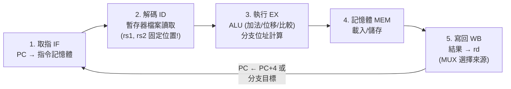

# 2.3 RISC-V 組合語言實作

## 學習目標

1. 認識 RISC-V 的暫存器檔案、慣例與基本指令類別。
2. 理解 RISC-V 六種指令編碼格式（R/I/S/B/U/J），並能手動編碼一條指令。
3. 能閱讀與撰寫基本的 RISC-V 組合語言：算術、記憶體存取、分支與函式呼叫。
4. 透過翻譯 C 程式到組語，理解編譯器如何使用 ISA——銜接 2.2 節「複雜度交給編譯器」的 RISC 哲學。

---

## 2.3.1 RISC-V 的暫存器檔案

RISC-V 提供整數暫存器 32 個，編號 `x0` 到 `x31`，每個 32 位元（RV32）或 64 位元（RV64）。`x0` 永遠是零——寫入無效，讀取得 0。這不是浪費一個暫存器，而是精心的設計：許多常見操作因此有了「免費指令」（見 2.3.3）。其餘暫存器依據**呼叫慣例（calling convention）**分配角色：

| 編號 | 別名 | 用途 | 呼叫時是否需保存 |
|------|------|------|-----------------|
| x0 | `zero` | 常數 0 | — |
| x1 | `ra` | 函式返回位址 | 呼叫者保存 |
| x2 | `sp` | 堆疊指標 | 被呼叫者保存 |
| x5–x7, x28–x31 | `t0–t6` | 暫存值 | 呼叫者保存 |
| x8 | `s0/fp` | 保存值 / 框架指標 | 被呼叫者保存 |
| x9, x18–x27 | `s1–s11` | 保存值 | 被呼叫者保存 |
| x10–x17 | `a0–a7` | 函式參數 / 返回值 | 呼叫者保存 |

「呼叫者保存」（caller-saved，t 系、a 系）表示跨函式呼叫後內容可能被破壞；「被呼叫者保存」（callee-saved，s 系）表示函式若要用它，必須先備份、返回前還原。這個分工讓編譯器能做出最省的暫存器配置——RISC 的「把複雜度交給編譯器」在此體現。

## 2.3.2 指令編碼格式：32 位元的精密佈局

每條基礎指令固定 32 位元。RISC-V 定義六種格式，所有欄位位置經過精心安排，使解碼電路最小化：

| 格式 | 31–25 | 24–20 | 19–15 | 14–12 | 11–7 | 6–0 | 用途 |
|------|-------|-------|-------|-------|------|-----|------|
| R | funct7 | rs2 | rs1 | funct3 | rd | opcode | 暫存器運算 |
| I | imm[11:0] | | rs1 | funct3 | rd | opcode | 運算含立即值、載入、jalr |
| S | imm[11:5] | rs2 | rs1 | funct3 | imm[4:0] | opcode | 儲存 |
| B | imm[12\|10:5] | rs2 | rs1 | funct3 | imm[4:1\|11] | opcode | 分支 |
| U | imm[31:12] | | | | rd | opcode | lui, auipc |
| J | imm[20\|10:1] | | | | rd | imm[19:12] | jal |

關鍵觀察：

- **opcode（7 位元）**決定指令大類；`funct3`/`funct7` 再細分小類。
- **rs1、rs2（各 5 位元）永遠在同一位置**——解碼器不需要看 opcode 就能先讀暫存器，縮短關鍵路徑。
- **rd（5 位元）也固定**，對應 2.1 節 ALU 之後「寫回哪個暫存器」的 MUX 控制訊號。
- 立即值欄位看起來零亂（尤其 B/J 格式），但這是刻意安排：把立即值的各個位元**旋轉**到固定位置，使符號擴充電路（第 11 位元的複製）只需接少數幾條線，硬體大幅簡化。這是「ISA 為硬體讓步」的教科書級範例。

**手動編碼範例**：`add x10, x11, x12`（即 `add a0, a1, a2`）。
查表：opcode = `0110011`，funct3 = `000`，funct7 = `0000000`，rd = 10 = `01010`，rs1 = 11 = `01011`，rs2 = 12 = `01100`：

```
funct7  rs2   rs1  funct3  rd    opcode
0000000 01100 01011  000   01010  0110011  → 0x00C58533
```

## 2.3.3 核心整數指令（RV32I）

RISC-V 基礎指令集僅 47 條。本節列出最常用的部分，並特別注意「用 x0 變把戲」之處：

```text
算術（R 型）：  add rd, rs1, rs2     sub rd, rs1, rs2
              sll/srl/sra rd, rs1, rs2   (位移)
              slt rd, rs1, rs2     (小於則設 1)
邏輯：        and / or / xor rd, rs1, rs2
立即值版（I 型）： addi rd, rs1, imm     andi / ori / xori rd, rs1, imm
記憶體：      lw rd, offset(rs1)    (載入字組)
              sw rs2, offset(rs1)   (儲存字組)
高位立即值：  lui rd, imm20         (rd = imm20 << 12)
              auipc rd, imm20       (rd = pc + imm20 << 12)
分支：        beq / bne / blt / bge / bltu / bgeu rs1, rs2, label
無條件跳躍：  jal rd, label         (跳躍並存返回位址)
              jalr rd, offset(rs1)  (間接跳躍)
```

注意三個精巧之處：

1. **沒有 `mov` 指令**：搬移寫成 `addi rd, rs, 0`。
2. **沒有 `neg` 指令**：取負寫成 `sub rd, x0, rs`（二補數： $0 - x = -x$ ）。
3. **沒有 `nop` 指令**：空操作是 `addi x0, x0, 0`。

這些「偽指令（pseudo-instructions）」讓組語好讀，組譯器自動翻譯成基礎指令。比較 `sub` 與 `addi`：減法必須保留 R 型（硬體），減常數則走 I 型（編譯器常用）——兩者編碼格式不同，但 2.1 節的 ALU 硬體可以共用。

## 2.3.4 資料路徑全景：指令如何被執行

把本章知識接起來。一條指令的執行經過五個階段（此處為單週期視角，第 4 章將管線化）：



控制訊號正對應本章所學：`RegWrite`（暫存器寫入致能）、`ALUSrc`（I 型指令第二運算元選立即值——一個 MUX）、`MemtoReg`（寫回資料選 ALU 結果或記憶體——另一個 MUX）、`Branch`/`Jump`（PC 更新來源的 MUX）。指令編碼格式中固定的 `rs1/rs2/rd` 位置，正是為了讓 ID 階段能與解碼並行。

## 2.3.5 實作一：C 函式翻譯成 RISC-V 組語

考慮 C 函式：

```c
int add3(int a, int b, int c) {
    return a + b + c;
}
```

編譯結果（`a, b, c` 依慣例在 `a0, a1, a2`）：

```assembly
add3:
    add  a0, a0, a1      # a0 = a + b
    add  a0, a0, a2      # a0 = a + b + c
    ret                  # = jalr x0, 0(ra)，跳回 ra 並不存返回位址
```

兩條算術、一條返回。注意返回值依慣例放在 `a0`。

再來一個含記憶體與分支的例子——計算陣列總和：

```c
int sum(int *array, int n) {
    int total = 0;
    for (int i = 0; i < n; i++)
        total += array[i];
    return total;
}
```

```assembly
# a0 = array 位址, a1 = n
sum:
    li   t0, 0           # total = 0     (偽指令: addi t0, x0, 0)
    li   t1, 0           # i = 0
loop:
    bge  t1, a1, done    # if (i >= n) 跳出迴圈
    slli t2, t1, 2       # t2 = i * 4    (每個 int 4 位元組；位移比乘法快)
    add  t2, a0, t2      # t2 = &array[i]
    lw   t3, 0(t2)       # t3 = array[i]
    add  t0, t0, t3      # total += array[i]
    addi t1, t1, 1       # i++
    j    loop            # (偽指令: jal x0, loop)
done:
    mv   a0, t0          # (偽指令: addi a0, t0, 0)
    ret
```

請逐行對照編碼格式：`slli` 是 I 型（位移量在 imm 欄）、`lw` 是 I 型（位移 0）、`bge` 是 B 型（13 位元立即值）。「乘以 4」編譯成左移 2 位而非乘法指令，是編譯器典型的最佳化——乘 4 在位元觀點就是左移兩位，這再次呼應 2.1 節的二進位本質。

## 2.3.6 實作二：函式呼叫與堆疊

遞迴函式需要堆疊。以階乘為例：

```c
int fact(int n) {
    if (n < 1) return 1;
    return n * fact(n - 1);
}
```

```assembly
fact:
    blt  a0, a1, ...     # 需與 1 比較：先看 n < 1
    li   t0, 1
    blt  a0, t0, base    # if (n < 1) goto base
    addi sp, sp, -16     # 開堆疊框架（16 位元組對齊）
    sw   ra, 12(sp)      # 備份返回位址（ra 是 caller-saved，遞迴會覆蓋）
    sw   s0, 8(sp)
    mv   s0, a0          # 保存 n
    addi a0, a0, -1      # n - 1
    jal  ra, fact        # 遞迴呼叫
    mul  a0, a0, s0      # n * fact(n-1)   (M 擴充)
    lw   ra, 12(sp)      # 還原
    lw   s0, 8(sp)
    addi sp, sp, 16      # 釋放框架
    ret
base:
    li   a0, 1
    ret
```

要點：`sp` 必須 16 位元組對齊；`ra` 在遞迴呼叫前必須存入堆疊，否則第二次呼叫會覆蓋返回位址；`s0` 是 callee-saved，若使用必須還原。這正是 2.3.1 慣例表的實戰意義。

## 2.3.7 上手工具鏈

本書使用兩種方式實際執行程式：

1. **RARS**（RISC-V Assembler and Runtime Simulator）：圖形化模擬器，適合教學，可觀察每個暫存器與記憶體。
2. **真實工具鏈**：`riscv64-unknown-elf-gcc` 編譯、`qemu-riscv64` 執行：

```bash
riscv64-unknown-elf-gcc -march=rv64i -mabi=lp64 -O1 -S sum.c   # 產生組語
riscv64-unknown-elf-objdump -d a.out                            # 反組譯對照
qemu-riscv64 ./a.out                                            # 模擬執行
```

建議讀者用 `-O1` 與 `-O3` 各編譯一次第 2.3.5 節的 `sum`，觀察編譯器如何做迴圈展開與強度削減——你會親眼看到 2.2 節「RISC 把複雜度交給編譯器」的具體樣貌。

---

## 本章小結

- RISC-V 有 32 個整數暫存器，`x0` 恆為零；呼叫慣例將暫存器分為 caller-saved 與 callee-saved，是函式呼叫正確性的基礎。
- 六種編碼格式（R/I/S/B/U/J）共享固定的 rs1/rs2/rd 與 opcode 位置，使解碼器最小化；立即值位元的「旋轉」是犧牲可讀性換取硬體簡化的設計。
- 許多直覺上「該有」的指令（mov、neg、nop）其實都是 x0 與基礎指令的偽裝——指令越少、硬體越簡、管線越順。
- C 到組語的翻譯揭示了 ISA 的真實用途：編譯器是 ISA 的主要客戶，位移取代乘法、暫存器配置、堆疊框架管理都由編譯器決策。
- 資料路徑（IF→ID→EX→MEM→WB）中的每個 MUX 對應一個控制訊號，本章的組語知識與 2.1 的邏輯電路、2.2 的 ISA 哲學在此合流。

## 習題

1. 將 `sub x5, x6, x0` 翻譯成等價的偽指令，並寫出它的 R 型編碼（32 位元二進位與十六進位）。
2. 手動編碼 `lw x11, 8(x2)`：查 opcode（`0000011`）、funct3（`010`），寫出 I 型各位元欄位與最終 32 位元值。
3. 將下列 C 迴圈翻譯成 RISC-V 組語：
   ```c
   for (int i = 0; i < 100; i++) a[i] = a[i] * 2;   // a 為 int 陣列，位址在 a0
   ```
   並指出哪些行是偽指令、對應哪條基礎指令。
4. 在 2.3.6 的 `fact` 中，若刪去 `sw ra, 12(sp)` 與 `lw ra, 12(sp)` 會發生什麼事？請以 `fact(3)` 的呼叫序列具體說明。
5. 為什麼 RISC-V 分支立即值（B 格式）的位元要交錯排列？請說明這種安排如何簡化硬體，並對照 2.1 節「布林代數化簡換取電路簡化」的論點。
6. 用 RARS 執行 2.3.5 的 `sum`，輸入陣列 `{5, -3, 12, 0, 7}`，追蹤每迴圈迭代的 `t0, t1, t2, t3` 值，並畫出前三迭代的暫存器變化表。
