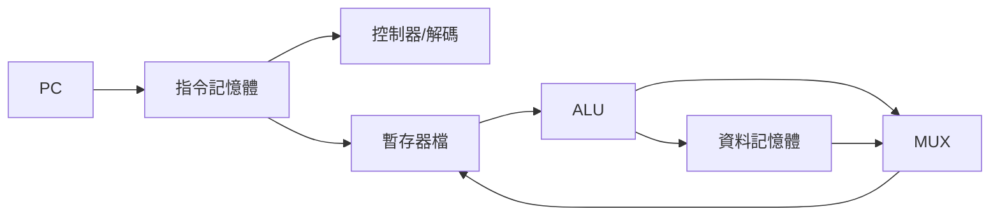
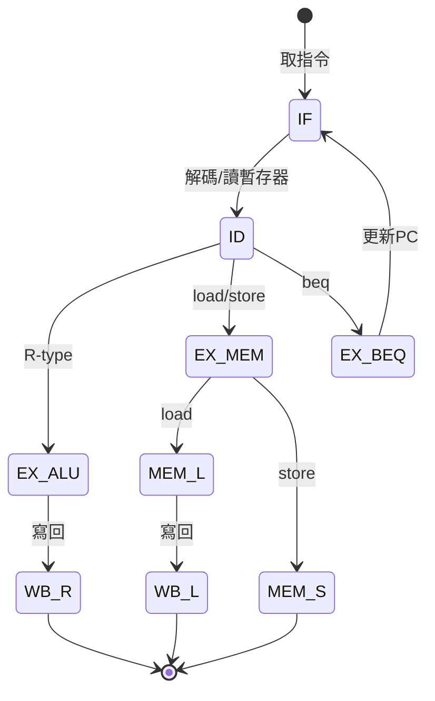

# 3.1 單週期與多週期處理器設計

## 學習目標

1. 說明單週期（single-cycle）處理器的資料路徑與控制路徑設計，並理解其「每條指令在一個時脈週期內完成」的意涵。
2. 分析單週期設計的關鍵瓶頸：關鍵路徑（critical path）由最慢的指令決定。
3. 理解多週期（multi-cycle）設計如何將指令執行拆解為多個較短週期的步驟，並以有限狀態機（FSM）控制。
4. 能計算單週期與多週期機器的 CPI 與效能差異。

## 3.1.1 從指令集到資料路徑

處理器微架構設計的第一步，是把抽象的指令集架構（ISA）落到具體的硬體上。一個指令的執行，無論是 RISC-V 的 `add`、`lw`、`beq`，都可以拆成五個階段：

1. **取擷取（Fetch, IF）**：以程式計數器 PC 為位址，從指令記憶體取出指令。
2. **解碼（Decode, ID）**：解出 opcode、暫存器編號、立即值，並讀取暫存器檔。
3. **執行（Execute, EX）**：ALU 進行算術運算、位址計算或比較。
4. **記憶體存取（Memory, MEM）**：load/store 指令讀寫資料記憶體。
5. **寫回（Write-back, WB）**：將結果寫回暫存器檔。

這五個階段是本書後續所有討論的骨架——無論單週期、多週期或流水線，都是在問同一個問題：**這五個階段該怎麼在時間上與硬體資源上安排？**

## 3.1.2 單週期設計：最直觀的答案

最直接的答案是：**每條指令在一個時脈週期內從頭到尾執行完畢**。PC 經指令記憶體、解碼器、暫存器檔、ALU、（可能的）資料記憶體，最後寫回暫存器檔，一路通到底，中間不需要任何狀態暫存。

單週期設計最大的優點是**簡單**：不需要額外的狀態暫存器，控制邏輯就是一組由 opcode 產生的控制訊號（`RegWrite`、`ALUSrc`、`MemRead`、`Branch`、`MemtoReg` 等）。這使它成為教學上理解資料路徑的最佳起點。

### 關鍵路徑決定時脈週期

然而單週期的代價在於：**時脈週期必須容納所有指令中最長的路徑**。考慮一條 load 指令：

$$T_{\text{cycle}} \ge T_{\text{PC}} + T_{\text{IM}} + T_{\text{RF-read}} + T_{\text{ALU}} + T_{\text{DM}} + T_{\text{RF-write-setup}}$$

load 指令需要：讀 PC → 指令記憶體 → 讀暫存器檔取得基址 → ALU 計算位址 → 資料記憶體讀取 → 寫回暫存器檔。這條路徑穿過**兩個記憶體**，通常是最慢的。

反觀 `add` 指令根本不需要資料記憶體，`beq` 只需要 ALU 比較。但它們都得陪著 load 指令共用同一個長週期。這是典型的「**最慢者決定全域**」：資源在時間上被硬性串聯，沒有任何指令能受益於自己的短。

### 另一個致命傷：每個硬體每週期只能用一次

單週期設計中，指令記憶體與資料記憶體必須是**分開的兩塊**（否則取指令與存取資料衝突）；暫存器檔必須支援「同週期讀兩個、寫一個」。若指令記憶體與資料記憶體是同一塊快取，單週期根本做不下去——這個結構性限制，正是後來「結構險障（structural hazard）」概念的種子。

## 3.1.3 多週期設計：把長路徑切短

既然瓶頸在於「一個週期塞下所有階段」，自然的想法是：**把一條指令拆成多個週期，每個週期只做一件事**。

每個週期只包含一段較短的邏輯（例如只做 ALU 運算、或只存取記憶體），階段與階段之間用**暫存器**（IR、MDR、A、B、ALUOut）保存中間結果。如此：

- 時脈週期可以大幅縮短，趨近於單一階段的延遲（記憶體存取或 ALU）。
- **硬體可以重複使用**：同一個 ALU 在不同週期分別做「PC+4」「位址計算」「分支比較」，不需要多個 ALU。
- 指令記憶體與資料記憶體可以合併為一塊（取指令與存取資料在不同的週期進行）。

### 控制方式：有限狀態機

多個週期意味著控制不再是「一組固定的訊號」，而是**隨時間變化的序列**。標準做法是以有限狀態機（FSM）描述每類指令的狀態流：

以 RISC-V 為例，各指令需要的週期數大約是：

| 指令類型 | 週期數 |
|---|---|
| load（`lw`） | 5 |
| store（`sw`） | 4 |
| R-type（`add`） | 4 |
| 分支（`beq`） | 3 |
| 跳躍（`jal`） | 3 |

### CPI 與效能比較

多週期機器的 CPI 是加權平均：

$$\text{CPI} = \sum_i (\text{CPI}_i \times F_i)$$

假設指令分布為：load 25%、store 10%、R-type 45%、分支 15%、跳躍 5%，則

$$\text{CPI} = 5(0.25) + 4(0.10) + 4(0.45) + 3(0.15) + 3(0.05) = 4.05$$

雖然 CPI 從 1 升到 4.05，但時脈週期從（例如）8 ns 縮短到 2 ns。總執行時間比較：

- 單週期：$1 \times 8\,\text{ns} = 8\,\text{ns/指令}$
- 多週期：$4.05 \times 2\,\text{ns} = 8.1\,\text{ns/指令}$

在這組假設下兩者幾乎打平——這不是意外。**多週期的真正價值不在單純加速，而在於它把「指令執行」分解為離散、規律的階段，為下一章的流水線鋪路**：流水線正是把多週期的每個階段，讓不同指令的相異階段同時進行（指令 $i$ 在 EX、指令 $i-1$ 在 MEM、指令 $i-2$ 在 WB），使 CPI 趨近於 1 而非 4。

## 3.1.4 前因後果：為什麼歷史走向流水線

回顧這段設計演化，驅動力有三：

1. **延遲不對稱**：記憶體遠慢於 ALU。單週期被迫以最慢路徑定週期，浪費了快速指令的潛力。
2. **硬體複用 vs. 併行的取捨**：多週期省硬體（一個 ALU 用多次），但喪失時間上的併行性；工程師很快意識到，既然階段已經切開、暫存器已經加上，何不讓多條指令交錯使用這些階段？
3. **記憶體頻寬的浪費**：單週期與多週期在任何時刻只有一個階段在工作，其餘硬體閒置。

歷史上的解答出現在 1960 年代：IBM Stretch 與 CDC 6600 開始嘗試指令重疊執行，IBM System/360 Model 91 則將流水線技術推向成熟。3.2 節將沿著這條歷史線，走進流水線的世界。

## 本章小結

- 單週期處理器將 IF/ID/EX/MEM/WB 串聯在一個週期內，設計簡單，但關鍵路徑由最慢指令（load）決定，且硬體無法複用。
- 多週期處理器以暫存器切分階段，以 FSM 控制狀態流，允許硬體複用與較短週期，CPI 上升至 3–5，但總效能可與單週期相當甚至更佳。
- 多週期最大的歷史貢獻，是把指令執行規格化為離散階段——這正是流水線的前提。理解「單週期瓶頸 → 多週期 FSM → 流水線重疊」這條驅動鏈，就掌握了微架構演化的主軸。

## 習題

1. 假設 $T_{\text{PC}}=1$ ns、$T_{\text{IM}}=2$ ns、$T_{\text{RF}}=1.5$ ns、$T_{\text{ALU}}=2$ ns、$T_{\text{DM}}=2$ ns、暫存器建立時間 0.5 ns。分別估計單週期（load 為關鍵路徑）與多週期（單階段最長延遲決定週期）的時脈週期。
2. 承上題，若指令分布為 load 30%、store 10%、R-type 40%、分支 20%，計算多週期 CPI 與兩者的每指令執行時間，判斷何者較快。
3. 說明為什麼單週期設計必須將指令記憶體與資料記憶體分開，而多週期設計不必。
4. 畫出 `beq` 指令在多週期 FSM 中的狀態轉移，並標註每個狀態作用中的控制訊號（至少含 `PCSrc`、`ALUOp`、`Branch`）。
5. 「多週期把週期切短，所以一定比單週期快」——這句話哪裡有問題？請以 CPI 與週期時間的乘積論證。
