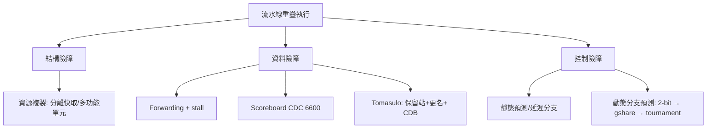

# 3.2 1964：流水線與 CDC 6600

## 學習目標

1. 理解流水線的基本原理：以指令級重疊（overlap）提升吞吐量，並能以 $S=\frac{n}{1+(n-1)t}$ 與 Amdahl 定律量化其上限。
2. 認識 1964 年 CDC 6600 的 scoreboard 機制，以及 IBM System/360 Model 91 的 Tomasulo 演算法如何處理資料相依。
3. 區分三類流水線險障：結構、資料、控制，並掌握 forwarding、 stall、分支預測等解法。
4. 建立「瓶頸 → 機制」的因果視角：每一項微架構技術都是對某一類險障的回應。

## 3.2.1 流水線的核心思想

多週期機器把指令切成階段，但任一時刻只有一個階段在工作。流水線的想法很樸素：**讓不同指令的相異階段同時進行**，就像福特的汽車裝配線——車身在第 3 站焊接時，前一輛車在第 4 站烤漆，後一輛在第 2 站裝引擎。

以五級流水線執行 $n$ 條指令、每級延遲 $t$ ：

- 非流水線時間： $n \times 5t$
- 流水線時間： $(5 + (n-1)) \times t$

理想加速比為：

$$S = \frac{5n\,t}{(5+n-1)\,t} \xrightarrow{n \to \infty} 5$$

一般化為 $k$ 級流水線、各級延遲 $t$ 、原指令耗時 $k t$ 時：

$$S = \frac{n}{1 + (n-1)\dfrac{t}{kt}} \approx \frac{n \cdot k}{n + k - 1}$$

當 $n \gg k$ 時 $S \to k$ 。但注意 Amdahl 定律的警告：任何**不可重疊的部分**（如程式開頭的填充時間、險障造成的 stall）都會吃掉加速比的上限。若程式中有比例 $f$ 的部分無法受益於流水線，則：

$$S \le \frac{1}{(1-f) + \dfrac{f}{k}}$$

更現實的是，流水線**不縮短單一指令的延遲**——甚至因為加了流水線暫存器而略微變長——它提升的是**吞吐量（throughput）**。這是初學者最常混淆的一點。

## 3.2.2 1964：兩台改變歷史的機器

### CDC 6600 與 Scoreboard

1964 年，Seymour Cray 在 Control Data Corporation 推出 CDC 6600，時脈 10 MHz，是當時最快的電腦。Cray 的設計哲學是「簡單的指令、極致的硬體」：沒有快取（當時記憶體以電感和邏輯棒實作）、十個周邊處理器分擔 I/O，中央處理器專心算數。

其核心創新是 **scoreboard（計分板）**：一個集中式的硬體表格，記錄每個功能單元（6600 有 10 個獨立功能單元：加法、乘法、除法、布林、位移等）與每個暫存器的狀態，動態判斷指令是否具備發射條件。scoreboard 追蹤三類相依：

- **RAW（真相依，read after write）**：後續指令要讀前者尚未寫出的結果 → 必須等待。
- **WAR（反相依，write after read）**：後者想寫的暫存器，前者還在讀 → 6600 中因「讀取在發射時一次完成」而不會發生。
- **WAW（輸出相依，write after write）**：兩者要寫同一暫存器 → 6600 靠「按序完成」避免。

scoreboard 允許**亂序發射（out-of-order issue）**：只要無資料相依，乘法還沒算完，後面的加法可以先進功能單元。這是「動態排程」的濫觴——用硬體在執行期自動找出可併行的指令，而非依賴編譯器靜態排序。

### IBM System/360 Model 91 與 Tomasulo 演算法

同年，IBM 為大型主機推出 System/360 Model 91，目標是浮點效能。其 FPU 設計師 Robert Tomasulo 提出的演算法，與 scoreboard 有兩個關鍵差異：

1. **暫存器更名（register renaming）**：結果不直接寫回架構暫存器，而是存在**保留站（reservation station）**的標籤（tag）之下。消費者追蹤的是「標籤」，生產者算完後透過**共同資料匯流排（CDB, Common Data Bus）**廣播結果，等待者即時擷取。
2. **WAR/WAW 徹底消除**：因為寫入的是保留站與標籤，不是架構暫存器，名義上的相依被「更名」掉了，只剩真正的 RAW 需要等待。

Tomasulo 演算法的影響深遠：從 POWER1、Alpha 21264 到今日所有亂序處理器，其保留站、更名、CDB 廣播的架構仍是教科書標準。3.2 節先記住一件事：**scoreboard 與 Tomasulo 都是對「資料險障」的機械化回應**。

## 3.2.3 三類險障：一切微架構技術的座標系

流水線在理想情況下每週期完成一條指令；現實中，指令之間會互相干擾，這些干擾稱為**險障（hazard）**。全部險障可歸為三類，理解此分類等於拿到了微架構的座標系。

### 1. 結構險障（structural hazard）

兩條指令爭搶同一硬體資源。最常見：單一記憶體埠同時被 IF（取指令）與 MEM（load/store）要求。解法：

- 資源加倍：分離式指令/資料快取（Harvard 式）。
- 或接受 stall：讓新指令晚一週期取指。

CDC 6600 的多個獨立功能單元，本質上就是「用資源換併行」的結構險障解法。

### 2. 資料險障（data hazard）

後續指令需要前續指令尚未寫回的結果。典型發生在 `add x5,...` 之後立刻 `sub x6, x5, ...`：sub 在 ID 讀 x5 時，add 才剛進 EX，結果還不存在。

```text
add x5, x1, x2    IF ID EX MEM WB
sub x6, x5, x3       IF ID **  **  WB   ← ID 時 x5 未就緒
```

解法依序為：

- **Forwarding（前饋 / bypass）**：ALU 的結果在 EX 結束時已存在，何必等 WB？直接用多工器把 EX/MEM 或 MEM/WB 暫存器的輸出繞回 ALU 輸入。這使大多數 RAW 延遲從 3 週期降為 0。
- **Load-use 剩餘的一週期 stall**：load 的資料要到 MEM 結束才存在，即使 forwarding 也追不上緊鄰的下一條指令，必須插入一個 bubble。編譯器可以排入無關指令來填補。
- **歷史上的大殺器**：動態排程（scoreboard / Tomasulo）讓與衝突無關的後續指令先執行，把 stall 的代價「藏」到別處。

### 3. 控制險障（control hazard）

分支指令要到 EX（或更晚）才知道要不要跳，但 IF 早已在抓後續指令——若抓錯，整條流水線上錯誤的指令都要沖掉（flush）。

歷史演進的解法譜系：

1. **凍結流水線**：分支結果出來前不取指——簡單但每次分支都浪費多個週期。
2. **預測不跳（predict-not-taken）**：假設順序執行，猜錯才沖掉。
3. **延遲分支（delayed branch）**：ISA 規定分支後的槽位必由編譯器填入有用或無效指令——MIPS 採用此法，把問題丟給軟體；但對更長流水線失效，現代 ISA 已揚棄。
4. **動態分支預測**：用硬體記錄分支歷史。最簡單的是 1 位元飽和計數器（上次結果預測下次）；2 位元飽和計數器改進了「迴圈出口兩次猜錯」的缺陷；再進一步是相關預測器（以最近分支的歷史索引）與 **gshare**、競賽預測器（tournament predictor）。1993 年的 Alpha 21264 的競賽預測器準確率已逾 95%。

### 統一的因果觀

把三類險障與歷史機制對應起來：



## 3.2.4 效能：險障讓 CPI 從 1 滑向 1.x

理想流水線 CPI = 1，實際 CPI 為：

$$\text{CPI}_{\text{實際}} = 1 + \text{stall}_{\text{結構}} + \text{stall}_{\text{資料}} + \text{stall}_{\text{控制}}$$

以典型整數程式為例：分支占 15–20% 指令，若預測準確率 90%、錯誤代價 3 週期，則控制 stall ≈ $0.18 \times 0.10 \times 3 = 0.054$ 。load 占 20%，其中半數緊鄰使用者（load-use），stall 1 週期，貢獻 $0.20 \times 0.5 \times 1 = 0.10$ 。合計 CPI ≈ 1.16。**每一項微架構技術，本質上都是在壓低這個加法的某一项**——這也是判斷「某技術解決什麼問題」的最快方法。

## 本章小結

- 流水線以階段重疊換取吞吐量，理想加速比趨近級數 $k$ ，但受 Amdahl 定律與各類險障制約。
- 1964 年是分水嶺：CDC 6600 的 scoreboard 開創硬體動態排程，IBM 360/91 的 Tomasulo 演算法以保留站、暫存器更名與 CDB 徹底處理 WAR/WAW。
- 三類險障（結構、資料、控制）構成微架構的座標系：資源複製解結構、forwarding 與動態排程解資料、分支預測解控制。
- 下節我們把理論落到程式碼：用 Verilog 實作一個含 hazard detection 與 forwarding 的五級流水線。

## 習題

1. 某五級流水線各級延遲均為 2 ns，執行 1000 條指令（無險障）。計算總時間與相對非流水線的加速比；再計算當 $n=10$ 時的加速比，並解釋差異。
2. 依 Amdahl 定律，若程式有 10% 的部分必須序列執行，即使流水線級數 $k \to \infty$ ，加速比上限為何？
3. 比較 CDC 6600 scoreboard 與 Tomasulo 演算法在處理 WAR 與 WAW 相依上的差異，並說明暫存器更名為何能消除這兩類相依。
4. 以下程式序列中，標出所有資料險障，指出哪些可由 forwarding 完全解決、哪些需要 stall：
   ```text
   lw  x5, 0(x10)
   add x6, x5, x7
   sub x8, x6, x9
   or  x10, x1, x2
   ```
5. 某 CPU 分支占指令的 20%，動態預測準確率為 85%，錯誤代價 4 週期。計算其對 CPI 的貢獻；若準確率提升至 95%，CPI 改善多少？
