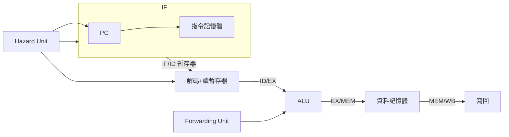

# 3.3 用 Verilog 實作五級流水線

## 學習目標

1. 將 3.1、3.2 的理論化為可執行的 RTL：以 Verilog 實作 IF/ID/EX/MEM/WB 五級流水線。
2. 實作 hazard detection 單元：偵測 load-use 資料險障與分支險障，插入 bubble 或沖掉指令。
3. 實作 forwarding 單元：以 EX/MEM、MEM/WB 暫存器前饋運算元，消除多數 RAW 延遲。
4. 透過模擬驗證：觀察 stall 與 forwarding 在波形中的實際行為。

## 3.3.1 設計總覽

我們實作一支簡化的 RISC-V 子集五級流水線，支援 `add`、`sub`、`and`、`or`、`lw`、`sw`、`beq`。整體架構如下：



設計要點：

- **流水線暫存器**：`IFID`、`IDEX`、`EXMEM`、`MEMWB`，在時脈上緣鎖存上級輸出；flush 時清為 NOP。
- **Forwarding Unit**：比較 EX 階段的 `rs1/rs2` 與 EX/MEM、MEM/WB 的目的暫存器，選擇前饋來源。
- **Hazard Unit**：偵測 load-use（必須 stall 一週期）與 `beq`（需沖掉下一條指令）。

## 3.3.2 流水線暫存器與主架構

```verilog
module pipeline (
    input  wire        clk,
    input  wire        rst,
    // 指令記憶體介面（簡化：內建陣列）
    // 資料記憶體介面（簡化：內建陣列）
);
    // ------------------- IF 階段 -------------------
    reg  [31:0] pc;
    wire [31:0] pc_plus4 = pc + 4;
    wire [31:0] pc_next;

    // 分支目標（ID 階段計算）
    wire [31:0] pc_branch;
    wire        pcsrc;        // 來自 hazard unit

    // IF/ID
    reg  [31:0] ifid_instr;
    reg  [31:0] ifid_pc4;
    wire        ifid_flush, ifid_stall;

    // 指令記憶體
    wire [31:0] imem_rdata;
    imem u_imem (.addr(pc), .rdata(imem_rdata));

    // ------------------- ID 階段 -------------------
    wire [31:0] instr   = ifid_instr;
    wire [4:0]  rs1     = instr[19:15];
    wire [4:0]  rs2     = instr[24:20];
    wire [4:0]  rd      = instr[11:7];
    wire [6:0]  opcode  = instr[6:0];
    wire [2:0]  funct3  = instr[14:12];

    reg  [31:0] rf [0:31];              // 暫存器檔
    wire        regwrite_wb;            // 來自 WB 的寫回控制
    wire [4:0]  rd_wb;
    wire [31:0] result_wb;

    wire [31:0] rd1 = (rs1 != 0) ? rf[rs1] : 32'b0;
    wire [31:0] rd2 = (rs2 != 0) ? rf[rs2] : 32'b0;

    // 立即值（I-type / B-type）
    wire [31:0] imm_i = {{20{instr[31]}}, instr[31:20]};
    wire [31:0] imm_b = {{20{instr[31]}}, instr[7], instr[30:25], instr[11:8], 1'b0};
    wire is_branch = (opcode == 7'b1100011);        // beq
    wire [31:0] imm    = is_branch ? imm_b : imm_i;
    wire [31:0] pc_branch_calc = ifid_pc4 + (imm << 1);

    // ID/EX
    reg         idex_regwrite, idex_memread, idex_memwrite,
                idex_memtoreg, idex_alusrc, idex_branch;
    reg  [1:0]  idex_aluop;
    reg  [31:0] idex_rd1, idex_rd2, idex_imm, idex_pc4;
    reg  [4:0]  idex_rs1, idex_rs2, idex_rd;
    reg  [2:0]  idex_funct3;
    wire        idex_flush;

    // ------------------- EX 階段 -------------------
    // forwarding 選擇
    wire [1:0] forward_a, forward_b;
    wire [31:0] alu_in1 = (forward_a == 2'b10) ? exmem_alu_result :
                          (forward_a == 2'b01) ? result_wb      : idex_rd1;
    wire [31:0] alu_in2_pre = (forward_b == 2'b10) ? exmem_alu_result :
                              (forward_b == 2'b01) ? result_wb      : idex_rd2;
    wire [31:0] alu_in2 = idex_alusrc ? idex_imm : alu_in2_pre;

    wire [31:0] alu_result;
    wire        alu_zero;
    alu u_alu (.a(alu_in1), .b(alu_in2), .funct3(idex_funct3),
               .aluop(idex_aluop), .result(alu_result), .zero(alu_zero));

    wire branch_taken = idex_branch & alu_zero;

    // EX/MEM
    reg         exmem_regwrite, exmem_memtoreg, exmem_memread, exmem_memwrite;
    reg  [31:0] exmem_alu_result, exmem_write_data, exmem_pc4;
    reg  [4:0]  exmem_rd;

    // ------------------- MEM 階段 -------------------
    wire [31:0] dmem_rdata;
    dmem u_dmem (
        .clk(clk),
        .addr(exmem_alu_result),
        .wdata(exmem_write_data),
        .we(exmem_memwrite),
        .rdata(dmem_rdata)
    );

    // MEM/WB
    reg         memwb_regwrite, memwb_memtoreg;
    reg  [31:0] memwb_alu_result, memwb_dmem_rdata, memwb_pc4;
    reg  [4:0]  memwb_rd;

    wire [31:0] result_wb_pre = memwb_memtoreg ? memwb_dmem_rdata : memwb_alu_result;
    assign result_wb = result_wb_pre;
    assign rd_wb     = memwb_rd;
    assign regwrite_wb = memwb_regwrite;

    // ------------------- Hazard Unit -------------------
    wire stall_f, stall_d, flush_e, flush_m;

    hazard_unit u_hazard (
        .idex_memread (idex_memread),
        .idex_rd      (idex_rd),
        .idex_rs1     (idex_rs1),
        .idex_rs2     (idex_rs2),
        .exmem_branch (branch_taken),
        .stall_f      (stall_f),
        .stall_d      (stall_d),
        .flush_e      (flush_e),
        .flush_m      (flush_m),
        .pcsrc        (pcsrc)
    );

    // ------------------- Forwarding Unit -------------------
    forwarding_unit u_fwd (
        .exmem_regwrite   (exmem_regwrite),
        .exmem_rd         (exmem_rd),
        .memwb_regwrite   (memwb_regwrite),
        .memwb_rd         (memwb_rd),
        .idex_rs1         (idex_rs1),
        .idex_rs2         (idex_rs2),
        .forward_a        (forward_a),
        .forward_b        (forward_b)
    );

    assign pc_next = pcsrc ? pc_branch_calc :
                     (stall_f ? pc : pc_plus4);

endmodule
```

## 3.3.3 Hazard Detection：何時 stall、何時 flush

hazard unit 只需回答兩個問題：

1. **load-use**：ID/EX 中的指令是 `lw`，其目的暫存器正是 EX 階段即將讀取的來源 → 停住 IF/ID 與 PC 一週期，並沖掉 ID/EX（插入 bubble）。
2. **分支跳走**：EX 階段確認 `beq` 成立 → 沖掉 IF/ID 與 ID/EX 上錯誤路徑的指令，改抓分支目標。

```verilog
module hazard_unit (
    input  wire       idex_memread,   // ID/EX 是 lw？
    input  wire [4:0] idex_rd,
    input  wire [4:0] idex_rs1,       // EX 階段要讀的來源
    input  wire [4:0] idex_rs2,
    input  wire       exmem_branch,   // 分支成立
    output reg        stall_f,        // 停住 PC
    output reg        stall_d,        // 停住 IF/ID
    output reg        flush_e,        // 沖掉 ID/EX（bubble）
    output reg        flush_m,        // 沖掉 EX/MEM
    output wire       pcsrc
);
    // load-use 資料險障：
    //   上一條是 lw，且目的暫存器 ≠ x0，
    //   且正是本條的來源暫存器
    wire load_use = idex_memread
                  & (idex_rd != 5'b0)
                  & ((idex_rd == idex_rs1) | (idex_rd == idex_rs2));

    always @* begin
        if (load_use) begin
            stall_f = 1'b1;
            stall_d = 1'b1;
            flush_e = 1'b1;   // 讓 ID/EX 變成 NOP
            flush_m = 1'b0;
        end else begin
            stall_f = 1'b0;
            stall_d = 1'b0;
            flush_e = 1'b0;
            flush_m = 1'b0;
        end
    end

    // 控制險障：分支成立，沖掉已抓取的錯誤路徑
    assign pcsrc  = exmem_branch;
    // 分支成立時 IF/ID、ID/EX 皆需沖掉（在頂層以 pcsrc 驅動 flush）
endmodule
```

注意 flush 的優先順序：`flush_e` 同時被 load-use 與分支使用，若兩者同時發生（極少見），以 load-use 為準即可，因為分支的沖掉是由 `pcsrc` 在頂層額外驅動 `ifid_flush` 與 `idex_flush`。

## 3.3.4 Forwarding：讓結果抄近路

forwarding unit 的邏輯核心是「**最近生產者優先**」：若 EX/MEM（上上條，結果剛算完）與 MEM/WB（上上上條）都要寫同一個暫存器，必須取 EX/MEM 的版本，否則會拿到舊值。

```verilog
module forwarding_unit (
    input  wire       exmem_regwrite,   // 上上條會寫回？
    input  wire [4:0] exmem_rd,
    input  wire       memwb_regwrite,   // 上上上條會寫回？
    input  wire [4:0] memwb_rd,
    input  wire [4:0] idex_rs1,
    input  wire [4:0] idex_rs2,
    output reg  [1:0] forward_a,        // 00:暫存器檔  10:EX/MEM  01:MEM/WB
    output reg  [1:0] forward_b
);
    always @* begin
        // 預設：從暫存器檔讀
        forward_a = 2'b00;
        forward_b = 2'b00;

        // MEM/WB 前饋（較舊，先判斷，會被 EX/MEM 覆蓋）
        if (memwb_regwrite && (memwb_rd != 5'b0) && (memwb_rd == idex_rs1))
            forward_a = 2'b01;
        if (memwb_regwrite && (memwb_rd != 5'b0) && (memwb_rd == idex_rs2))
            forward_b = 2'b01;

        // EX/MEM 前饋（較新，優先）
        if (exmem_regwrite && (exmem_rd != 5'b0) && (exmem_rd == idex_rs1))
            forward_a = 2'b10;
        if (exmem_regwrite && (exmem_rd != 5'b0) && (exmem_rd == idex_rs2))
            forward_b = 2'b10;
    end
endmodule
```

兩個細節值得咀嚼：

1. **`rd != 0` 檢查不可省**：x0 永遠是零，若省略，`addi x0, x5, 1` 這類「寫 x0」的指令會誤觸發 forwarding，把 1 前饋給下游——這是經典的教科書陷阱題。
2. **「先判舊、後判新」**：利用 always 區塊中後面賦值覆蓋前面的特性，讓 EX/MEM（較新的結果）蓋過 MEM/WB，等價於寫明優先序。

## 3.3.5 流水線暫存器的更新規則

把 stall 與 flush 落到暫存器上，是整個設計最容易出錯的地方。規則只有三句話：

- **stall**：上級暫存器「不更新」（保持原值），PC 不前進。
- **flush**：暫存器「清為 NOP」（控制訊號全部歸零，如 `RegWrite`、`MemRead` 歸零）。
- **正常**：每個時脈上緣鎖存上級輸出。

```verilog
    // 時序邏輯：流水線暫存器（節錄 IF/ID 與 ID/EX）
    always @(posedge clk or posedge rst) begin
        if (rst) begin
            ifid_instr <= 32'h00000013;   // NOP = addi x0, x0, 0
            pc         <= 32'h0;
        end else if (stall_f) begin
            pc <= pc;                   // PC 停住
        end else begin
            pc <= pc_next;
        end
    end

    always @(posedge clk) begin
        if (rst || ifid_flush) begin
            ifid_instr <= 32'h00000013; // 沖掉 = 塞入 NOP
        end else if (!stall_d) begin
            ifid_instr <= imem_rdata;
            ifid_pc4   <= pc_plus4;
        end
        // stall_d = 1 時：保持原值
    end

    always @(posedge clk) begin
        if (rst || idex_flush) begin
            idex_regwrite <= 1'b0;      // 全部控制訊號歸零 => bubble
            idex_memread  <= 1'b0;
            idex_memwrite <= 1'b0;
        end else begin
            idex_regwrite <= ~is_branch && (opcode == 7'b0110011 || opcode == 7'b0010011 || opcode == 7'b0000011);
            idex_memread  <= (opcode == 7'b0000011);
            idex_memwrite <= (opcode == 7'b0100011);
            idex_rd1      <= rd1;
            idex_rd2      <= rd2;
            idex_imm      <= imm;
            idex_rs1      <= rs1;
            idex_rs2      <= rs2;
            idex_rd       <= rd;
            idex_funct3   <= funct3;
        end
    end
```

寫回暫存器檔同樣發生在時脈上緣（WB 階段末）：

```verilog
    always @(posedge clk) begin
        if (regwrite_wb && (rd_wb != 5'b0))
            rf[rd_wb] <= result_wb;
    end
```

注意：暫存器檔在 ID「讀」、WB「寫」發生於不同週期，靠的正是 3.2 節講的 forwarding——`result_wb` 直接前饋給 EX，不必等 rf 更新。

## 3.3.6 驗證：從波形看見 stall 與 forwarding

寫一支小測試程式，覆蓋三種情境：

```asm
# 測試程式（組語示意）
add x5, x1, x2     # T0
sub x6, x5, x3     # T1: RAW on x5 → forwarding 解決，0 stall
lw  x7, 0(x6)      # T2
add x8, x7, x4     # T3: load-use → 1 個 stall
beq x8, x0, done   # T4
add x9, x1, x1     # 錯誤路徑，分支成立時被沖掉
done:
```

在模擬波形中應觀察到：

- `sub` 的 ALU 輸入 `forward_a = 2'b10`（來自 EX/MEM），無任何 bubble。
- `lw` 之後的 `add` 出現一個 bubble：`idex_flush` 拉高、PC 停一週期。
- `beq` 成立的下一週期，`ifid_instr` 變成 NOP。

```verilog
module alu (
    input  wire [31:0] a, b,
    input  wire [2:0]  funct3,
    input  wire [1:0]  aluop,
    output reg  [31:0] result,
    output wire        zero
);
    always @* begin
        case ({aluop, funct3})
            5'b10_000: result = a + b;            // add
            5'b10_111: result = a & b;            // and
            5'b10_110: result = a | b;            // or
            5'b11_000: result = a + b;            // lw/sw 位址
            default:   result = a + b;
        endcase
    end
    assign zero = (a == b);   // 供 beq 使用
endmodule
```

## 3.3.7 從 200 行 RTL 回看歷史

實作完這 200 行左右的 RTL，我們可以重新檢視 3.2 節的歷史脈絡：

- **forwarding unit 就是「Tomasulo 的最原始形態」**：用硬體追蹤「生產者—消費者」關係，讓資料在硬體間直接傳遞而非經過暫存器檔。scoreboard 與保留站只是把這種追蹤一般化、支援亂序。
- **hazard unit 的 `stall`/`flush` 訊號**，正是 3.2 節 CPI 公式裡每一項 stall 的實體化身——每拉高一次，CPI 就加一分之幾。
- **為什麼現代處理器不長這樣？** 因為本設計的分支在 EX 才解決（3 週期代價）、沒有快取缺失處理、沒有例外（exception）。真實 CPU 把分支解析提前、加入多層預測器、把險障偵測擴充為亂序排程——但「偵測相依 → 選擇 stall/forward/flush」的問題骨架從未改變。

建議讀者以此程式碼為基礎動手改：把分支解析移到 ID 階段（減少控制險障代價）、加入 jal/jalr、或加上簡單的 1 位元分支預測器，每一項改動都會讓你對 3.2 節的理論有更深的體感。

## 本章小結

- 五級流水線的 RTL 由四組流水線暫存器與兩個輔助單元（hazard unit、forwarding unit）構成，其餘即是 3.1 節的單週期資料路徑攤平到五個階段。
- Hazard unit 偵測 load-use（stall + bubble）與分支成立（flush 錯誤路徑）；forwarding unit 以「最近生產者優先」把 EX/MEM、MEM/WB 的結果繞回 ALU 輸入，消解多數 RAW。
- 陷阱與細節：x0 檢查、flush 以 NOP（控制訊號歸零）實現、stall 時暫存器與 PC 同時停住——這些都是理論書不寫、動手才懂的功夫。
- 這份簡單 RTL 與 CDC 6600 scoreboard、Tomasulo 之間，隔著的只是「把依賴追蹤一般化並支援亂序」這一步；問題的骨架——相依偵測與資料繞送——完全相同。

## 習題

1. 在 3.3.4 節的 forwarding unit 中，若調換 EX/MEM 與 MEM/WB 的判斷順序（先判新、後判舊），會發生什麼錯誤？構造一個三條指令的序列說明。
2. 說明為什麼 flush 要把「控制訊號歸零」而不是把整個暫存器清為 0——若把 `idex_rd` 也清為 0 且 `idex_regwrite` 未歸零，會發生什麼？
3. 以下序列中，指出每個週期 forwarding unit 的輸出（`forward_a/forward_b`）與是否有 stall：
   ```text
   add x2, x3, x4
   sub x5, x2, x6
   lw  x7, 0(x2)
   add x8, x7, x2
   ```
4. 將分支解析從 EX 提前到 ID 階段：需要在 ID 增加哪些硬體（比較器、分支目標加法器）？控制險障的 flush 範圍會如何改變？又可能與 forwarding 產生什麼新的衝突？
5. （挑戰）設計一個 1 位元飽和分支預測器的 Verilog 模組：以 PC 低位元索引的預測表，說明它在 3.3 節流水線中要接在哪裡、預測錯誤時如何復原，並以 3.2 節「迴圈出口兩次猜錯」的例子分析其缺陷。
