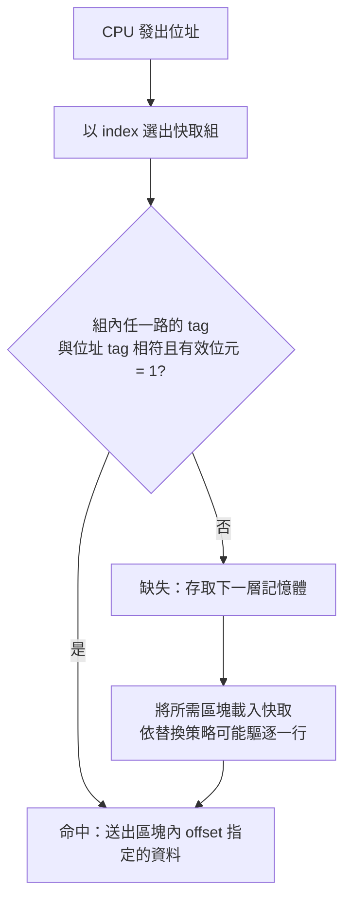

# 4.1 快取記憶體與 Atlas 電腦（1962）

## 學習目標

1. 理解處理器與主記憶體之間速度差距如何催生快取記憶體的概念。
2. 認識 1962 年曼徹斯特 Atlas 電腦的「一級儲存」（one-level store）設計與其在記憶體階層史上的地位。
3. 掌握快取的基本組織：直接映射、組相聯與全相聯。
4. 能進行快取容量與位址切分的計算。
5. 會計算平均記憶體存取時間（AMAT）。

## 4.1.1 速度差距：問題的根源

從 1950 年代開始，處理器與主記憶體的技術路線就注定分道揚鑣。處理器採用最快的邏輯元件（當時是電晶體，後來是更快的電晶體電路），而主記憶體為了追求大容量與低成本，採用的是磁芯（magnetic core）記憶體。磁芯的存取週期約為數微秒，而處理器的機器週期卻只有數百奈秒。處理器每等待一次記憶體讀取，就要浪費好幾個週期——這在當時被稱為「記憶體瓶頸」（memory bottleneck）。

工程師們想到兩種對策：

- **拓寬記憶體**：讓記憶體一次讀出多個字（word），或採用交錯式（interleaved）記憶體以提升頻寬。但這只解決頻寬，不解決延遲。
- **縮短距離**：在處理器旁邊放一個又小又快的「緩衝記憶體」，把最近用過的資料留在裡面。這就是快取（cache）。

第二種方案基於一個深刻的事實：程式的行為具有**局部性**（locality）。

- **時間局部性**：剛被存取的資料，短期內很可能再次被存取（如迴圈變數、計數器）。
- **空間局部性**：被存取位址附近的資料，很可能不久後被存取（如循序執行的指令、陣列元素）。

## 4.1.2 Atlas 電腦與「一級儲存」

1962 年，英國曼徹斯特大學的 Ferranti/Atlas 電腦問世。它的設計者（Kilburn 等人）提出了一個影響深遠的架構觀念：**一級儲存**（one-level store）。程式設計師看到的是一個單一、巨大、統一編址的儲存空間，但硬體實際上把它分散放在快速的磁鼓（drum）與少量的磁芯記憶體之間，由硬體自動在兩者之間搬移頁面。

Atlas 的做法本質上是「速度差距的系統化解法」：

- 磁芯記憶體容量小但快，作為「運行現場」；
- 磁鼓容量大但慢，作為「後備倉庫」；
- 硬體以頁（page）為單位自動換入換出，配合學習演算法（LEarning algorithm，即後世 LRU 替換策略的先驅）預測哪些頁最可能被用到。

雖然 Atlas 的機制後來被歸類為**虛擬記憶體**的先驅（見 4.2 節），但它的「在兩層儲存間自動搬移熱門內容」思想，正是快取記憶體的靈魂。Atlas 團隊甚至明確使用了 "slave memory"（奴隸記憶體）一詞來稱呼其小型快速緩衝儲存——這就是快取的直接前身。事實上，快取（cache memory）與虛擬記憶體是同一思想在兩個層級上的實現：前者在 CPU 與主記憶體之間，後者在主記憶體與磁碟之間。

## 4.1.3 快取的基本組織

快取以「區塊」（block/line）為搬移單位（典型 32–64 位元組）。當處理器要存取位址 A 時，硬體必須快速判斷 A 所在的區塊是否已在快取中——這個判斷必須在一個週期內完成，因此不能逐一比對。常見三種組織方式：

| 組織方式 | 區塊可放位置 | 對策硬體成本 | 命中率 |
|---|---|---|---|
| 直接映射（direct-mapped） | 每區塊只有唯一位置 | 最低 | 最低 |
| 組相聯（set-associative） | 對應組內任一路 | 中 | 中 |
| 全相聯（fully associative） | 任意位置 | 最高（需 CAM） | 最高 |

### 位址切分：直接映射

設記憶體位址有 $m$ 位元，區塊大小 $2^b$ 位元組，快取有 $2^c$ 個區塊。則直接映射的位址切分為：

$$
\text{tag} \;|\; \text{index}\;(c \text{ 位元}) \;|\; \text{offset}\;(b \text{ 位元})
$$

**例題**：快取容量 16 KiB、區塊大小 64 B、直接映射、位址 32 位元。

- 區塊數 $= 16\text{KiB} / 64\text{B} = 256 = 2^8$ ，故 index 為 8 位元；
- offset 為 $\log_2 64 = 6$ 位元；
- tag $= 32 - 8 - 6 = 18$ 位元。

位址 `0x12345678` 的切分：

```text
0x12345678 = 0001 0010 0011 0100 0101 0110 0111 1000
tag   = 000100100011010001 (0x12344>>... ) 即高位 18 位元
index = 01011001 (0x59)，落於第 89 個區塊
offset= 111000 (0x38)
```

### 位址切分：2 路組相聯

同樣 16 KiB、64 B 區塊、2 路組相聯：每組 2 個區塊，故組數 $= 256/2 = 128 = 2^7$ ，index 縮短為 7 位元，tag 增為 19 位元。相聯度每翻倍，index 就少 1 位元、tag 多 1 位元。位址查詢時同時比對組內所有路（並行比較器），命中任一路即成功。

### 查詢流程



## 4.1.4 性能分析：AMAT

衡量記憶體階層的核心指標是**平均記憶體存取時間**（Average Memory Access Time）：

$$
\text{AMAT} = t_{\text{hit}} + \text{缺失率} \times t_{\text{penalty}}
$$

**例題**：命中時間 1 週期，缺失率 5%，缺失代價 100 週期：

$$
\text{AMAT} = 1 + 0.05 \times 100 = 6 \text{ 週期}
$$

若把缺失率降到 3%（例如提升相聯度），AMAT $= 1 + 0.03 \times 100 = 4$ 週期，但硬體比較器成本與功耗增加。反之若用 2 路組相聯使命中時間拉長為 1.2 週期，收益要重新權衡。這正是記憶體階層設計的永恆主題：**在命中率、命中時間與硬體成本之間取捨**。

## 4.1.5 從 Atlas 到現代

Atlas 之後，IBM System/360 Model 85（1968）首次以「快取」（cache）之名將高速緩衝儲存產品化，證明了即使只有 8–16 KiB 的快取也能大幅提升性能。此後快取成為所有處理器的標配，並演化出 L1/L2/L3 多層結構、寫回（write-back）與寫穿（write-through）策略、非阻塞快取等技術。而 Atlas 的頁面管理思想則由 IBM System/370（1970）繼承，發展為成熟的虛擬記憶體（見 4.2 節）。

## 本章小結

- 處理器與主記憶體的速度差距催生了快取記憶體；其有效性根基於程式的時間與空間局部性。
- Atlas 電腦（1962）的「一級儲存」與 slave memory 是快取與虛擬記憶體的共同思想源頭。
- 快取以區塊為單位，組織方式分為直接映射、組相聯與全相聯；相聯度越高命中率越高，但硬體成本與命中時間越大。
- 位址切分為 tag | index | offset；組相聯時 index 選組、tag 決定路。
- AMAT = 命中時間 + 缺失率 × 缺失代價，是評估階層設計的核心公式。

## 習題

1. 快取容量 32 KiB、區塊 64 B、直接映射、位址 40 位元。求 tag、index、offset 各為多少位元？位址 `0x7FFF_FFA0` 會映射到哪一個 index？
2. 同上題，改為 4 路組相聯，重新計算 tag、index、offset 位元數，並說明相聯度對 index 與 tag 的影響規律。
3. 某機器命中時間 2 週期，缺失代價 120 週期。若缺失率為 4%，求 AMAT；若改用更大快取使缺失率降為 2% 但命中時間增至 3 週期，是否值得？
4. 說明時間局部性與空間局部性各對應快取設計中的哪一項機制（提示：區塊大小、替換策略、預取）。
5. 為什麼 Atlas 的 "one-level store" 概念能同時孕育快取與虛擬記憶體兩種技術？請從「自動搬移 + 對程式透明」的角度說明。
