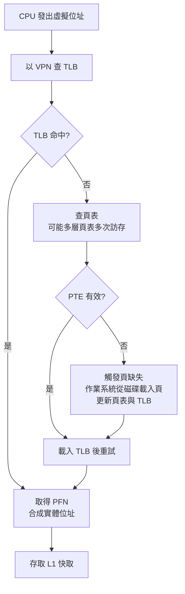

# 4.2 虛擬記憶體與分頁機制

## 學習目標

1. 理解虛擬記憶體的動機：記憶體容量不足、多程式共享與保護需求。
2. 掌握分頁機制：虛擬位址、實體位址、頁表與位址轉換。
3. 認識 TLB 的由來與工作原理，理解「虛擬記憶體會讓每個位址多查一次表」的問題如何被 TLB 解決。
4. 了解從 Atlas 到 IBM System/370 的虛擬記憶體發展脈絡。
5. 能進行虛擬位址切分與頁表查詢的計算。

## 4.2.1 動機：比快取更大的問題

4.1 節的快取解決的是「速度差距」，但 1960 年代的計算機還面臨三個更根本的問題：

1. **容量差距**：程式所需記憶體常超過物理記憶體；程式設計師被迫手工「覆蓋」（overlay）管理記憶體，既痛苦又易錯。
2. **多程式共享**：記憶體中同時駐留多個程式，需要防止彼此破壞。
3. **重定位**：程式載入到記憶體的哪個位置不應寫死在程式碼中。

Atlas 的「一級儲存」給出了統一解答：**讓程式看到一個不存在於物理世界的大型連續位址空間，由硬體自動將它映射到實際的儲存層級**。這個「虛構」的位址空間即為**虛擬位址空間**（virtual address space）。程式設計師不必再管記憶體放哪、放得下放不下——作業系統與硬體聯手，以頁為單位在主記憶體與磁鼓之間自動搬移。

這一概念後來在 IBM System/370（1970）上得到大規模商業實現，虛擬記憶體自此成為大型主機乃至所有通用計算機的標配。

## 4.2.2 分頁與位址轉換

虛擬位址空間與實體記憶體都被切成固定大小的**頁**（page，典型 4 KiB）。對應的實體記憶體單位稱**頁框**（page frame）。轉換規則極為簡單：虛擬位址分為**虛擬頁號**（VPN）與**頁內偏移**（offset），轉換只換頁號、不動偏移：

$$
\text{虛擬位址} = \text{VPN} \;|\; \text{offset} \quad\Longrightarrow\quad \text{實體位址} = \text{PFN} \;|\; \text{offset}
$$

**例題**：頁大小 4 KiB、虛擬位址 48 位元、實體位址 32 位元。

- offset $= \log_2 4096 = 12$ 位元；
- VPN $= 48 - 12 = 36$ 位元，PFN $= 32 - 12 = 20$ 位元。

虛擬位址 `0x0000_1234_5678`：offset $= 0x678$ ，VPN $= 0x12345$ 。查頁表得 PFN（例如 $0x00ABC$ ），則實體位址為 `0x00ABC_678`。

### 頁表與頁表項

每個行程擁有一張**頁表**（page table），VPN 為索引，每項（PTE）記錄：

- **有效位元**（valid）：該頁是否在主記憶體中；
- **實體頁框號**（PFN）或磁碟位址；
- **保護位元**：讀／寫／執行權限；
- **髒位元**（dirty）、**參考位元**（referenced），供替換演算法使用。

若有效位元為 0 而處理器存取該頁，硬體觸發**頁缺失**（page fault），作業系統從磁碟載入該頁（必要時驅逐別頁寫回磁碟）。這就是「需求分頁」（demand paging）：頁只在被用到時才載入。

### 替換策略

頁缺失代價高達數百萬個時脈週期（磁碟存取），因此替換策略至關重要。理想策略是 Belady 的 MIN（淘汰最久不會再用的頁），但不可實作；實務上採用其近似——Atlas 首創的**LRU 及其近似**（如參考位元 + 時鐘演算法）。LRU 利用時間局部性，與快取的替換思想一脈相承。

## 4.2.3 TLB：位址轉換的速度瓶頸

分頁有一個致命的性能隱患：**每次記憶體存取都要先查頁表**。頁表本身就在記憶體中，於是一次載入指令變成兩次記憶體存取（先取 PTE、再取資料），速度直接減半——這是速度差距問題的「復仇」。

解法又是同一思想的復用：**把最常用的轉換結果快取起來**。這就是 **TLB**（Translation Lookaside Buffer，轉譯後備緩衝），一個小型的、通常全相聯的快取，保存最近的 VPN→PFN 映射。TLB 通常只有 16–512 項，但由於頁局部性極強（一頁 4 KiB 內的所有存取共用一項），命中率可達 99% 以上。

### TLB 與快取的互動

TLB 命中後再以實體位址查快取，兩者串聯。現代處理器常用**虛擬索引、實體標籤**（VIPT）技術，讓 TLB 轉換與快取索引並行，以消除 TLB 的延遲。若 TLB 也缺失，多層頁表的查詢可能需要多次訪存，代價相當可觀。

**AMAT 擴充**：完整的三層平均存取時間可近似為

$$
\text{AMAT} = t_{\text{L1}} + \text{L1缺失率} \times \left(t_{\text{L2}} + \text{L2缺失率} \times t_{\text{mem}}\right) + \text{TLB缺失率} \times t_{\text{TLB缺失}}
$$

**例題**：L1 命中 1 週期、缺失率 4%；L2 命中 12 週期、缺失率 40%；主記憶體 100 週期；TLB 缺失率 0.5%、TLB 缺失代價 30 週期（假設 TLB 與快取可並行）：

$$
\text{AMAT} \approx 1 + 0.04 \times (12 + 0.4 \times 100) + 0.005 \times 30 = 1 + 2.08 + 0.15 = 3.23 \text{ 週期}
$$

可見 TLB 雖小，其缺失代價同樣不可忽視；大頁（如 2 MiB/1 GiB huge page）可降低 TLB 缺失率，正是因為一項轉換覆蓋更多位址。

## 4.2.4 虛擬記憶體帶來的額外饋贈

1. **保護**：每個行程有獨立頁表，天然隔離；保護位元防止越權存取。
2. **共享**：多個行程的頁表可指向同一頁框，實現共享程式庫與記憶體。
3. **重定位**：程式編譯時使用虛擬位址，載入到任何實體位置皆可。
4. **超額配置**（overcommit）：虛擬空間可以遠大於實體記憶體，作業系統以工作集（working set）管理，把「記憶體不夠」的問題轉化為「性能下降」而非「程式無法執行」。

## 4.2.5 演進：多層頁表與現代擴充

頁表本身會占據巨大空間（48 位元虛擬位址、4 KiB 頁的單層頁表需要 $2^{36}$ 項），因此現代系統採用**多層（階層式）頁表**：頂層頁表項指向下層頁表，未使用的位址區域可整段省略。x86-64 使用四到五層頁表；TLB 則演化為多層（L1/L2 TLB）、分指令與資料 TLB。ARM 與 RISC-V 的分頁格式雖異，思想相同：**以局部性換取有限硬體的最大效益**。

## 本章小結

- 虛擬記憶體源於 Atlas 的一級儲存思想，在 IBM System/370 上商業化；它同時解決容量、共享、保護與重定位四大問題。
- 分頁以固定大小頁為單位，虛擬位址切為 VPN | offset，經頁表轉為 PFN | offset。
- 頁缺失由作業系統處理，從磁碟載入頁面；替換策略以 LRU 近似為主流。
- 每次訪存都查頁表會拖慢速度，TLB 以快取轉換結果的方式解決，命中率極高。
- TLB 缺失代價不小，大頁與多層 TLB 是現代系統的應對手段。

## 習題

1. 頁大小 8 KiB、虛擬位址 40 位元、實體位址 30 位元。求 VPN、offset、PFN 各多少位元？虛擬位址 `0x1234_5678` 若其 VPN 對應 PFN 為 `0x0AB`，實體位址為何？
2. 為什麼 TLB 可以做得極小（幾百項）卻有 99% 以上的命中率？請從頁大小與局部性角度分析。
3. 某系統 TLB 命中率 98%、TLB 命中時間 0（與快取並行）、TLB 缺失代價 50 週期。若快取 AMAT 為 1.5 週期，加入 TLB 後的總 AMAT 為多少？
4. 說明需求分頁（demand paging）如何讓「程式比實體記憶體大」成為可能，並比較頁缺失與快取缺失在代價上的量級差異。
5. 若將頁大小從 4 KiB 增為 16 KiB，頁表項數、內部碎片（fragmentation）、TLB 覆蓋範圍各會如何變化？各有何利弊？
