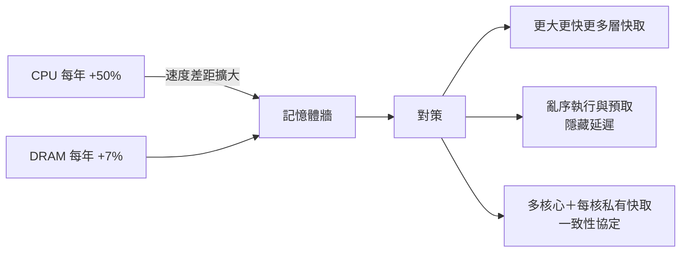

# 4.3 儲存技術與記憶體階層經濟學

## 學習目標

1. 認識構成記憶體階層的各種儲存技術：SRAM、DRAM、快閃記憶體（SSD）、磁碟。
2. 理解「記憶體牆」（memory wall）問題及其現代演化。
3. 從單位成本與性能的量化角度，理解記憶體階層為何是「必然的經濟結構」。
4. 掌握多層階層的 AMAT 計算與階層設計原則。

## 4.3.1 儲存技術全景

記憶體階層的每一層都由不同物理技術構成，其性能與成本差距高達數個數量級：

| 技術 | 典型用途 | 存取延遲 | 帶寬 | 揮發性 | 相對成本/位元 |
|---|---|---|---|---|---|
| SRAM | L1–L3 快取、TLB | 0.5–10 ns | 極高 | 揮發 | 最高 |
| DRAM | 主記憶體 | 50–100 ns | 高（GB/s 級） | 揮發 | 中 |
| NAND 快閃（SSD） | 次級儲存 | 25–100 µs | 中（GB/s 級） | 非揮發 | 低 |
| HDD 磁碟 | 大容量儲存 | 3–10 ms | 低（MB/s 級） | 非揮發 | 最低 |

關鍵觀察：

- **速度與成本成正相關、與容量成反相關**。SRAM 一位元需要 6 個電晶體，DRAM 一位元只需 1 個電晶體加 1 個電容，NAND 快閃更以電荷儲存於浮閘，密度遠高於前兩者。
- **DRAM 揮發**：斷電即失，故需要非揮發層（SSD/HDD）保存；DRAM 電容電荷會漏電，需定期刷新。
- **SSD 與 HDD 的差異**：SSD 無機械移動、延遲低三個數量級、抗震，但每單元有寫入壽命限制且位元成本較高；HDD 容量單價極低，適合冷資料歸檔。

## 4.3.2 記憶體牆

1990 年代，處理器性能每年提升約 50–60%，DRAM 延遲卻只改善約 7%。兩條曲線的裂口被稱為**記憶體牆**（memory wall）：處理器再快，也會被等記憶體拖住。快取正是跨越這堵牆的橋樑——用 SRAM 的小快，掩蓋 DRAM 的大慢。

現代問題的形態已改變：進入多核心時代後，瓶頸從「單執行緒延遲」轉為「頻寬與能耗」。每一層快取的讀寫能耗都遠低於 DRAM 訪存（DRAM 訪存約需快取存取的 10–100 倍能量），因此資料離處理器越近，能效越高。記憶體牆也以新的面貌重現：**「移動位元比計算位元更耗能」**，這推動了運算貼近資料的趨勢（近記憶體運算、HBM 高頻寬記憶體）。

## 4.3.3 記憶體階層的經濟學

### 為什麼階層是必然的

假設你可以任意選擇儲存技術，預算固定為 $B$，程式需要 $S$ 位元容量。若全部用 SRAM：速度最快但買不起 $S$ 那麼大；若全部用 HDD：買得起但慢到不可接受。**唯一可行解**就是混合：少量最快的放最靠近 CPU，多量最慢最便宜的放遠處，再靠局部性讓大部分存取落在上層。

量化的關鍵是**命中率**。以兩層為例，設上層命中時間 $t_1$、缺失率 $r$、下層代價 $t_2$：

$$
\text{AMAT} = t_1 + r \cdot t_2
$$

下層慢 100 倍沒關係，只要 $r$ 夠小。例如 $t_1 = 1$ ns、$t_2 = 100$ ns：$r = 10\%$ 時 AMAT = 11 ns（慢 11 倍）；$r = 1\%$ 時 AMAT = 2 ns（僅慢 2 倍）。**局部性把數量級的成本差距壓縮成小比例的額外延遲**——這就是階層經濟學的全部精髓。

### 三層實例

L1 命中 1 ns、缺失率 5%；L2 命中 10 ns、缺失率 20%；主記憶體 80 ns：

$$
\text{AMAT} = 1 + 0.05 \times \left(10 + 0.2 \times 80\right) = 1 + 0.05 \times 26 = 2.3 \text{ ns}
$$

對比直接訪存 DRAM 的 80 ns，加速約 35 倍；而整套系統的容量由 DRAM 決定、單位成本卻遠低於全 SRAM。這正是「用局部性兌換經濟性」。

### 成本效益的邊界

階層不是越多越好。新增一層的條件是：該層的技術在速度與成本上都位於相鄰兩層之間且有明顯落差（如快閃之於 DRAM 與 HDD），且工作集的局部性能支撐足夠命中率。多層也帶來一致性、管理開銷與軟體複雜度（如頁快取與快取的雙重快取）。

## 4.3.4 從磁碟到 SSD：階層的重構

NAND 快閃的出現改寫了階層經濟學。傳統上「主記憶體 ↔ 磁碟」的頁缺失代價是百萬週期級，分頁系統的設計（預讀、寫回、工作集管理）都是圍繞這個巨大代價演化。SSD 把次級儲存延遲縮小 100 倍後：

- 頁缺失代價下降，虛擬記憶體的超額配置變得更寬容；
- 檔案系統與資料庫的 I/O 設計（旋轉延遲、尋道最佳化）失去意義，轉向快閃的寫入放大與磨損均衡問題；
- 顯露出新的「牆」：SSD 的寫壽命與 DRAM 到 SSD 之間仍存在的數千倍延遲落差，促使持久記憶體、CXL 記憶體擴充等新階層實驗。

歷史在此循環：Atlas 面對「磁芯 ↔ 磁鼓」的速度落差發明了一級儲存；今天工程師面對「DRAM ↔ SSD」的落差，重新思考同一問題。**技術會更替，速度落差與局部性的經濟學不變。**

## 4.3.5 階層設計原則彙總

1. **每層重複同一模式**：上層小而快、下層大而慢；上層存放下層的子集；資料以區塊/頁為單位上下搬移。
2. **對上層軟體透明**：程式設計師看到的是一個統一大空間，階層由硬體與作業系統協作管理。
3. **替換策略利用時間局部性**（LRU 系）；**區塊大小利用空間局部性**。
4. **AMAT 是統一度量**：任何一層的改造，最終都應以對 AMAT（乃至程式性能）的貢獻來評估。

## 本章小結

- SRAM、DRAM、快閃、磁碟在延遲、帶寬、成本上相差數量級，這種不均衡是記憶體階層存在的物質基礎。
- 處理器與 DRAM 性能增長的長期失衡造成記憶體牆；快取、預取與多層階層是跨越之策，多核時代瓶頸轉為頻寬與能耗。
- 階層經濟學的核心：局部性使命中率夠高，讓 AMAT = 命中時間 + 缺失率×缺失代價中的缺失項趨於微小，於是以平均速度接近上層、容量與成本接近下層。
- SSD 壓縮了次級儲存的延遲，重構了虛擬記憶體與 I/O 的設計假設，也暴露新的落差與新階層的機會。
- 階層每一層都遵循「自動搬移、對上透明、以局部性取勝」的同一模式——這是本章貫穿 Atlas 至現代的主線。

## 習題

1. 下表技術依延遲由低到高排序，並說明各自的物理原理與揮發性：SRAM、DRAM、NAND 快閃、HDD。
2. 某三層階層：L1 命中 1 週期、缺失率 6%；L2 命中 15 週期、缺失率 30%；主記憶體 120 週期。求整體 AMAT。若 L2 缺失率降至 15%，AMAT 改善多少週期？
3. 全用 DRAM 建置 64 GiB 的價格假設為全用 SRAM 的 1/10，而某工作集為 2 GiB、在 8 MiB 快取下命中率 96%。試從 AMAT 與成本兩面論證「8 MiB SRAM 快取 + 64 GiB DRAM」比「64 GiB DRAM 無快取」或「縮減 DRAM 換更大 SRAM」更合理的前提假設是什麼？
4. SSD 使次級儲存延遲降低約百倍，列出至少三個因此受到衝擊或必須重新設計的系統機制。
5. 解釋「移動一個位元比計算一個位元耗能更多」如何影響多核心處理器的快取設計與近記憶體運算的興起。
