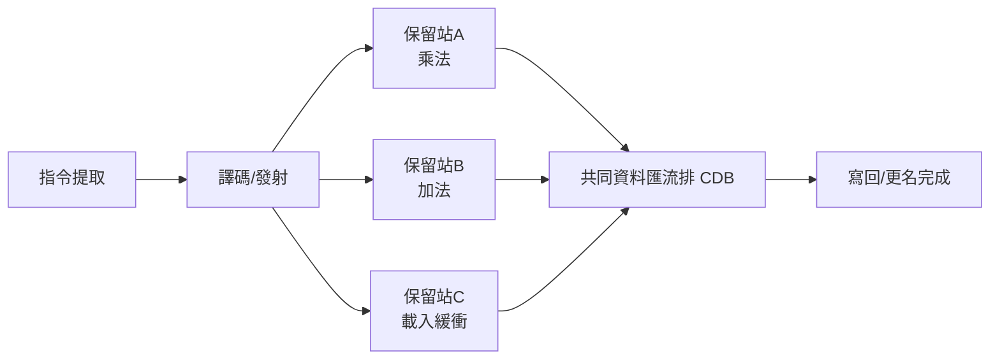

# 05.1 指令級平行與亂序執行

## 學習目標

讀完本節後，你應該能夠：

1. 說明指令級平行（ILP, Instruction-Level Parallelism）的意義，以及為何它是提升單一執行緒效能的關鍵。
2. 解釋流水線冒險（結構、資料、控制冒險）與「真相依、反相依、輸出相依」的差別。
3. 描述 Tomasulo 演算法（IBM System/360 Model 91，1967）如何以暫存器更名與保留站實現亂序執行。
4. 說明超純量（Superscalar）與 VLIW（Very Long Instruction Word）的設計取捨，以及為何後者在通用處理器上失敗。
5. 理解分支預測與推測執行如何共同把 ILP 推向極限。

---

## 5.1.1 為什麼需要指令級平行？

第 4 章的流水線技術把一條指令的執行切成五段（IF、ID、EX、MEM、WB），理想情況下每個時脈週期都能完成一條指令。但流水線真正想榨出的資源，其實是**指令之間的平行性**：如果相鄰指令彼此沒有資料相依，它們本來就可以同時執行。這種存在於單一程式流之中的平行性，稱為**指令級平行（ILP）**。

ILP 的多寡由兩個因素決定：

- **程式本身的特性**：相鄰指令間的距離（指令視窗大小）內有多少真相依。
- **硬體的寬度與智慧**：處理器一次能發射幾條指令，以及它能「看多遠」找出互不相依的指令。

兩個度量常被引用：

- **IPC**（Instructions Per Cycle，每週期指令數）：理想流水線的 IPC 上限就是流水線寬度。
- **CPI**（每指令週期數）：$CPI = 1/IPC$。

問題在於：簡單的五段流水線一旦遇到相依指令就必須**停等（stall）**。要突破 CPI = 1 的天花板，就必須解決三大冒險，並進一步讓多條指令同時進入執行單元。

## 5.1.2 三大冒險與資料相依

**冒險（hazard）**是「下一條指令無法在下一週期執行」的原因：

| 冒險類型 | 成因 | 典型解法 |
|---|---|---|
| 結構冒險 | 硬體資源衝突（如同一週期要讀指令又要寫記憶體） | 增加硬體資源、分離式快取 |
| 資料冒險 | 後續指令需要前面指令的結果 | 前遞（forwarding）、停等、亂序執行 |
| 控制冒險 | 分支指令改變程式流 | 分支預測、延遲分支、推測執行 |

資料冒險進一步細分為三種（以 RAW/WAR/WAW 表示）：

- **真相依（RAW，Read After Write）**：`add r1, r2, r3` 之後 `sub r4, r1, r5` 需要等 `r1`。這是資料流的**本質相依**，無法消除，只能靠前遞縮短等待。
- **反相依（WAR，Write After Read）**：後面的指令要**寫** `r1`，而前面的指令還要**讀** `r1`。
- **輸出相依（WAW，Write After Write）**：兩條指令要寫同一個暫存器。

注意 WAR 與 WAW 都是**假相依（false dependency）**：衝突的根源只是「暫存器名稱不夠用、被重複使用」，而不是真的有資料要傳遞。這個觀察正是亂序執行的破口——只要**重命名暫存器**，假相依就會消失。

## 5.1.3 Tomasulo 演算法：亂序執行的濫觴

1960 年代，IBM 為科學計算市場打造 System/360 Model 91，其浮點單元由 Robert Tomasulo 設計的演算法驅動。這個 1967 年問世的設計，成為此後五十年所有高效能 CPU 的心臟。

Tomasulo 演算法的兩個核心機制：

### 1. 暫存器更名（Register Renaming）

每條指令在**發射（issue）**時，其來源運算元若尚未就緒，就改記「哪一個保留站將產生它」（tag），而非記暫存器編號；目的暫存器也被改記為接收結果的保留站編號。這等於動態地把架構暫存器（architectural registers，如 16 個浮點暫存器）映射到遠多於此的實體儲存位置（保留站）上，**WAR 與 WAW 冒險因此自動消失**。

### 2. 保留站與亂序完成



每個功能單元前設有**保留站（reservation station）**：指令在此等待運算元。一旦兩個來源都就緒，就**亂序執行（out-of-order execution）**——哪條指令的運算元先到齊就先執行誰。結果透過**共同資料匯流排（CDB, Common Data Bus）**廣播，所有等著這個結果的保留站同時接收（這本身就是一種硬體上的廣播式資料流計算）。

雖然執行亂序，但**例外行為必須像順序機器一樣精確（precise exception）**。後世以**重排序緩衝區（ROB, Reorder Buffer）**補上這一塊：指令按序進入 ROB，執行完先緩衝，等排到它前面全部完成後才**按序提交（in-order commit）**。這套「按序發射→亂序執行→按序提交」的三段式結構，就是現代亂序處理器的標準藍圖。


## 5.1.4 超純量：從一發射到多發射

Tomasulo 的機器每週期仍只完成約一條指令。下一個躍進是**超純量（superscalar）**處理器：在同一流水線中放置多個同型功能單元，**每週期發射多條指令**。1990 年代的設計從 2-issue（如 Pentium）一路發展到 4-issue、6-issue。現代 x86 大核心普遍是 4～8 寬的亂序超純量機器，配備數百個項目的指令視窗（ROB）。

超純量把「找出平行指令」的難題交給**硬體動態排程**：硬體掃描指令視窗、解相依、分配功能單元。優點是對二進位相容——舊程式不用重編譯就自動變快；缺點是硬體複雜度與功耗隨視窗寬度**非線性成長**（排程器的查詢是寬度的平方量級），這為 5.3 節的功耗牆埋下伏筆。

## 5.1.5 VLIW：把排程交給編譯器

與超純量相對的路線是 **VLIW（Very Long Instruction Word）**：由**編譯器在靜態時期**找出互不相依的指令，打包成一條「超長指令」，硬體只負責照表操課，不需要動態排程電路。硬體因此簡單、省電、時脈容易拉高。

VLIW 的理想很美，但有三個致命傷：

1. **程式平行性變動**：編譯時不知道 cache miss 何時發生，一個 miss 就卡住整個超長指令。
2. **二進位不相容**：指令格式綁死硬體寬度，換一代晶片就要重編譯所有程式。Intel 的 Itanium（IA-64，2001）正是 VLIW 思想（EPIC）在通用市場的嘗試，最終在 x86 的相容性壁壘前失敗。
3. **編譯器負擔過重**：需要激進的迴圈展開、軟體流水線（software pipelining）、投機載入等技巧。

**歷史的裁決**：通用處理器選了超純量（硬體排程、相容性優先）；但 VLIW 在**可預測、可控制環境**中活了下來——數位訊號處理器（DSP）與**圖形處理器 GPU 的著色器核心**本質上就是 VLIW/SIMT 混合體，因為編譯器清楚知道程式碼的形狀。路線之爭沒有絕對勝負，只有場景之分。

## 5.1.6 分支預測與推測執行

在典型程式中，每 4～6 條指令就有一條分支。控制冒險若不處理，亂序引擎再寬也沒用——你根本不知道該提取哪些指令。

**分支預測（branch prediction）**賭的是分支的方向與目標：

- **靜態預測**：編譯期決定（如「向後跳就預測 taken」，利用迴圈特性）。
- **動態預測**：硬體以歷史紀錄學習。從 1-bit、2-bit 飽和計數器，到兩層適應式預測器（如 gshare、Alpha 21264 的混合預測器），再到現代的 TAGE 類預測器與以**分支歷史暫存器為索引的**神經網路預測器，預測正確率普遍超過 95%。

預測之後還不夠，必須敢「先斬後奏」：沿著預測路徑**推測執行（speculative execution）**，把結果放在 ROB 中暫不提交，等分支確定後，猜對就整批生效，猜錯就整批作廢並清空流水線（pipeline flush）。推測執行 + 亂序執行，讓處理器在等待一個 cache miss 的數百週期裡，持續執行幾十條後續指令——這是隱藏記憶體延遲最重要的武器。

（值得附註：2018 年曝光的 Spectre/Meltdown 攻擊正是利用推測執行的微架構副作用（如 cache 狀態）外洩資訊，說明了這項技術的安全面代價。）

## 5.1.7 ILP 的極限

 ILP 不是無限的。DSCI 學者分析顯示，即使在理想（無限視窗、完美預測）條件下，通用整數程式的 IPC 上限也只有個位數；真實條件下則更受三面牆限制：

1. **資料流牆**：真相依構成的資料流圖決定了最短執行時間。
2. **記憶體牆**：cache miss 的延遲成長快於我們隱藏它的能力。
3. **功耗牆**：更寬的視窗、更大的預測器、更多功能單元，每一項都要燒電（詳見 5.3 節）。

當 ILP 榨到極限、時脈也撞上功耗牆，業界只剩下兩條路：**在同一晶片上放多個核心（多核心）**，以及**讓每個週期同時處理更多資料（SIMD/向量）**——這正是 5.2 節的主題。

## 本章小結

- 指令級平行（ILP）是單一執行緒內指令間的潛在平行性，以 IPC 衡量。
- 冒險分為結構、資料、控制三類；資料冒險中的 WAR 與 WAW 是可用更名消除的假相依。
- Tomasulo 演算法（IBM 360/91, 1967）以暫存器更名 + 保留站 + CDB 實現亂序執行；ROB 的加入保證精確例外。
- 超純量由硬體動態排程、多發射；VLIW 由編譯器靜態打包，在通用市場失敗但存活於 DSP 與 GPU。
- 分支預測 + 推測執行讓處理器「先算錯也不要閒著」，是對抗記憶體牆的關鍵。
- ILP 終有極限：資料流牆、記憶體牆、功耗牆，驅使架構走向多核心與資料平行。

## 習題

1. 對下列程式碼，標出所有 RAW、WAR、WAW 相依，並指出哪些可用暫存器更名消除：

   ```asm
   I1: mul r1, r2, r3
   I2: add r1, r1, r4
   I3: sub r4, r1, r5
   I4: or  r1, r4, r6
   ```

2. 說明 Tomasulo 演算法中保留站與 CDB 的角色，並解釋為什麼 CDB 是效能瓶頸（提示：想想多條指令同時完成時會發生什麼）。
3. 某程式 20% 的指令為分支，分支預測正確率為 95%，猜錯的代價為 15 個週期。若無其他冒險，平均 CPI 為多少？若正確率提升到 99% 呢？
4. 比較超純量與 VLIW 在「誰負責找平行性」上的差異，並各舉一個它們勝出的實際場景。
5. 為什麼推測執行必須搭配「按序提交」才能維持精確例外？請用一個會觸發例外的指令舉例說明。
