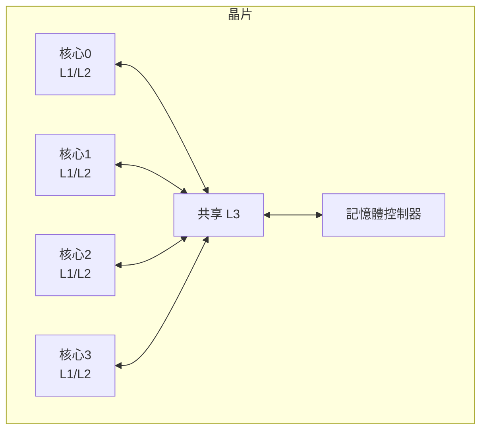
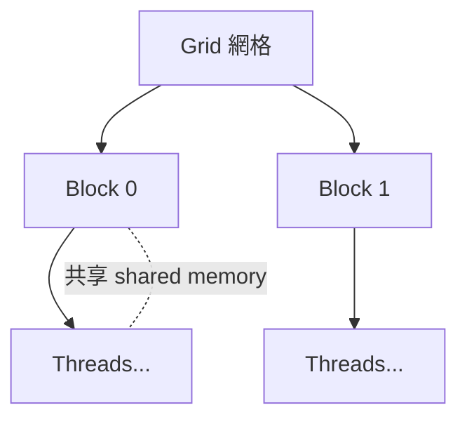

# 05.2 多核心與 GPU 平行架構

## 學習目標

讀完本節後，你應該能夠：

1. 說明多核心（multicore）崛起的原因，特別是 Dennard 縮放終結與功耗牆的角色。
2. 用 Amdahl 定律計算平行加速比，並理解強縮放與弱縮放的差別。
3. 描述快取一致性（cache coherence）與 MESI 協定的基本原理。
4. 解釋 GPU 的 SIMT 執行模型、執行緒層級，以及為何 GPU 適合資料平行工作負載。
5. 比較 CPU 與 GPU 的設計哲學差異（延遲導向 vs. 吞吐量導向）。

---

## 5.2.1 為什麼轉向多核心？

5.1 節的結尾指出 ILP 有極限，但真正的臨界點發生在 2000 年代中期。此前的三十年，晶片設計者享受著兩條同時有效的縮放定律：

- **摩爾定律**：每 18～24 個月，單晶片電晶體數量約翻倍。
- **Dennard 縮放定律**（1974）：電晶體尺寸縮小時，電壓與電流也同步縮小，使**功率密度保持不變**——晶片做小做密，還可以同時做快（提時脈）而不過熱。

2005 年前後，Dennard 縮放**終結**：漏電流無法再隨尺寸等比下降，電壓下降趨緩（停在約 1V 附近），但電晶體密度仍依摩爾定律翻倍——結果是**功率密度急速上升**。奔騰 4 曾把時脈推向 3.8GHz，功耗逼近 130W，再往上就是熱當機。單核「垂直」成長（提時脈、加深流水線、加寬亂序視窗）的每一條路都撞上功耗牆。

業界的回應在 2005 年同步發生：Intel 宣布放棄單核時脈路線、轉向多核心；AMD、Sun、IBM 皆然。**把省下的電晶體預算從「把一個核心做快」改成「多放幾個簡單核心」**——這就是多核心時代，而其驅動力是功耗，不是創意的枯竭。

## 5.2.2 Amdahl 定律：平行化的數學天花板

把程式交給多個核心，能快多少？Gene Amdahl 在 1967 年給出了著名的悲觀答案。設程式中可平行化的比例為 $p$ ，使用 $n$ 個核心，則加速比為：

$$
S=\frac{1}{(1-p)+\frac{p}{n}}
$$

- 當 $n \to \infty$ ， $S \to \dfrac{1}{1-p}$ ：**加速比受序列部分的倒數封頂**。若 5% 的程式無法平行，無論用多少核心，加速比上限只有 20 倍。
- 這解釋了為什麼「核心數競賽」很快失去意義：128 核心對 95% 可平行的程式也只得到約 17 倍加速。

Gustafson 在 1988 年提出反駁：實務上資料量會隨核心數增加（**弱縮放**），序列部分占比隨問題規模縮小，因此有效加速可以線性成長。兩者並不矛盾：

- **強縮放（strong scaling）**：固定問題規模、增加核心 → 遵循 Amdahl。
- **弱縮放（weak scaling）**：問題規模隨核心數成長 → 更接近 Gustafson。

此外還有不可忽略的**通訊與同步開銷**：鎖（lock）、屏障（barrier）、快取一致性流量都會隨核心數增加，實務加速比往往低於理論值。

## 5.2.3 快取一致性：多核心的第一道難題

每個核心有自己的 L1/L2 快取，同一筆資料可能存在多份副本。若核心 A 改了它快取裡的 `x`，核心 B 讀到的卻是舊值，程式語意就崩壞。**快取一致性（cache coherence）**協定保證所有核心對記憶體有一致的視圖。

主流做法是**偵聽匯流排（snooping bus）**上的無效化協定，經典者為 **MESI**：

| 狀態 | 意義 |
|---|---|
| M (Modified) | 此快取有唯一有效副本，且已被修改（與記憶體不一致） |
| E (Exclusive) | 此快取有唯一有效副本，且與記憶體一致 |
| S (Shared) | 多個快取都有相同的有效副本 |
| I (Invalid) | 該行無效 |

寫入時必須先取得 M 態（將其他副本無效化），讀取時可共享 S 態。核心數一多，偵聽成本劇增，大型系統改用**目錄式（directory-based）**協定。一致性也解釋了並行程式的經典陷阱：**偽共享（false sharing）**——兩個執行緒寫不同變數，但變數位於同一快取行，導致快取行在核心間來回彈跳，效能雪崩。

## 5.2.4 GPU 的誕生：從圖形管線到通用運算

多核心解決的是「幾十個執行緒」的平行；但圖形運算需要的是**同一著色程式對數百萬個頂點與像素並行執行**。這種**資料平行（data parallelism）**——同一程式、不同資料——催生了完全不同的處理器形態。

GPU 的設計哲學與 CPU 相反：

| 面向 | CPU | GPU |
|---|---|---|
| 目標 | 最小化**單一執行緒延遲** | 最大化**整體吞吐量** |
| 控制電路 | 龐大（亂序、推測、大分支預測器） | 極簡（多用 in-order + SIMT） |
| 快取 | 大快取隱藏延遲 | 小快取 + 海量執行緒**切換**隱藏延遲 |
| ALU 比例 | 少 | 密度極高（晶片面積 80% 給運算單元） |

關鍵洞察：與其用快取「避免」等待，不如準備**幾萬個執行緒**——某個執行緒等記憶體時，硬體立刻切到別的執行緒算，延遲被吞吐量掩蓋（latency hiding by oversubscription）。

**SIMT（Single Instruction, Multiple Threads）**是 GPU 的執行模型：例如 NVIDIA 以 **warp**（32 執行緒）為單位，同一 warp 的所有執行緒共用一個程式計數器、執行同一指令，只是各自處理不同資料。這實為 SIMD 與多執行緒的混合體。若 warp 內執行緒在分支上意見分歧，就會**分支分歧（divergence）**——兩條路徑各執行一遍，非活躍執行緒空轉，這是 GPU 程式設計的首要效能殺手。

2007 年 NVIDIA 推出 **CUDA**，讓開發者以類 C 語言直接撰寫 GPU 程式，把 GPU 從圖形專用機轉為**通用平行運算平台**。執行緒組織成階層：執行緒（thread）→ 區塊（block，共享一塊低延遲的 shared memory）→ 網格（grid）。記憶體也有對應階層：暫存器 → shared memory → global memory（含 L2）。

## 5.2.5 異構運算：CPU + GPU 的分工

GPU 不是取代 CPU，而是與之互補。典型工作負載被切成兩半：

- **控制密集、分支多、序列性強**的部分 → CPU（亂序、大快取、低延遲）。
- **規則、大規模、資料平行**的部分 → GPU（SIMT、高吞吐）。

這種**異構運算（heterogeneous computing）**需要解決資料搬移的問題：CPU 與 GPU 各有記憶體空間，PCIe 的複製成本高昂。現代方案包括**統一記憶體（unified memory）**、**快取一致性互連**（NVIDIA NVLink、CXL、AMD Infinity Fabric），讓 CPU/GPU/加速器共享同一實體記憶體的視圖。程式語言層面則有 OpenCL、SYCL、oneAPI 等試圖寫一次、到處平行。

至此，第 5 章的技術主線成形：**Tomasulo→超純量→ILP 極限→Dennard 終結→多核心（執行緒級平行 TLP）→ SIMD/GPU（資料級平行 DLP）→異構運算**。但電晶體再怎麼平行分配，功耗牆仍在——晶片上愈來愈多電路因供電與散熱預算而必須長期關閉，這個「黑暗矽」問題，把架構師推向下一個戰場：領域特定架構。

## 本章小結

- 2005 年 Dennard 縮放終結造成功耗牆，單核垂直成長（時脈、ILP）觸頂，業界轉向多核心。
- Amdahl 定律 $S=\frac{1}{(1-p)+\frac{p}{n}}$ 說明序列部分封頂加速比；Gustafson 的弱縮放觀點補充了實務面向。
- 快取一致性（MESI）是多核心正確性的基礎；偽共享是常見效能陷阱。
- GPU 以 SIMT + 海量執行緒實現資料平行，用吞吐量掩蓋延遲，與 CPU 的延遲導向哲學相反；CUDA（2007）開啟 GPGPU 世代。
- 異構運算依工作負載特性在 CPU 與 GPU 間分工，互連與統一記憶體是系統整合關鍵。

## 習題

1. 某程式 70% 可完美平行。用 4、16、64 個核心時，依 Amdahl 定律各得到多少加速比？序列比例上限何在？
2. 兩個執行緒分別不斷更新 `struct { int a; int b; }` 中的 `a` 與 `b`（64 位元系統，快取行 64B）。解釋為何效能可能比單執行緒更差，以及兩種修正方法。
3. 核心以 MESI 協定運作。核心 1 欲寫入一個自己快取中為 S 態的資料行，而核心 2 也持有該行的 S 態副本。寫出後續的狀態轉移序列。
4. 解釋 GPU 為何「用執行緒切換而非大快取」來處理記憶體延遲，並說明這與工作負載的什麼特性配合。
5. 一段影像濾波程式（每像素計算彼此獨立）在 CPU 上 10 秒完成，在 GPU 上 0.5 秒，但資料來回複製耗時 0.8 秒。討論在什麼條件下改用 GPU 才划算，並提出一種減少複製成本的系統層做法。
