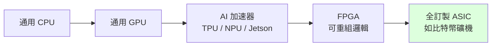
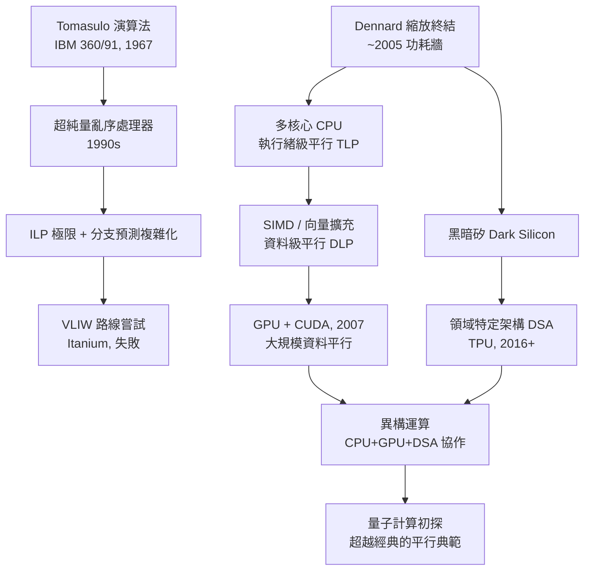

# 05.3 2005：功耗牆之後——領域特定架構與平行運算的未來

## 學習目標

讀完本節後，你應該能夠：

1. 解釋 2005 年前後 Dennard 縮放終結如何造成「功耗牆」與黑暗矽（dark silicon）問題。
2. 說明 Roofline 模型如何用運算強度判斷程式的效能上限。
3. 描述 TPU 等領域特定架構（DSA）的設計邏輯，以及它們為何在功耗效率上勝過通用處理器。
4. 整述第 5 章的技術演化主線：ILP → 多核心 → SIMD/GPU → DSA → 異構運算 → 量子計算初探。
5. 對「通用 vs. 專用」「開放 vs. 封閉」等架構爭論形成自己的判斷。

---

## 5.3.1 功耗牆：2005 年的轉捩點

回顧 5.2 節：1974 年的 Dennard 縮放定律保證「電晶體縮小時功率密度不變」，因此三十年間架構師可以放心地把每一代晶片做得更密、更快、更耗電總量卻差不多。**2005 年前後，這個保證失效了**：

1. **電壓下降停滯**：CMOS 動態功耗約為 $P = \alpha C V^2 f$，功耗與電壓平方成正比。過去每一代製程電壓從 5V、3.3V、1.8V 一路下降，是功率預算的主要救星；但電壓降到約 1V 附近，再降就會讓電晶體的**閾值電壓**過低、漏電流暴增——這是物理極限，不是工程問題。
2. **漏電流失控**：製程微縮使閘極氧化層薄到只有幾個原子層，電子穿隧而過。漏電功耗從可忽略變成總功耗的重要組成。
3. **密度照常成長**：摩爾定律繼續兌現，電晶體每代翻倍，但每顆電晶體的能耗**不再**等比下降。

三者相加：**功率密度指數上升**，而封裝散熱與供電（曾經的「可容忍 100W」）已到天花板。Intel 在 2004 年取消下一代 4GHz 奔騰計畫（Tejas）、2005 年正式轉向多核心路線，業界公認這就是「**功耗牆（power wall）**」降臨的時刻。

### 黑暗矽

功耗牆的直接後果是一個弔詭的現象：摩爾定律仍給我們越來越多的電晶體，但我們**供不起所有電晶體同時開機**。在固定的散熱預算下，晶片上大面積的電路必須處於斷電或降頻狀態——這些「有得用卻不能同時用」的區域被稱為**黑暗矽（dark silicon）**。2011 年的估計指出，22nm 世代晶片上可能有超過一半的電晶體在同一時刻是黑暗的。

架構師因此必須回答一個新問題：**既然電晶體便宜而「瓦特」昂貴，該把有限的功率預算投資在什麼電路上？** 答案有兩條主路：把電路設計得更**省電**（近閾值運算、DVFS、power gating），以及讓每一瓦特做更多**有用功**——後者引出了領域特定架構。

## 5.3.2 Roofline 模型：一瓦特的功要用在刀口上

要談「專用化何時值得」，先要有工具判斷一個程式的瓶頸。2009 年提出的 **Roofline 模型**把處理器的兩種極端能力畫在同一張圖上：峰值運算效能 $P_{peak}$（FLOP/s）與記憶體頻寬 $B$（Byte/s）。定義程式的**運算強度（arithmetic intensity）**：

$$
I = \frac{\text{浮點運算次數 (FLOP)}}{\text{記憶體存取位元組數 (Byte)}} \quad (\text{FLOP/Byte})
$$

則可達到的效能為：

$$
P = \min\left(P_{peak},\; I \times B\right)
$$

以 $I$ 為橫軸（對數）、$P$ 為縱軸（對數）作圖，效能曲線呈**屋頂形**：左段斜坡受記憶體頻寬限制（memory-bound），右段平頂受運算峰值限制（compute-bound），轉折點在 $I^* = P_{peak}/B$。

Roofline 的價值在於把「優化方向」變成可讀圖的決策：

- 程式落在斜坡 → 提昇運算強度（重構資料布局、提高重用、分塊 tiling）比換更快的核心有用。
- 程式已貼近平頂 → 只有提高 $P_{peak}$（更多/更專的運算單元）才有效。

矩陣乘法是典型的高強度工作（適當分塊後 $I$ 可達數百），而稀疏矩陣向量乘、排序、很多圖計算則是低強度的 memory-bound 工作。這個區分直接決定了後面 DSA 的設計取捨。

## 5.3.3 領域特定架構（DSA）：TPU 與其同道

### 為什麼 DSA 能贏？

通用處理器為了「什麼程式都能跑」，付出了三重代價：取指與譯碼電路、分支與投機機制、為最壞情況設計的快取層級。Hennessy 與 Patterson 在 2017 年的圖靈獎演講中直指：**摩爾定律減速之下，DSA 是「後摩爾時代」效能成長的主要來源**，並提出DSA 的三個利基——

1. 針對單一領域，可以用寬泛的平行形式（如矩陣運算）取代靈活但昂貴的指令流。
2. 可以貼近領域的記憶體存取模式，最大化重用、最小化資料搬移。
3. 可以用「精確度換效率」——例如降精準度、定點化。

### Google TPU：一個教科書級案例

2016 年公開的 **TPU v1**（2015 年部署）是為神經網路推論設計的 ASIC。其核心是一個 **256×256 的 MAC 陣列**（systolic array，脈動陣列）：資料像血液一樣在相鄰運算單元間脈動傳遞，一個權重載入後可與一整列/行的活化值相乘累加，**資料搬移量被壓到極低、運算強度極高**。設計取捨包括：

- **捨棄**：分支預測、亂序執行、多級快取（以大型暫存器/緩衝區取代）、甚至不做浮點（v1 用 8 位元整數）。
- **保留**：矩陣乘法單元、超大 on-chip 緩衝（24MB）、簡單的 CISC 式指令（僅十餘種）。

結果：對當時的神經網路推論，TPU v1 的每瓦效能比同期的 CPU/GPU 高出 30～80 倍。原因不是奇蹟，而是**把通用處理器為彈性付出的電路全部省下，換成運算密度**。這正是 Roofline 模型說的：神經網路推論是 compute-bound、運算強度可被設計拉高的工作負載，DSA 對症的藥。

### DSA 的光譜

DSA 不是一個點，而是一條光譜，按「專用化程度」排列：

越往右，每瓦效能越高、彈性越低、單位經濟越依賴「需求量夠大」。FPGA 佔據中間，因可重組而在原型與小量部署上有價值。智慧型手機的 NPU、汽車的視覺加速器、資料中心的 AI 晶片，都是同一邏輯的落地。

### 異構運算的成熟

DSA 崛起使 SoC 的主導權從「CPU 中心」轉為「**工作負載分工**」：手機晶片裡 CPU 管互動與控制、GPU 管圖形與平行運算、DSP 管音訊、NPU 管神經網路、ISP 管影像。系統架構的核心問題從「如何讓單核更快」變成：

- **排程與分配**：哪個加速器接哪個工作（runtime 與編譯器的重要性大增）。
- **記憶體共享**：CXL、NVLink、cache-coherent 互連消除搬移成本。
- **開放生態**：RISC-V 等開放 ISA 降低自訂加速器與控制核心的門檻；軟體棧（編譯器、圖執行環境）成為 DSA 能否被採用的真正戰場。

## 5.3.4 主線總整理：一條驅動關係鏈

本書第 4、5 章的技術演化，可以被讀成一連串「前因→後果」：

幾個關鍵的因果教訓值得記住：

1. **Tomasulo → 超純量**：單一演算法思想的工程化，撐起了二十年的單核成長。
2. **超純量 → VLIW**：同一問題（找 ILP）的兩條路線之爭，勝負由生態（相容性）而非純技術決定。
3. **Dennard 終結 → 多核心**：物理極限直接改寫了架構藍圖與程式設計師的責任（並行程式從選配變必備）。
4. **功耗牆 → SIMD/GPU**：既然「更多控制邏輯」燒不起，就讓每條指令驅動更多資料。
5. **黑暗矽 → DSA → 異構**：把有限的功率預算，交給「對特定工作每瓦產出最高」的電路。
6. **DSA → 量子初探**：當經典架構的每瓦改善趨緩，人們開始尋找計算模型的根本躍遷。

## 5.3.5 量子計算初探

平行處理故事的最遠端，是**改變計算本身**的典範。量子計算以**量子位元（qubit）**為基本單位，其核心資源是兩種經典位元沒有的性質：

- **疊加（superposition）**：$n$ 個量子位元可同時承載 $2^n$ 個基態的線性組合，這常被（略為誤導地）描述為「同時計算所有可能」。
- **糾纏（entanglement）**：量子位元間形成經典系統無法描述的關聯。

量子演算法利用這些性質，透過**干涉**讓錯誤答案的振幅相消、正確答案的振幅相長，最後測量得到解：

- **Shor 演算法**（1994）：多項式時間質因數分解，直接威脅 RSA——是量子計算被重視的起源。
- **Grover 演算法**（1996）：無序搜尋平方加速（$O(\sqrt{N})$），是「廣義平行加速」的例子。

但必須誠實地指出限制：量子電腦**不會**取代經典平行計算。退相干、雜訊與錯誤率使它只能跑特定結構的問題（量子優勢已在新穎的取樣與模擬任務上初步展示，容錯量子計算仍是長期工程）。更可能的未來是：**量子處理器成為異構系統中的另一種加速器**，與 CPU、GPU、TPU 一起，在經典控制與資料管線的包圍下解決它擅長的問題——這正是本節主題「異構」邏輯的極致延伸。

## 5.3.6 展望：給架構學習者的三個提醒

1. **物理永遠是最終的架構師**：Dennard 縮放終結、記憶體牆、散熱極限，每一個物理事實都重塑了整個產業的路線圖。學架構就是學「在約束下做取捨」。
2. **彈性與效率是一場永恆的拉鋸**：通用（CPU）→ 半通用（GPU）→ 專用（TPU/ASIC）→ 可重組（FPGA），沒有終極勝者，只有場景匹配。
3. **軟硬協同設計成為顯學**：DSA 的成敗往往不在晶片本身，而在編譯器、runtime 與生態。未來的架構師必須同時懂硬體的約束與軟體的需求。

## 本章小結

- 2005 年前後 Dennard 縮放終結：電壓停滯 + 漏電流 + 密度照常成長 ⇒ 功率密度暴增，形成功耗牆，單核成長路線終結。
- 功耗牆的產物是黑暗矽：電晶體便宜、瓦特昂貴，架構問題變成「功率預算該投資給誰」。
- Roofline 模型以運算強度 $I = \text{FLOP}/\text{Byte}$ 與 $P = \min(P_{peak}, I \times B)$ 判斷程式是 memory-bound 或 compute-bound，指引優化與專用化的方向。
- TPU 等 DSA 以「捨彈性、換每瓦效能」的邏輯，在特定工作負載上達成 30～80 倍的效率優勢，並推動異構運算成熟。
- 全章主線：Tomasulo → 超純量 → VLIW 之爭 →（Dennard 終結）→ 多核心 → SIMD/GPU → 黑暗矽 → DSA → 異構運算 → 量子初探；驅動力從「ILP 榨取」轉為「每瓦有用功」。

## 習題

1. 以 $P=\alpha CV^2f$ 解釋為什麼「電壓停止下降」比「頻率停止上升」對功耗更致命，並由此說明 2005 年後時脈成長停滯的原因。
2. 某程式在峰值 8 TFLOP/s、記憶體頻寬 400 GB/s 的系統上執行，其運算強度為 2 FLOP/Byte。用 Roofline 模型求可達效能上限，並判斷該程式是 memory-bound 還是 compute-bound。若想把效能提升 50%，提出一個程式層面的改法。
3. TPU v1 為何可以省去多層快取與分支預測電路？請從工作負載特性（控制流、記憶體存取模式）出發論證，並指出哪一類程式因此**不適合**在 TPU 上執行。
4. 比較 FPGA 與 ASIC 在開發成本、單位能耗、量產經濟上的取捨，並各給一個合理的應用場景。
5. 有說法稱「量子電腦因為疊加可以同時計算 $2^n$ 個狀態，所以能平行解決所有問題」。請指出這個說法的錯誤，並說明量子演算法真正的加速來源。
