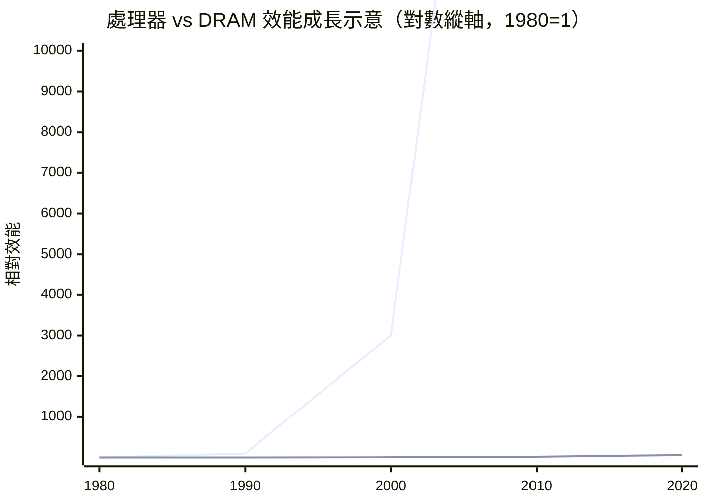
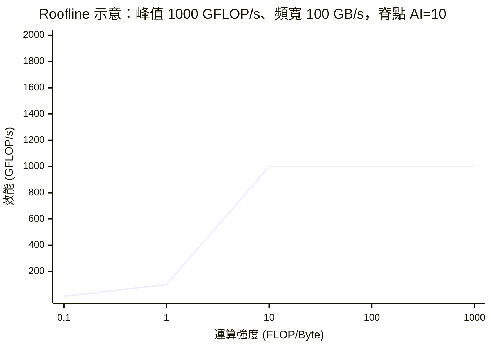

# 1.2 Roofline 模型與記憶體牆

## 學習目標

讀完本節後，你應當能夠：

1. 定義運算強度（arithmetic intensity），並為任一核心程式估算其數值。
2. 繪製並解讀 Roofline 模型圖，判斷核心程式是 compute-bound 還是 memory-bound。
3. 說明記憶體牆的歷史成因（處理器與 DRAM 效能成長曲線的分歧）與其現代形貌。
4. 依 Roofline 分析結果選擇正確的調校策略，並以實務案例驗證。

## 1.2.1 記憶體牆：一段分歧的歷史

「記憶體牆」（memory wall）不是一個突發事件，而是兩條成長曲線長期分岔的必然結果。1980 年代以前，處理器與主記憶體的速度大致同步。此後處理器效能沿著三條軸線爆炸性成長：頻率（從 MHz 到數 GHz）、指令級平行（超純量、亂序執行、SMT）、以及 2000 年代之後的核心數。而 DRAM 的延遲改善極為緩慢——DRAM 的存取延遲主要受電容充放電與行位址定址物理限制，每年僅改善約 7–10%，遠低於處理器每年 50% 以上的成長率。

用數字說話：1980 年 8 MHz 的 Intel 8088 每 4 個週期取一條指令，主記憶體延遲約 4 個週期；2010 年代的 3 GHz 亂序處理器，主記憶體延遲卻高達 200–400 個週期。處理器「等待記憶體」的成本膨脹了兩個數量級。工程界以層層快取（L1/L2/L3、多層 cache、prefetcher、非一致快取互連）回應，但快取只能消除具 locality 的存取；對串流式、大矩陣、圖結構等 locality 差的負載，記憶體延遲與頻寬就成為硬上限。

> 圖示：處理器效能（上方曲線）與 DRAM 效能（下方曲線）的指數級分岔，即「記憶體牆」的量化形貌。數值為示意量級。

理解這段歷史是必要的，因為它解釋了現代結構設計的核心矛盾：**電晶體越來越多，但單位電晶體能餵到的資料越來越稀缺**。AI 加速器（如 TPU 採用脈動陣列）、晶上網路（NoC）、高頻寬記憶體（HBM）、3D 堆疊（3D V-Cache）等，全都是對記憶體牆的不同回應。

## 1.2.2 運算強度

要定量描述「一個核心程式離記憶體牆有多近」，關鍵指標是**運算強度**（arithmetic intensity，AI）：

$$AI = \frac{FLOPs\ executed}{Bytes\ moved\ to/from\ memory} \quad [\text{FLOP/Byte}]$$

注意兩個要點：

1. **分母是「實際搬移的位元組」**，不是「演算法理論上的資料量」。若矩陣適合放進快取並被重複使用，分母應計 DRAM 層級的流量；若每個元素只碰一次，分母才等於理論資料量。因此 AI 是**快取行為的函數**，可用硬體計數器（如 `perf stat -e fp_arith_inst_retired,LLC-load-misses` 搭配 DRAM 帶寬計數）實測。
2. **典型核心的 AI 量級**：SpMV（稀疏矩陣-向量乘）每個非零元素需 8 bytes 值 + 4 bytes 行索引 + 4 bytes 欄指標，約 2 FLOP，AI ≈ 0.125–0.25 FLOP/Byte；矩陣-矩陣乘 GEMM 有 $O(n^3)$ 運算對 $O(n^2)$ 資料，AI = $O(n)$ ，快取分塊後輕鬆超過 100 FLOP/Byte。這 2–3 個數量級的差距，正是「GEMM 是 AI 加速器甜點、SpMV 是硬骨頭」的根本原因。

## 1.2.3 Roofline 模型

Williams 等人（2009）提出的 **Roofline 模型**把運算強度與硬體兩個上限放在同一張圖上。系統可達效能為：

$$P = \min\left(P_{peak},\ AI \times BW_{peak}\right)$$

其中 $P_{peak}$ 是處理器尖峰算力（FLOP/s）， $BW_{peak}$ 是記憶體尖峰頻寬（Byte/s）。在以 AI 為橫軸（對數）、效能為縱軸（對數）的圖上，可達效能形成一條「屋頂線」：

- 左側斜線段： $P = AI \times BW$ ，效能隨 AI 線性（對數圖上斜率 1）上升，**memory-bound 區**。
- 右側水平段： $P = P_{peak}$ ，**compute-bound 區**。
- 兩段交點的 AI 值稱為**脊點**（ridge point） $= P_{peak}/BW_{peak}$ 。上例為 $1000/100 = 10$ FLOP/Byte。

Roofline 的價值在於**把調校問題變成讀圖問題**：量測一個核心的實際 AI 與實際效能，把點畫在圖上，立即知道離屋頂多遠、該往哪個方向調。它也能比較不同硬體：脊點低的機器（算力弱、頻寬高）對 memory-bound 程式友善；脊點高的機器對 compute-bound 程式友善。選機器時應把目標負載的 AI 分布畫在候選機器的 roofline 上，而不是只看規格表的峰值。

延伸變體包括加入各層快取頻寬的多層 roofline、考慮整數/SIMD 混合的廣義 roofline，以及加入延遲上限、波形因子的 more-realistic roofline。研究生應理解：**roofline 是上界模型，不是預測模型**——點落在屋頂下還可能是因為依賴鏈、bank conflict、同步開銷等未建模因素。

## 1.2.4 實務調校例

**案例一：SpMV 調校（memory-bound）**。某稀疏線性代數求解器中 SpMV 實測效能僅為 DRAM 頻寬理論值的 45%。Roofline 分析顯示其 AI ≈ 0.14 FLOP/Byte，遠在脊點左方——提升計算核心毫無意義，正確方向是**減少位元組**：

1. 格式最佳化：從 CSR 換成對 SIMD 更友善的格線格式，減少索引開銷。
2. 重排矩陣以提升 locality，增加 L2 命中率，降低 DRAM 流量（分母變小、AI 變大）。
3. 雙精度轉單精度（視收斂容許度），位元組直接減半。

結果 DRAM 流量下降 38%，效能提升約 1.6 倍，並逼近新 AI 對應的 roofline 上界。**關鍵教訓：memory-bound 程式的最佳化是「省位元組」，不是「省浮點」**。

**案例二：矩陣乘調校（compute-bound 邊緣）**。手寫三層迴圈 GEMM 實測 4% 的峰值算力。其理論 AI 很高，但 naive 實作每個元素反覆從主記憶體載入，實測 AI 極低。調校依序為：迴圈重排改善空間 locality → 記憶體對齊與 SIMD 向量化 → 快取分塊（blocking/tiling）使 $C$ 與 $A$ 的子塊留在 L1/L2 → 對齊供應商微調核心（如 BLAS 中的 micro-kernel）。最終達峰值的 85% 以上。此例說明：**理論 AI 與實測 AI 的差距，本身就是最佳化空間的度量**。

**案例三：AI 訓練中的 roofline**。Transformer 訓練的 GEMM 部分接近 compute-bound，但 embedding lookup、softmax 與 optimizer step 偏 memory-bound。因此批大小（batch size）的選擇本質上是在提高 AI：batch 越大，權重載入被越多樣本攤提，AI 越接近脊點。當你觀察到 GPU 利用率低，第一件事應該是畫 roofline、量 AI，而不是盲目疊更多硬體。

## 1.2.5 記憶體牆的現代形貌與對策

記憶體牆今天並未消失，只是換了戰場：

- **頻寬牆 vs. 延遲牆**：多核心時代的核心矛盾從「單執行緒等延遲」轉為「多核心搶頻寬」。HBM、GDDR6X、DDR5、CXL memory pooling 都是頻寬供給側的對策。
- **算力增長快於頻寬**：GPU 每代峰值算力成長約 2–3 倍，頻寬僅 1.5 倍左右，脊點逐年上升，意味著越來越多負載被推向 memory-bound——這是量化分析必須每代重做的原因。
- **結構對策光譜**：軟體層（tiling、fusion、量化、稀疏化）、微結構（prefetcher、壓縮、非一致快取）、架構（脈動陣列以重用代替搬移、近記憶體運算 processing-in-memory）。每一層對策本質上都在做同一件事：**提高 AI 或提高供給側的 $BW$ **。

## 本章小結

- 記憶體牆源於處理器與 DRAM 效能成長曲線近四十年的指數級分岔，快取層次是主要防線，但對低 locality 負載效力有限。
- 運算強度 $AI = \text{FLOPs}/\text{Bytes}$ 把軟體的資料重用行為與硬體的算力/頻寬比連接成一個可比較的純量。
- Roofline 模型 $P = \min(P_{peak}, AI \times BW_{peak})$ 將調校轉為讀圖：脊點 $P_{peak}/BW_{peak}$ 左側省位元組、右側省運算；它是上界模型，點未達屋頂時需進一步找非建模因素。
- 三個案例的共同方法論：先量測（AI、實際頻寬、實際算力）→ 定位（memory- or compute-bound）→ 選對方向的調校 → 回到 roofline 驗證。

## 習題

1. **（計算）** 某機器峰值算力 60 TFLOP/s（FP32）、記憶體頻寬 1.5 TB/s。求脊點運算強度。一個核心程式實測 AI 為 2 FLOP/Byte，求其 roofline 上限，並判斷其位於哪一區。
2. **（計算）** 對 $n=4096$ 的稠密矩陣乘，計算其理論運算強度（FLOPs = $2n^3$ ，若完全無重用則需讀寫 $3n^2$ 個 8-byte 元素）；再說明為何實務上能達到遠高於此的 AI。
3. **（計算，Little's Law 結合）** 某核心的 AI 為 0.5 FLOP/Byte、延遲受限下每條 in-flight 存取平均 300 cycles、時脈 2.5 GHz、記憶體頻寬 100 GB/s。欲餵滿頻寬，至少需要多少 bytes 的 in-flight 資料（MLP）？由此推論：為什麼軟體預取或更多暫存器對低 AI 核心重要？
4. **（分析）** 某實驗者把 SpMV 從雙精度改單精度後效能只提升 5%，遠低於預期的 2 倍。請提出至少兩個可能原因，並設計量測實驗（使用哪些硬體計數器）逐一檢驗。
5. **（設計）** 你要為「AI ≈ 1 FLOP/Byte 的圖神經網路訓練」選購加速器。候選 A：峰值 100 TFLOP/s、頻寬 900 GB/s；候選 B：峰值 40 TFLOP/s、頻寬 1.6 TB/s。分別計算兩者的 roofline 上限與脊點，並以定量理由推薦其一。
