# 02.1 1967 — Tomasulo 演算法與動態排程

## 學習目標

1. 說明 IBM System/360 Model 91 浮點單元所面對的設計難題，以及 Tomasulo 演算法如何在硬體成本受限的 1960 年代解決這些難題。
2. 描述 Reservation Station（保留站）、Common Data Bus（CDB）與暫存器更名（register renaming）三者的協作機制。
3. 解釋 Reorder Buffer（ROB）如何將「亂序執行」轉換為「依序交付（in-order commit）」，並引入虛擬暫存器的概念。
4. 能夠對一組指令序列手動追蹤 Tomasulo + ROB 的執行時程，標出 ISSUE、EXECUTE、WRITE RESULT、COMMIT 四個階段。

## 2.1.1 歷史前因：為什麼 360/91 需要動態排程

CDC 6600 在 1964 年以 scoreboard 證明亂序完成（out-of-order completion）可行，但它有兩個先天限制：其一， scoreboard 只在「讀取運算元」時檢查 RAW 與結構冒險，遇 WAR/WAW 冒險仍必須停住發行（issue stall）；其二，CDC 6600 的結果直接寫回架構暫存器檔，導致相鄰指令搶同一個暫存器埠時互堵。

IBM 在 1961 年啟動 Project X（後成為 System/360 Model 91）的目標是打造當時最快的科學計算機，浮點效能必須高出 IBM 7030 (Stretch) 一個數量級。Model 91 的浮點單元採用六段流水線，加法器延遲 2 拍、乘法器延遲 6 拍。在這種「運算單元延遲不均勻」的機器上，若不動態排程，編譯器產生的簡單迴圈會被假相依（anti-dependency 與 output dependency）卡死。Robert Tomasulo 在 1967 年發表的演算法，核心突破是：**把運算元等在「來源」而非「目的地」**——指令在保留站等待它的運算元變為可用，而不是等待某個暫存器被寫入。這一步使硬體能自然消除 WAR/WAW 冒險。

值得注意的是，Tomasulo 演算法在 1967 年問世後沉寂了近二十年，直到 1990 年代的亂序處理器（PowerPC 604、Intel Pentium Pro）才真正普及。原因是：VLSI 讓大量比對器（comparator）與 CAM 結構變得便宜，而深流水線使記憶體延遲與分支冒險的代價暴增，動態排程從「奢侈品」變成「必需品」。這是理論先行、工藝驅動落實的典型例子。

## 2.1.2 三個關鍵機制

### 保留站（Reservation Station, RS）

每個功能單元（加法器、乘除法器）前掛數個保留站項目。一條指令在 ISSUE 階段被解碼、配置一個 RS 項，並做兩件事：

- 若來源暫存器已就緒，直接把**值**複製進 RS（稱為 operation buffering）；
- 若尚未就緒，記下「哪一個 RS 最後會產生這個值」的 tag（S1/S2 欄位），此後該指令盯著 CDB 等值送到，而不再回頭看暫存器檔。

這個以 tag 傳值（value forwarding by tag matching）的設計，等於讓每個 RS 項內建兩組比對器。當 CDB 上廣播的 tag 與 S1 或 S2 相符，就將該值鎖入 RS 並清除 tag；兩個 tag 都清空後指令即可執行。

### 暫存器更名：虛擬暫存器

Tomasulo 用「保留站編號 + 載入緩衝編號」充當**虛擬暫存器（virtual/renamed registers）**。暫存器狀態表（register result status）記錄每個架構暫存器目前由哪個虛擬單元負責產生。WAW 與 WAR 冒險因此消失：

- 兩條指令都寫 F6（WAW）：後發行者覆蓋狀態表中的 tag，前者照樣把結果透過 CDB 廣播給所有等它的人，架構狀態由「最後提交者」決定（在有 ROB 的版本中）。
- 指令 B 讀 F6 而更早的指令 A 寫 F6（WAR）：B 在 ISSUE 時已把 F6 的**舊值**複製進 RS，之後 A 寫 F6 與 B 無關。

現代處理器以實體暫存器檔（PRF）實作同樣概念：架構暫存器只是「映射表上的名字」，每次寫入都分配新的實體暫存器，映射表在 commit 時更新。這是從 Tomasulo「RS 即虛擬暫存器」演化而來的等價形式，差別在於值存放的位置（RS 持值 vs. PRF 持值）。

### Reorder Buffer 與依序交付

原始 Tomasulo 在例外處理上有缺陷：指令一完成就寫架構狀態，一旦某條稍早的指令觸發例外，已寫入的結果無法回復，精確例外（precise exception）不復存在。Smith、Pleszkun 於 1985 年提出 Reorder Buffer：指令依序進入 ROB 佇列，執行可以亂序完成，但結果先寫入 ROB 項（或以更名指標指向它），只有當它到達佇列頭且無例外時才 COMMIT——正式更新架構暫存器或映射表。如此：

- 亂序執行的效能與依序交付的正確性同時成立；
- 分支誤預測時，只需把 ROB 中該分支之後的項目全部 flush，架構狀態不會被污染——這是第 02.2 節推測執行的必要前提；
- 記憶體寫入延到 COMMIT 階段，使 store 成為唯一「不可逆」的動作。

## 2.1.3 範例追蹤

考慮以下序列（乘法器 2 拍起算、加法器 1 拍，CDB 廣播各需 1 拍，單一 CDB；`MUL.D` 與 `DIV.D` 共用同一保留站群，各站充足）：

```text
I1: L.D    F6, 34(R2)      ; 載入延遲 3 拍
I2: L.D    F2, 45(R3)
I3: MUL.D  F0, F2, F4      ; 延遲 4 拍
I4: SUB.D  F8, F6, F2
I5: DIV.D  F10, F0, F6
I6: ADD.D  F6, F8, F2      ; 對 I4/F6 的假相依：被更名化解
```

用 mermaid gantt 呈現時程（INT = issue，EX = 執行，WB = 廣播，CM = 提交）：

```mermaid
gantt
    title Tomasulo + ROB 執行時程（每拍一格）
    dateFormat X
    axisFormat %s
    section I1 L.D F6
    ISSUE                :0, 1
    EX (mem 3 cycles)    :1, 4
    WB/CDB               :4, 5
    COMMIT               :5, 6
    section I2 L.D F2
    ISSUE                :1, 2
    EX (mem 3 cycles)    :2, 5
    WB/CDB               :5, 6
    COMMIT               :6, 7
    section I3 MUL.D
    ISSUE (等F2 tag)     :2, 3
    EX (4 cycles)        :6, 10
    WB/CDB               :10, 11
    COMMIT               :11, 12
    section I4 SUB.D
    ISSUE (等F6)         :3, 4
    EX (1 cycle)         :6, 7
    WB/CDB               :7, 8
    COMMIT               :8, 9
    section I5 DIV.D
    ISSUE (等F0, F6舊值) :4, 5
    EX (等F0; F6已舊值)  :11, 15
    WB/CDB               :15, 16
    COMMIT               :16, 17
    section I6 ADD.D
    ISSUE (F6舊值入RS)   :5, 6
    EX (等F8)            :8, 9
    WB/CDB               :9, 10
    COMMIT               :12, 13
```



幾個關鍵觀察：

1. **I6 不被 I5 擋住**：I5 讀的 F6 是「舊值」（由 I1 產生、已在 I6 ISSUE 前寫入 RS），I6 改寫 F6 不影響 I5——WAR 冒險被更名消除。
2. **I5 的真正資料相依是 I3**：它等的是 MUL 的 tag，而非暫存器 F0 本身。
3. **ROB 使 COMMIT 依序**：I6 雖在第 10 拍就廣播完，但必須等 I3（第 11 拍提交）之後才能提交；這保證了精確例外。
4. **單一 CDB 是瓶頸**：若 I3 與 I4 同拍想廣播，需仲裁或增設第二條 CDB——這正是後世「多埠 CDB／多組 writeback bus」設計的動機。

## 2.1.4 理論與實務的互相驅動

Tomasulo 演算法確立了「硬體視窗（hardware window）」的概念：視窗越大（RS + ROB 項數越多），越能容忍延遲不確定性、越多指令可同時更名。但視窗尺寸的每一分擴大都伴隨 CAM 比對器功耗的平方級成長，這個張力直接催生了 1990 年代的 P6 微架構（集中式 ROB）、Alpha 21264（分散式整數叢集）、乃至現代的 grouped dispatch 設計。換言之，1967 年的演算法框架至今未變，變的是「視窗怎麼切、tag 怎麼廣播、值存在哪」——本書 02.3 節將看到這些取捨在 M1 與 Zen 4 上的具體樣貌。

## 本章小結

- Tomasulo 演算法源自 IBM 360/91，以保留站 + tag 廣播（CDB）實現動態排程，把運算元等待從「等暫存器」改為「等值」，天然消除 WAR/WAW 冒險。
- 虛擬暫存器（RS 編號／現代 PRF）是硬體更名的載體；暫存器狀態表（或映射表）只記「誰將產生此架構暫存器的下一個值」。
- ROB 提供依序交付，補足了原始 Tomasulo 缺乏的精確例外與分支回復能力，是推測執行的基石。
- 執行時程顯示：效能瓶頸往往不在功能單元，而在 CDB 頻寬與視窗深度。

## 習題

1. 對 2.1.3 節的指令序列，若乘法延遲改為 8 拍，請重畫 gantt 時程，並指出哪一條指令成為關鍵路徑。
2. 說明為何「RS 持值」設計在 ROB 項數超過 200 時功耗不划算，而 PRF 設計相對較優。提示：比較兩種設計中 tag 廣播時需要驅動的儲存位元數。
3. 原始 Tomasulo 沒有 ROB。請舉一個指令序列，證明它在何種例外情境下會破壞精確例外。
4. 若機器有兩條 CDB，重算 2.1.3 節時程中 WB 階段可提前幾拍？亂序效能的增益來自何處？
5. 解釋為什麼 store 指令必須延後到 COMMIT 階段才真正寫入資料快取，而 load 可以在推測狀態下提早執行。
