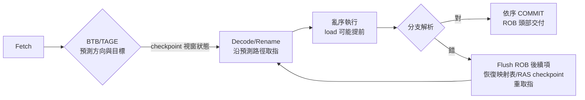

# 02.2 分支預測與推測執行

## 學習目標

1. 掌握靜態預測到兩層式自適應預測器的演化邏輯，理解「歷史相關性」為何需要 pattern history table。
2. 說明 TAGE 與 Perceptron 預測器的原理、各自適用的分支型態，以及現代處理器為何逐漸採用混合或 TAGE 系。
3. 描述 Return Address Stack（RAS）對函式呼叫密集程式的關鍵作用。
4. 解釋推測執行的完整流程：預測 → 亂序執行 → 驗證 → 恢復，及其微架構狀態殘留。
5. 分析 2018 年 Spectre／Meltdown 如何把推測執行變成側通道，並歸納各層級緩解手段與其效能代價。

## 2.2.1 前因：控制冒險是流水線最深的坑

資料冒險可以用更名與前遞解決，但**分支**在取指那一刻就要求你「預知未來」。假設分支解析需要 15 拍（現代深流水線的典型值），而平均每 5 拍就有一條分支，那麼即使 100% 資料並行可用，不預測分支的機器也有一半以上時間在等分支解析。這組數字解釋了為什麼分支預測器的準確率每提升 0.5%，IPC 都會有可觀的回報——預測器直接決定了硬體視窗能否被填滿。

## 2.2.2 兩層式預測器：從 1-bit 到相關預測

靜態預測（永遠不跳、BTFN、編譯器提示）準確率約 80–90%；1-bit BHT 對迴圈分支有兩次連續誤判的固有缺陷（進入與最後一次離開），故改用 2-bit 飽和計數器。但真正質變是 1991 年 Yeh 與 Patt 提出的 **two-level adaptive predictor**：

- **第一層**：分支歷史暫存器（BHR）記錄最近 N 次該分支（或全域）的 taken/not-taken 位元串。
- **第二層**：Pattern History Table（PHT）以歷史串為索引，每項為一組 2-bit 計數器。

其洞見是：**許多分支的行為不是獨立的馬可夫過程，而是「歷史模式 → 結果」的函數**。經典例子：

```c
if (x % 2 == 0) a++;        // A
if (x % 2 == 1) b++;        // B
// 交替輸入下，A、B 互為對方的預測線索
```

- **GAg**（global history index PHT）：捕捉上述跨分支相關性；
- **PAg**（local history index local PHT）：捕捉單分支內的長週期模式；
- **gshare**（global history XOR PC）：在硬體成本固定的前提下提升 PHT 利用率，1990 年代中期的主流。

兩層式預測器把 SPECint 基準的誤判率壓到每千條指令數次以下，這使「推測執行」從理論變成划算的工程決定——預測錯的代價（flush 視窗、重取指）遠小於預測對的收益。

## 2.2.3 TAGE 與 Perceptron

### TAGE（Tagged Geometric History Length, Seznec 2006）

單一歷史長度終有極限：有些分支需要 5 拍的歷史，有些需要 300 拍（例如壓縮器、XML 解析中的長週期）。TAGE 以**幾何級數遞增的多組歷史長度**維護一疊帶 tag 的表（T0 為不帶歷史的基準表，T1…Tk 使用 8, 16, 32… 拍歷史）：

- 預測時由「tag 命中且歷史最長」的表提供預測與置信度；
- 更新時，若長歷史表能更正錯誤而未命中，則以機率方式配置新項（u-bit aging），避免污染。

TAGE 幾乎壟斷了 CBP（Championship Branch Prediction）歷屆冠軍，並已進入商用處理器：AMD Zen 系列的感知預測器融合了 TAGE 風格的多歷史表，Apple 的 Firestorm/M2 亦被逆向工程證實使用 TAGE 疊層（歷史長度甚至超過 700 拍）。TAGE 的本質是「**用容量換歷史長度的自由度**」，在 SRAM 預算固定下提供近理論上限的覆蓋。

### Perceptron（Jiménez 與 Lin, 2001）

把每個分支視為線性分類問題：以 W·h 的符號作為預測（W 為權重向量，h 為 ±1 歷史位元）。優點是歷史可以極長（數百位元）而硬體為加法器樹而非巨型表，擅長**高維相關性**的分支；缺點是訓練時間較長、且無法像 TAGE 那樣按分支「選擇歷史長度」。Zen 1/Zen 2 採用感知器預測器即是此路線的商用實例；後續世代的趨勢是 **TAGE 為主、感知器為輔**的混合架構。

### 間接分支與 Return Address Stack

函式返回是間接分支中最規律的一種：`ret` 的目標在呼叫當下已知。Branch Target Buffer 只能記「PC → 目標」，無法區分同一 `ret` 位址的不同呼叫者，因此處理器維護 **Return Address Stack**：`call` 壓入返回位址、`ret` 彈出。RAS 規模極小（8–32 項），但對 C++／Java 這類深呼叫層級程式的預測準確率影響巨大；推測執行會加深 RAS 狀態恢復的複雜度（需 checkpoint 或 shadow stack），這是設計上的隱性成本。

## 2.2.4 推測執行：流程與恢復



關鍵不變量：**推測執行只能接觸架構狀態的影子（ROB、store buffer），任何不可逆動作（寫快取、寫暫存器檔、觸發例外）都推遲到 COMMIT**。這個紀律是正確性的保證，但——下一節將看到——「接觸了但不留下架構痕跡」不等於「不留任何痕跡」。

## 2.2.5 2018 年 Spectre 與 Meltdown

### 攻擊原理：用快取當錄音機

M slump 的核心觀察（Kocher et al.、Lipp et al., 2018）：推測執行期間的**微架構副作用**不會被 commit 紀律清除——最顯著的是資料快取。攻擊者先「訓練」分支預測器使其誤判，令受害者核心在推測下執行本不該執行的載入：

```c
// 受害者核心內的推測執行（attack 為越界索引）
if (attack < array1_size)          // 預測器被訓練成預測「會通過」
    y = array2[array1[attack] * 4096];
```

越界讀出的機密位元組 `array1[attack]` 決定了 `array2` 中哪一頁被帶入快取。事後用 Flush+Reload 量測 256 個候選頁的存取時間，即可逐位元組還原機密——**推測的錯誤結果被丟棄，但快取殘留成了側通道**。

- **Spectre-V1（bounds check bypass）**：利用上述條件分支誤訓練，需受害程式含有可被操縱的陣列存取。
- **Spectre-V2（branch target injection）**：污染 BTB／間接分支預測器，使受害者的間接分支在推測下跳到攻擊者選定的 gadget。
- **Meltdown（rogue data cache load）**：更根本——在權限檢查完成前，x86 允許推測地使用越權載入的資料，核心記憶體直接可被讀出。這是硬體投機「先取值後驗權」的設計直接被反用。

### 緩解與代價

| 層級 | 手段 | 代價 |
|------|------|------|
| 硬體 | 序列化敏感性載入（LFENCE）、更名快取分割（partitioned L1D）、沿新取指路徑驗權（Zen 之後／M 系列） | L1 延遲與面積增加 |
| 微碼/OS | KPTI（核心頁表隔離）對抗 Meltdown | 系統呼叫路徑多一次頁表切換，早期量測損失 5–30% |
| 編譯器 | 分支後插 barrier、retpoline 對抗 Spectre-V2 | 間接呼叫成本上升，核心效能個位數損失 |
| 架構 | Speculative Store Bypass Disable（SSBD）、未來 ISA 層面的 spec-barrier 指令 | 需 OS/虛擬機器調度配合 |

Spectre 的深遠影響在於：它證明**微架構本身是一個必須納入安全模型（threat model）的抽象層**。此後的設計（Apple M 系列、Zen 3+、Intel 的 下-代核）都把「推測載入的權限與邊界檢查提前」與「跨執行緒快取隔離」列為第一級設計需求——安全從此成為微架構取捨的常駐變數，而非事後補丁。

## 本章小結

- 分支預測準確率直接決定深流水線與寬視窗的可用性；兩層式預測器以「歷史模式索引 PHT」捕捉分支間與分支內相關性。
- TAGE 以幾何級數的多組歷史長度覆蓋長短不一的分支模式，Perceptron 以線性分類支援超長歷史；商用處理器趨向 TAGE 為主、感知器為輔。
- RAS 以極小硬體成本解決函式返回的間接分支預測，但推測執行要求其具備 checkpoint 恢復能力。
- 推測執行的正確性靠「commit 前不接觸架構狀態」保證，但快取等微架構殘留使 Spectre/Meltdown 得以把效能機制轉化為側通道；緩解手段橫跨硬體、微碼、OS、編譯器四層，且皆有效能代價。

## 習題

1. 構造一個 1-bit 預測器連續誤判兩次、而 2-bit 計數器只誤判一次的分支序列，並說明 gshare 如何進一步改善跨分支相關的例子。
2. 比較 TAGE 與 Perceptron 在「長週期分支」與「高維多分支互擾」兩種場景下的優劣，說明混合式設計的理由。
3. 遞迴深度超過 RAS 深度時會發生什麼？提出一種 RAS 溢位恢復策略並分析其對預測準確率的影響。
4. 寫出 Flush+Reload 在 Spectre-V1 攻擊中的量測偽碼，並解釋為何 `clflush` 與時間戳的精度決定了攻擊可行性。
5. 某處理器緩解 Spectre-V1 的方式是在推測載入前重放邊界檢查。分析此設計對「以記憶體為瓶頸」的工作負載影響最大還是「以分支為瓶頸」者最大，並說明理由。
