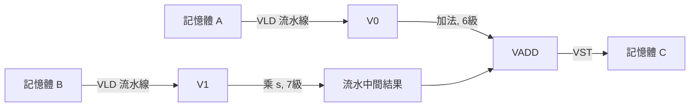

# 03.1 1976 年 Cray-1 與向量處理器

## 學習目標

1. 理解 1976 年 Cray-1 誕生的技術與市場背景，以及它為何選擇向量處理作為超越超純量的路徑。
2. 掌握向量暫存器、向量長度暫存器（VL）、向量遮罩暫存器的基本語義與硬體代價。
3. 分析 chaining（向量鏈結）如何將「記憶體—運算—寫回」的資料流重疊起來，達成接近流水線理論極限的吞吐量。
4. 理解 memory bank conflict（記憶體體衝突）的成因、對向量載入吞吐量的影響，以及 stride 與 bank 數選擇之間的數學關係。
5. 能夠將 Cray-1 的設計取捨對應到現代 SIMD/GPU 架構，理解「前因」如何驅動「後果」。

---

## 一、前因：為什麼 1976 年需要向量處理器

1970 年代中期，電晶體密度雖然快速成長，但單一純量流水線的效益已經逼近極限：控制邏輯複雜度（記分板、互鎖、分支預測的前身技術）呈超線性膨脹，而浮點運算的延遲（加法 4～6 級、乘法更多級）使純量機器在科學計算的核心迴圈上平均 CPI 難以低於 1。Seymour Cray 的洞察是：**與其讓硬體費力地從順序程式中「發掘」指令級平行（ILP），不如讓程式設計師與編譯器直接把平行性「声明」出來**——將整個陣列當成一條指令的操作對象。

這就是向量架構的核心主張：

$$\text{向量指令 } V_1 \leftarrow V_2 + V_3 \quad\equiv\quad \text{一整個迴圈的語義}$$

一條向量指令等價於數十到數百次純量運算，因此：

- 取碼與解碼的能量/頻寬成本被攤薄 $N$ 倍；
- 流水線只要「啟動一次」，之後每個週期穩定產出一個結果（吞吐量趨近 1 result/cycle）；
- 資料相關在向量層級表達，控制邏輯反而比激進的純量亂序機器簡單。

Cray-1 於 1976 年發表，時脈約 80 MHz（12.5 ns 週期），在當時是世界上最快的電腦，峰值浮點效能約 160 MFLOPS。它的成功不只靠電路技術，更靠一套至今仍影響所有 SIMD 硬體的架構原則。

## 二、Cray-1 的向量暫存器與向量長度暫存器

Cray-1 提供 8 個向量暫存器 V0–V7，每個暫存器固定容納 **64 個 64 位元元素**。這是「向量暫存器檔」思想的第一次大規模實作：資料一旦載入向量暫存器，後續所有運算都在暫存器之間進行，避免每一步都往返記憶體（對照早年的 CDC STAR-100 記憶體—記憶體向量機，Cray 的暫存器—暫存器設計大幅降低記憶體頻寬壓力）。

### 向量長度暫存器 VL

真實程式的迴圈次數 rarely 恰為 64 的倍數。Cray-1 以 **向量長度暫存器 VL**（6 位元，值 1–64）定義「本條向量指令實際操作幾個元素」。編譯器因此採用標準的 **strip-mining（條帶開採）** 迴圈轉換：

```text
; C: for (i = 0; i < n; i++) C[i] = A[i] + B[i];
    LD    VL, 64        ; 先按滿長度處理
loop:
    VLD   V0, A+k
    VLD   V1, B+k
    VADDV V2, V0, V1    ; 只運算 VL 個元素
    VST   V2, C+k
    SUB   n, n, VL
    ; 尾批次迭代將 VL 設為餘數 (n < 64)
    BGTZ  n, loop
```

VL 暫存器是今日 AVX-512 遮罩暫存器（k0–k7）與 RISC-V RVV 的 `vtype`/`vl` 的直接祖先。它的設計哲學是：**硬體提供「部分向量」的語義，把處理尾端（tail）的責任交給軟體**，硬體只需一個計數器與門控邏輯，代價極小。

Cray-1 另有 **向量遮罩暫存器**（64 位元，每元素一位元），使條件執行（如 `if (a[i] > 0) b[i] = ...`）可以在向量層級完成，避免分支。這是 predication 的早期實踐，直接啟發了日後的遮罩運算。

### 向量功能單元與流水線深度

Cray-1 的加法、乘法、邏輯、移位等各為獨立的向量功能單元，均為完全流水線化：加法 6 級、乘法 7 級。啟動延遲（fill delay）之後每 12.5 ns 產出一個結果。

## 三、Chaining：讓資料流自己說話

考慮 SAXPY 的核心：`C[i] = A[i] + B[i] * s`。若不重疊，三個向量運算必須依序執行，每條要等前一條完全寫回。**Chaining（向量鏈結）** 的想法是：當一條向量指令的第一個元素結果剛從功能單元流出時，下游指令即可「接上」該結果流，作為自己的運算元輸入——本質上是在向量級別重現了純量 forwarding（旁路），但意義更重大：它把 **功能單元串成一條生產線**。



時間軸上，乘法流水的第一個結果在第 $t_0+7$ 週期可用，加法單元立即接上（chain），加法的第一個結果再被 VST 接上。總執行時間近似：

$$T \approx \underbrace{(s_m + s_a + s_{st})}_{\text{流水線啟動}} + \underbrace{(N-1)}_{\text{穩態吞吐}} \quad \text{個週期，而非 } (s_m + N) + (s_a + N) + (s_{st} + N)$$

以 $N=64$ 、 $s_m=7, s_a=6, s_{st}=2$ 計：無 chaining 約 $7+64+6+64+2+64=207$ 週期；有 chaining 約 $15+63=78$ 週期，加速比約 2.65 倍，且 $N$ 越大越接近 3 倍（等於把三個單元的吞吐量相加）。

**理論與實務的互動**：chaining 之後，瓶頸立刻轉移到 **記憶體頻寬**——兩條載入要同時供應 2 words/cycle。這個「解決一個瓶頸、暴露下一個瓶頸」的循環，正是向量架構效能分析的典型方法論（今日的 roofline model 是其現代化身）。

## 四、Memory Bank Conflict：向量機的記憶體難題

單一 DRAM 體每存取一次需多週期才能就緒（當時約 4 週期）。要每週期載入一個 word，Cray-1 配置了 **16 個記憶體體（bank）**，交錯編址：位址 $i$ 落在 bank $i \bmod 16$ 。連續存取（stride = 1）時，每次存取錯開一個 bank，各 bank 有充足時間恢復。

但當 stride 與 bank 數不互質時，**bank conflict** 發生：連續元素落到同一個 bank，每次都要等它恢復，向量載入吞吐量驟降。經典案例：對 $16\times 16$ 矩陣做 **列存取**（stride = 16），所有元素都在 bank 0，效能跌至 1/16。

**設計法則**：bank 數 $B$ 應為質數或與常見 stride 互質。Cray 機器演進中 bank 數一路增加（Cray X-MEP 已達數百），現代 GPU 則以 shared memory bank（常取 32 個）與 padding 技術緩解同樣的問題——教科書中的 pad-to-odd 技巧即源於此：

```c
float A[16][17];   // 刻意 pad 成奇數寬度，打散 bank 對應
```

這說明一個反覆出現的主題：**軟體與硬體的介面（stride、alignment、padding）本身就是架構契約的一部分**。編譯器必須知道 bank/stride 幾何才能生成高效碼，這也推動了後續編譯器對資料布局的分析與轉換（見 03.3）。

## 五、後果：Cray-1 遺產如何驅動現代設計

| Cray-1 概念 | 現代對應 |
|---|---|
| 64 元素向量暫存器 | AVX-512 的 512-bit zmm（8×fp64）、RVV 的可變 VLEN |
| VL 暫存器 + strip-mining | AVX-512 遮罩、RVV `vsetvli` 自動處理尾端 |
| 向量遮罩 | AVX-512 opmask、SVE predication |
| Chaining | 超純量亂序引擎中的通用 forwarding；GPU 的雙發射 |
| Bank 交錯 | CPU cache bank、GPU shared memory bank |
| 暫存器—暫存器架構 | RISC 潮流（MIPS、ARM、RISC-V）的前奏 |

Cray-1 證明：**把平行性上移到指令集，是控制複雜度與效能之間最划算的交易**。當 1980 年代末微處理器以快取+超純量追上向量機後，向量思想並未消失，而是以 SIMD 延伸（MMX 1996 起）的形式「回家」——回到通用 CPU 內部（見 03.2）。

## 本章小結

- Cray-1 以暫存器—暫存器向量架構取代記憶體—記憶體向量機，一條向量指令攤薄取碼解碼成本並使流水線穩態吞吐達 1 result/cycle。
- VL 暫存器與 strip-mining 解決任意長度迴圈的尾端問題；向量遮罩提供無分支的條件執行，兩者皆是現代 SIMD 遮罩機制的原型。
- Chaining 藉向量級 forwarding 串聯功能單元，使多運算複合的效能接近各單元吞吐量之和；瓶頸隨之轉移到記憶體頻寬。
- Memory bank conflict 源於 stride 與 bank 數不互質，設計法則是取質數 bank 數或以 padding 打散；資料布局因此成為硬體—軟體共同契約。
- Cray-1 的取捨（部分向量語義交給軟體、把平行性寫進 ISA）持續驅動 AVX-512、SVE、RVV 與 GPU 的設計。

## 習題

1. **（推導）** 某 Cray 類機器加法單元 6 級、乘法單元 7 級、載入 5 級、存回 2 級，向量長度 $N=128$ 。分別計算「無 chaining」「部分 chaining（載入與乘法可鏈，乘法與加法不可鏈）」「完全 chaining」三種情況下執行 `C[i] = A[i] + B[i]*s` 的週期數，並說明瓶頸所在。
2. **（分析）** 機器有 32 個記憶體 bank，bank 存取週期 4。對 stride 分別為 1、16、32、33 的向量載入，計算每元素平均週期數，並說明哪一種 stride 需要 padding。
3. **（設計）** 若 VL 暫存器不存在，硬體必須以「每次操作固定 64 元素」處理尾端，請描述編譯器需要付出什麼代價（提示：遮罩與記憶體越界）。
4. **（程式設計）** 用 C 模擬一個 16-bank 交錯記憶體與向量載入單元：輸入起始位址與 stride，輸出載入 $N=64$ 元素所需週期數。以矩陣大小 64×64 驗證 stride=64 時的衝突行為，並比較 padding 一欄前後的結果。
5. **（討論）** Chaining 與現代亂序處理器的暫存器相依性旁路（forwarding）有何本質異同？為何向量機在 1976 年就能以簡單硬體實現，而亂序執行要到 1990 年代才普及？
