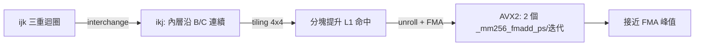

# 03.3 2020 年代自動向量化與編譯器最佳化實務

## 學習目標

1. 說明編譯器自動向量化成立的前提條件（相依性分析、對齊、別名、無副作用），以及現實程式碼「向量不了」的常見原因。
2. 掌握主要 loop transformation（unroll、interchange、tiling、fusion/fission、strip-mining）與其對向量化及記憶體階層的影響。
3. 理解 LLVM 向量化器（loop vectorizer + SLP vectorizer + cost model）的架構與 RVV/SVE 等 VLA 後端的互動。
4. 以 NPB（NAS Parallel Benchmarks）與 CNN 工作負載為例，建立「原始碼特徵 → 編譯器行為 → 效能」的實務診斷能力。
5. 分析 AVX-512 頻率降載（frequency throttling）的機制、量化影響，與 2020 年代軟硬體的因應演進。

---

## 一、前因：自動向量化為何困難

向量處理器時代（03.1），平行性由程式設計師寫進向量指令；SIMD ISA 時代（03.2），平行性雖存在於硬體，但 **絕大多數程式碼是純量 C/C++**。自動向量化編譯器的使命是「從純量語意中還原資料平行」，這是一個逆問題：語言標準（如 C 的記憶體模型）允許的別名與未定義行為遠比數學上的資料流寬鬆，編譯器必須 **證明** 轉換合法才能套用。

### 1.1 向量化成立的四大條件

```c
// 典型可向量化迴圈
for (int i = 0; i < n; i++)
    c[i] = a[i] + b[i];     // (1) 無循環遞迴相依
```

1. **相依性可證明安全**：所有讀寫之間無「寫後讀跨迭代」的真相依（RAW across iterations）。`a[i] = a[i-1] + b[i]` 是歸約鏈，除非可轉成樹狀歸約，否則不可向量。
2. **位址可分離（no aliasing）**：`c` 不得與 `a`、`b` 重疊。C 語言的 `restrict` 關鍵字是程式設計師提供證明的正式管道；無 restrict 時編譯器需假設最壞情況而放棄或插入 runtime 檢查。
3. **對齊與連續性可證明或可補償**：非對齊載入在多數 ISA 上可執行但有代價；stride 不為 1 時可能退化为 gather 或完全放棄。
4. **迭代次數可估**：若 trip count 未知且尾端成本高，cost model 可能判定不划算；VLA ISA（`vl` 語義）大幅降低尾端成本，改變了這個計算。

### 1.2 常見的「向量殺手」

- 條件分支內含副作用（函式呼叫、可能 trap 的除法/載入）：需要 if-conversion 轉為 select/mask，但僅在無例外風險時合法；
- 浮點重組合：向量化會改變求值順序，違反 IEEE 嚴格語義，需 `-ffast-math` 授權（自擔風險：捨棄 NaN/Inf 語義與結合律保障）；
- 指標型別不一致與 type punning、`volatile`、以及跨執行緒的原子操作。

**因果關係**：語言定義越寬鬆 → 編譯器需更多動態檢查或放棄 → 實務上要靠 pragma（`#pragma omp simd`、`#pragma clang loop vectorize(assume_safety)`）與 restrict 由程式設計師補交證據。這是「ISA 承諾 vs 語言承諾」的落差，也是為什麼 Rust、Fortran（別名規則明確）在 2020 年代向量化表現常優於預設 C。

## 二、Loop Transformation：向量化的前置手術

自動向量化很少直接作用於原始迴圈；通常先做 **迴圈轉換** 把資料存取模式整形成向量機友善的形狀。

### 2.1 五種核心轉換

| 轉換 | 做什麼 | 為什麼 |
|---|---|---|
| Unroll（展開） | 複製迴圈體 k 次 | 增加指令級並行、填滿多個 SIMD 單元；暴露獨立 FMA |
| Interchange（交換） | 交換內外層迴圈 | 讓內層沿連續記憶體走（row-major 矩陣乘的 i/j 交換） |
| Tiling（分塊） | 迴圈切成 \(T\times T\) 方塊 | 提升工作集的 cache 命中率，同時保持內層連續可向量化 |
| Fusion/Fission（合併/分裂） | 合併或拆開相鄰迴圈 | 合併提高暫存器重用；分裂避免依賴阻斷向量化 |
| Strip-mining | 外層按向量寬度切條帶 | VLA ISA 的原生形態（RVV `vsetvli` 即語義化的 strip-mining） |

### 2.2 矩陣乘法的轉換鏈



理論上 \(n^3\) 次乘加若每次都從記憶體取數，效能被記憶體頻寬釘死；經過 interchange + tiling + unroll 後，每個載入的資料在暫存器中被重用 \(T\) 次，運算強度（arithmetic intensity）提升至讓 FMA 單元成為瓶頸——**這是 03.1「解一個瓶頸、現下一個瓶頸」方法論的編譯器版**。現代編譯器（LLVM 的 loop interchange、Polly、MLGO 輔助的 heuristic）已能自動完成部分此鏈，但生產級 GEMM 仍需人工微核心（micro-kernel），說明 cost model 與真實硬體仍有落差。

## 三、LLVM Vectorizer：2020 年代的主流引擎

LLVM 的向量化由兩個 pass 加一個 cost model 構成：

1. **Loop Vectorizer**：處理 for/while 迴圈。流程為：合法性檢查（相依性、別名、trip count）→ if-conversion（條件轉 mask/select）→ 以「目標向量寬度 × interleave 因子」展開 → 由 **Vectorization Factor (VF) 與 Interleave (IC) 由 cost model 決定**。VLA 目標（SVE、RVV）的關鍵變化：VF 不再是編譯期常數，而是 **運行時的 `vscale`**（LLVM IR 以 `vscale` 表示「以硬體 VLEN 為單位的倍數」），cost model 以 `vscale_range(min,max)` 描述硬體範圍。
2. **SLP Vectorizer**（Superword-Level Parallelism）：不找迴圈，而是 **在直線程式碼中找同構的獨立運算樹**（如 `x0=a0+b0; x1=a1+b1; ...` 或影像處理的 RGB 三元組），打包成 SIMD 指令。它補足迴圈向量化器照顧不到的區域。
3. **Cost Model**：為候選向量版本估價（指令數 × 每指令成本 + 尾端 + 迴圈開銷），與純量版本比較後擇優。2020 年代的重要演進：**Profile-guided optimization（PGO）** 提供真實 trip count 與分支機率，使尾端成本估計從「最壞情況」變成「加權平均」；ML-based cost model（MLGO）開始以學得的模型取代人工調校的表。

實務診斷命令：

```bash
clang -O3 -march=native -Rpass=vectorize -Rpass-missed=vectorize foo.c
# 或檢視成本模型決策
clang -O3 -mllvm -force-vector-width=8 ...
```

`-Rpass-missed` 的輸出（如 "loop not vectorized: could not prove no aliasing"）是實務調校的第一入口。

## 四、實務案例：NPB 與 CNN 的向量化

### 4.1 NPB（NAS Parallel Benchmarks）

NPB 是 1991 年為向量機與平行機設計的基準，至今仍是向量化研究的標準測資，五個核心核心（kernel）呈現不同向量化特徵：

| Kernel | 計算特徵 | 向量化行為 |
|---|---|---|
| FT | 3D FFT | 蝶形運算可向量化，但轉置（transpose）造成非連續存取；實務上以分塊轉置 + SIMD transpose（`_mm256_transpose8_ps` 式微核心）解決 |
| MG | 多重網格 | 鬆弛迭代（stencil）是向量化的甜蜜點；邊界處理（多維索引、局部性）是主要損失來源 |
| CG | 稀疏矩陣-向量乘 | 記憶體頻寬瓶頸，向量化增益取決於稀疏格式（CSR 的不規則間接索引 vs ELL/BCSR 的規整化） |
| BT/SP | 方塊三對角/五對角求解 | 迴圈遞迴相依阻斷直觀向量化；需演算法級重構（如將對角塊求解向量化） |

**診斷方法論**：對每個 kernel 先看「運算強度」（FLOP/byte），預測是 compute-bound（MG stencil、FT 蝶形）還是 memory-bound（CG），再決定向量化投入是否划算——這是 roofline 思維（03.1 的現代形式）在基準實務中的直接應用。

### 4.2 CNN 推論

CNN 的卷積層在 2020 年代被系統性地「im2col + GEMM 化」或以直接卷積微核心實作，兩條路徑都高度依賴向量化：

- **GEMM 路徑**：卷積摺疊成矩陣乘後，沿用 2.2 的轉換鏈；oneDNN（原 MKL-DNN）等函式庫為每 ISA（AVX2/AVX-512/SVE/NEON）維護 micro-kernel 並 runtime dispatch——03.2 所述「固定寬度碎片化成本」在這裡具體化為數十萬行微核心程式碼；
- **直接卷積路徑**：`winograd` 變換以更多加法換乘法，對 SIMD 友善但對暫存器壓力敏感；深度可分離卷積（depthwise conv）channel 維度獨立，天然適合向量化但工作集小，需 fusion（conv+ReLU+pooling 融合為一個向量化核心）避免中間張量往返 DRAM。

**量化考量**：INT8 推論每 512-bit 可做 64 次整數乘加，吞吐量理論上 4 倍於 fp32；AVX-512 VNNI（`vpdpbusd`）將「乘+累加」合為單指令，是 ISA 為工作負載演化再加值的例證——編譯器對 VNNI 的利用同樣依賴 cost model 與張量布局（NCHW vs NHWC 的選擇直接影響 lane 對齊）。

## 五、AVX-512 頻率降載：軟硬體互動的教科書案例

### 5.1 機制

AVX-512 在 Skylake-X/Ice Lake 等微架構上使用 512-bit 執行單元，單位時間開關更多電晶體，電流瞬變（di/dt）加大。為守住功率/電流上限，CPU 實施 **license-based frequency scaling**：依目前執行的指令類別（license：輕量 SSE、重 256-bit、重 512-bit 浮點）將時脈分級下調。AVX-512 重載級在部分 SKU 上可降 300–500 MHz（數量級：3.6 → 3.1 GHz，約 10–15%）。

### 5.2 對效能的雙面影響

$$T_{\text{AVX-512}} = \frac{W_{\text{vec}}}{f_{\text{down}}}, \qquad T_{\text{AVX2}} = \frac{2\,W_{\text{vec}}}{f_{\text{up}}}$$

512-bit 只有在 \(\dfrac{W_{\text{vec}}}{f_{\text{down}}} < \dfrac{2 W_{\text{vec}}}{f_{\text{up}}}\)，即 \(\dfrac{f_{\text{up}}}{f_{\text{down}}} < 2\) 時才勝過 256-bit——多數實際比值約 1.1–1.2，故 **長向量、持續重載** 的工作負載 AVX-512 明顯勝出；但 **混合輕重載、短向量** 負載中，降載的滯後效應（進入重載降頻、退出後恢復有延遲）可能使 AVX-512 程式碼反而拖慢整體。經典實例：某些編譯產物中少量 512-bit 指令（如 `vzeroupper` 週邊的轉換）觸發全核降頻，殃及相鄰的輕量程式碼——**效能懲罰由「當下是否使用」擴散為「是否曾經使用」**。

### 5.3 2020 年代的演進

- **硬體修正**：Ice Lake/AMD Zen 4 將 512-bit 稼動的降載幅度縮小甚至取消（Zen 4 以 256-bit 資料路徑「雙打」實現 512-bit，簡稱「雙 pumping」，頻率幾乎不降）；
- **ISA 路線**：Intel 以 AVX10 統一向量 ISA，規定所有實作皆支援 512-bit 指令（可由 256-bit 路徑實現），把「寬度」與「頻率」解耦；
- **編譯器/函式庫**：oneDNN 等依 CPU 型號表選擇 micro-kernel；LLVM 提供目標特性調校（`-mavx512f -mllvm -x86-use-...`），並在 PGO 回饋下決定 VF；
- **作業系統**：Linux 的 XSAVE 優化（AVX-512 狀態區 2.5 KB）減少 context switch 成本，說明 ISA 狀態大小也是效能契約的一部分。

這一節的核心教訓呼應全章主線：**ISA 決策（加寬）→ 微架構約束（功率）→ 頻率政策 → 編譯器與函式庫策略**，每一層都不是孤立最優，必須共同演化。

## 六、實務工作流總結

1. **測量先行**：`perf stat` 看 IPC 與 cache miss，`llvm-mca` 靜態估計核心迴圈吞吐，確認瓶頸在運算還是記憶體；
2. **讓編譯器說話**：`-Rpass/-Rpass-missed` 找出未向量化原因，優先修資料布局與別名（`restrict`、SoA），其次用 pragma；
3. **只手寫熱點**：以 profile 找出佔 80% 時間的 20% 迴圈，對其寫 intrinsics 或使用調校函式庫（oneDNN、OpenBLAS），其餘交給自動向量化；
4. **重視尾端與降載**：VLA ISA 天然緩解尾端；AVX-512 環境以 PGO 驗證重載程式碼的淨收益。

## 本章小結

- 自動向量化是「從寬鬆語言語意中還原資料平行」的逆問題，成立條件為可證明的相依性安全、別名分離、對齊可補償與 trip count 可估；`restrict`、pragma 與 `-ffast-math` 是程式設計師補交證據的三個正式管道。
- Loop transformation（interchange、tiling、unroll、fusion、strip-mining）是向量化前置手術，其本質是同時最佳化運算強度與記憶體連續性——矩陣乘法是完整轉換鏈的教科書範例。
- LLVM 以 Loop Vectorizer、SLP Vectorizer 與 cost model 三件套實作向量化；VLA 目標以 `vscale` 取代編譯期 VF，PGO 與 ML cost model 是 2020 年代的關鍵演進。
- NPB 各 kernel 展示不同向量化特徵（stencil 甜蜜點、FFT 轉置、稀疏間接索引、遞迴阻斷）；CNN 推論經 GEMM 化後成為 SIMD 函式庫的主戰場，INT8 VNNI 與算子融合是實務重心。
- AVX-512 頻率降載展示 ISA、微架構、功率、頻率政策與軟體的耦合：license-based scaling 使「曾用 512-bit」即受懲罰，後續以雙 pumping、AVX10 與函式庫調校逐步化解。
- 一貫的診斷流程：roofline 定位瓶頸 → 編譯器診斷訊息定位障礙 → 修資料布局 → 僅對熱點手工向量化。

## 習題

1. **（分析）** 下列迴圈為何可能不被自動向量化？逐一指出障礙並給出最小修改使其可向量化：
   ```c
   for (i = 1; i < n; i++) a[i] = a[i-1] * 0.5f + b[i];   // (A)
   for (i = 0; i < n; i++) c[i] = (a[i] > 0) ? f(a[i]) : b[i]; // f 為純函式
   for (i = 0; i < n; i++) sum += a[i] * b[i];            // (C)
   ```
2. **（實驗）** 實作 \(512\times512\) 矩陣乘法四個版本：naive ijk、interchange 後的 ikj、加 tiling（block=32）、加 4×4 unroll + AVX2 FMA。使用 `-O3 -march=native`，以 `perf stat -e cycles,instructions` 比較 IPC 與時間，解釋每步轉換貢獻的加速與原因。
3. **（程式設計）** 以 LLVM/Clang 對 NPB MG 的 stencil 核心做向量化診斷：先編譯並記錄 `-Rpass-missed` 訊息，再以 `restrict`、padding（避免 power-of-two stride）與 pragma 修復，量測改進倍數。
4. **（推導）** 某核心在 AVX2 下耗時 \(T\)、512-bit 重載使時脈降 15%。假設運算量固定，請推導 AVX-512 版本勝出所需的最小向量化效率（相對 AVX2 的每週期運算倍數），並討論混合負載（20% 512-bit + 80% 輕量）時滯後效應的定性影響。
5. **（討論）** 比較「runtime dispatch 的多版本函式庫（oneDNN 模式）」與「VLA ISA 一次編譯」兩種策略在 CNN 推論場景的長期維護成本與效能上限，說明你認為 2030 年代的主流會是哪一種，並以本章的因果鏈（ISA→硬體→編譯器→生態）論證。
