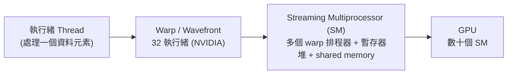

# 4.1 1999 — GPU 的誕生與可編程著色器

## 學習目標

1. 說明 1999 年 NVIDIA GeForce 256 為何被視為「GPU」概念的起點，以及硬體 T&L 的意義。
2. 描述從固定功能管線（fixed-function pipeline）到可編程著色器（programmable shader）的演進動因。
3. 解釋 GPGPU 概念的興起：如何將通用計算映射到圖形管線。
4. 掌握 SIMT 執行模型的核心思想，及其與 SIMD、多執行緒的關係。

## 4.1.1 GeForce 256：第一顆「GPU」

1999 年 10 月，NVIDIA 推出 GeForce 256，並首次使用「Graphics Processing Unit」一詞行銷。其關鍵創新是將**變換與光照（Transform and Lighting, T&L）**從 CPU 移入 GPU，整合了約 2300 萬個電晶體，支援硬體立方體環境貼圖等 DirectX 7 功能。

在 GeForce 256 之前，3D 場景中每個頂點的模型變換（model/view/projection）與光照計算都由 CPU 完成。當三角形數量增長時，CPU 成為瓶頸。將 T&L 硬體化，使 CPU 得以釋放，也確立了 GPU 作為「數學協同處理器」的地位：

$$
\mathbf{v}' = P \cdot V \cdot M \cdot \mathbf{v}, \qquad
I = k_a i_a + \sum_{i} \left[ k_d (\mathbf{N}\cdot\mathbf{L}_i) i_{d,i} + k_s (\mathbf{R}\cdot\mathbf{V})^{\alpha} i_{s,i} \right]
$$

其中 $P,V,M$ 分別為投影、視角、模型矩陣；第二式為 Phong 光照模型。這些運算本質上是大量獨立的向量/矩陣運算——**天然並行**，這正是日後通用運算的種子。

## 4.1.2 固定功能管線的極限

DirectX 7 時代的管線是「固定功能」：頂點經過固定的 T&L 電路，像素經過固定的 texture-blend 單元。程式設計師只能透過狀態機開關選擇預定義的效果，無法自訂計算流程。隨著遊戲對真實感的要求（per-pixel lighting、cartoon shading、陰影體積），固定電路無法滿足演算法多樣性，於是產生了「硬體功能趕不上演算法創新」的矛盾。

**解法：把固定電路換成可編程處理器。** 2001 年 GeForce3（代號 NV20）支援 DirectX 8 的 vertex shader 與 pixel shader：

```asm
; 簡化的 vertex shader 語法（vs.1.1）
dp4   oPos.x, c[0], v[0]     ; 與模型矩陣第一列做內積
dp4   oPos.y, c[1], v[0]
dp4   oPos.z, c[2], v[0]
dp4   oPos.w, c[3], v[0]
dp3   r0.x,   v[3], c[4]     ; 法線與光源方向的 dot product
```

這代表 GPU 首次具備「可編程」能力：每個頂點/像素執行同一段短程式。由於資料之間互相獨立、控制流簡單，硬體設計者可以犧牲複雜的分支預測與大快取，換取**大量簡單的平行執行單元**。這是微架構上的根本轉向：CPU 追求單執行緒延遲（ILP、亂序執行、深管線），GPU 追求**總吞吐量**（throughput），以多執行緒切換隱藏記憶體延遲。

2002 年 GeForce FX / Radeon 9700 支援 DirectX 9：shader 改用接近 C 的高階語言（HLSL/GLSL），分支、迴圈、浮點精度提升，可編程性逼近通用處理器。

## 4.1.3 GPGPU：把問題「騙」進圖形管線

2002–2006 年，研究者開始利用 pixel shader 做**通用計算**（General-Purpose computation on GPU, GPGPU）。手法是將資料編碼成貼圖（texture），計算過程寫成 fragment shader，輸出畫面再讀回來：

| 通用概念 | GPGPU 對應 |
|---|---|
| 陣列/矩陣 | texture（2D 浮點貼圖） |
| 核心程式 | fragment shader |
| 迴圈迭代 | 多個 render pass |
| 輸出結果 | render-to-texture + readback |

代表工作如 BrookGPU（Stanford，2004），以及著名的分子動力學 NAMD、MATLAB GPU 加速原型。GPGPU 證明了 GPU 的算力優勢（當時浮點峰值已是 CPU 的十倍以上），但也暴露了三大痛點：

1. **記憶體模型受限**：texture 只能有限地隨機讀取，無真正的 scatter-write（只能寫 render target）。
2. **通訊成本高**：結果需經過 rasterizer，來回經過 PCIe 讀回。
3. **程式設計困難**：必須理解圖形 API，將演算法硬套進繪製框架。

這些痛點直接驅動了 2006 年 CUDA 與統一著色器架構（見 4.2 節）——理論上 GPGPU 的成功與實務上的不便，形成了「需求拉動架構演進」的典型案例。

## 4.1.4 SIMT 執行模型

GeForce 8800（2006，G80）確立了現代 GPU 的執行模型 **SIMT（Single Instruction, Multiple Threads）**，此後一直沿用：



- **Warp**：32 個執行緒組成最小調度單位，共享一個程式計數器，以「鎖步（lockstep）」執行同一指令。
- **分支處理**：若 warp 內執行緒走向不同分支（divergence），硬體序列化執行各路徑並以遮罩（mask）屏蔽不參與的執行緒：

$$
\text{cost} \approx \sum_{\text{paths } p} \text{cycle}(p) \quad \text{（而非取最大路徑）}
$$

- **延遲隱藏**：每個 SM 維護大量 resident warps，某個 warp 因記憶體存取或同步停等時，零成本切換到另一個 warp。這取代了 CPU 的大型快取與亂序執行，是「以執行緒平行換延遲」的設計哲學。

**SIMT vs. SIMD**：SIMD（如 AVX-512）暴露向量暫存器給程式設計師，資料寬度固定；SIMT 則讓每個執行緒寫**純量的程式碼**，由硬體聚合成寬操作。對程式設計師而言 SIMT 更直觀，對硬體而言兩者執行單元其實相似。這個抽象層的選擇，正是 CUDA 能普及、而早期 SIMD 程式設計始終小眾的關鍵之一。

## 本章小結

- GeForce 256（1999）以硬體 T&L 定義了 GPU，將並行數學運算從 CPU 卸載。
- 固定功能管線無法跟上演算法創新，GeForce3（2001）引入可編程 vertex/pixel shader，開啟可編程時代。
- GPGPU 時代（2002–2006）證明了 GPU 的通用算力，但其彆扭的貼圖程式模型催生了 CUDA。
- SIMT 模型以 warp 為單位執行、以多執行緒隱藏延遲，確立了 GPU「吞吐量優先」的微架構哲學。

## 習題

1. 說明硬體 T&L 為何能顯著提升 1999 年遊戲效能，並計算：若場景有 100 萬個頂點、每頂點 T&L 需 50 FLOPs，CPU（1 GFLOPS 有效）與 GeForce 256（20 GFLOPS）各需多久。
2. 比較固定功能管線與可編程管線在硬體面積、功耗、功能彈性上的取捨。
3. 設計一個用 pixel shader 計算兩個 $N\times N$ 矩陣乘法的 GPGPU 方案，指出其需要幾個 render pass、如何處理中間結果。
4. 一個 warp 中 30 個執行緒走 if 分支、2 個走 else 分支，估計該段程式碼的執行週期數比例，並提出減少 divergence 的重構策略。
5. 論證：為何 GPU 選擇 SIMT 而非暴露 SIMD 暫存器？從程式設計生產力與硬體成本兩方面分析。
