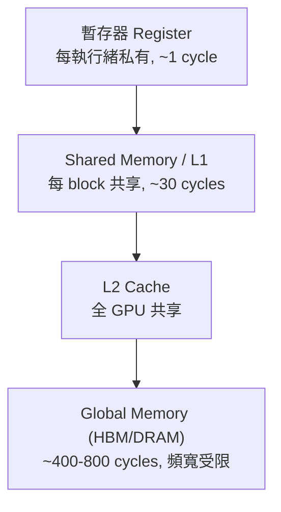

# 4.2 CUDA 程式設計實務

## 學習目標

1. 撰寫基本的 CUDA kernel（vector add）並理解執行配置（grid/block）。
2. 運用 shared memory 與 tiling 優化矩陣乘法，理解記憶體階層的影響。
3. 認識 warp divergence、memory coalescing、occupancy 三大效能法則。
4. 使用 streams 重疊計算與資料傳輸；理解 CUTLASS 的工程意義。

## 4.2.1 CUDA：把 GPGPU 從「貼圖魔術」中解放

2006 年 NVIDIA 隨 G80 推出 CUDA（Compute Unified Device Architecture），提供 C 語言擴充、獨立的 device memory（任意讀寫，不再受限於 texture）、以及統一著色器硬體。程式模型的三層抽象：

**執行緒層級**：`thread → block → grid`。block 內執行緒可透過 shared memory 合作並可同步（`__syncthreads()`）；不同 block 之間（傳統上）只能透過 global memory 溝通。

### 第一個 kernel：vector add

```cuda
__global__ void vecAdd(const float* a, const float* b, float* c, int n) {
    int i = blockIdx.x * blockDim.x + threadIdx.x;
    if (i < n) c[i] = a[i] + b[i];
}

void launch(const float* a, const float* b, float* c, int n) {
    int threads = 256;
    int blocks = (n + threads - 1) / threads;   // ceil division
    vecAdd<<<blocks, threads>>>(a, b, c, n);    // 在 device 上執行
}
```

執行配置 `<<<blocks, threads>>>` 決定並行度。此例中一個 `i` 對應一個執行緒，位址連續——這正是 coalescing 的理想形態。

## 4.2.2 記憶體階層與矩陣乘法

CUDA 記憶體階層：



矩陣乘法 $C = A \times B$ ，其中 $C_{ij} = \sum_k A_{ik}B_{kj}$ ，共 $2N^3$ FLOPs 但只讀 $3N^2$ 資料——**計算密集**，理論上能跑滿 GPU。但 naive 版本每個執行緒直接讀 global memory，會被頻寬卡死。解法是 **tiling**：將資料分塊載入 shared memory 重複使用。

```cuda
constexpr int TILE = 32;

__global__ void matmulTiled(const float* A, const float* B, float* C, int N) {
    __shared__ float As[TILE][TILE];
    __shared__ float Bs[TILE][TILE];

    int row = blockIdx.y * TILE + threadIdx.y;
    int col = blockIdx.x * TILE + threadIdx.x;
    float sum = 0.f;

    for (int t = 0; t < N / TILE; ++t) {
        As[threadIdx.y][threadIdx.x] = A[row * N + t * TILE + threadIdx.x];
        Bs[threadIdx.y][threadIdx.x] = B[(t * TILE + threadIdx.y) * N + col];
        __syncthreads();                       // 等待 tile 載入完成
        for (int k = 0; k < TILE; ++k)
            sum += As[threadIdx.y][k] * Bs[k][threadIdx.x];
        __syncthreads();                       // 避免提前覆寫 tile
    }
    C[row * N + col] = sum;
}
```

**定量分析**：naive 版本每個 MAC（乘加）需要 2 次 global 讀取（8 bytes）；tiled 版本將 $2 \times \text{TILE}$ 次讀取攤提給 TILE 次 MAC。以 TILE=32 計，每 FLOP 的 DRAM 流量降至原來的 $1/32$ ，同時 shared memory 頻寬（約數十 TB/s 等級）遠高於 global。這解釋了為何實測效能可從 naive 的數百 GFLOPS 提升至接近 Tensor Core 峰值。進一步的極致版本（如 CUTLASS 產生的 kernel）再加入**雙重緩衝（double buffering）**：用兩組 tile buffer，一組在計算、另一組同時用非同步拷貝預載，讓記憶體延遲完全被計算掩蓋。

## 4.2.3 三大效能法則

### (1) Warp Divergence

warp 以鎖步執行，分支分歧導致序列化：

```cuda
// 反面範例：依 threadIdx 分支，warp 內必然分歧
if (threadIdx.x % 2 == 0) x = f(x); else x = g(x);

// 改善：讓分歧沿 block 邊界對齊，或以資料重排消除分支
```

在 GPU 上分支本身不貴，貴的是**同一 warp 內**的分歧。規則：控制流應盡量以 warp 為單位一致（如依 `blockIdx` 分支而非 `threadIdx`）。

### (2) Memory Coalescing

warp 的 32 執行緒同時存取 global memory 時，若位址落在**連續且對齊**的區間，硬體合併為少數幾筆 128-byte 交易；否則拆成多筆交易，頻寬利用率可跌至 1/32：

| 存取模式 | 每交易有效位元組 | 效率 |
|---|---|---|
| `a[i]`（連續） | 128 / 128 | 100% |
| `a[i*4+stride]`（跨距） | 4 / 128 | 3.1% |
| 矩陣轉置 naive | 依序差 | 需 tile + coalesced 讀寫 |

經典案例：**矩陣轉置**需要「讀 coalesced、寫 coalesced」二者只能取一，故以 shared memory 中轉：讀入時 coalesced、寫入 shared 時以轉置索引存放、再 coalesced 寫出，並加 padding 避免 bank conflict。

### (3) Occupancy

Occupancy = 活躍 warp 數 ÷ SM 最大 warp 容量。受限於三種資源：**暫存器**、**shared memory**、**block 數量上限**。例如某 kernel 用 96 暫存器/執行緒、SM 有 65536 暫存器、最多 64 warps：

$$
\text{每 block（256 執行緒）暫存器用量} = 256 \times 96 = 24576
\Rightarrow \text{每 SM 僅能容納 } \lfloor 65536/24576 \rfloor = 2 \text{ blocks} = 16 \text{ warps} = 25\%
$$

可用 `__launch_bounds__` 或編譯器選項限制暫存器。但高 occupancy 不等於高效能——若 kernel 本身計算密集（arithmetic intensity 高），低 occupancy 也能跑滿；occupancy 主要救「延遲受限（latency-bound）」的 kernel。

## 4.2.4 Streams：重疊計算與傳輸

預設所有操作在同一 stream 中依序執行。使用多個 stream 可讓**資料傳輸（PCIe/HBM DMA）與 kernel 執行重疊**，並利用 pinned memory 的非同步拷貝：

```cuda
const int S = 4, SEG = N / S;
cudaStream_t stream[S];
for (int s = 0; s < S; ++s) {
    cudaStreamCreate(&stream[s]);
    cudaMemcpyAsync(d_a + s*SEG, h_a + s*SEG, SEG*sizeof(float),
                    cudaMemcpyHostToDevice, stream[s]);
    vecAdd<<<SEG/256, 256, 0, stream[s]>>>(d_a + s*SEG, d_b + s*SEG,
                                           d_c + s*SEG, SEG);
    cudaMemcpyAsync(h_c + s*SEG, d_c + s*SEG, SEG*sizeof(float),
                    cudaMemcpyDeviceToHost, stream[s]);
}
```

分段流水線使總時間從「 $T_{copy} + T_{kernel}$ 」逼近 $\max(T_{copy}, T_{kernel})$ 。在現代系統中更進一步：GPUDirect RDMA 讓 NIC 直接讀寫 GPU 記憶體，Hopper 的 TMA（見 4.3 節）則將拷貝再卸載給硬體單元。

## 4.2.5 CUTLASS：把最佳化工程化

CUTLASS 是 NVIDIA 開源的 C++ 模板庫，將高效 GEMM 拆解為階層式的可組合組件：

- **Threadblock 級**：tiling 策略、多階段流水線（pipeline stages）。
- **Warp 級**：MMA 指令排布（現在對應 Tensor Core 的 `wmma`/`mma` PTX）。
- **執行緒級**：fragment 佈局與資料重用。

核心思想是 **「分層軟體流水線（hierarchical pipeline）」**：global→shared 用非同步拷貝（`cp.async`）、shared→register 用 ldmatrix、計算與搬運重疊。以現代強調「研發可重用」的視角看，CUTLASS 展示了硬體微架構（Tensor Core 形狀、shared memory 大小）如何被**參數化的模板**吸收，使同一套演算法邏輯可跨 A100/H100/Blackwell 重編譯即得最佳化——這是「架構演進驅動軟體抽象層」的具體例證。

## 實務最佳化檢查表

| 優化項 | 檢查方法 | 典型收益 |
|---|---|---|
| Coalescing | `nsys`/`ncu` 的 memory workload 分析 | 頻寬利用率 3%→90%+ |
| Shared memory tiling | 比較 global load 次數與 FLOP 數 | 10×+ |
| 避免 bank conflict | padding、swizzle（CUTLASS 自動處理） | 2–8×（shared 受限時） |
| Reduce divergence | 以 block 為單位分支、資料重排 | 視分支比例 |
| Occupancy | `--ptxas-options=-v` 查暫存器用量 | 救 latency-bound kernel |
| Streams + pinned memory | timeline 分析計算/傳輸重疊 | 逼近 max(傳輸, 計算) |
| 演算法層：Strassen / FlashAttention 減少 DRAM 流量 | 分析 arithmetic intensity | 隨問題而定 |

## 本章小結

- CUDA 以 thread/block/grid 抽象與 C 語言介面，將 GPGPU 從貼圖框架解放。
- 效能的第一原則是 **arithmetic intensity**：tiling + shared memory 減少 DRAM 流量，是所有 GPU kernel 優化的核心套路。
- warp divergence、coalescing、occupancy 是三大硬體層法則，分別對應執行模型、記憶體系統、調度資源。
- streams 讓計算與傳輸重疊；CUTLASS 將微架構知識封裝成可重用模板，銜接 4.3 節的 Tensor Core 時代。

## 習題

1. 將 vector add 的 threads 設為 1024，討論與 256 相比可能變慢的原因（提示：暫存器壓力、block 調度粒度）。
2. 令 TILE=16 與 32，計算 tiled matmul 的 DRAM 流量比 naive 減少多少倍；並討論 TILE=32、使用 float 時 shared memory 用量是否超過 48KB。
3. 寫出矩陣轉置 kernel，解釋為何需要 shared memory padding（避免 bank conflict），並畫出讀寫的 coalescing 情形。
4. 某 kernel：每執行緒 64 暫存器、每 block 512 執行緒、shared memory 16KB/block、SM 上限 32 blocks、65536 暫存器、100KB shared、64 warps。計算 occupancy 並指出瓶頸資源。
5. 說明為什麼「高 occupancy 不一定高效能」，舉一個低 occupancy 但跑滿算力的 kernel 例子。
