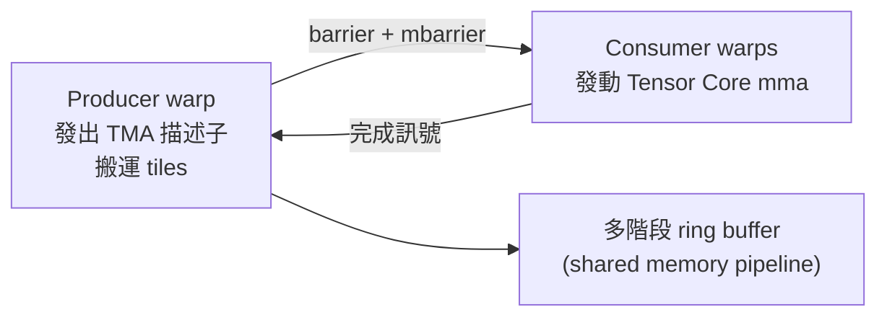

# 4.3 2022 — Tensor Core 與 Hopper 微架構

## 學習目標

1. 描述 Tensor Core 從 Volta（2017）到 Hopper（2022）、Blackwell（2024）的演進脈絡。
2. 理解 TMA（Tensor Memory Accelerator）與 warp specialization 如何重塑資料流。
3. 說明 FP8/BF16 等低精度格式的設計動機與量化策略。
4. 分析稀疏化與 HBM 頻寬對現代 AI 工作負載的影響。

## 4.3.1 Tensor Core 演進：從混合精度到巨型 tile

Transformer 時代的工作負載是「巨大矩陣乘法 + 巨大記憶體流量」，GPU 的演進因此圍繞兩條主線：**每瓦算力（precision 下降 + MMA 單元強化）**與**資料搬運效率（TMA、HBM）**。

| 年代 | 架構 | Tensor Core 關鍵特性 | 支援精度 |
|---|---|---|---|
| 2017 | Volta (V100) | 首代 TC，$4\times4$ 矩陣混合運算封裝為 warp 級 `mma` | FP16, FP32 accumulate |
| 2018 | Turing (T4) | 進入消費級；INT8/INT4 推理加速 | FP16, INT8/4 |
| 2020 | Ampere (A100) | Async copy、TF32、稀疏化（2:4） | FP16/BF16/TF32, INT8/4 |
| 2022 | Hopper (H100) | TMA、warp specialization、FP8、執行緒塊叢集 | FP8, FP16/BF16, INT8 |
| 2024 | Blackwell (B200) | 第二代 TC、FP4/FP6、tensor memory | FP4/FP6/FP8, NVFP4 |

**峰值算力的成長**：V100 FP16 約 125 TFLOPS，A100 約 312 TFLOPS（稀疏 624），H100 FP8 約 1979 TFLOPS（稀疏約 4000），Blackwell FP4 再翻倍。以 $O(10^4)$ 倍的量級回望 1999 年的 GeForce 256，正呼應 4.1 節「吞吐量哲學」的極致延伸。算力成長來自三個乘法因子：單元數量（晶片面積、製程）、每單元頻率（逼近功耗牆後趨緩）、以及**每週期運算寬度（低精度格式）**——第三項是近年最主要的成長引擎，因為 Moore's Law 與 Dennard Scaling 均已失效。

## 4.3.2 Hopper 微架構：TMA 與 Warp Specialization

H100 的核心問題：算力成長遠快於頻寬，資料搬運成為主導成本。兩大回應：

### TMA（Tensor Memory Accelerator）

TMA 是專門的硬體 DMA 引擎，以「描述子（descriptor）」描述多維 tensor 的形狀、stride、資料型別，一次性完成 global↔shared memory 的整塊搬運，支援邊界處理、轉置、swizzle：

```
// 概念（CUTLASS/CuTe 風格）
tma_load(tensor_A_desc, smem_A, coord_k, coord_m);  // 整個 tile 一次到位
```

相比 Ampere 的 `cp.async`（每執行緒搬 16 bytes），TMA **把搬運從執行緒卸載給硬體**：一個 thread 發出描述子即可搬整個 tile，省下地址計算指令、暫存器與發射槽位，且天然支援 swizzle 避免 bank conflict。

### Warp Specialization

傳統 kernel 中所有 warp 執行同一段程式（load → compute → store 交錯）。Hopper 的最佳實務是**生產者-消費者分工**：



- 生產者 warp 只做 TMA；消費者 warp 只做 MMA；透過 `mbarrier`（memory barrier with phase）同步。
- 軟體層次組成**多階段流水線**：shared memory 分成 $S$ 個 stage 環形使用，使得「搬 tile $i+1$」與「計算 tile $i$」完全重疊——這正是 4.2 節 double buffering 的硬體級強化版。

此外 Hopper 引入 **thread block cluster**：多個 SM 組成叢集，透過 distributed shared memory（DSMEM）互相讀寫 shared memory，讓跨 SM 的資料重用不必繞道 L2/DRAM。

## 4.3.3 低精度：BF16 與 FP8 量化

神經網路對數值精度的需求是**統計性**的：梯度雜訊容忍度高，故可用更少位元換取更高吞吐。關鍵在浮點格式的設計：

$$
x = (-1)^{s} \times \text{mantissa} \times 2^{\text{exponent}}
$$

| 格式 | 位元 (E/M) | 動態範圍 | 適用 |
|---|---|---|---|
| FP32 | 1/8/23 | 極大 | 累加、權重更新 |
| TF32 | 1/8/10 | 同 FP32 指數 | Ampere 訓練折衷 |
| BF16 | 1/8/7 | 同 FP32 指數 | 訓練主流（範圍優先） |
| FP16 | 1/5/10 | 較小 | 推理/部分訓練 |
| FP8 E4M3 | 1/4/3 | 窄 | 前向/激活（精度優先） |
| FP8 E5M2 | 1/5/2 | 較寬 | 反向/梯度（範圍優先） |

**BF16 的取捨**：與 FP16 同位元數，但指數位元與 FP32 相同，避免 overflow/underflow，代價是 mantissa 較少（相對誤差約 $2^{-8} \approx 0.4\%$）。訓練中損失尺度大範圍變動，範圍往往比精度重要，故 BF16 成為 LLM 訓練標配。

**FP8 量化策略**：直接以 FP8 儲存與計算，累加仍在 FP16/FP32。實務要點：

1. **per-tensor / per-channel scaling**：為每個（子）張量學習或動態統計 scale factor $s$，使值域映射到 FP8 可表達區間：$x_{fp8} = \text{clamp}(x/s)$。
2. **混合精度分層**：敏感層（embedding、LM head、第一/最後層）保持 BF16。
3. **延遲量化（in-flight quantization）**：在 kernel 內、資料尚未寫回 HBM 前即轉換，節省頻寬。
4. 與 4.2 的 arithmetic intensity 分析相連：位元數減半 → 同 tile 的算力翻倍且 DRAM 流量減半，是「雙重收益」。

## 4.3.4 稀疏化與結構化剪枝

Ampere 起 Tensor Core 支援 **2:4 結構化稀疏**：權重矩陣每 4 個連續元素中強制 2 個為零，硬體以壓縮格式（值 + 2-bit 索引）跳過零運算，峰值直接翻倍：

$$
W = \begin{pmatrix} w_{11} & 0 & w_{13} & 0 \\ 0 & w_{22} & 0 & w_{24} \end{pmatrix}
\;\Rightarrow\; \text{儲存 } (w_{11},w_{13}), (w_{22},w_{24}) + \text{索引，計算量減半}
$$

結構化稀疏保留硬體規則性（與非結構化稀疏的 irregular memory access 不同），訓練後經 prune + fine-tune 通常可維持精度。實務上 2:4 稀疏在推理中配合 FP8 使用；但對 attention 這類動態稀疏（token 間依賴隨輸入變化），仍需 FlashAttention 等演算法層解法——再次說明**硬體規則性與演算法動態性的張力**是 GPU 架構設計的永恆課題。

## 4.3.5 HBM 頻寬：算力的另一面

HBM（High Bandwidth Memory）以 3D 堆疊 + 寬介面（上千 bit）提供遠高於 GDDR 的頻寬：

| GPU | HBM | 容量 | 頻寬 |
|---|---|---|---|
| V100 | HBM2 | 16/32 GB | ~900 GB/s |
| A100 | HBM2e | 40/80 GB | ~2 TB/s |
| H100 | HBM3 | 80 GB | ~3.35 TB/s |
| H200 | HBM3e | 141 GB | ~4.8 TB/s |
| B200 | HBM3e | 192 GB | ~8 TB/s |

**Roofline 分析**解釋為何頻寬如此重要。以 Transformer 推理的 decode 階段為例：batch 小時每生成一個 token 需讀入全部權重，arithmetic intensity 低（約 1–2 FLOP/byte），是**頻寬受限**；batch 大或 prefill 階段則偏計算受限：

$$
P_{\text{attainable}} = \min(P_{\text{peak}},\; I \times B_{\text{memory}})
$$

故 H100 同時強化三件事：FP8 峰值算力（抬高原項）、TMA+多階段流水線（提高實際 $I$）、HBM3（抬高 $B$）。訓練超大模型時記憶體容量本身也是約束（optimizer state、activation），驅動了 HBM 容量競賽、多 GPU NVLink 互連（NVSwitch、NVLink 4.0 達 900 GB/s），以及 4.4 節將討論的系統級架構。

## 本章小結

- Tensor Core 演進主線：精度下降（FP16→FP8→FP4）+ MMA 單元強化 + 稀疏化，每瓦算力是第一驅動力。
- Hopper 以 TMA 將資料搬運卸載給硬體、以 warp specialization 建立 producer-consumer 流水線，回應「算力成長快於頻寬」的根本矛盾。
- BF16/FP8 的設計核心是動態範圍與精度的取捨，量化需配合 scaling 策略與混合精度分層。
- 2:4 結構化稀疏以規則性換硬體可實現的兩倍峰值；HBM 頻寬與 Roofline 共同決定實際效能上限。

## 習題

1. 對照 4.2 節的 CUDA matmul：說明 CUTLASS 在 Hopper 上如何以 TMA + warp specialization 重組該 kernel 的資料流，並畫出多階段流水線的時空圖。
2. 計算：權重共 70B 參數，分別以 FP16 與 FP8 儲存時，batch=1 decode 每生成一個 token 最少需讀多少 bytes？在 3.35 TB/s 頻寬下每秒最多生成多少 token？
3. BF16 的 mantissa 只有 7 位元，說明為何訓練仍可收斂；何種層或運算對 mantissa 精度最敏感？
4. 設計一個 FP8 per-channel 量化方案的數值實驗流程：如何選 scale、如何驗證精度損失、何時該退回 BF16？
5. 比較 2:4 結構化稀疏與非結構化稀疏在硬體可行性、記憶體存取模式、壓縮率上的差異；解釋為何 attention 的動態稀疏難以直接用 2:4 硬體加速。
