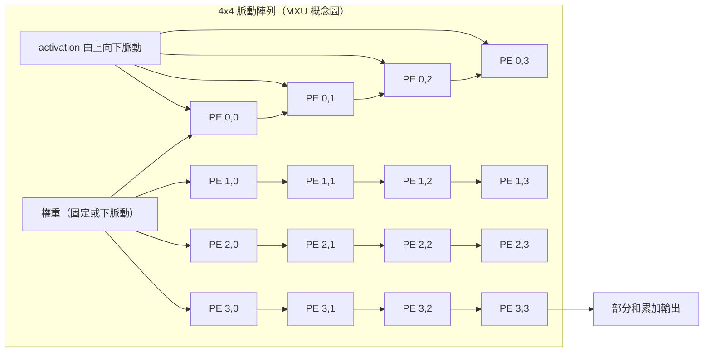

# 5.1 2016 — TPU 與脈動陣列

## 學習目標

1. 理解 Google TPU v1 誕生的背景：深度神經網路推論工作負載對資料中心帶來的效能與功耗壓力。
2. 掌握脈動陣列（systolic array）的資料流原理，以及其 1978 年 Kung 與 Leiserson 的理論淵源。
3. 認識 TPU v1 的核心架構元件：MXU 矩陣乘法單元、int8 量化、統一緩衝區（Unified Buffer）與硬管線（Weight FIFO / Activation pipeline）。
4. 能以 TPU v1 對比 GPU（K80）與 CPU（Haswell）的公開數據，說明 DSA「效能/瓦特」優勢的來源。

---

## 5.1.1 前因：深度學習敲開資料中心的大門

2013 年前後，Google 內部的語音辨識（Deep Speech 路線）、Google Photos、Google Translate 等服務開始全面改用深度神經網路（DNN）。一個看似平常的產品決策——例如把語音解碼器的聲學模型換成 DNN——會使每使用者運算需求上升一到兩個數量級。工程師估算：若語音辨識的使用者每天對伺服器說三分鐘話，以當時的 CPU 資料中心規模繼續擴張，Google 必須將資料中心的運算能力倍增，這在電力、散熱與資本支出上都不可行。

GPU 當然是一個候選。但資料中心的推論服務有其特殊約束：

- **延遲（latency）優先於吞吐**：使用者按下滑鼠後 10ms 內要有回應，批次（batch）不能無限加大，因此 GPU 善用的大批次攤提優勢受限。
- **功耗上限嚴格**：資料中心機櫃功率密度固定，成本模型以 TCO（總擁有成本）計算，每瓦效能是關鍵指標。
- **工作負載單一且長期穩定**：與通用伺服器不同，推論伺服器只跑 LSTM、MLP、CNN 三類模型，正好符合 DSA「犧牲通用性換取效率」的前提。

2013 年，Google 啟動 TPU（Tensor Processing Unit）專案，目標是「每瓦多一個數量級的效能」。2015 年 TPU v1 進入資料中心部署，2016 年 Hennessy 與 Patterson 在紀念圖靈獎背景下的論文（以及 Jouppi 等人的 ISCA 2017 論文 *In-Datacenter Performance Analysis of a TPU*）將其定位為 DSA 時代來臨的標誌性案例。

## 5.1.2 淵源：1978 年的脈動陣列

TPU v1 的心臟不是新發明，而是 1978 年 H. T. Kung 與 Charles Leiserson 在 Carnegie Mellon 提出的**脈動陣列（systolic array）**。其靈感來自心臟幫浦血液的生理模型：資料像血液一樣，由時脈（心跳）驅動，在處理單元（PE, Processing Element）陣列中有節奏地流動，每個 PE 吸收並處理流過的資料。

矩陣乘法 $C = A \times B$ 是 DNN 的基本運算。傳統馮紐曼機器的做法是：把 $a_{ij}$ 、 $b_{jk}$ 反覆從記憶體載入到暫存器、相乘累加（MAC）、寫回——記憶體頻寬成為瓶頸，而每個 MAC 只做一次乘加，運算/記憶體比極低。脈動陣列的洞見是：**讓一筆資料被多個 PE 依序重複使用**。資料自左向右脈動傳遞，經過 $N$ 個 PE 就被使用了 $N$ 次，因此只需一次記憶體讀取，就支撐了 $N$ 次運算，大幅提高**運算對記憶體頻寬比（arithmetic intensity）**。

以二維脈動陣列計算矩陣乘法為例：

每個 PE 只做一件小事：接收上方傳來的 activation 與左方傳來的數值，做 MAC，將部分和往下傳。導線極短、控制極簡、時脈可以很高，且**運算密度隨陣列面積平方增長**——這是脈動陣列在矽面積效率上勝過 SIMT 亂排資料流的根本原因。代價則是通用性：陣列形狀固定，適合稠密、規則的矩陣運算，不適合分支密集或稀疏不規則的程式。

## 5.1.3 TPU v1 架構剖析

TPU v1 是一張 PCIe 插卡，核心架構可概括如下（Jouppi et al., ISCA 2017）：

| 元件 | 說明 |
|---|---|
| MXU | $256 \times 256$ 脈動陣列，每次處理 8-bit 輸入、32-bit 累加，可於每時脈輸出 65,536 次乘加（256K ops/cycle @ int8） |
| Unified Buffer (UB) | 24 MiB 的 SRAM 權重/activation 緩衝，由 CISC 指令控制，256 bank |
| Weight FIFO | 4 層深度，串接外部 8 GiB DDR3 權重記憶體（晶片外） |
| Accumulators | 4 MiB 的 32-bit 部分和收集區 |
| Activation pipeline | 硬體 ReLU、Sigmoid、Tanh 等非線性函數 |
| 指令集 | 少量 CISC 風格指令，如 `Read_Host_Memory`、`MatrixMultiply`、`Activate`，平均 CPI 約 10–20 |

設計上有兩個值得深究的取捨：

1. **不做訓練、只做推論**。訓練需要反向傳播與更高精度浮點；推論可容忍較低精度。TPU v1 因此只支援前向運算，並以 int8 為預設精度。
2. **沒有快取，只有軟體管理的緩衝**。CPU 的多層快取是為通用記憶體行為設計的；DNN 的記憶體存取模式是可預測的（已知層的大小與順序），硬體快取的猜測機制反而浪費面積與功耗。TPU 用確定性的統一緩衝加上雙重緩衝（double buffering）讓下一層權重在上一層計算時預載，實現 100% 的 MXU 利用率路徑。

### int8 量化

量化（quantization）把以 32-bit 浮點訓練的模型轉為 8-bit 整數推論。其理論基礎是：DNN 權重與 activation 的數值分布對雜訊有相當容忍度，將浮點值 $x$ 線性映射到整數

$$
x_{int8} = \mathrm{round}\left(\frac{x}{s}\right) + z,\qquad s = \frac{x_{max} - x_{min}}{255}
$$

其中 $s$ 是縮放因子、 $z$ 是零點偏移。乘加仍以 int8 輸入、int32 累加，避免溢位。實務上 CNN 在 int8 下 top-1 精度平均僅下降 0.2–0.6%，卻換來三重紅利：

- MXU 面積效率約為 FP32 管線的 8 倍（每 8-bit MAC 所需加法器與乘法器遠小於 FP32）；
- 記憶體頻寬需求降為 1/4；
- 每瓦效能提高一個數量級。

這是「演算法容忍性 → 架構簡化 → 效率躍升」的教科書級互相驅動範例：沒有量化，TPU 的面積/功耗優勢會大幅縮水；沒有 TPU 這類硬體，量化也不會成為工業標準。

## 5.1.4 數據對比：TPU vs. GPU vs. CPU

Jouppi 等人以 2016 年當時的 CPU（Intel Haswell E5-2699 v3, 18 核）、GPU（NVIDIA Tesla K80，雙 GK210）與 TPU v1 對比六種 DNN 推論工作負載（MLP、LSTM、CNN），在可達最高效能下結果如下（相對比值，TPU 為 1 時的每瓦效能比）：

| 指標 | CPU (Haswell) | GPU (K80) | TPU v1 |
|---|---|---|---|
| 絕對峰值運算（int8） | ~50 GOPS | ~9 TOPS（12.5 FP16 GOPS×8） | **92 TOPS** |
| 峰值功耗 | 145 W | 300 W（二晶片） | 40 W |
| 六種應用的幾何平均速度 | 1× | 7.6× | **29.2×** |
| 每瓦 TOPS（Kilo-OPS/W） | ~0.35 | ~2.2 | **~2.3–4.1（依量測口徑）** |

更有意義的數字是**每瓦每 TOPS 的成本（$/W）**：TPU v1 的性能/瓦是 K80 的約 30–80 倍（不同工作負載下），是 Haswell 的 80–190 倍。研究團隊進一步做「類比實驗」：若 K80 關閉雙精確度、提高時脈、加大批次，或用與 TPU 相同的 28nm 製程重新設計，GPU 仍無法追平——因為差距主要來自 **DSA 的本質**：

1. MXU 以脈動陣列將運算密度平方級放大；
2. 無快取、確定性執行，且不需要 SIMT 的 warp 排程與暫存器檔案；
3. int8 量化使面積與頻寬雙降；
4. 25 種指令的簡潔 ISA，控制邏輯不到晶片面積的 0.2%（GPU 為數倍，CPU 則高達 30% 以上花在取解碼、快取與分支預測）。

值得注意的是：TPU v1 的高延遲（CISC 指令、無投機執行）在單執行緒服務下其實不利，但資料中心以數十個使用者請求交錯（interleaving）餵入，吞吐反而更高——這說明 DSA 的最終優勢必須在**系統層級的 TCO** 上檢驗，而非單晶片延遲。

## 5.1.5 後果與啟示

TPU v1 的成功帶來三個結構性影響：

- **驗證了 DSA 商業模式**：Hennessy 與 Patterson 在 2017 年的 Turing Lecture 中將「領域特定架構」列為電腦結構黃金時代的三根支柱之一（另兩者是開放 ISA 與領域特定語言）。
- **帶動量化標準化**：int8 推論成為 ONNX、TensorFlow Lite、TensorRT 的預設路徑，後續 int4、FP8（TPU v4、H100）皆沿此脈絡演進。
- **脈動陣列的復興**：從 TPU、NVIDIA 的 tensor core（本質是小型脈動化 MAC 陣列）、Apple Neural Engine 到各家 NPU，稠密矩陣引擎幾乎都採用 systolic 或其變體（weight-stationary、output-stationary）資料流。

但 TPU v1 也留下教訓：它無法訓練、無法跑稀疏模型、非線性函數寫死在硬體中。當 2017 年 Transformer 出現、模型架構快速演化後，硬體必須為「未知的新模型」保留可程式性——這正是 5.3 節 TPU v2 以後與生態系要處理的問題。

## 本章小結

- TPU v1 誕生於深度學習推論對資料中心功耗與成本的结构性壓力，是「領域單一、長期穩定、延遲敏感」工作負載的必然解。
- 脈動陣列源自 1978 年 Kung 與 Leiserson 的理論：資料在 PE 陣列中脈動流動、一筆資料多次使用，將運算/記憶體比平方級放大。
- TPU v1 的 256×256 MXU、int8 量化、軟體管理的統一緩衝與極簡 ISA，共同帶來相對 GPU 30 倍以上的性能/瓦優勢。
- 量化是演算法容忍性驅動架構簡化的典範；其代價是通用性，預示了後續訓練與稀疏支援的架構分歧。

## 習題

1. 推導：在一個 $N \times N$ 脈動陣列上做 $N \times N$ 矩陣乘法，若每 PE 每週期完成一次 MAC，計算完成 $N \times N \times N$ 次乘加需要多少週期？記憶體讀取量與傳統逐一載入作法相比節省多少倍？
2. 說明 TPU v1 為何不採用 CPU 式的多層快取，而採用軟體管理的 Unified Buffer？請從 DNN 記憶體存取模式與快取猜測機制的面積/功耗成本兩方面分析。
3. 給定一層 weight 的浮點範圍 $[-2.0, 3.0]$ ，請計算其 int8 線性量化的縮放因子 $s$ 與零點 $z$ ，並討論若權重分布高度偏斜（outlier 集中於極少數值），此映射會產生什麼精度問題？
4. GPU 的 SIMT 資料流與 TPU 的脈動陣列在「大批次」與「小批次（延遲敏感）」推論場景下各有何優劣？請結合 5.1.4 節的 interleaving 討論。
5. 查閱並比較 TPU v1 與 NVIDIA Volta tensor core（2017）的矩陣引擎設計差異（資料流、精度支援、是否支援訓練），並論述為何 tensor core 是「GPU 對 DSA 潮流的回應」。
