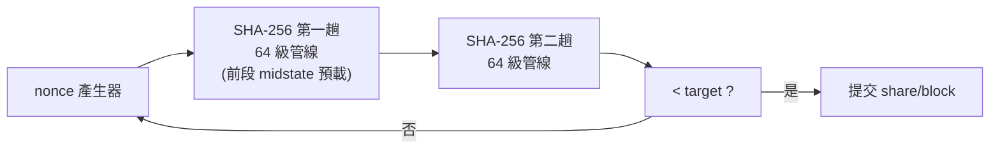

# 5.2 2009 — 挖礦機：從 CPU 到 ASIC 的極致優化

## 學習目標

1. 描述 Bitcoin 挖礦硬體從 CPU、GPU、FPGA 到 ASIC 的四階段演化，並能解釋每一階段被淘汰的技術與經濟原因。
2. 理解 SHA-256 雜湊函數的計算結構，以及挖礦電路如何將其管線化（pipelining）與展開（unrolling）以最大化吞吐。
3. 能閱讀並比較「瓦特/TH」（J/TH）能效演進數據，說明製程、微架構與散熱如何共同驅動優化。
4. 從挖礦戰場提煉對 DSA 設計的啟示：單一功能、極致固定邏輯、市場淘汰壓力下的架構演化。

---

## 5.2.1 背景：一個只有一種運算的工作負載

2008 年中本聰發表 Bitcoin 白皮書，2009 年 1 月創世區塊誕生。Bitcoin 的共識機制為工作量證明（Proof of Work, PoW）：礦工必須不斷對區塊標頭（80 bytes）做雙重 SHA-256（即 $\mathrm{SHA256}(\mathrm{SHA256}(x))$），直到結果小於目標值（難度）。也就是說，挖礦的本質是一個**純整數、無分支、無記憶體隨機存取、完全資料平行**的雜湊搜尋問題：

$$
\text{find } n \text{ such that } \mathrm{SHA256}\big(\mathrm{SHA256}(\text{header}\,\|\,n)\big) < \text{target}
$$

這是 DSA 思想的極端測試場：工作負載**永遠不變**（協定寫死）、**單一運算**（無其他程式可跑）、且參與者處於**純經濟淘汰賽**——每度電換取的雜湊數直接決定獲利。結果是一場十年間將每雜湊能效提升逾十個數量級的演化競賽。

## 5.2.2 四階段演化：CPU → GPU → FPGA → ASIC

### 第一階段：CPU（2009–2010）

中本聰的原始客戶端 `getwork` 挖礦使用 x86 CPU 的 SSE 指令。SHA-256 以 32-bit 加法、旋轉、位移與邏輯運算為主，CPU 一核每秒約可做數百萬雜湊（MH/s 以百萬計）。CPU 的问题在於：大量電晶體花在分支預測、亂序排程與多層快取——對一個無分支、無資料相依的工作，這些通用機制全是浪費。

### 第二階段：GPU（2010–2011）

2010 年，礦工改用 ATI Radeon 5850/5870：GPU 的數千個 ALU 天然適合資料平行雜湊，單卡可達 300–400 MH/s，性能/瓦約為 CPU 的 10–50 倍。但 GPU 仍受累於：SIMT 需要以 warp 為單位排程、每個雜湊「slot」需佔用大量暫存器、以及功耗牆。GPU 時代也催生了礦池（如 2010 年的 slush pool）與 `stratum` 協定——**硬體演化驅動了軟體與經濟組織的演化**，這是 DSA 史上反覆出現的模式。

### 第三階段：FPGA（2011–2013）

FPGA 實現 SHA-256 可省去 GPU 的指令取解碼開銷，Icarus、ModMiner 等機器把能效推進到約 20–50 MH/s/W 的量級。但 FPGA 的 LUT 與可重組佈線本身消耗數倍於專用邏輯的面積與延遲；當同一顆 65nm 晶片能把 SHA-256 核心直接燒成固定電路（ASIC），FPGA 的「可重程式化」優勢在單一不變的工作負載下毫無價值。

### 第四階段：ASIC（2012 至今）

2012 年，蝴蝶實驗室（Butterfly Labs）與 Avalon 專案（黃毓凱/canaan 前身，以眾籌方式交付世界第一台商業 ASIC 礦機）點燃 ASIC 時代。隨後螞蟻礦機（Antminer，比特大陸 Bitmain，2013 年創立）以更好的供應鏈與持續換代成為霸主。幾個關鍵里程碑：

| 年份 | 機種 | 製程 | 能力 | 能效 |
|---|---|---|---|---|
| 2013 | Avalon 第一批 | 110nm | ~3.6 TH/s（全機） | ~66 J/TH 等級 |
| 2013 | Antminer S1 | 110nm | 180 GH/s | 2 J/GH（=2000 J/TH） |
| 2014 | Antminer S3/S5 | 55nm / 28nm | 0.4–1.2 TH/s | 0.6–0.8 J/GH |
| 2016 | Antminer S9 | 16nm TSMC | 14 TH/s | 0.1 J/GH（=100 J/TH） |
| 2019 | Antminer S17 | 7nm | 56 TH/s | 40 J/TH |
| 2022 | Antminer S19 XP | 5nm | 141 TH/s | 21.5 J/TH |
| 2024 | Antminer S21 | 5nm | 200 TH/s | ~17.5 J/TH |
| 2024–25 | 油冷/液冷機型 | 5nm/3nm 試產 | 400–470 TH/s | ~12–16 J/TH |

（表列為量級參考；J/TH 即每 1 TH 雜湊消耗的焦耳數，愈小愈好。）

從 CPU 到 S21，單位雜湊能耗改善約 **8–9 個數量級**：SSE 時代的 CPU 約需數千焦耳做 1 TH，現代礦機只需約 17 焦耳。這個數字之殘酷在於：難度自動調升，**社會總雜湊率只由電價與效率決定**，效率落後的機器立即變成廢鐵——沒有任何教科書案例比這更直接地展示「DSA 優化是零和淘汰賽」。

## 5.2.3 SHA-256 與管線化電路

要理解礦機，必須先看 SHA-256 的結構。它處理 512-bit 訊息區塊，執行 64 輪（round），每輪做：

$$
\begin{aligned}
T_1 &= h + \Sigma_1(e) + Ch(e,f,g) + K_t + W_t \\
T_2 &= \Sigma_0(a) + Maj(a,b,c) \\
h&{\leftarrow}g,\; g{\leftarrow}f,\; f{\leftarrow}e,\; e{\leftarrow}d{+}T_1,\; d{\leftarrow}c,\; c{\leftarrow}b,\; b{\leftarrow}a,\; a{\leftarrow}T_1{+}T_2
\end{aligned}
$$

其中 $\Sigma_0,\Sigma_1$ 是旋轉與右移的 XOR 組合，$Ch$、$Maj$ 是位元選擇函數——全部是 32-bit 整數運算，**無乘法、無記憶體**。礦機電路的設計空間包括：

1. **全管線化（full pipelining）**：把 64 輪攤開成 64 級流水線，每級一組組合邏輯加 32-bit 暫存器。每個時脈週期都有一個新的 nonce 進入管線、一個舊結果出來，吞吐達每週期 1 雜湊。管線延遲（64 週期）無所謂——nonce 搜尋之間沒有相依性，迴圈可完全平行展開。
2. **多核（unrolled + duplicated cores）**：單晶片放置數百個上述管線核心，例如 S21 內含數百個 hashing die/core，共享一顆控制 SoC 與電源樹。
3. **前導工作固定化**：對 80-byte 區塊標頭，雙重 SHA-256 的第一輪 SHA 之 64 輪中，前半部與 nonce 無關，可**離線預算**（midstate 技巧，早在 CPU/GPU 時代即有）；nonce 與 merkle root 的關聯也讓每次換 coinbase 只需重算前兩輪——這是演算法知識轉化為電路面積節省的範例。
4. **電壓/頻率曲線調校**：礦機廠對每顆 die 做 binning，以略低於臨界電壓運行，並用軟體微調每個 power domain 的 DVFS，榨取最後幾個百分點的 J/TH。

值得注意：第二趟 SHA-256 的輸入是第一趟的 256-bit 摘要，兩趟之間有真實資料相依，無法合併成一條 128 級超管線——所以每顆核心是兩條 64 級管線串接。這說明**管線化深度受演算法的資料相依結構限制**，不是電晶體能堆多深就堆多深。

## 5.2.4 散熱、電源與系統工程

當 ASIC 核心能效逼近 5nm 製程極限，系統層工程成為新的戰場：

- **供電**：從中央電源改為每算力板多相供電與高壓直流（48V）母線，降低傳輸損耗。
- **散熱**：從風扇風牆，到 2019 年後的沉浸式油冷/水冷，讓晶片可長期貼著功耗牆運行並提高頻率。
- **部署**：礦場跟著廉價電源遷徙（四川水電季、德州風電、中亞），能效劣勢的舊機種被賣到電價更低的地區，直到電費追上——「淘汰」是連續的而非瞬時的。

這些系統工程與 5.1 節 TPU 的教訓相同：**DSA 的最終指標是端到端 TCO**（在礦場是每度電產出的法幣），晶片只是 TCO 的一項。

## 5.2.5 挖礦戰場對 DSA 的啟示

1. **單一不變工作負載 → 固定邏輯全勝**。當 workload 永不改變（如 Bitcoin 的 SHA-256），可程式性毫無價值，最簡單的硬管線就是最優架構。這與 TPU 面對「模型會演化」的處境形成對照：**架構選擇取決於工作負載的穩定性，而非技術優劣**。
2. **演化由經濟淘汰驅動，速度遠超學術週期**。CPU→ASIC 只花三年；而在學界，脈動陣列從 1978 到 2016 等了 38 年才等來 TPU。DSA 想跑得快，需要「工作負載有明確的經濟報酬」作為驅動力——加密貨幣、而後是 AI 推論。
3. **基準即協定**：Bitcoin 把「比什麼」寫進協定，造就了無歧義的競賽標尺。AI 領域的對應物是 MLPerf（見 5.3 節）——當基準模糊，DSA 優勢就會被行銷數字稀釋。
4. **DSA 也會有軍備競賽的副作用**：Bitcoin 年耗電一度相當於一個中型國家，這促使 PoW 之外的共識與「可持續 DSA」討論；同樣的邏輯也提醒 AI 加速器必須把性能/瓦寫入設計第一目標。
5. **軟體棧可以極薄，但不能沒有**：礦池協定、韌體 DVFS 調度、die binning 工具構成了礦業的「軟體棧」。即使是極致固定的硬體，價值仍在於系統整合。

## 本章小結

- Bitcoin 挖礦是 DSA 的極端案例：單一、永不改變、資料平行的雙重 SHA-256 搜尋，驅動 CPU→GPU→FPGA→ASIC 的四年級距演化。
- ASIC 的核心技術是 64 輪 SHA-256 的全管線化與多核複製、midstate 前導計算固定化，以及 die binning + DVFS 的電壓頻率極限調校。
- 能效從 CPU 時代數千 J/TH 演進到現代礦機約 12–20 J/TH，改善約 8–9 個數量級；難度自動調升使這場競賽成為零和淘汰賽。
- 對 DSA 的核心啟示：架構選擇由工作負載穩定性決定；經濟報酬與明確基準是加速演化的引擎；最終優勢必須以系統級 TCO 檢驗。

## 習題

1. 假設某礦機核心為兩條 64 級 SHA-256 管線串接，時脈 1.5 GHz。單一核心每秒可算多少雜湊？若整機有 512 個核心，總算力為多少 TH/s？與 Antminer S21 的 200 TH/s 相比，差幾個數量級？
2. 解釋 midstate 優化為何成立：給定 80-byte 區塊標頭，指出雙重 SHA-256 中哪些輪次可預先計算，並估計省下的電路面積/計算比例。
3. CPU→GPU→FPGA→ASIC 的每一階段，被淘汰的關鍵原因是什麼？請以「面積效率、能源效率、可程式性」三軸為各階段定性排序，並討論可程式性在何種工作負載下才具有正價值。
4. Bitcoin 難度每 2016 個區塊調整一次。若全網能效在一年內從 30 J/TH 進步到 15 J/TH，電價不變且所有礦工換用新機，請論述總雜湊率與單機收益會如何變化，並說明這與 TPU 所在的「雲端推論市場」在競爭結構上有何不同。
5. 礦場將舊機移往低電價地區延長壽命。這種「能效分層部署」對資料中心內新舊 TPU 世代並存的策略有何啟示？請從 TCO 角度比較兩者。
