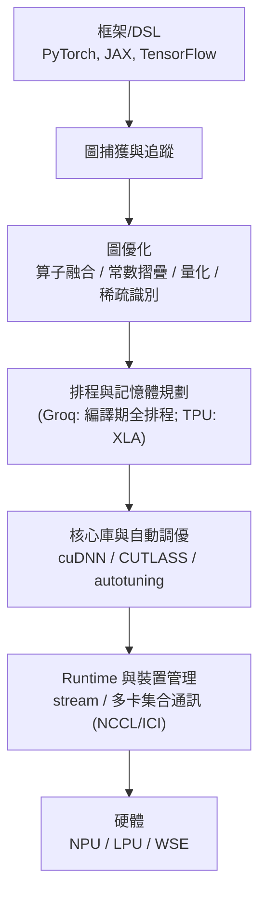

# 5.3 DSA 設計空間與加速器生態系

## 學習目標

1. 概覽 2016 年後 DSA 的主要族譜：TPU v2–v4/v5、手機 NPU（Apple Neural Engine、Qualcomm Hexagon/DSP）、DPU/SmartNIC、Groq LPU 與 Cerebras 晶圓級引擎。
2. 理解模型壓縮技術（量化、剪枝、稀疏化）與硬體資料流的共同設計（co-design）關係。
3. 掌握 Hennessy 與 Patterson 對 DSA 的設計準則：多核/多晶片擴展、領域特定語言、 以及以基準（如 MLPerf）驅動的評估文化。
4. 能論述軟體棧（編譯器、runtime、圖優化）為何是 DSA 成敗的第一決定因素。

---

## 5.3.1 DSA 族譜：五條演化主線

### 主線一：TPU v2 → v4（從推論到訓練與叢集）

TPU v1 驗證了脈動陣列，但無法訓練。2017 年的 TPU v2 進行三項關鍵擴充：

- **支援訓練**：加入反向傳播所需的雙向資料流（weights 可下傳、梯度可回流），並改用 bfloat16——截斷 FP32 尾數的高 16 位而保留完整指數域，使訓練數值穩定性接近 FP32，面積效率接近 FP16。bfloat16 之後成為訓練事實標準，並衍生出 FP8（v5e、H100）。
- **晶片間互連（ICI, Inter-Chip Interconnect）**：以 2D torus 將 4×4、16×16 顆 TPU 連成「Pod」，讓模型平行（model parallelism）跨越數千晶片。
- **HBM 高頻寬記憶體**：取代 DDR3，供給數百 GB/s 至 TB/s 級頻寬，餵飽更大的 MXU。

TPU v4（2021）以 4096 晶片構成 9 exaOPS（bf16）的 v4 Pod，OCI 光路交換器（OCS）讓 torus 拓撲可依工作負載重組——這是「資料中心即電腦（datacenter-as-computer）」的具體化：**DSA 的設計單位已從晶片上升到整個機櫃與資料中心**。

### 主線二：手機端 NPU

與資料中心相對，手機端追求「每毫焦耳的推論」，其 DSA 演化有兩個代表：

- **Apple Neural Engine（ANE）**：自 2017 年 A11 起整合，A 系列晶片的 ANE 採大規模 MAC 陣列 + 本地記憶體，設計目標是與 CPU/GPU 共存但由 Core ML 統一排程；其強項是低功耗常駐推論（Face ID、即時語音）。
- **Qualcomm Hexagon**：從 DSP 進化為 NPU。DSP 的傳統（VLIW、SIMD、低功耗、非精確浮點）成為 NPU 的良好起點；Hexagon 加上 Tensor Accelerator 與稀疏支援，Snapdragon 8 系列可跑 10B 級 LLM 量化模型。**「DSP → NPU」路徑說明 DSA 常由既有領域處理器漸進演化，而非憑空新造。**

手機 NPU 的設計約束與 TPU 幾乎相反：記憶體容量以 MB 計、必須與其他 IP 共享頻寬與散熱預算、且模型由應用商店動態部署——因此**量化與壓縮在手機端是生存條件而非選項**。

### 主線三：DPU / SmartNIC

當資料中心內的 CPU 從「做運算」變成「搬資料」，網路協議處理（TCP/IP、RDMA、NVMe-oF、加密、儲存抽象）成為可觀的固定開銷。DPU（Data Processing Unit，如 NVIDIA BlueField、AWS Nitro、AMD Pensando）把這些工作從主 CPU 卸載：

- AWS Nitro（2017 起）將網路、儲存、虛擬化幾乎全部卸載到專用卡，讓 EC2 主機幾乎 100% 的 CPU 留給租戶——雲端經濟學直接驅動的 DSA。
- BlueField 再加上可程式 ARM 核心與硬體加密、正則表示式引擎，作為「基礎設施處理器」。

DPU 的啟示是：**DSA 的「領域」不限於 AI**——凡是資料中心內大量重複、可預測的系統軟體功能，都是 DSA 的獵物。

### 主線四：Groq LPU——確定性資料流的極端

Groq 的 LPU（Language Processing Unit）由前 Google TPU 團隊打造，把脈動陣列思想推到極端：**完全確定性的 compile-time 排程**。所有張量在編譯期被安排好每一週期的位置，硬體上以超大 SRAM（數百 MB，取代 HBM）實現 TB/s 級片上頻寬，且**沒有投機執行、沒有硬體排程器、沒有亂序**。

代價是極端的軟體依賴：模型改一層，編譯器要重新全域排程；新模型架構的支援週期長。回報則是推論延遲極低且**延遲可預測**——對 LLM 的自迴歸解碼（逐 token 生成）尤其關鍵：每 token 的延遲決定使用者體驗。Groq 展示了一種取捨光譜：**把智慧從硬體（快取、投機）搬到編譯器**，是資料流架構的現代復興。

### 主線五：Cerebras——晶圓級引擎

Cerebras WSE（Wafer-Scale Engine）放棄「切晶圓成小晶片」的慣例，直接以整片晶圓做一顆晶片：WSE-3（2024）擁有 4 兆電晶體、90 萬個 AI 核心、44 GB 片上 SRAM。其動機是**通訊成本**：大模型訓練的瓶頸常在晶片間互連，而晶圓級內部的導線延遲與頻寬遠優於任何外接互連。工程挑戰則是良率（以冗餘核心與繞過電路克服）與封裝散熱（多點液冷模組）。

| 加速器 | 策略 | 強項 | 主要風險 |
|---|---|---|---|
| TPU Pod | 陣列 + torus + OCS | 規模化訓練/推論 | 生態閉鎖（僅 TensorFlow/JAX 路線） |
| ANE / Hexagon | 端側低功耗 | 每毫焦效能 | 記憶體與模型演化限制 |
| DPU | 卸載系統功能 | 主機效率 | 領域邊界重疊（SmartNIC vs. 主機 offload） |
| Groq LPU | 編譯期確定排程 + 巨量 SRAM | 極低延遲推論 | 模型彈性、編譯器複雜度 |
| Cerebras | 晶圓級單體 | 晶片內大模型通訊 | 良率、散熱、成本 |

## 5.3.2 量化、剪枝、稀疏：演算法與硬體的共同演化

DSA 时代的性能來源，一半來自電路，一半來自**讓電路少做事**：

- **量化**：TPU v1 的 int8 是起點；訓練感知量化（QAT）讓低精度不損精度；FP8 訓練（Transformer Engine）把範圍自適應縮放交給軟體、讓電路保持簡單。int4 權重（W4A8、W4A16）成為端側 LLM 的主流。
- **剪枝（pruning）**：2015 年 Han 等人展示權重可剪掉 90% 而精度僅微降。但**非結構化稀疏在 GPU 上難以加速**（不規則記憶體存取），直到 NVIDIA Ampere 的 2:4 結構化稀疏——每四個權重剪兩個、位置可預測——硬體才給出 2× 加速。這是典型的**「演算法讓步、硬體回報」協商**：演算法接受約束，硬體才能兑现效率。
- **稀疏注意力與 MoE**：Transformer 的注意力複雜度為 $O(n^2)$，稀疏/線性注意力與 Mixture-of-Experts 把「全稠密計算」改為「條件式計算」，直接重寫加速器的需求：MoE 需要巨大記憶體容量與高頻寬（專家權重讀取），推動 HBM 容量與多晶片記憶體池化。
- **KV cache 與推論瓶頸轉移**：LLM 推論中 KV cache 的讀寫使許多工作負載變成**記憶體頻寬受限**，促使加速器競賽從 FLOPS 轉向「頻寬/瓦」——這說明**演算法演化會持續改變 DSA 的瓶頸位置**，架構必須留有重新平衡的能力。

## 5.3.3 Hennessy & Patterson 的 DSA 設計準則

Hennessy 與 Patterson 在 2017 年 Turing Lecture 與後續論文 *A New Golden Age for Computer Architecture* 中，給出 DSA 時代的設計綱領，可整理為以下準則：

1. **以領域特定處理器（DSP/GPU/NPU/影像/網路處理器）為設計單位**，而非通用 CPU。犧牲通用性是效率的來源，但必須確認工作負載長期穩定。
2. **用領域特定語言（DSL）定義介面**：TensorFlow、PyTorch、JAX 之於 AI，如同 Verilog 之於硬體。DSL 給編譯器足夠的語義資訊，使圖級優化（融合、常數摺疊、稀疏識別）成為可能——沒有 DSL，DSA 的硬體效率無法被軟體觸及。
3. **多核、多晶片、機櫃擴展**：單晶片性能受功耗牆與良率限制，DSA 必須把互連（如 TPU ICI、NVLink、光交換）視為第一級設計對象。
4. **以 MLPerf 這類公認基準驅動**：避免紙上峰值（peak FLOPS）行銷，強調端到端、實際收斂時間（time-to-accuracy）。
5. **性能/瓦與 TCO 是最終指標**：5.1 與 5.2 節的 TPU 與礦機皆驗證此點。
6. **開放 ISA 與生態**（RISC-V）：DSA 時代也需要可組合的基礎，避免每個加速器都重造快取一致性與 IO 介面。

## 5.3.4 軟體棧：DSA 成敗的第一決定因素

硬體效率只是必要條件。一家 DSA 公司的護城河通常不在晶片，而在軟體棧：

三個關鍵事實：

1. **編譯器決定效率上限**。同一顆 TPU，XLA 融合與記憶體規劃的好壞可造成 2–5 倍實際差距；Groq 更是把全部賭注押在編譯期排程。
2. **模型演化速度快於硬體迭代**。硬體週期 2–3 年，模型架構 6 個月一變（RNN→Transformer→MoE→Mamba/SSM）。軟體棧必須能把「新算子」快速落到固定電路上（可程式向量單元、微碼、可重組資料流），否則硬體出貨時已過時——TPU v1 寫死的非線性函數正是前車之鑑。
3. **生態鎖定與開放的張力**。CUDA 的成功證明軟體生態可成為架構壟斷；對應的反抗力量是 Triton、ONNX、MLIR、IREE 等中間表示與編譯框架，試圖讓「模型一次寫、多種 DSA 跑」。DSA 越多，IR 與編譯基礎建設的價值越高。

## 5.3.5 展望：設計空間的座標

綜合本章，任何 DSA 都能在以下座標軸上定位，並依工作負載穩定性選點：

| 軸 | 光譜 |
|---|---|
| 可程式性 | 固定功能（SHA-256）↔ 微碼/可重排（TPU MXU）↔ 可程式向量（Hexagon）↔ 近通用（GPU） |
| 資料流 | 權重固定 ↔ 輸出固定 ↔ 脈動 ↔ 編譯期全排程（Groq） |
| 記憶體 | 無快取 UB（TPU v1）↔ 巨量 SRAM（Groq/Cerebras）↔ HBM 池化（TPU v4/v5） |
| 精度 | int4/int8 ↔ bf16 ↔ FP8 可調 ↔ FP32 |
| 擴展單位 | 晶片 ↔ 機櫃 torus ↔ 光交換資料中心 ↔ 晶圓級 |
| 部署場域 | 端側（ANE/Hexagon）↔ 邊緣 ↔ 雲 ↔ 基礎設施層（DPU） |

DSA 的黃金時代不在於某一種架構勝出，而在於**這個設計空間首次被系統性地探索**：工作負載的經濟價值（AI、網路、雲）提供了燃料，DSL 與編譯器提供了槓桿，而 MLPerf 與 TCO 提供了標尺。

## 本章小結

- 2016 年後 DSA 分成五條主線：TPU 訓練化與資料中心規模化、手機 NPU（DSP 演化路徑）、DPU/SmartNIC 的系統功能卸載、Groq 的編譯期確定性排程、Cerebras 的晶圓級整合。
- 量化、剪枝、稀疏、MoE 等模型壓縮與條件計算，與硬體資料流共同演化：演算法讓步於硬體約束，硬體以效率回報；LLM 時代瓶頸已從 FLOPS 轉向頻寬/瓦。
- Hennessy 與 Patterson 的準則：領域特定處理器 + DSL 介面 + 多晶片擴展 + 公認基準（MLPerf）+ TCO 導向 + 開放生態。
- 軟體棧（DSL、圖優化、排程編譯、runtime）決定 DSA 的實際效率與能否追上演化速度，是比晶片更深的護城河。

## 習題

1. TPU v4 的光路交換器（OCS）讓 torus 拓撲可重組。請說明 OCS 對「模型平行 vs. 資料平行」混合策略的支援方式，並論述為何資料中心級互連成為 DSA 的第一級設計對象。
2. 比較 2:4 結構化稀疏與非結構化剪枝：從記憶體壓縮、索引開銷、硬體加速難度三方面分析，並說明為何「演算法讓步」是硬體加速稀疏的前提。
3. Groq LPU 以編譯期全排程換取確定性延遲。若出現一種新的模型架構（如狀態空間模型），Groq 需要哪些軟體與硬體改動才能支援？與 TPU 的可程式向量單元路線相比，何者的「新模型上市時間」較短？
4. 手機 NPU（ANE、Hexagon）與資料中心 TPU 在記憶體階層、精度支援、散熱預算上有何本質差異？請論述為何端側 LLM 高度依賴 int4 量化與權重共享。
5. 假設你要為「邊緣影片分析（偵測+辨識）」設計一個 DSA，請依 Hennessy & Patterson 準則給出：(a) 領域與工作負載假設；(b) DSL 介面選擇；(c) 精度與稀疏策略；(d) 評估基準設計。並說明哪些決策是從本章五條主線各借了一個什麼教訓。
