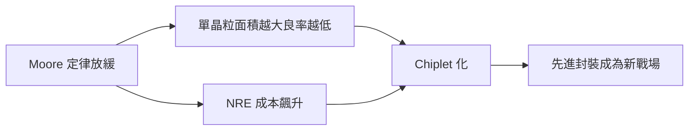

# 6.1 2022：Chiplet 與先進封裝

## 學習目標

讀完本節後，你應該能夠：

1. 解釋 Moore 定律放緩的物理與經濟成因，以及它如何驅動晶片設計典範從「單一大型晶粒（monolithic die）」轉向「晶粒（chiplet）」與先進封裝。
2. 說明 UCIe（Universal Chiplet Interconnect Express）標準的動機、分層架構與其對晶片產業生態的意義。
3. 分析 AMD Zen 2 chiplet 與 Intel Foveros 兩種代表路線的設計權衡。
4. 比較 TSMC CoWoS、InFO 等 2.5D/3D 封裝技術，並建立良率與成本的基本數學模型。
5. 以 AMD 3D V-Cache 為例，說明 3D 堆疊如何改變微架構的取捨空間。

---

### 6.1.1 Moore 定律的極限：為何必須換一條路

自 1965 年 Gordon Moore 提出觀察以來，「單位面積電晶體數每 18–24 個月倍增」一直是半導體產業的節拍器。然而到了 2010 年代後半，這條曲線在兩個層面同時出現裂縫。

**物理極限。** 當製程進入 7nm、5nm 以下，閘極長度接近材料的物理尺度，量子穿隧效應導致漏電流上升；光刻上，EUV（13.5nm 波長）雖解決了部分多重圖形化（multi-patterning）的複雜度，但單次曝光成本與缺陷控制難度都在攀升。電晶體密度仍在成長，但每單位成本的密度成長率（cost-per-transistor 曲線）自 28nm 之後明顯趨緩甚至反轉——這是所謂的「Moore 定律在經濟上已死」的論點。

**經濟極限。** 一座 3nm 級晶圓廠投資超過 200 億美元；一枚大型 SoC（例如伺服器級 CPU 或 AI 加速器）的設計與軟體驗證成本可達數億美元，且 NRE（非重複工程成本）必須由足夠大的出貨量攤提。更關鍵的是良率：晶片缺陷率通常以缺陷密度 $D_0$ （defects per cm²）描述，晶片面積越大，單一晶粒良率越低。這使得「把整個系統做成一顆大晶片」的路線在經濟上越來越不可行。

Chiplet 的核心思想因此浮現：**將大型晶片切分為多顆小晶粒，分別以最適合的製程製造，再以先進封裝在封裝層級整合**。這實質上把「製程縮小」的部分成長動能，轉移到「封裝與互連」上——2022 年前後，業界開始稱先進封裝為「超越 Moore（More than Moore）」的主戰場。

### 6.1.2 UCIe 標準：晶粒互連的统一語言

2022 年 3 月，Intel、AMD、Arm、TSMC、三星、微軟、Meta、Google 等共同成立 UCIe Consortium，發布 UCIe 1.0 規範。在此之前，各家的晶粒互連（Intel 的 EMIB 專屬介面、AMD 與 TSMC 的 CoWoS 互連、AIB、BOW 等）彼此不相容，晶粒無法像 IP 般跨廠交易。

UCIe 的分層架構：

| 層級 | 內容 |
|---|---|
| Physical（PHY） | 基於 PCIe/NVMe 生態的電氣訊號；支援先進封裝（bump pitch 25–130μm，極短走線、極低功耗）與較鬆的基板封裝（organic substrate）兩種模組 |
| Die-to-Die（D2D） | 定義 Flit 格式、鏈路層重試（retry）、CRC；可攜 PCIe/CXL 或專屬協議的語意 |
| Adapter / Protocol 層 | 直接映射 PCIe/CXL 事務層，使其可與系統軟體生態接軌 |

關鍵的理論意義在於：**D2D 互連位於封裝內部，走線長度在毫米級，因此能以遠低於 PCIe SerDes 的每 bit 能量（~0.25–0.5 pJ/bit，相較 PCIe 5.0 的數 pJ/bit）運作，並維持極高頻寬密度**。這使得晶粒之間可以「近乎像同一晶片內部」般交換快取一致性流量——這是 AMD chiplet 能做 NUMA 化、以及未來「混合廠商晶粒」的物理基礎。

### 6.1.3 AMD Zen 2：CPU 領域的 chiplet 典範

AMD 於 2019 年 Zen 2（EPYC Rome、Ryzen 3000）導入 chiplet 架構，是業界第一款量產的 x86 chiplet CPU：

- **CCD（Core Complex Die）**：8 核心 + L3 快取，用 TSMC N7 先進製程。
- **IOD（I/O Die）**：記憶體控制器、PCIe、Infinity Fabric，用 GlobalFoundries 12nm 成熟製程。
- CCD 與 IOD 以 Infinity Fabric 在封裝基板上互連（2.5D 式，非矽中介層，而是 organic substrate）。

設計權衡：IOD 使用舊製程，因此犧牲了記憶體延遲（跨晶粒存取），但大幅降低了先進製程面積的消耗，並且**同一顆 IOD 可服務 1 到 8 顆 CCD，直接創造出 64 核的 Rome**。NRE 與良率收益遠大於延遲損失，在伺服器市場尤其划算。這條路線延續到 Zen 3、Zen 4，並推動 AMD 在 2020 年代伺服器市占率回升。

### 6.1.4 Intel Foveros：3D 堆疊與邏輯晶粒

Intel 的路線強調**主動式 3D 堆疊**：

- **EMIB（Embedded Multi-die Interconnect Bridge）**：在矽中介層嵌入小段橋接，讓相鄰晶粒獲得高密度互連，而不用整片昂貴的矽 interposer。
- **Foveros**：真正的 3D 邏輯對邏輯堆疊，以 TSV（Through-Silicon Via）垂直連通上下晶粒。2022 年推出的 Meteor Lake 用 Foveros 將「SoC tile」「Compute tile」「Graphics tile」「I/O tile」以不同製程堆疊，甚至整合 Intel 4 與 TSMC N5 的晶粒——這是「混合晶圓代工」策略的典範。

與 AMD 的 2D/2.5D 基板路線相比，Foveros 的垂直互連長度更短（~μm 級），頻寬密度與能耗效率更高，但熱設計（下層晶粒需導熱穿過上層）與良率疊乘的挑戰更大。

### 6.1.5 TSMC CoWoS / InFO：封裝技術光譜

TSMC 的先進封裝形成一條由 2D 到 3D 的光譜：

- **CoWoS（Chip-on-Wafer-on-Substrate）**：晶粒先貼在大片矽中介層上，中介層內部走高密度金屬互連（bevel ~65nm 線寬的後段金屬層），再上基板。是 NVIDIA A100/H100 等 AI 加速器的主要封裝——把 HBM 記憶體堆疊與 GPU 晶粒放在同一個矽中介層，提供 >3TB/s 的頻寬。
- **InFO（Integrated Fan-Out）**：以 RDL（redistribution layer）取代基板上的部分走線，用於行動裝置（Apple A 系列處理器）與 CoWoS-L 的中介層替代方案。
- **SoIC（System on Integrated Chips）**：3D 堆疊的微凸塊/混合鍵合（hybrid bonding）技術，鍵合間距可低於 10μm。

### 6.1.6 良率與成本模型

Chiplet 經濟學可以用簡單模型描述。假設晶圓缺陷密度為 $D_0$ ，晶片面積為 $A$ ，用經典的 Poisson 模型：

$$Y_{die} = \frac{1}{(1 + A \cdot D_0 / \alpha)^\alpha}$$

其中 $\alpha$ 是聚集參數（cluster parameter，通常 0.5–2）。當 $D_0 = 0.1/\text{cm}^2$ 、 $\alpha = 1$ 時：

- 單一大晶粒 $A = 8\,\text{cm}^2$ ：良率 $\approx 1/1.8 \approx 55.6\%$
- 晶粒化為 4 顆 $A = 2\,\text{cm}^2$ ：良率 $\approx 1/1.2 \approx 83.3\%$

但 chiplet 並非沒有成本。每顆晶粒需要额外的 bump、測試（known-good-die, KGD）、封裝疊加的良率 $Y_{pkg}$ ，以及互連介面面積開銷。總成本模型大致為：

$$C_{sys} \approx \sum_i \frac{C_{wafer,i} \cdot A_i}{Y_i \cdot N_{die,i}} + C_{pkg} \cdot \frac{1}{Y_{pkg}} + C_{test}$$

chiplet 化划算的條件是：**良率改善與跨產品線複用（amortization）的節省 > 互連與封裝的額外成本**。對高階大晶片（ $A > 400\,\text{mm}^2$ 、先進製程）而言，這個不等式幾乎必然成立；對小晶片則不一定。

### 6.1.7 3D V-Cache：堆疊改變微架構取捨

AMD 於 2022 年推出 Ryzen 7 5800X3D，透過 TSMC SoIC 將 **64MB L3 SRAM 晶粒以混合鍵合垂直堆疊在 CPU 晶粒上方**。這帶來三個架構啟示：

1. **SRAM 縮放已嚴重落後邏輯**：5nm 的 SRAM 單元面積接近 0.021 μm²，與 7nm 相比僅微幅縮小。當邏輯晶粒繼續縮小而快取停滯，**把快取做成獨立晶粒垂直堆疊**成為合理選擇。
2. **頻寬與延遲**：TSV + 混合鍵合使 L3 頻寬達 TB/s 級、額外延遲僅數 ns，遠優於封裝層級的 HBM。
3. **熱與時脈的折衷**：3D 堆疊限制散熱，5800X3D 時脈反而下調。這提示 3D 堆疊最適合的是**電晶體密度高、功耗密度相對低的電路**（如快取），而非峰值邏輯。

---

## 本章小結

- Moore 定律在物理（漏電、光刻極限）與經濟（NRE、cost-per-transistor）兩方面同步放緩，驅動架構典範從「做大單晶粒」轉向「chiplet 化 + 先進封裝」。
- UCIe 於 2022 年將 die-to-die 互連標準化，使晶粒可以像 IP 一樣跨廠組裝，是晶片產業生態的結構性變革。
- AMD Zen 2 以「先進製程做核心、成熟製程做 I/O」的 2D 基板路線證明 chiplet 的成本優勢；Intel Foveros 則以 3D 堆疊與多代工混合，指向更高整合密度的未來。
- TSMC CoWoS／InFO／SoIC 提供 2.5D 至 3D 的技術光譜，是 AI 加速器（HBM + GPU）的核心支撐。
- 良率-成本模型說明：chiplet 的淨收益來自良率指數級改善與跨產品複用，而非單純的「面積切小」。
- 3D V-Cache 顯示，當 SRAM 縮放落後邏輯時，垂直堆疊成為補償快取容量與頻寬的自然路徑。

## 習題

1. **良率計算**：假設 $D_0 = 0.08/\text{cm}^2$ 、 $\alpha = 1$ ，分別計算 $A = 400\,\text{mm}^2$ 與 $A = 100\,\text{mm}^2$ 晶粒的良率。若 wafer cost 為 15000 美元，每片可切 100 顆 $400\,\text{mm}^2$ 或 350 顆 $100\,\text{mm}^2$ 晶粒，比較每顆良品晶粒的成本，並討論在什麼條件下 chiplet 化仍不划算。
2. **架構比較**：比較 AMD Zen 2 的「organic substrate + Infinity Fabric」與 Intel Foveros 3D 堆疊在（a）互連頻寬密度、（b）熱設計、（c）多代工整合彈性 三方面的優劣。
3. **UCIe 標準化效應**：討論 UCIe 若成熟到可讓第三方（例如記憶體、加速器、光互連廠）供應晶粒，對現有 IDN（整合元件製造商）與晶圓代工的商業模式會產生什麼衝擊？
4. **3D V-Cache 應用外推**：除了 L3 快取，你認為還有哪些電路適合用 3D 堆疊（提示：暫存器、TLB、分支預測表、AI 加速器的 activation buffer）？請說明每種情況對頻寬、延遲、熱的敏感度。
5. **（開放研究題）**：假設 hybrid bonding 間距在十年內降到 1μm 以下，「晶粒邊界」與「晶片內部電路」的差異是否會消失？請提出一個架構模型（例如：把整個 SoC 視為多層 3D 網狀晶片），並分析其在驗證、散熱、測試上的新挑戰。
