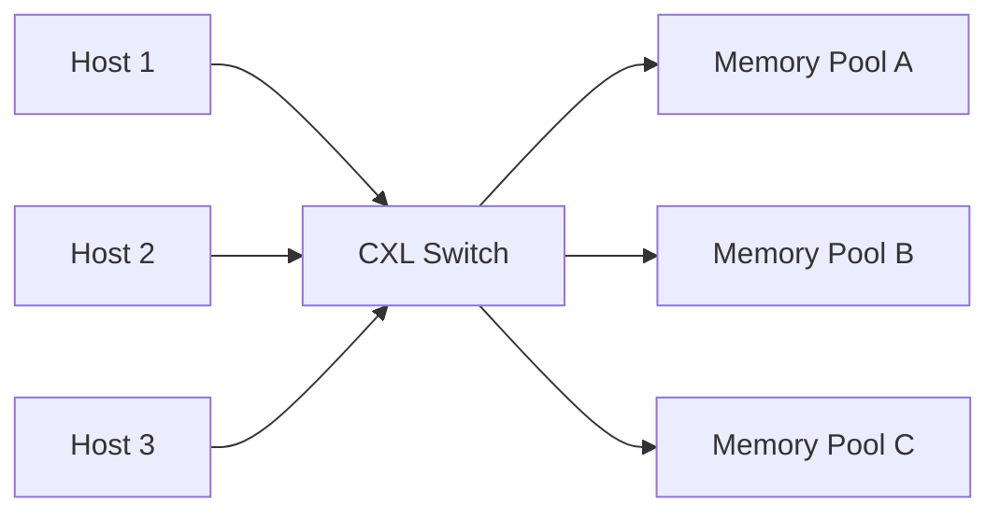

# 6.2 近記憶體運算與 CXL 互連

## 學習目標

讀完本節後，你應該能夠：

1. 說明「記憶體牆（memory wall）」與「資料移動成本」在資料中心的量化重要性，並解釋為何 Processing-in-Memory（PIM）重新受到重視。
2. 比較 UPMEM、三星 HBM-PIM 兩種代表性 PIM 架構的設計哲學與適用負載。
3. 解釋 CXL 1.1 / 2.0 / 3.0 的協議演進、記憶體池化（memory pooling）與共用（memory sharing）的差異。
4. 分析資料中心記憶體擴充的經濟學：記憶體使用率、TCO 與池化收益的估算模型。

---

### 6.2.1 記憶體牆的資料中心版本：資料移動成本

傳統 von Neumann 瓶頸在單機層面被討論了數十年，但在資料中心尺度，它有了新的量化形式：

- **能量不對稱性**：從 DRAM 讀取一個 64-bit word 約需 10–20 pJ，透過 PCIe 讀取約需 10–20 nJ，跨網路（如跨機架）則需數百 nJ 到數 μJ。**資料移動的能量可比資料運算本身高 2–4 個數量級**。
- **頻寬牆**：AI 推理與推薦系統（如 Meta DLRM）大量時間花在 embedding table 的隨機存取，DRAM 頻寬而非算力成為瓶頸。
- **記憶體使用率低落**：微軟、Meta 等公開研究指出，資料中心 DRAM 的平均使用率僅 40–60%，但因記憶體「被綁死在特定伺服器」無法跨機共用，仍需採購更多記憶體來保障尾延遲。

這兩個問題——「資料靠近算」與「記憶體跨越伺服器邊界」——分別由 **PIM** 與 **CXL** 兩條技術路線回應，並且在 2022 年前後同時成熟。

### 6.2.2 Processing-in-Memory：把算術搬到資料旁邊

PIM 的譜系可分為三類：

1. **Processing-Near-Memory（PNM）**：在記憶體晶片或堆疊的邏輯層放置小型處理器或 ALU 陣列（例：HBM 基底 die 上的 compute unit）。
2. **Processing-Using-Memory（PUM）**：利用 DRAM/SRAM 陣列本身的類比或數位特性做運算（如 RowClone 的 bulk copy、Ambit 的 triple-row activation 做位元運算）。
3. **近記憶體加速器**：在記憶體模組上附加可程式核心（例如 Samsung HBM-AQUA、UPMEM 模組）。

**UPMEM**（2019 量產）是第一個商用通用型 PIM：在每顆 DDR4 晶片上嵌入 8 個 DPU（每個 DPU 含 14 線程的簡單 in-order 核心、64KB IRAM、80KB DRAM），一條 128GB DIMM 含 128 個 DPU，整個系統可達數千個 DPU。其架構哲學是：**大量簡單核心 + 極高聚合記憶體頻寬**，適合 bandwith-bound 的資料分析（資料庫掃描、DNA 定序、推薦系統）而非 latency-bound 負載。

**三星 HBM-PIM（2021 FIMDRAM / 2022 HBM-PIM）** 則走另一條路：在 HBM 的每個 bank 下方加一個可程式 ALU 單元（FP16 adder/MAC），稱為 PCU（PIM compute unit）。它不需要修改軟體棧的記憶體配置，可在「普通 DRAM 模式」與「PIM 模式」間切換。三星展示在 LLM 推理上，HBM-PIM 可將 energy consumption 降低約 70%、性能提升 2 倍以上。

兩者的對比：

| 維度 | UPMEM | 三星 HBM-PIM |
|---|---|---|
| 位置 | DDR4 晶片內部 | HBM3 堆疊內部（靠近邏輯 die） |
| 運算粒度 | 獨立 DPU 核心 | Bank 級 ALU / MAC |
| 程式模型 | C 語言 + 專屬 SDK | 需修改 kernel（如 SIMD 指令） |
| 適用負載 | 資料分析、定序、圖計算 | LLM 推理、推薦系統矩陣-向量 |
| 主要瓶頸 | DPU 算力弱、host-DPU 資料搬移成本 | 單 PCU 頻寬有限、與 host 一致性 |

**理論意義**：PIM 的收益與負載的「運算強度（arithmetic intensity, FLOPs/Byte）」強相關。用 roofline model 描述：當負載落在 roofline 的「memory-bound」區，PIM 把記憶體頻寬就地提升 10×，等比放大性能；但對 compute-bound 負載幾乎無益。這也解釋了為何 PIM 至今主要落地在 embedding lookup、attention KV cache 讀取、向量相似度搜尋等特定 kernel，而非全面取代 CPU/GPU。

### 6.2.3 CXL：讓記憶體跨越伺服器邊界

Compute Express Link 建立在 PCIe 的物理層上，提供了**快取一致性（coherent）**的主機-裝置互連。它對記憶體的意義是：**讓 DRAM 可以不插在 CPU 的記憶體通道上，而成為可被池化、擴充的資源**。

CXL 的三個子協議：

- **CXL.io**：相容 PCIe 的基本 I/O 與發現機制。
- **CXL.cache**：允許裝置（如加速器）存取 host 記憶體，並維持一致性。
- **CXL.mem**：允許 host 存取裝置端（或記憶體池中）的記憶體。

**版本演進**：

| 版本 | 年份 | 主要新能力 |
|---|---|---|
| CXL 1.0/1.1 | 2020/2021 | 基礎規範、Type 1/2/3 裝置、單 host |
| CXL 2.0 | 2022 | 記憶體池化（MHD 多邏輯裝置）、持久性記憶體、Back-invalidate、switch 支援 |
| CXL 3.0 | 2022 年 8 月 | 基於 PCIe 6.0（64 GT/s PAM4）、記憶體共用（multi-host sharing）、PBR 埠基由路由、記憶體結構（memory fabric） |

**池化 vs. 共用**是兩個關鍵概念：

- **Pooling**：一塊 DRAM 被邏輯切成多份，分別指派給不同 host，**每份同一時間只有一個 host 可存取**。用於解決「每台機器都要預留峰值記憶體」的浪費。
- **Sharing**：多個 host **同時**讀寫同一塊記憶體，需要硬體一致性（Back-invalidate）與分散式鎖。這是 3.0 之後才實用的能力，用於分散式共享記憶體、跨機 KV cache 等。

**記憶體擴充的架構代價**：CXL.mem 走 PCIe 實體層，延遲為 **170–250ns**（native DDR5 約 80–100ns），頻寬受限於 PCIe lane。因此 CXL 記憶體不適合作為熱路徑的 DRAM 替代，而更適合：

1. 冷資料、大型 lookup table、VM swap 後備。
2. Tiered memory（OS 層面 NUMA node 分層，如 Linux 的 `memory tiering`）。
3. Memory-bound 的資料庫 buffer pool、向量索引（如 FAISS 的 index）。

### 6.2.4 資料中心記憶體擴充經濟學

CXL 的商業動機可以用一個簡化模型描述。假設資料中心有 $N$ 台伺服器，每台的 DRAM 需求為隨機變數 $X$ ，若要保障 99.9% 的 SLA，每台需配備第 99.9 百分位的記憶體量 $Q_{99.9}$ ；總採購量為 $N \cdot Q_{99.9}$ 。若記憶體池化後由中央池供應，總量僅需 $N \cdot E[X] + \text{safety margin}$ 。這是排隊理論中「池化（statistical multiplexing）」的經典結果：**變異數越大、單位越小，池化收益越大**。

微軟的研究（"Pond" 論文）估算：CXL 池化可節省 4–10% 的總記憶體採購，且在尾延遲 SLA 嚴格的環境下收益更大。加上 CXL 允許使用「不綁 CPU 的 DRAM 擴充條」（例如伺服器原本只有 8 個 DIMM slot 已滿，仍可透過 CXL 擴到 12 個 DIMM 容量），進一步推遲了「CPU 換代」的需求。

但 CXL 也有經濟上的阻力：每個 CXL 裝置需要額外的 CXL controller 晶片（成本 ~30–50 美元）、switch 本身昂貴且頻寬有限、且 host 端需要 BIOS/OS 的 memory tiering 支援。這些成本意味著**池化只在「記憶體需求變異大、記憶體成本占整機成本比例高」的場景划算**——AI 推理伺服器（HBM 昂貴）與大資料庫主機正是典型例子。

---

## 本章小結

- 資料中心尺度的記憶體問題有兩個面向：「資料移動的能量與頻寬成本」（驅動 PIM）與「記憶體資源低使用率」（驅動 CXL）。
- PIM 的收益與負載的 arithmetic intensity 強相關，最適 memory-bound kernel；UPMEM 以通用 DPU 走 DDR4 路線，三星 HBM-PIM 以 bank 級 ALU 整合進 HBM3 針對 LLM 推理。
- CXL 透過 PCIe 物理層提供 cache-coherent 的記憶體擴充；1.1 建立基礎、2.0 加入池化與 switch、3.0 引入共用與 fabric 化。
- CXL 記憶體的 170–250ns 延遲決定其適用場景為分層記憶體與冷資料，而非取代 DRAM。
- 記憶體池化的經濟收益來自 statistical multiplexing：記憶體需求變異越大，池化節省越多；但 CXL controller、switch 與軟體棧成本構成阻力。

## 習題

1. **Roofline 分析**：一個 LLM 推理 kernel，算術強度為 0.5 FLOP/Byte，GPU 峰值算力 300 TFLOPS、HBM 頻寬 3TB/s。若改用 HBM-PIM 使有效頻寬提升 2×，估算性能提升比例；若算術強度改為 50 FLOP/Byte 呢？請解釋差異。
2. **池化收益**：假設某資料中心 100 台伺服器的記憶體需求服從均勻分布 $U[100, 300]$ GB，SLA 要求 99% 不超過。比較（a）每台獨立配 300GB 與（b）中央池配 $100 \cdot E[X] + 50$ GB 的總記憶體量，並討論變異數增大時池化收益如何變化。
3. **CXL 延遲代價**：在 Linux memory tiering 機制下，若 hot page 誤放 CXL 記憶體，會額外增加多少訪問延遲？請提出一個啟發式（如基於 PEBS/Numastat 的頁面遷移策略），並分析其開銷與收益。
4. **PUM vs PNM**：比較「利用 DRAM 陣列類比特性做運算（PUM）」與「在記憶體中加數位 ALU（PNM）」在精度、可程式性、量產難度上的取捨。
5. **（開放研究題）**：若 CXL 3.0 的 memory sharing 真正普及，分散式共享記憶體（DSM）是否會從作業系統研究課題變成資料中心的標準程式模型？請設計一個「跨主機 KV cache」的架構原型，分析一致性協定、故障恢復與安全隔離三個關鍵問題。
