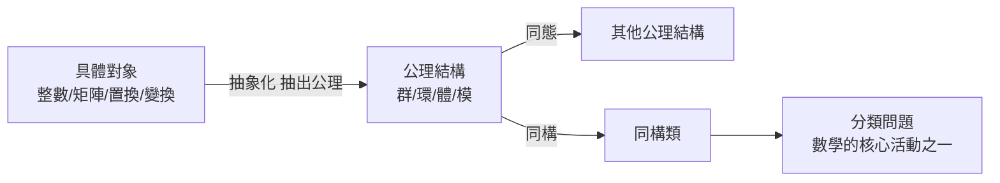

# 1.3 抽象代數的本質：透過運算律定義物件

## 前因：從「計算物件」到「公理物件」

19 世紀以前，代數是「關於數的計算技巧」。1800 年代連續的震撼改變了一切：

- Hamilton（1843）四元數：**乘法可以不交換**！
- Boole（1847）：邏輯可以變成代數。
- Cayley（1854）：矩陣與抽象群。
- Dedekind、Noether（1870s–1920s）：理想論與公理化。

這些事件共同宣告：**代數研究的不是數，而是滿足特定運算律的任意集合。**

## 構造：公理即「合約」

現代代數的方法論：

1. 挑選一組想保留的性質（運算律），寫成公理。
2. 任何滿足公理的對象都納入研究範圍。
3. 保持公理的映射（同態）成為物件之間的橋樑。

**定義（同態）。** $f: (G,\cdot) \to (H,*)$ 滿足 $f(a\cdot b) = f(a) * f(b)$ 。

例如：行列式 $`\det: (\mathrm{GL}_n(\mathbb{R}), \times) \to (\mathbb{R}^\times, \times)`$ 是群同態；指數 $`\exp: (\mathbb{R},+) \to (\mathbb{R}_{>0}, \times)`$ 把「加法結構」轉譯成「乘法結構」。

**第一同構定理。** $\ker f \triangleleft G$ ，且 $G/\ker f \cong \mathrm{im}(f)$ 。

「商」的概念——把一個子結構「壓成點」——是 20 世紀數學最重要的發明之一：幾何上壓空間（商拓撲）、拓撲上壓同倫（7.1）、代數上壓理想（商環）。

## 同構：結構主義的宣言

「 $G \cong H$ 」的意思不是 $G$ 與 $H$ 相等，而是**在研究該公理體系時，它們沒有區別**。 $4$ 階群只有兩種： $\mathbb{Z}/4$ 與 Klein 四元群 $V_4$ ；任何恰好有四個對稱的對象，必定是其中之一。

## 後果

1. **範疇論**（第 9 章）：把「物件 + 同態」整體視為新物件，公理化再上一層。
2. **普遍性質**：積、餘積、自由物件——「最通用、最不特別」的構造，成為定義的新標準。
3. **泛函分析**（第 5 章）：把「完備賦範向量空間」當作公理物件，函數成為點。

抽象代數因此不是「更難的代數」，而是**數學的作業系統**：一旦把結構寫成公理，定理就能在不同領域間免費移植。

## 練習與思考

1. 證明群同態保持單位元與反元素。
2. 「自由群」的自由體現了什麼普遍性質？為什麼它是「最通用」的群？
