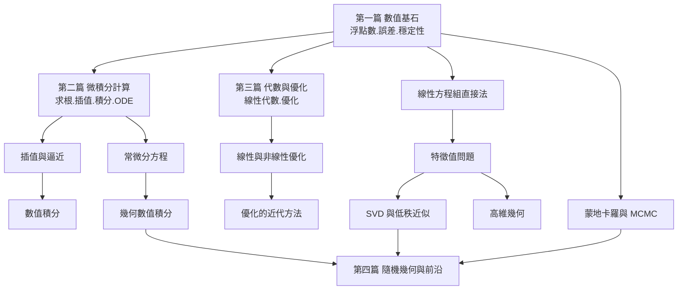

# 閱讀地圖與全景導覽

一本計算數學的書，最怕寫成一本演算法食譜：讀者照著做可以算出答案，卻不知道為什麼選這個方法、它什麼時候會失效、它和別的方法在數學上如何相通。本書的組織方式正好相反：以「離散的連續」為主軸，把演算法、幾何與結構放在同一個框架裡，讓每一章都同時回答「怎麼算」與「為什麼這樣算」。本章說明全書的四篇結構、各篇的內容與相互依賴，並為不同背景的讀者規劃閱讀路徑。

## 全書結構：四篇的邏輯

全書分為四篇，大致對應計算數學的四個層次：地基、微積分的離散化、代數與優化的結構、以及隨機與幾何的近代前沿。

第一篇「數值基石」處理一切的出發點：機器如何表示實數（浮點數、IEEE 754、捨入誤差）、誤差如何傳播（前向與後向誤差分析、條件數）、以及什麼樣的演算法值得信任（穩定性）。這一篇的歷史背景正是 00.1、00.2 兩章提到的戰後歲月——Turing、von Neumann、Wilkinson 那一代人建立的誤差理論，至今仍是判斷一切數值方法的準繩。讀完這一篇，你會明白為什麼「數學上等價」在機器上不等於「計算上等價」。

第二篇「微積分計算」是連續數學離散化的主戰場：非線性方程求根（二分法、Newton 法、不動點迭代的收斂理論）、插值與逼近（多項式插值的 Runge 現象、Chebyshev 節點、樣條）、數值微分與積分（Newton–Cotes、Gaussian 求積、自適應積分）、以及常微分方程的數值解（Euler 法、Runge–Kutta、剛性問題與隱式方法、相空間的幾何數值積分）。這一篇的思想核心是：收斂階、穩定域與守恆性質三者之間的取捨，是無法兼得的結構性事實。

第三篇「代數與優化」處理離散結構的計算：線性方程組的直接法（LU 分解、pivoting、稀疏矩陣）、特徵值問題（QR 演算法、對稱矩陣的 Krylov 子空間方法）、線性與非線性優化（單純形法的故事、內點法、凸性、拉格朗日對偶、KKT 條件），以及矩陣分解與低秩近似（SVD 的幾何意義、主成分分析）。這一篇連接了兩條歷史線：一條是 Dantzig 在 1947 年為美國空軍規劃問題發明的單純形法，另一條是蘇聯 Khachiyan 與 Karmarkar 先後在 1979、1984 年推出的多項式時間演算法，引爆了「理論複雜度與實務效率」的著名論戰。

第四篇「隨機幾何與前沿」把視野推向近代：蒙地卡羅方法（從氫彈到金融，重要性抽樣、MCMC、Metropolis 演算法——這篇方法 1953 年誕生於 Los Alamos，後來成為統計物理與貝葉斯統計的通用引擎）、隨機漫步與馬可夫鏈的計算、高維幾何（凸體、體積演算法、維度災難的結構性應對），以及計算的前沿議題：深度學習背後的數值與優化視角（梯度下降的收斂、隨機方法）、張量分解、以及演算法本身被機器學習搜尋的新趨勢。

## 章節依賴關係

閱讀時不必按圖索驥地走完全部箭頭，但箭頭所指的方向代表「先讀前者，後讀者才不吃力」的依賴關係。例如 QR 演算法需要正交矩陣與條件數的概念（第一、三篇），蒙地卡羅的收斂分析需要機率基礎加上一點積分的直覺（第二篇），梯度下降的理論則依賴優化篇的凸性與收斂速率。

## 三條閱讀路徑

工程師路線。目標是「寫出可靠、高效的數值程式」。順序：第一篇全部 → 第二篇的求根與積分（工程中最高頻）→ 第三篇的線性方程組直接法與稀疏矩陣（任何模擬的核心）→ 第二篇的 ODE 或第三篇的優化（依工作領域二選一）→ 第四篇的蒙地卡羅。這條路線的重點是每一章的「實務準則」：什麼時候該換方法、如何檢驗答案、如何閱讀函式庫文件中關於穩定性的警告。計算數學史上最昂貴的教訓（如 1991 年 Patriot 飛彈的時間累積誤差事故、1996 年 Ariane 5 的整數溢出爆炸）都屬於這條路線必修的案例。

理論路線。目標是「理解計算數學的數學結構」。順序：第一篇全部（特別是後向誤差分析）→ 第二篇的收斂理論（插值誤差界、Gaussian 求積的正交多項式理論、ODE 的穩定性理論）→ 第三篇的特徵值理論與對偶理論 → 第四篇的高維幾何與複雜度主題。這條路線可以和 00.2 講的複雜度理論對讀：FFT 與 Strassen 是「改進上界」的範式，P vs NP 與維度災難是「證明極限」的範式——一個領域的成熟，表現在同時知道什麼可為、什麼不可為。

AI 研究者路線。目標是「理解深度學習底下的數值與優化地基」。順序：第一篇（浮點與穩定性——混合精度訓練、數值下溢，全靠這些概念）→ 第三篇的線性代數與優化（SVD、條件數、梯度法收斂）→ 第四篇的蒙地卡羅與隨機方法（SGD 就是隨機近似，Robbins 與 Monro 1951 年的論文是共同祖先）→ 最後回到第四篇的前沿章節。這條路線的歷史趣味在於：深度學習的數學工具——梯度下降、蒙地卡羅、SVD、共軛方法——沒有一個是新發明，全是計算數學數十年積累的結構被新硬體重新點亮。

## 幾點閱讀建議

第一，每篇的第一章是該篇的地圖，各章末的歷史註記可以獨立閱讀，串起來就是一部計算數學的社會史：戰爭與經濟如何催生演算法、制度（國家實驗室、軍方委託、大學科系）如何塑造研究方向、文化（開放原始碼、教科書傳統）如何讓知識擴散。第二，數學式請動手驗證：本書的例子大多可以用任何計算環境（Python/NumPy、Julia、MATLAB）在幾行內重現，數值分析是最好的「實驗科學」之一——Runge 現象、捨入誤差的放大、蒙地卡羅的 $N^{-1/2}$ 收斂，親手跑過一次勝過讀十遍。第三，遇到失敗的計算不要急著換更強的機器，先問三個問題：問題病態嗎？演算法穩定嗎？複雜度是否根本不允許？這三問就是 00.1 與 00.2 兩章的全部遺產，也是全書反覆出現的主旋律。

準備好了，就從第一篇「數值基石」開始——從一個看似平凡的問題出發：0.1 在你的電腦裡，究竟是多少。
