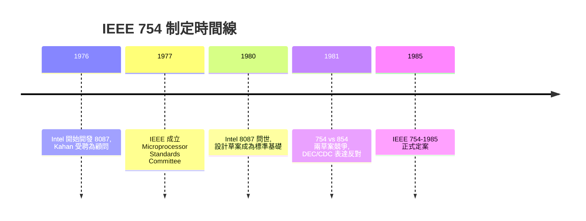

# 1985 — IEEE 754 浮點數算術與捨入誤差

## 一個標準誕生前的混亂年代

1970 年代末，電腦產業正面臨一個尷尬的問題：同樣一份 Fortran 程式，在 IBM、CDC、DEC、Honeywell 的機器上跑出來的數值結果可能完全不同。那時每家電腦廠商都有自己的浮點數格式：IBM System/360 用十六進位基底（base 16），CDC 6600 系列用 60 位元的一補數，DEC 的 PDP-11 和 VAX 又是另一套。十六進位基底尤其惡名昭彰——它會在有效位數前端「吞掉」多達三位二進位元，使得 1.0 + ε 這類運算的行為難以預測。

經濟上的驅動力很直接：微處理器讓電腦從實驗室走進辦公室與工廠，軟體第一次成為可以跨機器販售的商品。如果每台機器的算術行為都不同，軟體廠商就必須為每個平台個別調校數值程式。這在制度上促成了 1977 年 IEEE（電機電子工程師學會）成立 Microprocessor Standards Committee，授權制定一個統一的浮點數標準，這就是後來的 IEEE 754 計畫（Project 754）。

## William Kahan 與 Intel 8087 事件

故事的核心人物是柏克萊加州大學的 William Kahan，一位從事數值分析多年的數學家。1976 年，Intel 決定開發 8087——這是一顆數學輔助處理器（floating-point coprocessor），要搭配 8086/8088 使用。Intel 聘請了 Kahan 擔任顧問，與 John Palmer 等人一起設計 8087 的浮點架構。

Kahan 的堅持在於幾件在當時看來近乎「奢侈」的事：

- 每個基本運算（加、減、乘、除、平方根）都必須「正確捨入」，也就是結果必須等於把真實無限精度結果用指定捨入模式捨入後的值。
- 提供「次正常數」（subnormal/denormal numbers），讓下溢（underflow）平滑漸進，避免一個極小的數突然變成零造成精度斷崖。
- 支援多重捨入模式：捨入到最近、向零、向正無窮、向負無窮。
- 保留特殊值 NaN 與無窮大，讓例外情況可以延後處理而不是立刻崩潰。
- 提供擴充精度（extended precision）的中間計算空間。

1980 年 Intel 8087 問世，完整實作了這套設計。關鍵的一步是 Kahan 說服 Intel 將 8087 的設計草案公開，交給 IEEE 委員會作為標準的基礎——這在商業上是不小的讓步，但 Intel 的算盤是：如果整個產業採用自家設計，Intel 將是最大受益者。事後看來這個判斷完全正確。

## 委員會的政治：DEC、CDC 與 Zilog 的反對

標準制定絕非一帆風順。IEEE 754 的起草過程從 1977 年延燒到 1985 年，期間的爭論在某種程度上是工程哲學之爭。

DEC（Digital Equipment Corporation）一開始主張採用它自家 VAX 上的 F 浮點格式作為標準——畢竟 VAX 是當時最成功的 32 位元小型機。Kahan 一派指出 VAX 格式在漸進下溢等關鍵性質上有所欠缺，且若直接採納某廠商的既有格式，等於把標準的未來交給單一公司。CDC（Control Data Corporation）則反對得更徹底：CDC 的超級電腦傳統上不做硬體的漸進下溢，主張精確地陷捕（trap）到軟體處理即可；他們認為次正常數會拖慢硬體速度、增加電晶體成本。Zilog 也提出自己的方案（Z8000 用的格式）加入競爭。

委員會內部的辯論以「854 號草案」與「754 號草案」兩個競爭版本的形式展開——前者較接近 Kahan 的完整設計，後者較寬鬆。最後在 1985 年，經過多輪表決、修訂與私下協調，IEEE 754-1985 正式定案：二進位浮點、正確捨入、次正常數、多重捨入模式全部入標。這是一個罕見的案例：一個由學者主導、以數學正確性為最高原則的設計，打敗了商業現實派，並且統治了此後四十年的所有主流 CPU。

## 二進位浮點數的結構與機器 epsilon

IEEE 754 單精度（binary32）用 32 位元表示一個數：1 位元符號、8 位元指數、23 位元尾數。雙精度（binary64）則是 1 + 11 + 52。一個規格化數的值為

$$
(-1)^s \times 1.f \times 2^{e - \text{bias}}
$$

尾數有個隱藏的首位 1，因此實際有效位數是 24 位（單精度）或 53 位（雙精度）。這個隱藏位是 Kahan 設計中的省位妙招。

定義機器 epsilon 為「1 與下一個可表示的浮點數之間的距離」。對二進位格式而言

$$
\epsilon_{\text{mach}} = 2^{-(p-1)}
$$

其中 $p$ 是有效位數。單精度 $\epsilon \approx 1.19\times 10^{-7}$，雙精度 $\epsilon \approx 2.22\times 10^{-16}$。相對捨入誤差的上界正是 $\epsilon/2$（捨入到最近時）。這個小小的常數，是此後一切誤差分析的起點。

## 捨入模式

IEEE 754 規定四種捨入模式：捨入到最近偶數（round-to-nearest-even，預設）、向零捨入、向 $+\infty$、向 $-\infty$。「捨入到最近偶數」是 Kahan 特別堅持的細節：當結果恰好在兩個可表示數的正中間時，選擇尾數最後一位為 0 的那個，可以避免長期累積的單向偏誤。後兩者（定向捨入）則是區間算術的基礎，讓人可以機械地為計算結果加上嚴格的誤差界。

## 捨入誤差的三大歷史災難

### 愛國者飛彈時鐘漂移（1991）

1991 年 2 月 25 日，波斯灣戰爭期間，沙烏地阿拉伯達蘭（Dhahran）的美軍營區被一枚伊拉克飛毛腿飛彈擊中，28 名美軍士兵死亡。事後調查（GAO/IMTEC-92-26 報告）發現原因正是捨入誤差：愛國者系統的內部時鐘以 0.1 秒為單位累加，而系統以 24 位元定點／浮點混合方式儲存這個值。0.1 在二進位中是無限循環小數

$$
0.1_{10} = 0.0001100110011\overline{0011}_{2}
$$

被截斷為 24 位元後，每次計時都產生約 $9.5 \times 10^{-8}$ 秒的誤差。系統連續運轉 100 小時後，累積時鐘誤差達 0.34 秒——足夠讓系統在預測飛彈位置時產生 687 公尺的偏差，雷達追蹤到的目標與實際位置差得太遠，攔截判定直接失敗。諷刺的是，該系統原本的設計要求是連續運轉不超過數小時，戰場現實讓它超時工作，也讓這個「理論上可忽略」的誤差成為致命傷。

### Vancouver Stock Exchange 指數錯誤（1982）

溫哥華證券交易所的加權股價指數在 1982 年啟用後，被發現數值長期「莫名」偏低。程式每此計算都將指數截斷（truncate）到小數點後三位而不做正確捨入。截斷是單向偏誤，每天數千次更新不斷往同一方向累積。到 1983 年 11 月被修正時，指數顯示為 524.811，但正確值應約為 1098.892——三年間錯了超過一半。這成為「微小捨入偏差 + 大量重複運算 = 系統性災難」的教科書案例。

### Ariane 5 爆炸（1996）

1996 年 6 月 4 日，歐洲太空總署的 Ariane 5 火箭首飛 37 秒後解體，損失約 3.7 億美元的載具與四枚衛星。調查報告指出，問題出在慣性參考系統（SRI）將一個 64 位元浮點數轉換為 16 位元有號整數時發生溢位（overflow）。這段程式碼原為 Ariane 4 所寫，負責水平速度相關的計算，在 Ariane 5 上該值實際上不需要，但因 Ariane 5 的軌跡參數不同，同樣的程式碼產生了超出 16 位元範圍的數值，觸發未受處理的例外，整個導航系統停擺。嚴格說這是溢位轉換的例外處理問題而非捨入誤差，但它與愛國者案例一起被引用為「數值邊界條件管理失當」的經典——在 IEEE 754 的世界裡，例外與捨入是同一枚硬幣的兩面。

## 為什麼這個標準如此重要

IEEE 754 的深遠影響在於它把「算術」從實作細節提升為可驗證的契約。從此，數值分析師可以寫出誤差界可證明的演算法，編譯器與硬體的行為可以預期，Matlab、NumPy、GPU 的浮點單元都繼承這套規則。Kahan 在 1989 年獲得 ACM Turing Award，表揚他對數值分析與浮點標準的貢獻。他在頒獎演說中反覆強調的觀念至今仍是座右銘：浮點算術不是「近似的算術」，而是「精確算術的精確捨入」——理解它的規則，才能寫出值得信賴的科學軟體。
