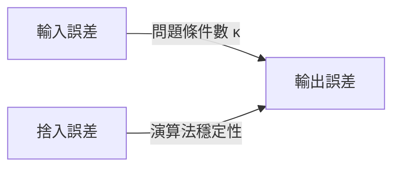

# 條件數與問題的病態性

## 天文學、測量學與「壞問題」的發現

條件數這個概念看似抽象，它的起源卻非常具體：人們發現，有些計算問題無論用多好的演算法都算不準。要理解這件事，得先回到問題的源頭。

1801 年，天文學家 Giuseppe Piazzi 發現了第一顆小行星 Ceres，追蹤 40 天後因太陽遮蔽而失去目標。年輕的 Carl Friedrich Gauss 用自己發展的軌道計算方法（結合大量觀測數據的最小平方處理）預測出它會在何處重現，同年 12 月天文學家果然在他預測的位置附近找回 Ceres。這讓 Gauss 聲名大噪，也讓「從含誤差的觀測數據反推參數」成為科學計算的核心課題。

在大地測量學中同樣如此。Gauss 於 1818 至 1826 年間主持漢諾瓦王國的大地測量（三角測量網），處理大量互相矛盾的觀測方程。方程組的求解精度，取決於觀測網的「幾何強度」——如果測站分布不佳，方程組對觀測誤差極度敏感，再精確的解法也救不回來。這正是「病態問題」（ill-conditioned problem）的直覺起源：問題本身把輸入誤差放大了。

## 誤差放大的數學描述

考慮線性方程組 $Ax = b$。若 $b$ 有擾動 $\delta b$，解的擾動 $\delta x$ 滿足

$$
\frac{\|\delta x\|}{\|x\|} \le \kappa(A)\,\frac{\|\delta b\|}{\|b\|},
\qquad
\kappa(A) = \|A\|\,\|A^{-1}\|
$$

$\kappa(A)$ 稱為矩陣 $A$ 的條件數。當 $\kappa(A) \gg 1$ 時，即使 $b$ 的相對誤差極小，解的相對誤差也可能被放大 $\kappa(A)$ 倍。若係數矩陣本身有擾動，同樣的界成立：

$$
\frac{\|\delta x\|}{\|x\|} \lesssim \kappa(A)\,\frac{\|\delta A\|}{\|A\|}
$$

在浮點算術下這有直接的推論：若捨入誤差量級為 $\epsilon_{\text{mach}}$，雙精度下實際可得的解精度大約是 $\kappa(A)\,\epsilon_{\text{mach}}$。當 $\kappa(A) > 10^{16}$ 時，連雙精度都救不了。

條件數概念的正式化通常歸功於 Alan Turing 1948 年在 Quarterly Journal of Mechanics and Applied Mathematics 發表的論文 "Rounding-off Errors in Matrix Processes"。Turing 在文中明確使用了 "condition number" 一詞並分析了它對捨入誤差傳播的影響。同一時期 John von Neumann 與 Herman Goldstine 在 1947 年關於高斯消去法誤差分析的報告中也發展了類似的誤差放大概念。二次大戰後 ENIAC 等早期電腦讓大規模線性系統第一次成為現實，人們立刻需要一套語言來回答「這個答案可信嗎」——條件數就是這套語言的核心。

## 教科書級的反面教材：Hilbert 矩陣

David Hilbert 在研究積分方程時引入的矩陣

$$
H_{ij} = \frac{1}{i+j-1}, \qquad i,j = 1,2,\dots,n
$$

是著名的病態矩陣。它對稱正定，看似無害，條件數卻隨 $n$ 指數成長：

| $n$ | $\kappa_2(H_n)$（約） |
|---|---|
| 3 | $5 \times 10^2$ |
| 6 | $1.5 \times 10^7$ |
| 10 | $1.6 \times 10^{13}$ |
| 13 | $4 \times 10^{17}$ |

實際計算中，用雙精度解 $H_{10}x=b$，答案可能只對前幾位數字；$H_{13}$ 則連雙精度都崩潰。由於 $H^{-1}$ 有整數元素（可以精確計算），Hilbert 矩陣成為檢驗數值軟體誤差分析的標準試金石。它還有一個漂亮的譜表達式：$\kappa(H_n) \sim \frac{(1+\sqrt{2})^{4n}}{\sqrt{n}}$。

值得強調的是：病態是 Hilbert 矩陣「本身的性質」，不是演算法的缺陷。任何演算法——包括理論上最精確的方法——都無法從病態問題中榨出比 $\kappa\,\epsilon_{\text{mach}}$ 更好的精度。唯一的出路是改變問題：正規化、正則化、或重新設計實驗取得更好的數據。

## Wilkinson 的洞見：把兩件事分開

James Wilkinson 在 1960 年代發展出一套系統性的向後誤差分析（這在下一節詳述），其哲學根基正是本節的主題：誤差來源要分兩層看。

- 條件數衡量的是「問題」的敏感度：把輸入稍微動一下，精確解會動多少。這與任何演算法無關，是數學模型的內禀屬性。
- 穩定性衡量的是「演算法」的品質：這個演算法在浮點機器上算出來的答案，與某個稍微擾動過的問題的精確解有多接近。

最終的誤差界大致是兩者的乘積：

$$
\text{總誤差} \lesssim \text{演算法誤差因子} \times \kappa(A) \times \epsilon_{\text{mach}}
$$

混淆這兩者會犯兩種相反的錯誤：一是把病態問題算壞了就怪罪演算法（其實換任何演算法都一樣），二是用病態問題去否定原本優良的演算法（Wilkinson 時代的文獻中就有這種爭論）。把兩者分開，數值分析才從「經驗與竅門」變成可以證明的科學。

## 條件數的直觀幾何

以 $2\times 2$ 矩陣為例，$\kappa(A)$ 大代表 $A$ 把單位圓映射成極扁的橢圓：某個方向被放大很多，另一個方向幾乎壓扁。壓扁方向的資訊在映射中幾乎丟失，反解時必然敏感。奇異值分解給出 $\kappa_2(A) = \sigma_1/\sigma_n$——最大奇異值與最小奇異值之比。最小平方問題也一樣：設計矩陣的列若近乎線性相依（例如多項式擬合時節點重複），$\kappa$ 爆炸，解就對數據噪聲極度敏感。

實務上還有一個重要的不對稱：正交變換不改變條件數（$\kappa_2(QA) = \kappa_2(A)$），這正是 QR 分解與 Householder 方法在數值上受青睞的根本原因之一——它們在解題過程中「不加重病態」。

## 制度性的延續

今天，條件數估計已是標準數值軟體的基本功能。LAPACK 提供了基於 Hager–Higham 方法的 $\kappa_1$ 估計器（如 `dgesvx`、`dlacn2`），Matlab 的 `cond`、NumPy 的 `cond` 一鍵可得。當代最熱門的話題——深度學習訓練中的梯度病態、大規模最小平方中的預條件（preconditioning）——本質上仍是同一個問題在新的名字下輪迴。Gauss 在漢諾瓦荒野中量測三角形時面對的困境，與今天訓練一個病態損失函數的神經網路時面對的困境，在數學上是同一件事：輸入的小誤差，經由問題本身，被放大成輸出的大誤差。承認這個放大的存在、量化它、並學會與之共存，是計算數學給實務工作者的第一課。
