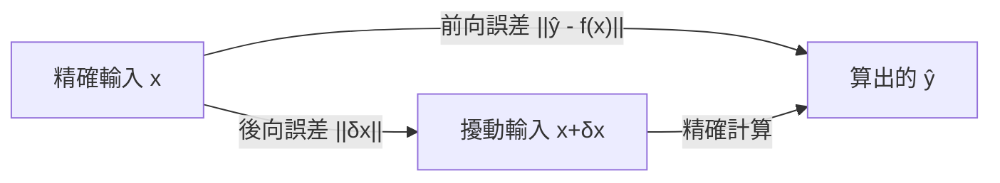

# 演算法的前向與後向穩定性

## 一個哲學問題：什麼叫做「算對了」？

在浮點機器上，幾乎所有運算都有捨入誤差，所以要求演算法「算出精確解」是不切實際的。真正的問題是：算出來的答案「錯得多有規律」。二十世紀中葉，劍橋的 James Hardy Wilkinson 對這個問題給出了一個改變整個學科的答案，而這個答案的背後有著戰後英國計算機科學的特殊土壤。

## 兩種誤差，兩種哲學

設我們想解的問題是 $f: x \mapsto y$，演算法在電腦上算出 $\hat y$。有兩種方式描述 $\hat y$ 與真值的差距：

前向誤差（forward error）直接度量答案本身的偏差：

$$
\text{前向誤差} = \|\hat y - f(x)\|
$$

後向誤差（backward error）則問一個反方向的問題：「$\hat y$ 是不是某個鄰近問題的精確解？」也就是找一個擾動 $\delta x$，使得

$$
\hat y = f(x + \delta x), \qquad \text{後向誤差} = \|\delta x\|
$$

這個視角的轉換看似只是措辭技巧，實則是數值分析的哥白尼式革命。它說：如果你的演算法算出的答案，等於「輸入只錯了一點點」的問題的精確解，那麼這個演算法已經把「它能控制的誤差」做到最小了——剩下被放大的部分，是問題本身的條件數（前節主題）在作祟，不該怪罪演算法。

若對所有合理的輸入，後向誤差都只有 $O(\epsilon_{\text{mach}})$ 量級，我們稱該演算法是後向穩定（backward stable）的。後向穩定演算法的前向誤差上界為

$$
\text{前向誤差} \lesssim \kappa \cdot \epsilon_{\text{mach}}
$$

——恰好等於「任何演算法都不可能更好」的理論下限乘上一個適度常數。



## Wilkinson、Turing 與 NPL 時代

Wilkinson 1946 年進入英國國家物理實驗室（NPL）的數學部，參與了 ACE 電腦的設計——這台機器源自 Alan Turing 1945 年提出的 ACE 報告。當時 NPL 正用這些早期電腦解大規模線性系統與特徵值問題，人們發現捨入誤差的行為難以預料，有些方法（如古典 Gram–Schmidt）實際表現遠比理論預期糟糕。

Turing 在 1948 年的論文中已經提出誤差分析的基本框架與 condition number 的概念。Wilkinson 接手後，在 1950 至 60 年代發展出一套完整的「向後誤差分析」方法論：對每個基本運算，證明浮點結果等於對運算元做微小相對擾動後的精確結果，然後把這些擾動一層層「往回推」，證明整個演算法的輸出等於某個擾動問題的精確解。他 1963 年的專著 Rounding Errors in Algebraic Processes 與 1965 年的 The Algebraic Eigenvalue Problem 是這套方法的聖經。

這個時代的制度背景值得一提：戰後英國的國家實驗室（NPL）與大學（劍橋數學實驗室）承擔了把數學變成「可靠工業產品」的任務，Wilkinson 本人是數理訓練出身的程式設計者，深度參與了早期 ALGOL 語言的設計與 NPL 的 ALGOL 編譯器實作。ALGOL 60 的「數學式語言」讓誤差分析的證明可以對應到程式碼的逐行結構，這對向後分析的書寫風格有實際影響。Wilkinson 因這些工作獲得 1970 年 ACM Turing Award——以 Turing 之名命名的獎，頒給了 Turing 在 NPL 的直接後繼者，表彰他把「數值計算可信度」變成嚴格數學的貢獻。

## 例子一：二次方程求根公式的不穩定

中學的求根公式

$$
x = \frac{-b \pm \sqrt{b^2 - 4ac}}{2a}
$$

在浮點下有一個著名陷阱：當 $b^2 \gg 4ac$ 時，$\sqrt{b^2-4ac} \approx |b|$，此時

$$
-b + \sqrt{b^2 - 4ac} \quad (b>0)
$$

是兩個相近數相減，產生災難性相消（catastrophic cancellation）——有效位數大半被吃掉。例如用雙精度解 $x^2 - 10^8 x + 1 = 0$，直接用公式算出的較小根可能只有兩三位數字正確。

經典的修正是先算出絕對值較大的根

$$
q = -\tfrac{1}{2}\left(b + \operatorname{sign}(b)\sqrt{b^2-4ac}\right),
\qquad
x_1 = q,\quad x_2 = \frac{c}{q}
$$

（$x_2$ 由根與係數關係 $x_1 x_2 = c/a$ 而來）。這個形式避免了相減，前向誤差大幅改善。注意其中的道理：我們沒有更努力地「逼近真解」，而是改寫代數，使每一步都只做「良態」的運算。這正是 Wilkinson 哲學的縮影——穩定性是演算法的性質，可以靠代數重構來獲得。

## 例子二：Kahan 求和與補償技巧

考慮把 $n$ 個浮點數相加。樸素的累加

$$
s \leftarrow s + x_i
$$

每一步都可能把小的 $x_i$ 整個捨入掉，誤差最壞可隨 $n$ 線性成長。前節提過的 Vancouver Stock Exchange 事件正是截斷式累加的惡果。

William Kahan 在 1964 年前後提出的補償求和（compensated summation，俗稱 Kahan summation）用一個額外變數 $c$ 記下「每次被捨入丟掉的那一小塊」，在下一次加法時補回去：

```text
s = 0; c = 0
for i = 1..n:
    y = x_i - c
    t = s + y
    c = (t - s) - y
    s = t
```

其中 `(t - s) - y` 正好把本次捨入損失「提取」出來（依賴於捨入到最近模式的性質，這也是 IEEE 754 規定正確捨入的原因之一）。誤差界從 $O(n\epsilon)$ 改善到 $O(\epsilon)$（與 $n$ 無關的常數因子），代價只是四倍的加減運算。有趣的是，Kahan 求和是「前向誤差大幅改善」的例子——它的後向誤差分析反而微妙：對任意輸入序列，它保證的是和的精度而非嚴格的後向穩定。這提醒我們：前向與後向是兩個互補的視角，選哪個來證明，取決於演算法的結構。

## 更廣的視野：穩定性譜系

演算法按誤差行為可粗略排成光譜：

- 後向穩定：如 Householder QR（下章）、用平衡（balancing）後的 QR 演算法解特徵值。它們算出的答案等於某個 $O(\epsilon)$ 擾動問題的精確解。
- 混合穩定（mixed stable）：後向誤差 $O(\epsilon)$ 但前向誤差可能被條件數放大——這是絕大多數好演算法的實況。
- 不穩定：如未加修改的古典 Gram–Schmidt、未經平衡的樸素特徵值迭代，即使問題良態也可能給出垃圾。

Wilkinson 之後，向後誤差分析成為數值線性代數的「驗收標準」。1970 年代 Pete Stewart、G. W. Stewart 與 Nicholas Higham 等人的教科書把它制度化；LAPACK 的每個常式文件都附有誤差界。現代應用中這個思想仍在延伸：浮點單元的 FMA（fused multiply-add）指令、區間算術、隨機化數值線性代數中的後向誤差機率界，都是同一個問題在新硬體與新規模下的變奏。

一句話總結本章：好的演算法不承諾算出「真解」，它承諾算出「一個幾乎相同的問題的真解」——至於這個解答離你要的真解有多遠，由問題的條件數決定，而那不是演算法的錯。
