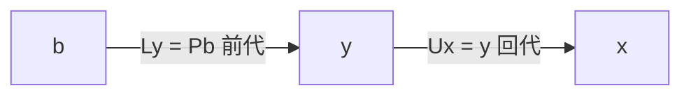

# 1809 — 高斯消去法、LU 分解與主元選擇策略

## 從 Ceres 到《天體運動論》

1801 年 1 月 1 日夜，西西里巴勒莫天文台的 Giuseppe Piazzi 發現了一顆在天空中緩慢移動的星點——第一顆被確認的小行星 Ceres。Piazzi 追蹤它 41 天後，Ceres 行至太陽背後，從望遠鏡中消失。當時的數學方法無法從這麼短的觀測弧推算完整軌道，許多天文學家認為它找不回來了。

24 歲的 Carl Friedrich Gauss 接受了挑戰。他發展出一套以圓錐曲線逼近、再由觀測數據反覆修正軌道要素的方法，其中關鍵之一，是如何「公平地」融合多組互相矛盾的觀測——他採用了他自稱自 1795 年起就在思考的原則：使各觀測殘差的平方和最小。1801 年 12 月 7 日，天文學家 Franz von Zach 依照 Gauss 的預測在天空中重新找到了 Ceres。這次成功使 Gauss 在歐洲科學界一舉成名，也直接促成他 1807 年獲聘為哥廷根天文台台長。

1809 年，Gauss 在《天體運動論》（Theoria motus corporum coelestium）中公開發表了最小平方法。這裡埋著科學史上一次著名的優先權之爭：法國數學家 Adrien-Marie Legendre 早在 1805 年就已在小冊子《確定彗星軌道的新方法》中獨立發表了最小平方法。Gauss 在 1809 年的著作中宣稱自己 1795 年即已使用此法，Legendre 大為光火，寫信給 Gauss 抗議：「沒有比搶先發表更重要的了。」Gauss 不為所動。後世一般認為兩人各自獨立發現，Legendre 擁有發表優先權，Gauss 擁有更深的理論（他還附帶證明了誤差常態分布下的最優性——這也是常態分布被稱為「高斯分布」的來由）。

## 正規方程與「消去」的誕生

最小平方法的實際操作是：給定 $m$ 個觀測方程 $A\theta \approx b$（$m > n$），轉成 $n$ 個正規方程

$$
A^{\mathsf T} A\, \theta = A^{\mathsf T} b
$$

然後解這個線性方程組。Gauss 在 1809 年的書中給出的求解程序，正是後人所稱的高斯消去法：用某列乘上倍數加到其他列，把未知數一個個消去，化成上三角系統再回代。他在 1826 年的大地測量論文中更明確地寫出了把消去法組織成系統性計算表格的形式——當時是為了讓測量助理能夠機械地執行。

數學史上有個有趣的後見之明：高斯消去法在中國《九章算術》（約公元前 2 世紀）的「方程」章中已有完整的程式化描述，日本江戶時代的和算家關孝和也獨立使用過類似方法。Gauss 的貢獻不在「發明」消去，而在把它與誤差理論、最小平方緊密結合，成為觀測科學的標準工具。

## LU 分解：消去法的矩陣表述

用矩陣語言重述消去法：存在單位下三角矩陣 $L$ 與上三角矩陣 $U$，使得

$$
PA = LU
$$

其中 $P$ 是置換矩陣（稍後解釋）。一旦有了 LU 分解，解 $Ax=b$ 變成兩次三角求解：

LU 分解的巨大實用價值在於「分解一次、求解多次」：同一係數矩陣要解多個右端項 $b$ 時（例如時變系統的模擬、參數掃描），只需做一次 $O(n^3)$ 的分解，之後每次求解只花 $O(n^2)$。這個觀點在 1940 年代由 Alan Turing、von Neumann 等人明確形式化，成為現代數值軟體的基本架構。

## 為什麼必須選主元

消去法有個致命的陷阱：如果對角線上的樞軸（pivot）非常小，除以它會把該列的其他元素放大，捨入誤差隨之爆炸。考慮

$$
\begin{pmatrix} \epsilon & 1 \\ 1 & 1 \end{pmatrix}
$$

不選主元直接消去，會產生乘數 $1/\epsilon$，結果的相對誤差被放大 $1/\epsilon$ 倍；但這個矩陣的條件數只有 $O(1/\epsilon)$——問題本身良態，是演算法把它弄壞了。

解法是主元選擇（pivoting）：

- 部分主元選擇（partial pivoting）：在當前欄中選絕對值最大的元素換到對角線。每步代價 $O(n)$，總開銷可忽略，是標準做法。理論上有構造出來的反例會使部分主元法表現不佳，但六十多年的實務與 Wilkinson 的分析都表明它在實際中極為穩定——增長因子（growth factor）通常接近 1。
- 完全主元選擇（complete pivoting）：在整個剩餘子矩陣中選最大元素。誤差界更漂亮，但搜尋代價 $O(n^3)$ 量級，除非對穩定性有極端要求，一般不用。

1940 至 50 年代的理論貢獻也值得一記：von Neumann 與 Goldstine（1947）與 Turing（1948）分別分析了高斯消去法的捨入誤差；Wilkinson 在 1960 年代完成了完整的向後誤差分析，證明帶部分主元的 LU 求解是後向穩定的（對增長因子作合理假設下）。從此「高斯消去 + 部分主元 + 向後誤差界」成為教科書標準。

## 計算量與現代實作

高斯消去法分解需要約 $2n^3/3$ 次浮點運算。這個立方成長意味著問題規模每增大 10 倍，時間增 1000 倍——這驅動了六十年來數值線性代數的一切工程努力。

現代實作的核心是分塊（blocking）：把矩陣切成 $b \times b$ 的塊，將運算重組為「矩陣—矩陣乘法」的形式，因為現代 CPU 的快取階層（cache hierarchy）對矩陣乘法的資料重用最為友好。此架構由 1970 至 80 年代的 EISPACK、LINPACK 演化而來。LINPACK 於 1979 年由 Argonne 的 Jack Dongarra 等人發布，其中「解 1000 階線性系統的速率」後來演變成著名的 TOP500 超級電腦排行榜（1993 年起）的基準測試。

LINPACK 的繼任者 LAPACK（1992 年起）由 Dongarra 團隊與 Tennessee、Berkeley、Rice 等校合作開發，以分塊 BLAS（Basic Linear Algebra Subprograms）為基礎，提供了 `dgetrf`（LU with partial pivoting）、`dgetrs`（三角求解）等常式，至今仍是每台超級電腦與每個科學計算環境（Matlab、NumPy、Julia、PyTorch 的 CPU 後端）的底層。

這個生態的制度背景是美國能源部（及其前身原子能委員會）的國家實驗室體系：Argonne、Oak Ridge、Los Alamos 等實驗室在冷戰期間為核武模擬與反應堆設計持續雇用數值分析師與電腦科學家，Fortran 語言（1957 年，IBM）則成為他們的共通語言。Fortran 的直譯與最佳化能力使數學軟體可以「寫一次、到處跑」，加上 Dongarra 堅持以可自由取得的開源形式散布 EISPACK/LINPACK/LAPACK，造就了今天「任何超算中心的峰值都要用 LAPACK 度量」的文化。2021 年 Dongarra 獲 Turing Award，表彰的正是這條從高斯消去法到 TOP500 的數值軟體工程血脈。

## 一點歷史的重量

回頭看，這條線索貫穿了兩百年：Gauss 為了找回一顆小行星與丈量漢諾瓦的王國領土，發明了最小平方與消去的計算程序；兩次世界大戰與冷戰的需求把線性系統求解推上電腦；Turing、von Neumann、Wilkinson 給它誤差理論；Dongarra 們給它工程架構。今天你用手機做影像去噪、用衛星定位、訓練神經網路，底層跑的仍是這個兩百年前在哥廷根天文台的手稿中成形、在美國能源部實驗室中被工業化、在 IEEE 浮點標準上被規範化的演算法。數學不會過時，它只是換了更快的硬體。
