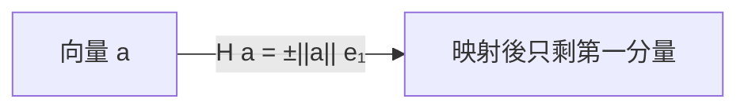

# 正交化與 QR 分解 — Gram–Schmidt 與 Householder

## 正交性：數值分析的美德

線性代數課本中，正交矩陣 $Q$（滿足 $Q^{\mathsf T}Q = I$）的性質看似平凡，在數值計算中卻是黃金標準：正交變換的 2-範數恆為 1，因此

$$
\kappa_2(QA) = \kappa_2(A)
$$

——正交變換不加重病態。這個性質使「把問題化成三角形式」的理想，從高斯消去法的初等列變換（可能放大誤差）升級為正交變換（誤差中性），是二十世紀數值線性代數最重要的觀念躍遷之一。本章講述達成它的兩條路：Gram–Schmidt 正交化與 Householder 變換，以及它們背後的學院與人物。

## Gram 與 Schmidt：從積分方程到演算法

丹麥自學出身的精算師 Jørgen Pedersen Gram 在 1883 年的論文中提出了把一組函數對某內積正交化的程序（他用以研究級數展開），1907 年他更發表了關於矩陣與雙線性形式的論文，其正交化思想的矩陣形式成為後世引用的源頭。稍後，德國數學家 Erhard Schmidt 在 1907–1908 年關於積分方程的論文（受 Hilbert 的積分方程理論啟發）中，把這個程序以幾何方式清晰表述，1909 年的論文中正式給出了遞迴格式。後來 E. W. Cholesky（1910 年，用於測量計算）與相關方法在矩陣語言下的命名，使「Gram–Schmidt 正交化」成為標準名稱。

古典 Gram–Schmidt（CGS）的遞迴是：

$$
q_j = a_j - \sum_{i<j} (q_i^{\mathsf T} a_j)\, q_i
\quad\text{再正規化}
$$

數值上的陷阱在 1960 年代被 Wilkinson 等人揭示：用 CGS 求得的 $Q$ 在浮點下會快速失去正交性——尤其當 $A$ 近乎線性相依時，$\|Q^{\mathsf T}Q - I\|$ 可以大到與 1 同階，結果完全不可用。修正是改變減法的順序，成為修正 Gram–Schmidt（MGS）：每算出一個投影方向就立刻從 $a_j$ 中扣掉（也可以等價地說成「對每個 $q_i$ 依次正交化所有後面的向量」）。MGS 在捨入下正交性損失僅與 $\kappa(A)\,\epsilon_{\text{mach}}$ 同階，對最小平方問題更是表現優異——James Demmel 與其他人的分析確認了它在這個用途上的後向穩定性。一個深刻的教訓：數學上等價的兩個遞迴順序，數值上可以天差地遠。

## Householder 變換：1958 年的美國中西部

真正讓正交化成為標準工具的，是 Alston Scott Householder。Householder 是美國數學家，第二次世界大戰期間在 Oak Ridge 的國家實驗室體系（當時屬原子能委員會）從事數學工作，戰後長期任職於 Oak Ridge National Laboratory（ORNL），領導那裡的數學部門。1958 年他在 Argonne National Laboratory 的研討會上報告了以鏡射矩陣做正交三角化的方法（同年有關論文見於 J. SIAM）：

$$
H = I - 2\,\frac{vv^{\mathsf T}}{v^{\mathsf T} v}
$$

這是一個對稱正交矩陣，幾何上是對超平面 $v^{\mathsf T}x = 0$ 的鏡射。取適當的 $v$，$H$ 能把一個任意向量映到只剩一個非零分量（例如只留第一分量）：

把 $A$ 的第一欄映成 $r_{11}e_1$，再對右下子矩陣遞迴操作，$n-1$ 次鏡射後 $A$ 就化成上三角：

$$
H_{n-1}\cdots H_2 H_1 A = R,
\qquad
A = QR
$$

其中 $Q = H_1 H_2 \cdots H_{n-1}$。相較於 Givens 旋轉（每次只消一個元素，總計 $O(n^2)$ 次旋轉），Householder 每步消掉整欄，總運算量約 $2mn^2 - 2n^3/3$（對 $m\times n$ 矩陣），且可用向量運算高效實作。Wallace Givens 也是同時期 Argonne/ORNL 體系的數值分析師，他的 1954 年博士論文與相關工作提出了平面旋轉正交化；Givens 旋轉在稀疏矩陣、特徵值演算法（QR 演算法的隱式位移）與即時更新問題中至今不可取代。

Householder 1958 年的貢獻不止於鏡射矩陣：他同場提出了著名的 QR 演算法（對矩陣做 QR 分解再反乘，迭代收斂到 Schur 形式）的觀念原型——後由 John Francis 與 Vera Kublanovskaya 獨立完善成隱式雙位移 QR 演算法，成為今天所有特徵值軟體的核心。

## Oak Ridge–Argonne 學派與 Householder 研討會

Householder 的影響遠超過幾個演算法。他在 ORNL 培養了一代數值分析師（包括 G. W. "Pete" Stewart 等人），1964 年出版的 The Theory of Matrices in Numerical Analysis 系統整理了矩陣分解（LU、QR、Householder、Givens）的理論，是這門學科成形的標誌性著作。1968 年他自 ORNL 退休後轉任 Tennessee 大學。

制度上的延續非常可觀：自 1969 年起，為紀念他而設的 Householder Symposium on Numerical Linear Algebra 每三年舉辦一次（近年常見於美國、英國、荷蘭、以色列等地），至今仍在舉行，是數值線性代數社群最重要的閉門會議之一。Argonne 則在 Jack Dongarra 等人的努力下成為 EISPACK/LINPACK/LAPACK 的搖籃（見前章）。可以說，二十世紀後半美國數值線性代數的主幹，就種在 Oak Ridge 與 Argonne 這兩個能源部實驗室的土壤裡。

## QR 分解與最小平方

回到 Gauss 1809 年的老問題。解最小平方 $\min_x \|Ax - b\|_2$，用正規方程 $A^{\mathsf T}A x = A^{\mathsf T}b$ 有一個數學缺陷：$\kappa_2(A^{\mathsf T}A) = \kappa_2(A)^2$——平方化的條件數讓病態問題雪上加霜，且形成 $A^{\mathsf T}A$ 本身就會損失資訊。

QR 分解提供了更好的路。設 $A = QR$，$Q$ 的前 $n$ 列張成 $A$ 的行空間，則

$$
\|Ax - b\|_2^2 = \|Rx - Q^{\mathsf T} b\|_2^2 + \|(I - Q\Q^{\mathsf T})b\|_2^2
$$

第二項與 $x$ 無關，故最小化只需解上三角系統 $Rx = Q^{\mathsf T} b$。整個過程只用正交變換，條件數不平方、不放大，是後向穩定的。這就是 LAPACK 的 `dgeqrf`、Matlab 的反斜線運算子 `A\b`（對長方矩陣）、以及 Python NumPy 的 `lstsq` 內部採用的路徑。當問題更加病態時，再往上游走一步，就是 SVD 與 Tikhonov 正則化的領域。

## 歷史的迴響

把三個時代放在一起看，會發現一條清晰的思想譜系：

- 1801–1826：Gauss 為了天文與測量，發明最小平方與消去程序。
- 1907–1909：Gram 與 Schmidt 在積分方程與矩陣理論中提出正交化，數學上漂亮，但直到電腦出現才有人認真問它「在浮點下是否還成立」。
- 1958 起：Householder、Givens 在美國能源部實驗室體系中，以正交鏡射和平面旋轉把三角化變成可靠、快速的機器程序；Wilkinson 的向後誤差分析給出為何它們可信的證明；LAPACK 把這些做成 everyone 都在用的軟體。

今天，QR 分解存在於每台伺服器的矩陣庫裡，也被隨機化演算法（randomized range finder）、GPU 稠密線性代數（如 MAGMA、cuSOLVER）重新實作以應對極大規模的數據。但核心思想不變：先問「怎樣的變換不會把誤差放大」，答案是正交；再問「怎樣用最少的算術達成正交三角化」，答案是 Householder 的鏡射。一個 1958 年在 Argonne 的黑板上畫出的幾何直覺，至今仍支撐著整個科學計算世界。
