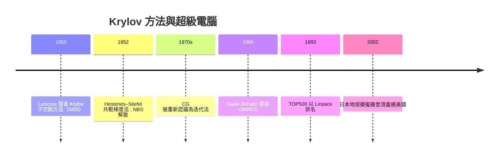

# 1951 大型稀疏矩陣與 Krylov 子空間迭代法

二十世紀中葉，一個新問題擺在數值分析師面前：把偏微分方程離散化之後，得到的線性系統往往有數萬甚至數百萬個未知數，但矩陣中絕大多數元素是零。高斯消去法這類直接法在這種矩陣上既浪費記憶又浪費時間。回答這個問題的，是兩位個性迥異的數學家：Cornelius Lanczos 與 Magnus Hestenes。他們開創的方法，今天支撐著從天氣預報到晶片設計的一切計算。

## Lanczos：從歐洲到量子力學的漂泊者

Cornelius Lanczos 1893 年生於布達佩斯，是匈牙利數學黃金世代的一員，與 Szegő、Riesz 等人同輩。他 1921 年以相對論論文在布達佩斯大學獲得博士學位，之後在德國法蘭克福大學任教。1931 年他申請教授職位受挫，加上納粹崛起，1932 年他在愛因斯坦的推薦下前往美國普度大學。Lanczos 與愛因斯坦保持著長達數十年的通信與合作，兩人反覆討論廣義相對論的統一場理論——這段友誼是他一生學術認同的重要部分。

1949 年，Lanczos 轉到剛剛成立的國家標準局（NBS，位於洛杉磯的分部 INA，Institute for Numerical Analysis），這裡是美國戰後數值分析的重鎮，SWAC 電腦正在此建造。1950 年，Lanczos 發表了著名的特徵值演算法：從任意向量出發，反覆以矩陣 $A$ 作用並做正交化，產生一組基底，使得 $A$ 在這組基底（即 Krylov 子空間 $\mathcal{K}_k = \mathrm{span}\{b, Ab, A^2b, \dots\}$）上的表示是三對角的。他很快就注意到同一套遞迴也可以解線性方程組。1952 年，Lanczos 為了參加歐洲的計算會議而回到歐洲，之後經愛因斯坦與 Weizmann 科學院友人介紹，1952 年起定居以色列的 Weizmann 研究所，直到 1974 年去世。所以「CERN 時期」是一個常見的誤傳——他並未任職於 CERN，但他 1950 年代的歐洲講學（包括著名的 1957 年 Argonne 會議之外的歐洲巡迴）確實把這些方法帶到了歐洲計算社群。

## Hestenes 與 Stiefel：被冷落了三十年的共軛梯度法

1951 到 1952 年間，在國家標準局工作的 Magnus Hestenes 與來自瑞士的 Eduard Stiefel（蘇黎世聯邦理工學院 ETH）發展出了共軛梯度法（Conjugate Gradient, CG）。他們的論文〈Methods of Conjugate Gradients for Solving Linear Systems〉1952 年發表於 NBS 的報告系列。這是純粹的戰後美國—歐洲學術交流產物：Stiefel 在訪美期間與 Hestenes 合作，兩人發現從最速下降法出發，若讓搜尋方向互相「共軛」，理論上 $n$ 步之內必然得到精確解。

弔詭之處在於：CG 誕生時被當成直接法。既然「$n$ 步收斂」，那它不就是另一種消去法嗎？與高斯消去相比，它需要儲存向量並反覆做矩陣向量乘法，在當時的硬體上不見得划算。再加上 1950 年代 NBS 遭逢政治災難——國會議員 McCarthy 陣營指控標準局的數學家（包括 Lanczos 曾任職的機構）同情共產主義，INA 於 1953 年被迫解散，研究團隊四散。CG 就這樣被冷落了近二十年。

轉機出現在人們意識到：對大型稀疏矩陣，CG 的價值不在於「$n$ 步精確解」，而在於「少數幾十步就得到夠好的近似解」。1970 年代，Reid、Concus、Golub 與 O'Leary 等人重新詮釋 CG 為迭代法，配合病態問題的收斂速率分析，CG 成為對稱正定系統的標準方法。而對非對稱矩陣，突破要等到 1986 年：Yousef Saad 與 Martin Schultz 在 Yale 發表 GMRES（廣義最小殘量法），在 Krylov 子空間中極小化殘量範數，配合 Arnoldi 過程與再啟動策略，成為非對稱系統的標準。預條件技術（incomplete Cholesky、multigrid 等）則讓這些方法的實際效率再提升數個數量級。

## 超級電腦、Linpack 與國家榮耀

稀疏迭代法與超級電腦的發展互相推動。美國 1970 年代的 ILLIAC IV、Cray-1，到 1980 年代日本廠商（NEC、富士通、日立）憑向量機追上甚至超越美國，引發了美國政府的焦慮——這是一場帶有冷戰色彩的高科技競賽，超級電腦被視為核武模擬、密碼學與經濟競爭力的戰略資源。1993 年，Jack Dongarra 等人開始發布 TOP500 榜單，以 Linpack 基準（解一個大型稠密線性系統所需的浮點運算速率）排名全球最快電腦。

用「解線性系統的能力」來定義超級電腦的強弱，有其數學理由：線性代數核心是幾乎所有科學計算的心臟；但也有政治經濟意義——它提供了一個單一、可排名、媒體易懂的指標，讓各國政府能夠「比賽」。2002 年 6 月，日本地球模擬器（Earth Simulator，NEC 打造）以近 36 Tflops 登頂，效能是第二名美國機器的近五倍，震驚美國朝野。《紐約時報》與國會為此舉行聽證，直接催生了美國 2002 年後的 High-End Computing Revitalization Task Force 與後續的 HPC 計畫。地球模擬器本身就是為全球大氣與海洋模式而生——其內核正是百萬階稀疏線性系統的迭代求解。中國後來的神威·太湖之光、Summit 與 Frontier 的排名之爭，延續的正是這套 Linpack 定輸贏的敘事。

## 結語

Krylov 方法的基本信念是：雖然矩陣有百萬維，但關於解的重要資訊往往集中在一個低維子空間裡。這與 SVD 的低秩哲學遙相呼應。從 Lanczos 在麥卡錫時代的漂泊，到地球模擬器引發的地緣政治震盪，線性系統求解的歷史說明：最抽象的數學遞迴，最終會成為國家實力的一部分。
