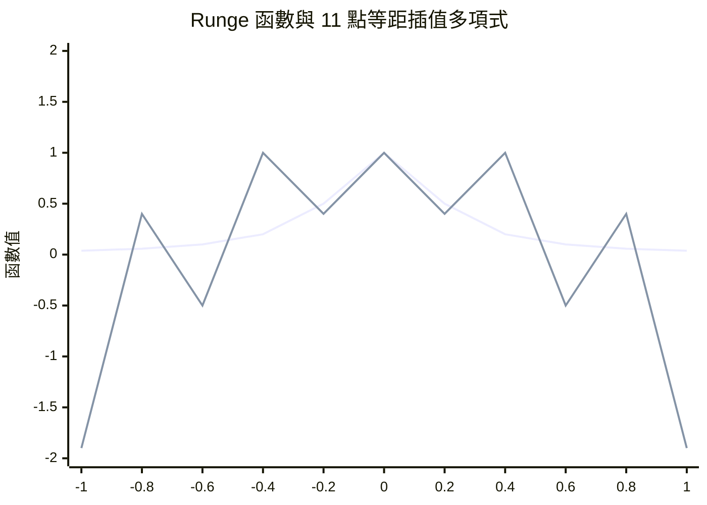

# 1795 多項式插值與 1901 Runge 現象

給定平面上 $n+1$ 個點，是否存在唯一的多項式通過它們？這個問題的答案是肯定的，而且答案的發現史遠比教科書上「Lagrange 插值公式」這個名字來得複雜。而當人們天真地以為「節點越多、多項式次數越高、逼近越好」時，1901 年 Runge 的一個例子給了所有人當頭棒喝。

## 誰先發現了插值公式？

Lagrange 公式的標準形式：

$$p(x) = \sum_{i=0}^{n} y_i \prod_{j \ne i} \frac{x - x_j}{x_i - x_j}$$

這個公式歸功於 1795 年 Lagrange 在 École Polytechnique（巴黎綜合理工學院，法國大革命後新創的工程師學院）的講義。法國大革命後，新政府急需培養砲兵與土木工程師，Lagrange 受邀講授分析課程，插值問題正是在這種「為國家培養計算員」的氛圍中被系統地寫進教材。

但歷史其實更早。1779 年，英國數學家 Edward Waring 在《哲學會會刊》上已發表了等價的公式；Euler 在更早的書信與著作中也知道這個結果；牛頓本人的差商（divided differences）方法早在十七世紀就給出了另一種構造方式——這就是今日 Newton 形式的插值多項式，它的優點是新增節點時只需加一項，不必重算。為什麼最後的桂冠落在 Lagrange 頭上？因為十九世紀法國分析學派（Lagrange、Laplace、Cauchy）掌握著學術話語權，公式隨他們的講義與教科書傳遍歐洲。命名史本身就是學術中心轉移的歷史。

## 算表經濟學：Babbage 與差分機

為什麼十八、十九世紀的數學家如此關心插值？答案是：數學表是當時的「晶片」。航海需要對數表、三角函數表與航海曆（Nautical Almanac）；天文學與保險業需要壽命表。手工計算這些表不但昂貴，而且錯誤百出——計算員的抄寫錯誤曾導致船難與保險糾紛，對以海上貿易立國的英國而言，這是實打實的經濟損失。

Nautical Almanac 的計算工作在十九世紀初已經品質堪憂，英國政府為此頭痛。1821 年前後，劍橋的年輕數學家 Charles Babbage 在天文學會與 Herschel 校對計算表時，據說感嘆「這些錯誤若能由機器來算該多好」。他隨後提出差分機（Difference Engine）的構想：利用多項式插值中「任意多項式的有限階差分最終為常數」的性質，機器只需做加法就能逐步產生對數表與三角函數表的數值。英國政府在 1823 年資助了這個計畫——這是人類史上政府大額資助計算機研發的最早案例之一。計畫歷經二十年、耗費遠超預算（當時一個工人的年薪約五十鎊，政府投入超過一萬七千鎊），最終於 1842 年被財政部砍掉。Babbage 轉而設計更宏大的分析機（Analytical Engine），由 Ada Lovelace 為它寫下史上第一個程式構想。差分機失敗的原因是精密機械工藝的極限，但「插值多項式可以機械化產生函數表」這個想法，正是數值分析與計算機工業共同的起點。

## Runge 現象：節點越多不一定越好

十九世紀末，Weierstrass 於 1885 年證明了著名的逼近定理：閉區間上的連續函數可以用多項式一致逼近到任意精度。這似乎保證了「多項式逼近無所不能」。但 Weierstrass 定理並沒有說「用等距節點的插值多項式」就能做到。1901 年，德國漢諾威的應用數學家 Carl Runge 在《Zeitschrift für Mathematik und Physik》上發表了一個震撼的例子：

$$f(x) = \frac{1}{1 + 25x^2}, \quad x \in [-1, 1]$$

用等距節點做插值，當節點數增加時，插值多項式在區間中央確實收斂到 $f$，但在靠近端點 $\pm 1$ 的地方劇烈震盪，振幅隨節點數增加而爆炸——需要約 20 個節點之後才開始好轉，而且 $f$ 必須足夠光滑才行。這就是 Runge 現象。

Runge 的教訓是：Weierstrass 存在性定理與特定節點的收斂速度是兩回事。解藥由俄國學派給出。

## Chebyshev、聖彼得堡學派與機械連桿

Pafnuty Chebyshev（切比雪夫）1850 年代在聖彼得堡大學工作，是俄國第一個獲得國際聲望的數學家，也是聖彼得堡數學學派的創立者。有趣的是，他許多最佳一致逼近的工作起源於工程問題：他長期擔任俄國軍械部門與大學的機械學顧問，研究蒸汽機的連桿機構（linkages）——如何用鉸接的連桿把旋轉運動轉換成近似的直線運動。1854 年前後，他發表了關於「在給定次數的多項式中，極小化與目標函數的最大偏差」的論文，導出了 Chebyshev 多項式 $T_n(x) = \cos(n \arccos x)$。這些多項式在等震盪意義下是最優的；把插值節點取為 $T_n$ 的極值點（Chebyshev 節點），插值誤差在整個區間上均勻分佈，Runge 現象消失（對足夠光滑的函數）。

Chebyshev 的學生 Markov 更進一步證明了極值多項式的嚴格性質，聖彼得堡學派因此成為逼近論的重鎮。工程問題（連桿、軍械）孕育了純粹數學（逼近論、矩量法、Markov 過程），這是應用驅動基礎研究的經典案例。到了二十世紀，Chebyshev 節點插值與 Clenshaw-Curtis 求積成為譜方法（spectral methods）的基礎，Lloyd Trefethen 等人在 2000 年代更證明：只要用對節點，高次多項式插值不但可行，而且威力驚人。

## 結語

從牛頓差商到 Babbage 的差分機，從巴黎理工的講義到聖彼得堡的連桿，多項式插值的歷史貫穿著一個主題：人類需要用有限的計算資源表示無限維的函數。Runge 現象提醒我們，理論存在性不等於實用收斂性；而 Chebyshev 的回答則展示了工程需求如何反哺出最深刻的數學。
