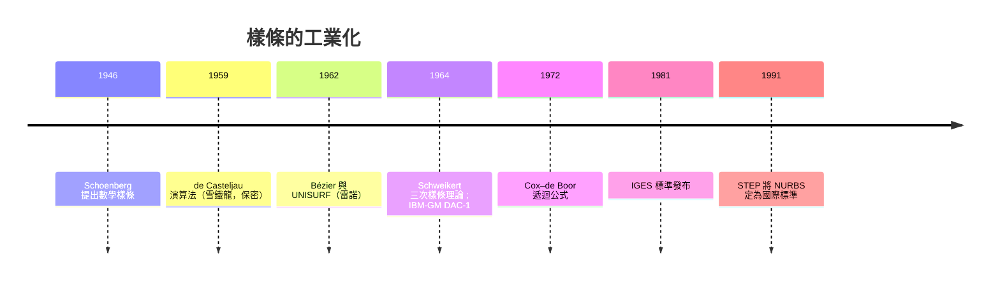

# 樣條插值與分段光滑曲線的幾何計算

在電腦出現之前，工程師畫光滑曲線用的是一件木頭或金屬做的工具：樣條（spline）。這條細長彈性的木條被放置在圖紙上，繞過一組稱為「鴨石」或壓鐵（ducks, weights）的鉛塊定位釘，木條在壓鐵之間自然彎曲，畫出一條處處光滑的曲線。造船廠的放樣師傅（loftsmen）用這種方法畫船體曲線已經數百年，飛機工廠在二戰時期也大量使用。沒有人想到，這個車間裡的實物工具，會在二十年內變成整個製造業與電腦圖形學的數學基礎。

## 從物理樣條到數學樣條

彈性力學告訴我們：一根細梁在小變形下的撓曲滿足四階微分方程，兩端點之間的形狀是三次多項式。因此數學樣條自然定義為：分段三次多項式，在節點處函數值、一階與二階導數連續。這個定義在 1946 年由數學家 I. J. Schoenberg 正式提出——他當時在美國賓州，戰後參與 Aberdeen 彈道研究實驗室（BRL）周邊的數值分析社群，正是軍方彈道計算的需求讓「分段多項式」首次被系統研究。Schoenberg 借用了造船業的名詞，稱之為 spline。

但樣條要成為工業工具，還差兩步：一是高效的計算方法，二是產業界的迫切需求。

## 雷諾與雪鐵龍：法國的雙雄競賽

1960 年代的法國汽車工業是曲線數學的搖籃，而推動力是兩家車廠的競爭。雪鐵龍（Citroën）在 1950 年代末率先引入數控機床與數學化設計，成為法國汽車業的技術領先者。雷諾（Renault）感受到壓力，從 1957 年起派工程師 Pierre Bézier 研究如何把車身設計完全數學化。Bézier 在 1962 年前後發展出以控制多邊形描述曲線的方法：曲線不經過控制點，但被控制點「拉」出形狀，設計師移動控制點即可直觀地修改曲線。這套系統在雷諾內部命名為 UNISURF，1970 年代起全面用於雷諾的車身設計與製造。Bézier 曲線的數學（Bernstein 多項式）其實 1912 年就有了，但把它變成設計師能用的工具，是 Bézier 對工業的巨大貢獻。

競爭的另一端，雪鐵龍的工程師 Paul de Casteljau 早在 1959 年就發明了等價的演算法（de Casteljau 演算法，以遞迴線性插值穩定地求曲線上的點），但雪鐵龍把這項技術當成商業機密封存多年，de Casteljau 的貢獻直到 1970 年代才被公開承認。一家公司保守機密，讓另一家公司獨享命名權——這是技術競爭史上常見的諷刺。

美國方面，波音的 James Ferguson 於 1964 年發表了關於多段曲線擬合的論文，MIT 的 Steven Anson Coons 也在 1960 年代發展了 Coons 曲面。1964 年，加州理工學院的 David Schweikert 發表了關於三次樣條的博士論文（一篇常被引用為「spline」一詞用於分段三次插值的早期文獻），明確給出了給定端點條件下三次樣條的存在唯一性與計算方法。同時期 IBM 與通用汽車合作的 DAC-1 系統（1964 年展出）成為 CAD 的先聲——汽車與航空業成為計算機圖形最大的金主。

## Cox–de Boor 遞迴與 B-spline

Bézier 曲線有一個致命弱點：改動一個控制點，整條曲線都會變。工業設計需要局部控制。答案在 B-spline（基礎樣條）。Schoenberg 早在 1946 年就提出了 B-spline 的概念，但真正讓它可計算的是 1972 年的兩篇獨立論文：英國阿斯頓大學的 Maurice Cox 與通用汽車研究實驗室的 Carl de Boor，各自發現了計算 B-spline 的遞迴公式。de Boor 的版本更為通用，成為標準（今日教科書稱之為 Cox–de Boor 遞迴公式）。B-spline 具備局部支撐性：移動一個控制點只影響曲線的局部，這正是設計師要的。de Boor 後來在威斯康辛大學麥迪遜分校任教多年，他的教科書《A Practical Guide to Splines》（1978）與隨附的 Fortran 套件成為業界聖經。

## NURBS 與 IGES：讓機器之間說同一種語言

剩下的一步是標準化。1980 年代前，各家 CAD 系統的資料格式互不相通，美國國防部面對供應商各自為政的檔案格式，決定介入：1980 年，美國空軍整合電腦輔助製造計畫（US Air Force ICAM Project）發布 IGES（Initial Graphics Exchange Specification）作為中立的圖形交換標準，1981 年第一版納入了 Bézier 曲線與 B-spline。

業界隨後走向更統一的表達：非均勻有理 B-spline（NURBS）。NURBS 用齊次座標把圓錐曲線（圓、拋物線）與自由曲線統一在一個框架下，既能精確表示圓柱、球這類解析曲面，也能表示 Bézier 式的自由曲面。Kenneth Versprille 在 1975 年的博士論文中首先系統化 NURBS，而它真正成為工業標準，是靠 1980 年代的推廣：1983 年波音採用 NURBS 作為其 CAD 系統的幾何基礎，並遊說將其納入 IGES；1991 年，國際標準組織的 STEP 標準把 NURBS 定為工業幾何交換的核心。今天，從汽車車身、手機外殼到動畫電影的角色造型，幾乎所有工業曲面底層都是 NURBS。

## 結語

樣條的歷史是一段製造業與數學互相驅動的佳話：法國車廠的商業競爭逼出了 Bézier 與 de Casteljau；美國軍方的採購需求催生了 IGES；波音的工程判斷讓 NURBS 一統江湖。而追根溯源，一切始於造船廠放樣間裡那根被鉛塊壓彎的木條——大自然用彈性力學寫下的三次多項式，比任何數學家都早了幾百年。
