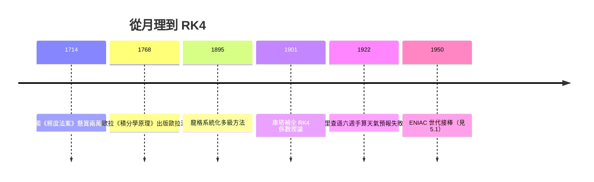

# 1768 歐拉法與 1895 龍格—庫塔法：從手算月理到數值積分的黃金法則

## 一、月亮、經度與獎金：數值積分的政治動機

今天我們在教科書裡學到的第一個常微分方程數值解法——歐拉法（Euler method），出自萊昂哈德·歐拉（Leonhard Euler）1768 年在聖彼得堡出版的《積分學原理》（*Institutiones calculi integralis*）。歐拉在書中以極其樸素的方式寫下：把區間切成小段，用切線斜率外推下一點，即

$$y_{n+1} = y_n + h f(t_n, y_n).$$

這個方法看似小學生都懂，但它誕生的背景卻是十八世紀最昂貴的國家工程之一：航海經度問題。

一艘在汪洋中的船，若不知道經度，就等於不知道自己離暗礁多遠。1714 年，英國國會通過《經度法案》（Longitude Act），懸賞高達兩萬英鎊——相當於今天數百萬美元——徵求將經度測定誤差控制在半度以內的實用方法。天文學家提供的路線之一是「月距法」：月亮在天球上每小時移動約半度，本身就是一只掛在天上的時鐘；只要能準確預測月亮位置，比對月亮與某顆恆星的角距，就能反推格林威治時間，進而得到經度。

問題在於，月球運動受到地球、太陽（以及行星擾動）的多體作用，三體問題沒有封閉解析解。牛頓自己都被月理（lunar theory）搞得頭痛，據說曾抱怨這問題讓他「頭痛欲裂」。實務上的出路只有一條：把月球的攝動級數展開，再逐項數值積分，製造出可以查表的《航海曆》（Nautical Almanac）。德國天文學家托比亞斯·邁爾（Tobias Mayer）的月理表在 1755 年寄到倫敦，後來他的遺孀獲得英國經度局三千英鎊的酬金，歐拉也因理論基礎分得三百英鎊。這是人類史上第一次，數值計算直接換算成國家級獎金。

歐拉法正是這種「逐段逼近」思想的極簡形式。在沒有任何計算機的年代，一位熟練的計算員（human computer）拿著對數表和紙筆，以固定步長推演天體位置。步長大了誤差爆掉，步長小了人工成本爆掉——這個張力至今仍是所有數值積分方法的核心課題。歐拉晚年在聖彼得堡幾乎全盲，仍靠口述完成大量計算工作；他大概不會想到，自己寫下的兩行公式，會在兩百年後成為每一台模擬衛星軌道、預報天氣、訓練神經網路的機器裡最基礎的演算法原型。

## 二、從改良到系統化：Heun 與 Runge

歐拉法是一階方法，全域誤差 $O(h)$，在精密天文計算中太粗糙。改善的直覺很自然：切線斜率只取區間起點，不如取起點與終點斜率的平均。這個「預估—校正」的改良版後來稱為 Heun 方法，是德國數學家卡爾·休恩（Karl Heun）在 1900 年前後整理出的成果之一。

真正把問題系統化的是休恩的同胞卡爾·龍格（Carl Runge）。1895 年，龍格發表論文，不再滿足於個別技巧，而是問一個一般性問題：如果我在一個步長內取多個斜率樣本、做適當的線性組合，最高能達到幾階精度？答案是：取 $s$ 個級（stage），最多能達到 $s$ 階。龍格給出了二階與三階的具體構造。有趣的是，龍格的背景並非純數學——他在慕尼黑與柏林受的是光譜學訓練，是物理學家出身的數學家，這種「為實驗數據服務的計算」的气质，正預示了數值分析此後一個世紀的命運。

## 三、庫塔、德國航空與四階方法的定裝

1901 年，龍格的學生威廉·庫塔（Wilhelm Kutta）在慕尼黑完成論文，補全了完整的係數理論，給出今日無所不在的經典四階方法（RK4）：

$$
\begin{aligned}
k_1 &= f(t_n, y_n),\\
k_2 &= f(t_n + \tfrac{h}{2},\, y_n + \tfrac{h}{2}k_1),\\
k_3 &= f(t_n + \tfrac{h}{2},\, y_n + \tfrac{h}{2}k_2),\\
k_4 &= f(t_n + h,\, y_n + hk_3),\\
y_{n+1} &= y_n + \tfrac{h}{6}(k_1 + 2k_2 + 2k_3 + k_4).
\end{aligned}
$$

每步四次函數求值，換來 $O(h^4)$ 的精度，不需要高階導數，也不必回溯更早的歷史點——這在手工計算時代是決定性的優點。庫塔本人與航空工程關係密切：他後來以機翼繞流的「庫塔—儒科夫斯基條件」（Kutta–Joukowski condition）聞名，這正是升力理論的基石。二十世紀初德國正全力發展航空與彈道學，彈道計算本質上就是積分砲彈的運動方程——阻力隨速度劇烈變化，解析積分無能為力，RK 方法於是成為砲兵彈道表的標準工具。計算數學的早期推進力，一半來自仰望月亮，一半來自瞄準地面。

當然，RK4 並非萬能。它的穩定域在複平面上是一塊有限的區域，對步長 $h\lambda$（$\lambda$ 為方程右端線性化的特徵值）設下限制：若方程「太剛硬」（見下一節），顯式方法的穩定性會強迫步長小到毫無經濟效益。穩定域的分析要到二十世紀中葉才由 Dahlbarge 與另有其人系統化，但問題的種子在此已經埋下。

## 四、里查遜的六週悲劇：手算時代的天花板

顯式方法最壯烈、也最著名的一次實戰，英國數學家路易斯·弗萊·里查遜（Lewis Fry Richardson）在 1922 年出版的《用數值過程預報天氣》（*Weather Prediction by Numerical Process*）中留下了完整紀錄。

里查遜是貴格會教徒，一戰期間以良心拒服兵役者的身分，在法國前線的救護單位服役。就在離前線不遠的營房裡，他用紙筆和計算尺，組織了一批計算員，以北歐某日（1910 年 5 月 20 日）的實測氣象資料為初始條件，手工積分大氣運動方程，預報六小時後的氣壓變化。這項工作耗時六週，得到的結果卻是一場災難：算出的氣壓變化率高達 145 百帕／6小時，比實際觀測大了兩個數量級——等於預報了一場從未發生的風暴。（事後分析，主因是初始資料未做平衡化處理，加上計算方案處理不當。）

里查遜在書中寫下那個著名的幻想：64000 名計算員坐在巨大廳堂的網格座位上，各自負責一小格大氣，指揮台像指揮交響樂一樣協調整體計算——「只有佛羅倫斯今日的算力才可能應付」。這段描寫當時被視為癡人說夢，實際上精準預言了二十五年後電子計算機時代的平行計算圖景。他1922年那場失敗，真正的教訓不是「數值預報不可能」，而是「手算的天花板到了」：方法已經成熟（Runge–Kutta、差分法皆已就位），欠缺的是算力。這根接力棒，要等到 ENIAC 出現才有人接得住（見 5.1 節）。

## 五、餘響

1768 到 1901，從歐拉到庫塔，方法論在七十年內走完了從一階到四階的路；但其後四十餘年幾乎停滯——因為手算成本鎖死了更高階方法的實用性。歷史在此再度示範：計算科學的演進從來不是純數學的內部邏輯，而是月球與經度獎金、航空與彈道訂單、戰爭與良心共同驅動的產物。Runge 與 Kutta 當年為了算出更漂亮的彈道表而設計的係數，今天以近乎相同的形式，藏在每一支遊戲引擎的物理模擬器裡。

