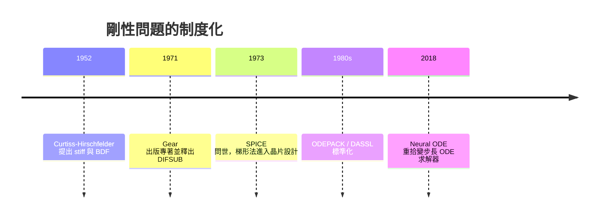

# 1952 剛性方程與隱式求解法：當顯式方法被時間尺度綁架

## 一、Curtiss 與 Hirschfelder：給「難纏」取一個名字

1952 年，加州理工學院的化學家查爾斯·柯蒂斯（Charles F. Curtiss）與約瑟夫·赫希菲爾德（Joseph O. Hirschfelder）在研究化學反應動力學時，於論文中首次正式使用了 "stiff"（剛性）一詞，來描述一類他們用顯式方法怎麼算都吃力不討好的常微分方程。

這類方程的特徵可以用一句話概括：系統裡同時存在快慢懸殊的時間尺度。考慮線性模型 $y' = \lambda y$，顯式歐拉法 $y_{n+1}=(1+h\lambda)y_n$ 要穩定就必須 $|1+h\lambda|\le 1$，即 $h \lesssim 2/|\lambda|$。現在假設一個燃燒模擬：自由基反應在微秒尺度上迅速趨於平衡（$|\lambda|\sim 10^6$），而溫度場演化在秒的尺度（$|\lambda|\sim 1$）。你真正想解析的是「秒」這個尺度的行為，但顯式方法的穩定性卻強迫你用微秒步長走完全程——就像為了看清一隻烏龜爬完全程，卻被規定必須用顯微鏡逐幀拍攝蜂鳥拍翅。計算量浪費了五、六個數量級，而那些快速衰減的分量早就小到沒有資訊價值。

Hirschfelder 是化學鍵理論與氣體動力學的巨擘，二戰期間參與過曼哈頓計畫相關的推進劑研究；Curtiss 則是化學物理與統計力學名家（他與 Hirschfelder、Bird 合著的《氣體分子動力學論》至今仍是經典）。戰後美國化學工程界面對噴氣引擎、火箭推進劑、石化裂解等課題，燃燒與反應器模擬成為剛需——正是這個產業背景，逼出了「剛性」這個概念。名詞一落地，問題就有了共同語言，隨後二十年的方法論爆發由此展開。

## 二、隱式歐拉與梯形法：用一點「未來」換取穩定

顯式方法用已知量算未來；隱式方法則讓未來出現在等號兩邊。隱式歐拉法

$$y_{n+1} = y_n + h f(t_{n+1}, y_{n+1})$$

每步需要解一個（非線性時）方程組，看似昂貴，卻換來 A-穩定：對 $h\lambda$ 的整個左半複平面穩定，快變分量再快也不會炸掉，步長只受精度而非穩定性約束。梯形法

$$y_{n+1} = y_n + \tfrac{h}{2}\left[f(t_n, y_n) + f(t_{n+1}, y_{n+1})\right]$$

則是二階且 A-穩定的折衷品，代價是對極剛硬分量會產生輕微的振盪衰減。

隱式方法的思想並不新——早在牛頓迭代與隱式差分格式中就若隱若現——但把它系統地變成剛性問題的解法工具箱，是 1950 到 1970 年代的事。其中最重要的是背向差分公式（Backward Differentiation Formulas, BDF）：用 $y$ 在過去若干點的值對 $t_{n+1}$ 做插值，再要求微分方程在 $t_{n+1}$ 處成立。BDF 家族在 1952 年由 Curtiss 與 Hirschfelder 的論文首先提出，其六階以內成員具有 A($\alpha$)-穩定性，成為此後半世紀剛性問題的主力。

## 三、Gear 的 1971：從方法到軟體的驚險一躍

有了好格式，不等於有了可用的軟體。剛性問題求解真正的產業化，歸功於比爾·Gear（C. William Gear）。1971 年，Gear 出版專著《常微分方程組的數值初值問題》（*Numerical Initial Value Problems in Ordinary Differential Equations*），並發表了 DIFSUB 程式：它把 BDF 與變步長、變階（VSVO）策略、牛頓迭代結合起來，自動偵測問題的剛性程度並調整階數——問題平緩時用高階省步數，問題劇變時降階縮步保穩定。使用者只需提供右端函數與初始值，不必再是數值分析專家。

這是典範轉移：數值方法第一次以「自動駕駛的黑箱程式庫」形態交付給領域科學家。Gear 的程式碼後來演化為 ODEPACK 套件中的 LSODE 系列與 DASSL（處理微分代數方程，DAE），至今仍是化學工程流程模擬器（如 Aspen Plus）、系統生物學（COPASI）、空間飛行器姿態動力學等軟體的核心引擎。諷刺的是，ODEPACK 這類 1980 年代的 Fortran 老古董，到今天仍被大量的現代軟體封裝呼叫——例如許多機器學習框架在實作「神經常微分方程」（Neural ODE, 2018 年由 Chen 等人提出，該工作獲 NeurIPS 最佳論文）的內建求解器時，其自適應步長控制的骨架仍是 Gear 時代確立的。求職市場上還有一個有趣的旁證：許多量化與模擬相關職缺的面試題庫（如 NVDA 等公司流傳的準備資料）仍把剛性 ODE 與 BDF 列為必考觀念——四十年前的理論，依然是當代工程師的入門磚。

## 四、SPICE：梯形法統治了你的手機

另一條平行戰線在積體電路。1970 年代，柏克萊大學的 Donald Pederson 團隊開發出 SPICE（Simulation Program with Integrated Circuit Emphasis，1973 年首版），成為晶片設計的祖師級工具。電路模擬的本質是求解由 KCL/KVL 導出的大型剛性 DAE 系統：電晶體在開關瞬間時間常數是皮秒級，而電源紋波的週期可能是毫秒級。SPICE 選用的時間積分器正是梯形法（可切換為 Gear/BDF），搭配稀疏矩陣分解與牛頓迭代。

這個選擇影響深遠：今天全球每年數兆美元產值的半導體設計流程，上游每一個電晶體在 tape-out 之前，都先在梯形法的時間軸上被「數值地」點亮過一次。隱式方法每步貴一點、但步長可以放大千萬倍的哲學，在這裡得到最徹底的商業驗證。

## 五、剛性的普遍性

剛性不是化學的專利。電力系統的暫態穩定分析（電磁暫態微秒級 vs 機電擺盪秒級）、控制理論（被控對象極點懸殊）、天體力學（近日點快、遠日點慢）、甚至深度學習中學習率與曲率懸殊的優化問題，本質上都是剛性現象。1952 年那篇論文的真正遺產，是教會工程師一個區分：顯式方法的成本由「最快的尺度」決定，隱式方法的成本由「你想知道的尺度」決定——而選對後者，就是計算數學送給工程世界最划算的禮物。

