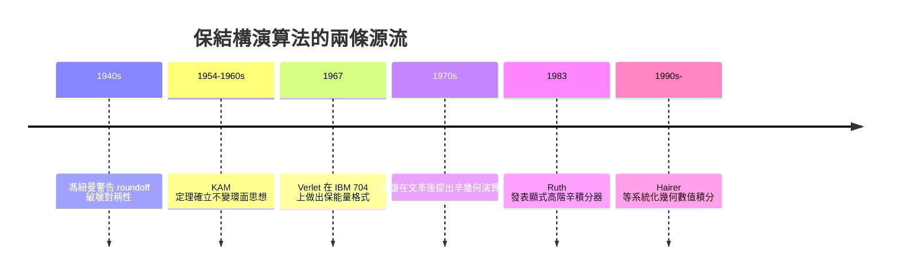

# 保結構演算法：辛積分器與能量守恆——當演算法學會尊重物理

## 一、問題：數值解會「漏能量」

傳統的數值積分方法（Runge–Kutta、Adams 等）追求的是逐步誤差小。但對於長時間演化的力學系統，這個目標是錯的。考慮最簡單的例子——用顯式歐拉法積分諧振子 $H = \frac{1}{2}(p^2 + q^2)$，每走一步，相平面的軌道就向外螺旋擴張一圈；計算出的能量單調膨脹，擺錘越盪越高，最後「憑空」飛出能量守恆允許的範圍。模擬太陽系一億年，行星會被數值誤差「加熱」而拋出軌道；模擬蛋白質一奈秒，分子會莫名發燙。

問題的根源在於：哈密頓力學的真正不變量不只是能量，還有相空間上的辛形式（symplectic form）。一般數值方法會破壞這個幾何結構，誤差於是隨時間系統性累積。要根治，就必須讓離散化的映射本身保辛——這就是保結構（structure-preserving）演算法的核心思想。

## 二、Verlet 演算法：分子動力學的意外先驅

有趣的是，實務界比理論界早了十幾年摸到答案。1967 年，法國物理學家盧維爾（Loup Verlet）在 IBM 704 上做液態氬的分子動力學模擬時，使用了這個格式：

$$q_{n+1} = 2q_n - q_{n-1} + h^2 a(q_n).$$

它源自三百年前牛頓時代就有的中心差分想法，寫起來毫不起眼，卻有一個神奇性質：它對 $p$ 有一個非常精細的守恆誤差——能量不會漂移，只在精確能量附近做微小的有界振盪。Verlet 演算法（及其 leapfrog 變體）因此成為整個分子動力學（MD）領域的標準積分器。沒有它，就不會有後來 GROMACS、AMBER、CHARMM 這些軟體，也不會有今天以 MD 為基礎的藥物設計產業——每個候選藥物分子在合成之前，都先在 Verlet 的時間軸上與蛋白質靶點「共舞」過。

Verlet 本人並非為了保結構而設計：他是被 IBM 704 的記憶體與速度限制逼著用最省的格式，而好性質是撿到的。理論解釋要等二十年後。

## 三、馮紐曼的警告與 KAM 的背景

為什麼「結構」如此重要，早有思想伏筆。1940 年代，馮紐曼在討論數值計算的穩定性時多次強調：浮點捨入與離散化會破壞物理系統的對稱性與守恆量，而某些系統對此極端敏感。他與烏拉姆在 1940 年代對混沌系統（如保守系統的長期行為）的興趣，預示了後來的 KAM 定理：Kolmogorov（1954）提出、Arnold 與 Moser（1960 年代）證明——近可積的哈密頓系統中，大部分不變環面在擾動下存活。不變環面的存活意味著相空間混合受到嚴格限制，也就是說，一個「洩漏能量」的數值格式根本模擬的是錯誤的相空間拓撲。KAM 理論為「保結構」提供了深刻的動機：你要保住的正是那些讓環面存活的幾何量。

## 四、Ruth 1983 與馮康的辛幾何演算法

理論突破發生在 1983 年。美國的 Ronald Ruth 在粒子加速器模擬（SLAC 的直線加速器設計需要長時間精確追蹤束流，而加速器電磁場正是哈密頓系統）背景下，發表論文構造了高階的「顯式辛積分器」——他證明可以透過合成簡單的辛映射，系統地得到任意階的保辛格式。Ruth 的工作第一次明確地把「辛」從幾何術語變成演算法設計原則。

而更宏觀的體系由中國數學家馮康（Feng Kang）獨立建立。馮康是中國計算數學之父，1920 年生於南京，早年就讀中央大學物理系，師從吳大猷等名師，1950 年代在中科院計算所主持中國第一代計算機（103 機）上的計算工作，並獨立於西方發展了有限元方法（見 5.2 節）。

文化大爆發前後，馮康的研究一度中斷，他被下放、受批判；但 1970 年代後期，他重新拾起一個問題：為什麼傳統方法算長期軌道總失真？他從幾何角度切入，意識到哈密頓系統的相空間不是歐氏空間而是辛空間，於是提出「以辛幾何為基礎的哈密頓系統計算方法」（辛幾何演算法，symplectic geometric algorithms）。1980 年代他率領秦孟兆等學生系統發展了這條路線，涵蓋辛差分、辛有限元、保體積格式等。馮康去世後，這項工作獲中國國家自然科學一等獎，並被國際學界公認與 Ruth、與 Hairer 等人發展的幾何數值積分（geometric numerical integration）潮流合流——恩里科·哈里爾（Ernst Hairer）與 Wanner 1996 年的專著《Solving Ordinary Differential Equations II: Stiff and Differential-Algebraic Problems》及後續的幾何積分專著，把辛積分器、守恆格式、B-系列理論整理成現代教科書體系，Ruth 與馮康的名字並列出現在文獻引用網的核心。

這段歷史的政治背景值得深思：馮康的理論誕生於封鎖與動盪之中——文革切斷了他與西方學界的正常交流，中科院的計算任務多與兩彈一星等國防工程相關，這既是壓迫，也提供了長時間模擬問題的真實需求（彈道、軌道、粒子束）。1980 年改革開放後，他的成果才被世界看見。保結構演算法因此是極少數由冷戰兩側、在不同政治體制下幾乎同時獨立開創的數學方向，也證明深刻的科學問題不屬於任何陣營。

## 五、現代應用：從遊戲引擎到重力波

今天，辛積分器與保結構方法遍佈各處：

- 分子動力學與藥物設計：Verlet/leapfrog 是 MD 引擎的預設積分器。
- 天體力學：太陽系長期演化模擬（如數億年的行星軌道積分）幾乎都用辛方法。
- 粒子加速器：束流動力學追蹤用高階辛合成格式。
- 遊戲與電影物理引擎：許多物理引擎用「半隱式歐拉」（一種一階辛方法）而非顯式歐拉，就是為了讓模擬的鞦韆與彈簧不會越盪越高。
- 引力波波形計算：數值相對論的廣義相對論模擬，高度依賴保約束（constraint-preserving）格式，這是保結構思想在雙曲型 PDE 的延伸。

馮康晚年常說，他的願景是「計算數學要與物理學、幾何學結合」。今天回看，這正是整個幾何數值積分學派的綱領。演算法不只是求近似答案的工具，也可以是物理定律的數位化身——這是二十世紀計算數學留給二十一世紀最深刻的觀念遺產之一。

