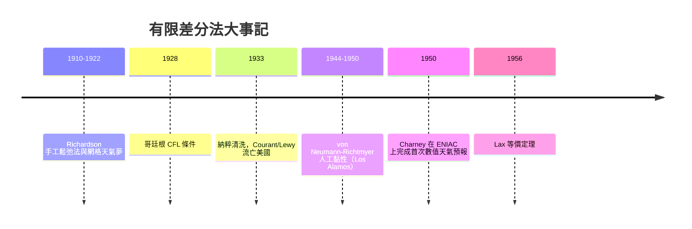

# 1944 有限差分法：把微分變成網格上的代數

## 一、里查遜的網格夢（1910–1922）

有限差分法的思想很古老：導數本來就是差商的極限，反過來在有限步長下用差商代替導數，微分方程就變成網格點上的代數方程組。最早把這個想法系統地用在物理問題上的，還是那位貴格會科學家里查遜。1910 年代，他在英國氣象局工作期間發表論文，用鬆弛法（relaxation method）手工求解應力分佈的偏微分方程；1922 年他出版《用數值過程預報天氣》，把大氣切成網格，每格寫下差分方程。我們在 4.1 節講過，他 1922 年的手工預報在數值上慘敗（六週算出一場不存在的風暴），但方法論的藍圖已經完整：離散化、代數化、逐格計算。差的只是算力與格式設計。

## 二、哥廷根與 CFL 條件（1928）

理論基礎在哥廷根奠立。1928 年，理查·庫蘭特（Richard Courant）、庫爾特·弗里德里希斯（Kurt Friedrichs）與漢斯·勒維（Hans Lewy）發表著名論文《偏微分方程的數學解》（Über die partiellen Differenzengleichungen der mathematischen Physik），證明：顯式差分格式要收斂，步長與網格間距必須滿足一個不等式——雙曲方程中資訊傳播速度有限，數值格式每步的依賴域必須覆蓋真實的依賴域。對波動方程 $u_{tt}=c^2u_{xx}$，這就是

$$c\,\frac{\Delta t}{\Delta x} \le 1,$$

後世稱為 CFL 條件。它告訴我們：顯式格式不是你想用多粗的網格就用多粗的——步長被物理（波速）鎖死。這個看似技術性的結果，實際上規定了此後所有顯式模擬的經濟學：三維問題把 $\Delta x$ 減半，計算量增加十六倍。

背後的文化背景同樣重要。哥廷根在 1920 年代是世界數學的中心，高斯與黎曼的傳統由希爾伯特、克萊因發揚，應用數學（Klein 主導的 Göttingen 8 教授計畫）與純數學並重，CFL 論文正是這種「數學為物理與工程服務」哲學的產物。然而 1933 年納粹上台，猶太裔學者遭大規模清洗：Courant 被迫流亡美國，1936 年在紐約大學重建根據地，創立了日後的 Courant Institute（柯朗研究所），成為美國應用數學與計算數學的搖籃；Lewy 先到英國，後落腳加州大學柏克萊分校；Friedrichs 也追隨 Courant 去 NYU。哥廷根的沒落與美國的崛起，是二十世紀知識分子遷徙史上最 dramatic 的一頁——納粹用政治暴力，把差分法的理論種子親手移植到了大西洋對岸。

## 三、馮紐曼、Los Alamos 與人工黏性

戰爭把方法推向極限。曼哈頓計畫中，馮紐曼（John von Neumann）擔任 Los Alamos 的顧問數學家，面對的核心計算問題之一是內爆式核彈設計：衝擊波在非均質材料中的傳播，必須數值求解可壓縮流體方程。而流體方程有個數學惡棍——激波（shock wave）：解在激波面處出現間斷，經典的差分格式在間斷處會發散或產生非物理振盪。

1944 年前後，馮紐曼與 Richtmyer 提出著名解法：人工黏性（artificial viscosity）——在方程中加入一個人為的、與速度梯度相關的耗散項，讓間斷被「抹開」成有限寬度的過渡層，格式於是穩定，且激波位置與速度仍然正確。這個想法（1950 年正式發表）本質上是「為了數值穩定而修改物理」，開創了整個激波捕捉格式的傳統，日後演化出 Godunov 格式、通量限制器、WENO 等龐大家族，至今統治著航太、爆炸力學與天體物理模擬。核武與冷戰科研體制（AEC 原子能委員會的龐大預算、國家實驗室的常設化）成為計算數學最強的資助來源——馮紐曼 1945 年那份著名的《EDVAC 報告》定義了現代計算機架構，而他心中最早的應用清單上，排第一的就是流體力學與天氣。

## 四、ENIAC 天氣預報（1950）：里查遜之夢的實現

1946 年馮紐曼在普林斯頓高等研究院召開會議，重提里查遜 1922 年的問題：有了電子計算機，數值天氣預報可行嗎？他組織了氣象學家 Jule Charney 團隊。關鍵的科學突破是 Charney 的「濾波」：大氣方程中快變的重力波模式（正是當年坑死里查遜的元兇）可以用準地轉近似濾掉，只保留天氣尺度演化。1950 年，團隊在賓州大學的 ENIAC 上，用 24 小時機時算出第一個成功的 24 小時數值天氣預報，誤差達到可用程度。里查遜當年設想的「64000 人計算廳」被一台 30 噸的機器取代，而他在書中設想的網格、中心差分、時間步進結構，幾乎原封不動地實現。1954 年美國氣象局成立數值預報業務單位（JNWPU），數值天氣預報從實驗變成每日業務，今天全球的天氣 App 都是其直系後代。

## 五、Lax 等價定理：什麼時候可以相信差分格式

戰後美國應用數學界（Courant 研究所、Los Alamos、紐約大學—原子能委員會體系）把差分方法的理論推向嚴格化。Peter Lax 與 Richtmyer 在 1956 年證明：對適定的線性初值問題，一個差分格式的收斂性等價於其穩定性（相容性為前提）——即著名的 Lax 等價定理。這是有限差分法的「憲法」：工程師不再需要逐一驗證收斂，只需驗證穩定（例如用馮紐曼在 1940 年代發明的穩定性分析法——用傅立葉模態追蹤誤差增長，至今每個寫格式的學生都會用）。Lax 本人是 Los Alamos 體系培養出來的（二戰時入伍後被派去參與計算工作），這條理論線與國家實驗室的工程線再次匯流。

## 六、小結

有限差分法的故事，是二十世紀計算科學的縮影：1910 年的紙筆鬆弛法、1928 年的哥廷根理論、1933 年的種族清洗與流亡、1944 年的核武計算、1950 年的 ENIAC 預報、1956 年的收斂理論。每一步的驅動力都不只是數學好奇心，而是航海、氣象、戰爭與冷戰體制的具體需求。差分法的核心思想——用網格上的代數代替連續介質的微積分——至今仍是數值模擬世界最粗壯的一根支柱。

