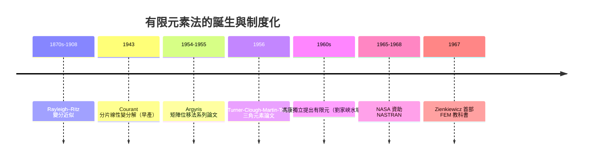

# 1956 有限元素法：弱形式、形狀函數與航空工業的催生

## 一、從 Courant 1943 說起：一個早產的想法

有限差分法把區域切成規則網格，這對矩形平板很方便，但飛機機翼、渦輪葉片、水壩壩體是不規則的。有限元素法（FEM）的答案更漂亮：把區域切成任意形狀的小塊（元素），在每塊上用簡單函數逼近解，再把全域問題變成代數系統。

這個想法最早可追溯到 1943 年。庫蘭特（對，就是 CFL 條件那位）在流亡美國期間發表論文，用「分片線性函數在三角剖分上的 Rayleigh–Ritz 過程」求解扭轉問題——他實際上已經寫出了有限元素法的全部數學骨架：變分原理、分片多項式、以節點值為自由度。但 1943 年既沒有電子計算機來解大規模方程組，也沒有工業問題迫切到需要它，Courant 的工作被冷落了十餘年。思想早產，等待著產業來接生。

## 二、變分原理與弱形式：FEM 的數學靈魂

要理解 FEM，先理解「弱形式」。許多物理平衡問題可以寫成微分方程邊值問題（強形式），例如彈性力學的平衡方程。對強形式直接做差分，要求解處處可微；但工程上大量問題的解天生不夠光滑（材料介面、集中荷載）。變分法提供另一條路：真正的解是使某個能量泛函（或虛功泛函）

$$\Pi(u) = \tfrac{1}{2}a(u,u) - \ell(u)$$

取極小值的函數。把問題搬到積分形式（弱形式）後，對試函數的連續性要求下降，允許分片多項式——這正是 FEM 的鑰匙。Rayleigh（1870 年代）與 Ritz（1908）早就提出用一組基函數的線性組合做變分近似（Rayleigh–Ritz 法），但傳統用的是全域光滑基（三角級數），收斂慢且不適合複雜邊界。FEM 的創新就是換成分片多項式基——「形狀函數」（shape functions）：每個元素內用低階多項式，由元素頂點（節點）的值決定，元素之間以弱意義拼合。弱形式、形狀函數、組裝成大型稀疏剛度矩陣 $K u = f$，三件事合起來就是現代 FEM。

## 三、Turner–Clough 1956：波音的三角元素

把 Courant 的想法變成工業現實的，是航空工業。1950 年代，波音公司面對後掠翼與三角翼時代的結構分析難題：薄壁、加勁、各向異性的機翼結構，傳統的一維梁理論與規則差分網格都力不從心。波音的結構分析師 M. J. Turner（曾參與二戰時期飛機設計）在 1952 年前後提出「直接剛度法」：把結構拆成標準件（元素），為每件寫出節點力—節點位移關係（元素剛度矩陣），再按節點組裝成總剛度矩陣。這是工程師思維——從矩陣結構力學（R. C. Courant 前輩的矩陣力學譜系之外，航空界自己有 Argyris 的一部分傳統，見下）而非變分數學長出來的。

1956 年，Turner、華盛頓大學的 Ray Clough、波音的 H. C. Martin 與 L. J. Topp 合寫論文《複雜結構的剛度與偏轉分析》（Stiffness and Deflection Analysis of Complex Structures），發表於《航空科學期刊》（Journal of the Aeronautical Sciences）。論文中首次使用三角形元素推導平面應力問題，並明確使用了 "finite element"（有限元素）一詞——據 Clough 回憶，這個名詞是他 1960 年才正式在論文中採用的，但 1956 年這篇文章公認是 FEM 的出生證明。值得注意的是，這篇論文的作者全部來自航空業與其周邊學術圈，而非傳統數學系——FEM 是被噴氣時代與冷戰軍備競賽（B-52、波音 707、洲際飛彈）的真實工程需求逼出來的。波音當時正與道格拉斯、洛克希德爭奪商用噴射機市場，誰能更快、更省地驗證新型機翼結構，誰就贏。

同一時期，斯圖加特大學的約翰·阿吉里斯（John Argyris）在德國以矩陣位移法為核心，於 1954–1955 年發表系列論文，獨立發展出幾乎相同的框架（他與英國皇家航空研究院的合作背景，讓這條線跨越了鐵幕兩側的航空界）。1960 年代，英國斯旺西大學的 O. C. Zienkiewicz 將 FEM 推廣到場問題（熱傳、流體、電磁），並於 1967 年出版第一本 FEM 教科書《The Finite Element Method in Structural and Continuum Mechanics》，把工程技藝轉化為可傳授的學科。

## 四、馮康 1960 年代：鐵幕內的獨立發明

就在同一時期，中國數學家馮康在完全封閉的環境下獨立走出了同一條路。1956 年中國展開「十二年科學規劃」，中科院計算技術研究所成立，馮康受命負責計算數學方向。當時的工程背景是水利與國防：1958 年上馬的劉家峽水壩（黃河第一座百萬千瓦級大型水電站，蘇聯專家撤走後全靠自主計算）需要求解大規模彈性力學問題，規則差分網格在複雜壩體邊界上束手無策。

馮康從變分原理出發，於 1960 年代初發表系列論文，提出了「基於變分差分方法的剖分逼近」——即今日所稱的有限元方法，包括三角形剖分、分片線性插值、誤差估計與收斂性理論（他的收斂理論甚至比西方更早給出系統的數學證明）。這完全是獨立完成：當時中蘇決裂（1960 年蘇聯撤走全部專家）、西方論文進不來，馮康不知道 Courant 1943 或 Turner–Clough 1956 的存在。1980 年代中國改革開放後，國際學界（包括法國 Lions、美國數學界）確認了馮康的獨立優先權之一部分，他被譽為「中國計算數學之父」。劉家峽水壩的計算被認為是 FEM 在中國的第一個實戰工程。政治的荒誕在於：冷戰的封鎖既切斷了知識流通，又意外地製造了一場兩側平行、彼此不知情的偉大發明。

## 五、NASTRAN 1965：NASA 把方法變成產業

FEM 從論文走向工業標準，靠的是制度化的關鍵一推。1960 年代，NASA 面對阿波羅計畫的結構驗證需求，發現各承包商各自為政的分析程式無法互相校核。1965 年，NASA 出資委託 MacNeal–Schwendler 公司（MSC）等團隊開發統一的結構分析系統，1968 年 NASTRAN（NASA Structural Analysis）正式交付，原始碼向美國產業界開放發行。這是美國政府以公共資金資助、以公共財形式發放工業軟體的經典案例：NASTRAN 迅速成為航空航太與汽車業的通用語言，MSC 公司靠它發展成 CAE 巨頭，原始碼的公開也催生了後續無數商業與開源 FEM 軟體（如後來的 CalculiX、Code_Aster 等血統上承 NASTRAN 思想）。

今天的 CAE（電腦輔助工程）產業——ANSYS、COMSOL、Abaqus、LS-DYNA，加上汽車、航太、半導體封裝、生醫植入物的所有模擬部門——規模以每年百億美元計。從波音 707 的機翼到 iPhone 的跌落測試，從心臟支架的應力分析到 CERN 探測器的磁鐵設計，背後都是同一套數學：弱形式 + 形狀函數 + 大型稀疏矩陣。

## 六、小結

有限元素法的歷史充滿雙重與巧合：Courant 1943 的數學先見，等了十三年才被波音的工程師「重新發明」；鐵幕兩側（美國航空工業、中國劉家峽水壩）在互不知情下各自創立；冷戰軍備競賽與登月工程以政府訂單把方法制度化為 NASTRAN。它比有限差分法晚二十年誕生，卻因為「任意剖分 + 變分框架」的普適性，成為今日連續介質模擬的第一選擇。當年 Clough 在波音拿三角板拼機翼的直覺，如今是每一台超級電腦上最常用的數學。

