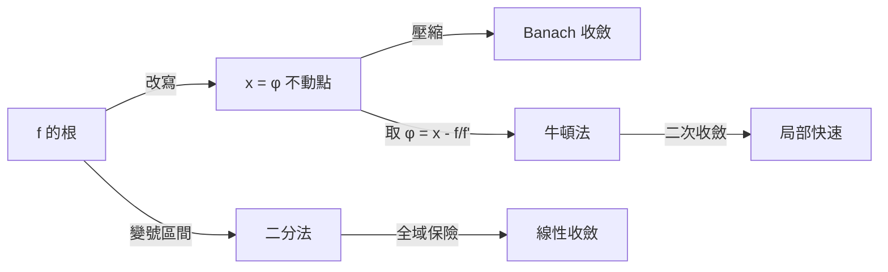
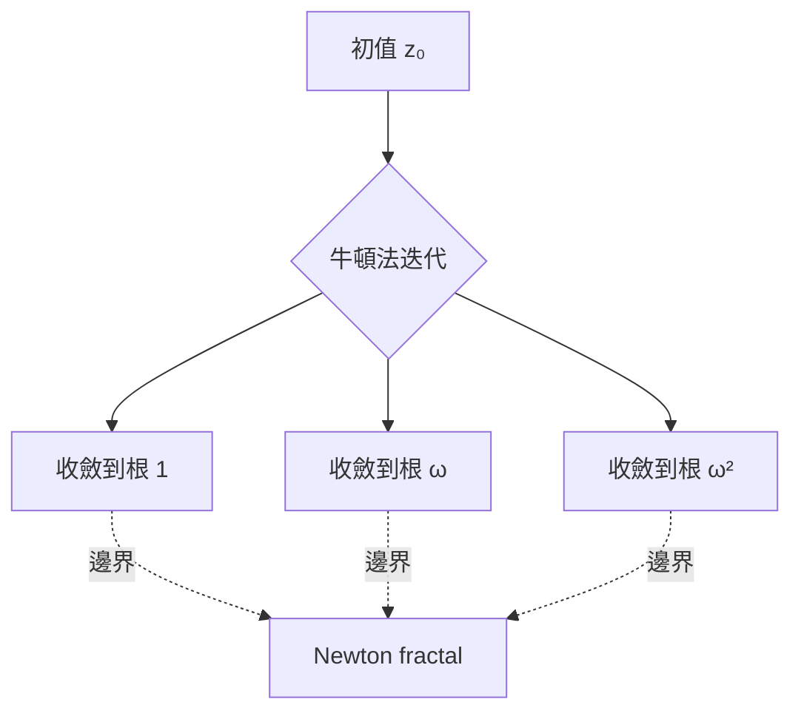

# 06.1 一維求根：二分法、不動點迭代與牛頓法

## 從巴比倫的黏土板說起

求方程的根，是人類最古老的計算問題之一。西元前 1800 年左右的巴比倫黏土板上，已記載著計算 $\sqrt{2}$ 的方法：從一個猜測 $x_0$ 出發，反覆計算

$$x_{n+1} = \frac{1}{2}\left(x_n + \frac{2}{x_n}\right).$$

這正是牛頓法應用在 $f(x) = x^2 - 2$ 上的特例。古希臘的 Heron 在《度量論》中記載了同一個演算法，因此後世稱之為 Heron 法。一個演算法在文字記載出現之前就已在實務中流轉，這說明「求根」的需求來自最基本的經濟活動：丈量土地、分配穀物、建築比例。

古代的動機還有一項常常被忽略：曆法。回歸年與朔望月的長度都不是整數，曆法改革（如漢代《太初曆》、羅馬儒略曆）需要求解帶非整數參數的方程。中國宋代的秦九韶在《數書九章》（1247 年）中提出的「正負開方術」，本質上是一套系統化的多項式求根數值程序，比西方的同類方法早了數百年。求根的方法史，幾乎就是一部古代的應用數學史。

## 中間值定理與二分法

現代求根的理論起點是中間值定理：若 $f$ 在 $[a,b]$ 連續且 $f(a)f(b) < 0$，則存在 $c \in (a,b)$ 使 $f(c)=0$。二分法把區間反覆對分，每次保留變號的一半，經過 $n$ 步後誤差至多 $(b-a)/2^n$。它是線性收斂的：每一步誤差減半，也就是每多算一位十進位數字，要多算約 3.3 步。

二分法的美德不是快，而是保險。只要知道一個變號區間，它必然收斂，並且可以事先算出需要多少步。在早期的手搖計算機與打孔卡時代，這種可預測性非常重要；在今天，二分法仍是許多可靠演算法的最後一道防線。

## 牛頓與 Raphson

1669 年，牛頓在手稿《De analysi per aequationes numero terminorum infinitas》中描述了一種多項式求根的方法：先猜一個近似值，代入方程，用線性展開修正誤差。這份手稿當時並未正式出版，只在小圈子里流傳。1690 年，英國數學家 Joseph Raphson 在《Analysis aequationum universalis》中發表了一個更簡潔、更利於實用的版本，把每一步的修正公式寫得直接明瞭。後世因此把這個方法稱為 Newton–Raphson 法——數學史上以兩人命名同一方法的例子不少，而這一次，Raphson 的版本確實比牛頓的更接近今天的寫法。

今天的迭代公式是

$$x_{n+1} = x_n - \frac{f(x_n)}{f'(x_n)}.$$

牛頓法的收斂是二次的：若 $r$ 是單根且初值夠近，則誤差滿足

$$|x_{n+1} - r| \le C |x_n - r|^2.$$

每迭代一次，正確位數大約翻倍。從 1 位到 16 位，只需四五步。這種收斂速度與二分法的線性收斂形成鮮明對比，也正是巴比倫人算 $\sqrt{2}$ 收斂快得驚人的原因——他們用的正是這個方法，只是不知道其理論依據。

把牛頓法推廣到多維方程組的，是 Thomas Simpson（1740 年，這位以 Simpson 法則留名的數學家在多變量求根上也有先見之明）。牛頓法因此不只是一維的工具，而是所有非線性方程組解法的原型，這將是下一節的主題。

## 不動點迭代與 Banach 壓縮映射

許多求根問題可以改寫為不動點問題：$f(x)=0$ 等價於 $x = \varphi(x)$，其中 $\varphi$ 的選法很多，例如 $\varphi(x) = x - f(x)/\lambda$。迭代 $x_{n+1} = \varphi(x_n)$ 是否收斂，取決於 $\varphi$ 是否是壓縮映射。

1922 年，二十歲出頭的 Stefan Banach 在博士論文中證明了壓縮映射原理：完備度量空間上的壓縮映射有唯一不動點，且任意初值迭代都收斂。這個定理把「迭代法為什麼有效」從一組個案的經驗，提升為一個抽象而普遍的原理，也是泛函分析的奠基成果之一。求根、微分方程解的存在唯一性（Picard 迭代）、動態規劃中的值函數迭代，用的都是同一個原理。

## 分形：牛頓法的黑暗面

牛頓法在復平面上求解 $z^3 - 1 = 0$ 時會展現驚人的結構。三個複根各有自己的吸引域，這些吸引域的邊界並不是光滑曲線，而是自相似的分形——今日稱為 Newton fractal，屬於 Julia 集合的一族。Benjamin 的觀察與 Fatou（1919 年前後）的復動力學研究早已指出這些現象；而使它廣為人知的，是 1970 年代末電腦繪圖普及之後：John Hubbard 等人在 Cornell 的螢幕上畫出牛頓法吸引域的彩色分形，Benoît Mandelbrot 的工作讓「分形」成為家喻戶曉的詞。

Newton fractal 的教育意義深遠：一個「直觀上應該收斂」的演算法，其全域行為可以極端複雜。這提醒我們，二次收斂是局部性質，初值選取、全域收斂策略（阻尼、同倫法、混合二分法）在實際軟體中不可或缺。

## 小結

從巴比倫的平方根疊代、秦九韶的正負開方、牛頓 1669 年的手稿與 Raphson 1690 年的出版，到 Banach 1922 年的抽象定理與 1970 年代的分形視覺化，一維求根的歷史橫跨四千年。它展現了數值分析的核心張力：二分法的穩健與牛頓法的速度各有其位，理論（壓縮映射、收斂階）與實務（初值、防呆機制）必須並重。下一節我們把這個故事推廣到多維，那裡的挑戰不只是收斂快慢，還有導數本身可能算不起來。
