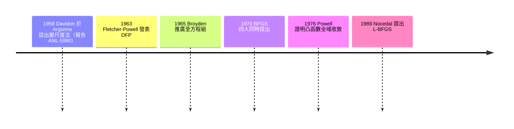

# 06.2 多維非線性方程組與擬牛頓：BFGS 的誕生

## 當導數太貴：問題的轉折

牛頓法解多維方程組 $\mathbf{F}(\mathbf{x}) = \mathbf{0}$ 需要每步計算 Jacobian 矩陣 $J(\mathbf{x})$ 並解線性方程組 $J \Delta\mathbf{x} = -\mathbf{F}$。二次收斂的代價昂貴：若 $\mathbf{F}$ 有 $n$ 個分量，每步要算 $n^2$ 個偏導數，而這些導數若靠有限差分近似，每個都要額外一次函數求值。1950 年代的核反應堆計算、化工流程模擬與經濟均衡求解中，一次函數求值可能要跑幾小時的計算機，導數更是一場災難。

問題由此轉向：能不能只用函數值，疊代出「夠用的導數資訊」？這就是擬牛頓法（quasi-Newton methods）的出發點。

## Davidon、Argonne、與那陣風

1959 年，William C. Davidon 在 Argonne 國家實驗室工作。Argonne 是美國戰後由曼哈頓計畫的芝加哥實驗室改組而來的國家實驗室，核工程與優化問題交織的環境，正是這類演算法的溫床。Davidon 構想出一個優雅的方案：用一個對稱矩陣 $B_k$ 近似 Hessian（或其逆），每步用最新的一對「梯度差」與「位置差」做秩二修正，使 $B_{k+1}$ 滿足割線條件

$$B_{k+1} s_k = y_k, \quad s_k = x_{k+1}-x_k,\ y_k = \nabla f_{k+1} - \nabla f_k.$$

這樣每步只需一個梯度，不需要二階導數，卻保有接近牛頓法的收斂速度。這個方法後來稱為變尺度法（variable metric method）。

關於這段歷史有一則流傳甚廣的軼事（Davidon 本人在 1991 年的回顧文章中親述）：他最初的手稿送交 Argonne 的技術通訊部門時，被以「內容太不合常規、可能不正確」為由拒絕發表，手稿此後遺失多年——Davidon 自己說，那份打字稿在某次開窗後被風吹散，再也沒找全。他於是重寫了一份更完整的版本，1959 年以 Argonne 技術報告 ANL-5990 的形式問世，正式期刊版本則遲至 1991 年才在《SIAM Journal on Optimization》發表（該刊創刊號特意收錄此文以致敬）。一個被審稿制度耽誤了三十年想法，最終成為整個非線性優化的支柱，這是學術史上關於「同行評審」最著名的一課。

## Fletcher–Powell 與 Broyden

1963 年，英國的 R. Fletcher 與 M. J. D. Powell 在 Harwell 的英國原子能研究所將 Davidon 的方法整理、修正並以期刊論文發表（Davidon–Fletcher–Powell，DFP），使這個方法廣為人知。Fletcher 與 Powell 所在的 Harwell，與美國 Argonne 遙相呼應——兩邊都是核能研究機構，都需要反覆求解工程最佳化問題。1965 年，Charles Broyden 把秩一修正的思路推廣到非線性方程組（求 Jacobian 的近似而非 Hessian 的近似），得出 Broyden 法，這是解 $\mathbf{F}(\mathbf{x})=0$ 的擬牛頓法直接版本。

哥廷根與劍橋的數學傳統在此交會：Broyden 在英國受訓，Fletcher 在 Leeds 受教後進入 Harwell；Powell 則在劍橋受訓後長期在 Cambridge 的數學系。1970 年前後，Powell 本人還開創了無導數方法（derivative-free methods），包括 1964 年的共軛方向法與後來的 Powell 方法；這條線在二十一世紀成為大規模模擬中「函數是黑箱」問題的主流選擇，也使得無論是哥廷根的數值傳統還是英國的原子能研究所群體，都在非線性計算的版圖上留下印記。

## 1970：四人與四篇論文

擬牛頓法的巔峰出現在 1970 年。那一年，四組作者幾乎同時提出了一個新的秩二修正公式，後世以四人名字命名為 BFGS：

- Broyden：在《Mathematics of Computation》上的系列論文，把各種修正統一成帶參數的 Broyden 族；
- Fletcher：提出實用的修正選項與收斂分析；
- Goldfarb：哥倫比亞大學的 Donald Goldfarb，獨立推導出這個修正；
- Shanno：David Shanno，當時在芝加哥大學，同樣獨立得出。

BFGS 的修正公式是

$$H_{k+1} = \left(I - \frac{s_k y_k^T}{y_k^T s_k}\right) H_k \left(I - \frac{y_k s_k^T}{y_k^T s_k}\right) + \frac{s_k s_k^T}{y_k^T s_k},$$

其中 $H_k$ 近似 Hessian 的逆。與 DFP 相比，BFGS 對數值誤差與非精確線搜尋更為魯棒；Powell 在 1976 年證明了它在凸函數上的全域收斂性，使它從「經驗上好用」變成「理論上站得住」。此後三十多年，BFGS 成為中小規模無約束優化的事實標準。

## L-BFGS 與機器學習

BFGS 的弱點是記憶體：$H_k$ 是 $n \times n$ 矩陣，$n$ 到十萬就裝不下。1989 年，Jorge Nocedal 提出 limited-memory BFGS（L-BFGS）：不儲存 $H_k$，只保留最近 $m$ 對 $(s_k, y_k)$，每步用兩層遞迴隱式重建矩陣向量乘。記憶體從 $O(n^2)$ 降到 $O(nm)$，而收斂性質幾乎不損失。

L-BFGS 此後成為科學計算的骨幹工具，並在 2000 年代被機器學習界採用：條件隨機場（CRF）訓練、邏輯迴歸、經典的 MNIST 手寫數字分類問題上，L-BFGS 一度是比隨機梯度下降更受歡迎的選擇。在深度學習的隨機、非凸環境裡，BFGS 的確定性精神讓位給 SGD 家族，但只要目標函數是確定性、光滑的（如結構化預測、最佳化超參數），L-BFGS 仍然是首選。從 Davidon 被風吹走的手稿到訓練神經網路的內建求解器，這條線索貫穿了優化方法的六十年。

## 小結

多維非線性問題的解法史，是一段由國家實驗室（Argonne、Harwell）的工程需求驅動、由英國與美國數學家接力完成的歷史。Davidon 1959 年的原始想法歷經拒稿、遺失與重寫，最終以 BFGS 的形式成為標準；Broyden 把它推廣到方程組；Powell 的無導數方法補上了黑箱函數的缺口；Nocedal 的 L-BFGS 讓它進入機器學習時代。下節我們暫離方程組，轉向另一個以代數為武器的求解思想：Gröbner 基底。
