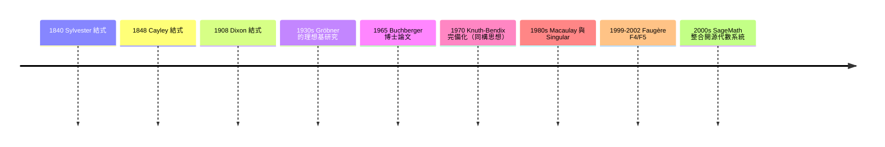

# 06.3 Gröbner 基底與多項式理想解集的計算

## 從結式到理想：問題的代數本質

求多項式聯立方程組 $\{f_1 = f_2 = \cdots = f_m = 0\} \subset \mathbb{C}[x_1,\dots,x_n]$ 的解，比線性方程組困難得多：解不一定是有限個（可能是曲線、曲面，甚至空集以外的任何代數集合），而且「消元」不再是簡單的高斯消去。

十九世紀的代數學家已經發展出關鍵工具：Sylvester（1840）與 Cayley（1848）的結式（resultant）可以從兩個多項式中消去一個變元；1880 年代，A. R. Forsyth 與 E. W. Dixon 等人將結式推廣到多變量（Dixon 結式於 1908 年發表）。結式是「消去理論」的核心：兩條曲線有公共點，等價於它們對某個變元的結式為零。但結式方法對任意多個方程與變元顯得笨重，而且它消去變元後產生的多項式，未必能再由原方程組以「可以掌握的方式」生成——也就是說，缺少一個標準形（canonical form）來判斷解集結構。

## Buchberger 與他的導師 Gröbner

1965 年，奧地利因斯布魯克大學（University of Innsbruck）的博士生 Bruno Buchberger 在論文《Ein Algorithmus zum Bestimmen der Gröbnerbasen》（一個計算 Gröbner 基底的演算法）中，解決了這個懸而未決的問題。他提出了一個標準形的概念：對多項式理想 $I = \langle f_1,\dots,f_m\rangle$，存在一組基底（今日稱為 Gröbner 基底），使得「多項式 $g$ 是否屬於 $I$」這個問題，可以用類似長除法的歸約過程判定。更關鍵的是，他給出了計算這組基底的完整演算法——Buchberger 演算法——其核心是找出歸約失敗的「S-多項式」對，並用歸約消去其首項的衝突。

以導師 Wolfgang Gröbner 命名這組基底，是 Buchberger 的致敬之舉：Gröbner 在 1930–40 年代研究多項式理想的理想基理論（受 Emmy Noether 學派影響），其想法為 Buchberger 提供了起點，但 Gröbner 本人並未給出演算法。Buchberger 在 1998 年的回顧文章〈History and basic features of the Critical-Pair/Completion procedure〉中，把這條演算法思想與 Knuth–Bendix 完備化程序（1970）聯繫起來，說明它屬於同一個「臨界對/完備化」的抽象框架。

Gröbner 基底的威力立刻顯現：

- 求解：取字典序（lex order）的 Gröbner 基底後，方程組被「三角化」，可以一個變元一個變元地回代求解；
- 判斷解的維度與個數：由基底中各多項式的首項集合讀出；
- 消去：$I \cap \mathbb{C}[x_1,\dots,x_k]$ 由 Gröbner 基底的子集給出（消去理想）。

## 代數幾何的計算化

Gröbner 基底把代數幾何的抽象理論轉變為可計算的對象。1970 年代，Buchberger 持續改進演算法（臨界對的篩選、簡化的基底定義）；1980 年代，計算代數幾何成為獨立領域，David Bayer 與 Michael Stillman 的早期實作催生了 Macaulay；德國 Kaiserslautern 大學的 Gert-Martin Greuel 等人開發了 Singular；Wolfram Research 的 Mathematica 與 Redlog 也內建了 Gröbner 基底計算。2000 年代，SageMath（由 William Stein 發起，整合 Singular、Macaulay2 等自由軟體）代表開源數學軟體運動的成熟——這場運動背後有明確的學術制度主張：數學演算法應可自由審查、重製與引用，正如定理與證明一樣。

## 機器人學與逆運動學：一個經典應用

Gröbner 基底最著名的工程應用之一，是機器手臂的逆運動學（inverse kinematics）：已知末端執行器的目標位置，求各關節角度。以平面 3R 機器手臂為例，約束條件是兩個多項式方程（正運動學的 $x$、$y$ 分量），且角度變數滿足 $\sin^2\theta + \cos^2\theta = 1$。這組多項式方程的解集，可以用 Gröbner 基底完整刻畫：解的個數、是否存在、在退化位置（如臂完全伸直）的行為。

Dixon/Cayley 結式在這類問題上仍然有用——結式通常比 Gröbner 基底更快地給出「消元後的一元多項式」，而 Gröbner 基底則給出更完整的解集結構資訊。兩者常配合使用：先用 Gröbner 基底判斷解的維度與分支，再用結式求出各變元的候選值。

## 開源軟體、學術制度與思想傳播

Gröbner 基底的歷史也見證了數學社群的變遷。1965 年的演算法誕生於一篇德文博士論文，如果沒有 Buchberger 自己在 1970–80 年代的持續推廣（他在 Linz 的約翰開普勒大學建立 RISC 研究所）、沒有 1980 年代個人電腦讓計算代數進入普通實驗室，這個演算法可能仍是小眾的代數珍玩。開源軟體的興起則把制度層面推進了一步：當 Singular、Macaulay2、CoCoA 成為可自由取得的工具，研究範式從「少數人擁有大型符號計算系統」轉變為「全球研究者共享同一組演算法實作」，也使得 Gröbner 基底的效率改進（Faugère 的 F4/F5 演算法，1999/2002）能在短時間內被廣泛採用與測試。

## 小結

Gröbner 基底的故事展示了數學的另一面：不是逼近與迭代，而是把「解」當作一個代數結構來完整計算。從 Sylvester 的消去技巧、Buchberger 1965 年的博士論文，到機器人學的逆運動學與開源符號計算系統，這條線索說明：抽象代數與實用計算之間的距離，往往只差一個好的演算法與一群願意把它做成軟體的人。下一章，我們轉向優化——那個從 Cauchy 的梯度下降到深度學習 loss 曲面的漫長故事。
