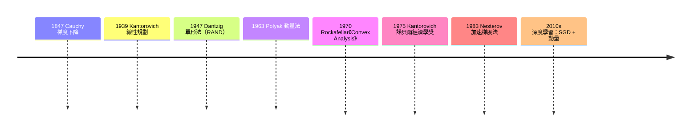

# 07.1 無約束優化：凸性、梯度下降與牛頓法

## Cauchy 的起步：從天文觀測到梯度下降

優化作為一門系統科學，起始點常被追溯到 1847 年 Augustin-Louis Cauchy 的論文〈Méthode générale pour la résolution des systèmes d'équations simultanées〉。Cauchy 當時的動機來自天文觀測：如何從誤差出發，求一組方程的最小平方解，當直接法失效時，能否沿著「最陡的方向」逐步逼近？他的答案是：沿負梯度方向

$$\mathbf{x}_{k+1} = \mathbf{x}_k - \alpha \nabla f(\mathbf{x}_k)$$

做線搜尋。這就是梯度下降法的起源。Cauchy 自己也意識到這個方法在病態問題上收斂緩慢——他所研究的 astronomer 問題恰好是病態的。梯度下降的美在於簡單，弱點也在於簡單：在狹長的橢圓等高線地形上，它會在谷底之間來回震盪，收斂速率由條件數 $\kappa$ 決定，誤差按 $((\kappa-1)/(\kappa+1))^{2k}$ 下降。

相對地，牛頓法在優化中的版本是

$$\mathbf{x}_{k+1} = \mathbf{x}_k - [\nabla^2 f(\mathbf{x}_k)]^{-1} \nabla f(\mathbf{x}_k),$$

在極小點附近二次收斂，但每步要算 Hessian 並解線性方程組，且對非凸區域不保證下降——這正是上一章 Davidon、BFGS 系列工作的出發點。梯度下降（便宜但線性收斂）與牛頓法（昂貴但二次收斂）之間的張力，貫穿了此後一百七十年的優化史。

## 凸性：優化的羅塞塔石碑

為什麼有些問題容易、有些難？1970 年，R. Tyrrell Rockafellar 出版《Convex Analysis》，把凸集、凸函數、次梯度、共軛函數等分散的結果整合成一門系統的學科。這本書的影響遠超數學：它給了優化一個「容易」與「困難」的分水嶺——凸函數的局部極小即是全域極小，KKT 條件成為充要條件，對偶理論完整。Rockafellar 在書中著名地寫道，凸分析是「與優化關係最深的數學分支」。

凸性為何重要？因為現實世界的大量決策問題，都可以被建模成凸優化，而凸優化在理論上是可解的。

## 線性規劃：冷戰的經濟學戰場

1939 年，蘇聯經濟學家兼數學家 Leonid Kantorovich 在《數學方法在生產計劃與組織中的應用》中，為膠合板工廠的生產調度提出了一個新的數學模型：在有限資源下最大化產出。這就是線性規劃的雛形。Kantorovich 甚至提出了對偶價格的思想（「客觀制約估值」），但史達林時代的蘇聯計劃經濟體制對「用市場價格概念重述資源配置」心存疑慮，他的工作多年未獲重視。直到 1975 年，Kantorovich 才與荷裔美國學者 Tjalling Koopmans 共同獲得諾貝爾經濟學獎——表彰他們在資源最優配置理論上的貢獻。

在美國，線性規劃的發展路徑截然不同。1947 年，George Dantzig 在 RAND 公司為美國空軍的軍事後勤規劃問題設計了單形法（simplex method）。RAND 成立於 1948 年，是冷戰時期美國最重要的軍事智庫；線性規劃與單形法從一開始就是冷戰技術：油料調度、物料分配、兵力部署。Dantzig 後來回憶，空軍給他描述的問題規模大得驚人，逼得他不得不發明真正可擴展的演算法。經濟體制也成為對照組：蘇聯的計劃經濟需要 Kantorovich 式的集中求解，美國的市場經濟則把線性規劃用在物流與國防——同一套數學，在兩種制度下扮演不同角色，這是優化史上最具政治意味的一章。

有趣的是，單形法在理論上是「指數時間」演算法（Klee–Minty 反例，1972），但實務上極快；1970–80 年代，蘇聯數學家 Khachiyan（1979 橢球法）與 Karmarkar（1984 內點法）先後提出多項式時間演算法，內點法在大型問題上與單形法分庭抗禮——而 Karmarkar 當時在 AT&T 貝爾實驗室，AT&T 為此申請專利並一度限制學術使用，引發了關於數學演算法能否商業化的激烈爭論。

## 動量與加速：Polyak 與 Nesterov

回到無約束優化本身。梯度下降在病態問題上的震盪，有一個簡單的解法：動量（momentum）。1950–60 年代，蘇聯學者 Boris Polyak 提出重球法（heavy-ball method）：

$$\mathbf{x}_{k+1} = \mathbf{x}_k - \alpha \nabla f(\mathbf{x}_k) + \beta (\mathbf{x}_k - \mathbf{x}_{k-1}),$$

物理意象是一顆有慣性的球滾下山坡，可以衝過狹谷而不是卡在裡面。1983 年，Yurii Nesterov 在蘇聯發表了加速梯度法（accelerated gradient method）：用一個巧妙的「前瞻」步驟，把凸光滑問題的收斂率從 $O(1/k^2)$ 改善到 $O(1/k^2)$（相對於普通梯度法的 $O(1/k)$）。Nesterov 在 2004 年的專著《Introductory Lectures on Convex Optimization》中建立了完整的理論，包括「一階方法不可能更快」的下界——加速法在理論上是最優的。

這些 1980 年代的蘇聯數學，在 2010 年代意外地成為深度學習的核心。訓練神經網路的 loss landscape 是高維、非凸、由海量資料定義的；SGD 加動量（以及 Adam 等自適應方法）的每一次更新，都可以追溯到 Polyak 的重球與 Nesterov 的加速。深度學習的 loss 曲面之所以可訓練——大量鞍點而非局部極小、山谷狀的極小盆地——是 2010 年代研究中反覆討論的問題，而「為什麼動量、學習率排程這些老方法在非凸世界仍然有效」至今仍是活躍的研究方向。

## 小結

優化的故事有三條互相纏繞的線：數學（Cauchy 的下降法、Rockafellar 的凸分析、Nesterov 的加速理論）、經濟（Kantorovich 的計劃調度、諾貝爾獎、市場與計劃的制度對照）、政治（Dantzig 在 RAND 的冷戰後勤、蘇聯內部對優化數學的意識型態顧慮、貝爾實驗室的專利爭議）。梯度下降與牛頓法的張力，在深度學習時代以新形式重現：一階方法便宜且可擴展，二階方法精確但昂貴——而加速、動量這些十九、二十世紀的老想法，仍然是二十一世紀訓練模型的日常工具。
