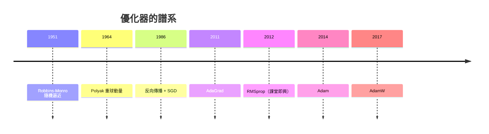

# 07.3 大規模優化：SGD 與 Adam，深度學習的數學基石

## Robbins-Monro：1951 年的隨機逼近

1951 年，統計學家 Herbert Robbins 與 Sutton Monro 在《Annals of Mathematical Statistics》發表〈A Stochastic Approximation Method〉。他們處理的問題是：當函數值只能帶雜訊觀測時，如何找根？答案是隨機梯度下降的雛形：沿雜訊梯度走，但步長要遞減，條件是 $\sum \alpha_k = \infty$ 且 $\sum \alpha_k^2 < \infty$。這兩個看似技術性的條件，成為爾後七十年學習率設計的數學骨架。

SGD 的實用價值在於成本：資料量大時，全量梯度太貴，用小批量的隨機梯度代替真梯度，每步便宜 $n$ 倍，而期望值不變。統計上的犧牲換來計算上的勝利——這個交換，在資料爆炸的時代只會越來越划算。

## 1986 年反向傳播：SGD 找到舞台

1986 年，Rumelhart、Hinton 與 Williams 發表反向傳播論文，神經網路得以用梯度法訓練。此後十年，LeCun 用 SGD 訓練卷積網路讀取手寫支票，momentum 這一招——把歷史梯度累積成慣性——來自 Polyak 的重球法與 Nesterov 的加速法，成為標配。

## 自適應學習率的十年

2011 年，John Duchi 等人提出 AdaGrad，讓每個參數依歷史梯度平方自適應步長，稀疏特徵受惠極大。Hinton 在 2012 年的 Coursera 課堂上即興提出 RMSprop——對梯度平方做指數移動平均而非累加——這個未正式發表的演算法靠一門線上課程風行全球，成為機器學習知識傳播方式的有趣註腳。

2014 年底，OpenAI 前身時代的 Diederik Kingma 與 Jimmy Ba 在 ICLR 投稿 Adam，結合 momentum 與 RMSprop 的二階矩估計並做偏差校正。這篇論文的審稿爭議是機器學習社群的著名軼事：初審被批「增量貢獻」，差點被拒，最終卻成為 ICLR 引用量最高的論文之一，也讓年會的審稿制度屢被檢討。Adam 之後的 AdamW（2017）修正了 weight decay 的耦合，成為大模型訓練的事實標準。

## GPU 與 2012 年的 ImageNet 時刻

2012 年，Alex Krizhevsky、Ilya Sutskever 與 Hinton 的 AlexNet 用兩張 GTX 580 GPU 訓練，在 ImageNet 競賽將錯誤率一口氣從 26% 壓到 16%，SGD + momentum + 學習率調度是背後的訓練配方。這場勝利宣告：優化演算法、算力與大數據三者同時到位，深度學習時代正式開張。此後學習率預熱、退火、批次大小與學習率的關係（linear scaling rule）、batch normalization（2015，Ioffe 與 Szegedy）重整了損失面的幾何，讓超大學習率成為可能。

## 算力資本主義與優化器的經濟意義

當一次 GPT 級模型的訓練成本以千萬美元計，優化器不再是學術選擇題，而是資本開支的乘數：收斂速度快 10%，等於省下 10% 的 GPU 時數與電費。AdamW 的超參數成為工業機密的一部分，分布式 SGD（資料並行、梯度壓縮、mixed precision）成為系統工程的核心。從 Robbins 在蘭德時代的數學直覺，到今日資料中心的電力曲線，隨機逼近的思想一路貫穿——只是賭注從論文的定理，變成了整個生成式 AI 產業。

## 小結

SGD 的故事是「簡單演算法 + 巨量算力」的勝利：Robbins-Monro 提供收斂理論，反向傳播提供梯度，GPU 提供規模，Adam 提供工程穩健性。理解這條譜系，才算摸到深度學習的數學地基。
