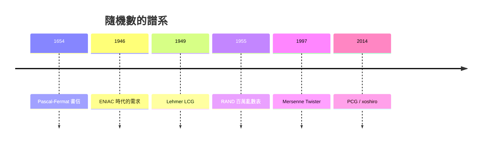

# 08.1 偽隨機數生成與採樣技巧

## 賭桌上的機率論

1654 年，賭徒 de Méré 爵士把骰子賭局的分配問題寫信請教 Blaise Pascal；Pascal 與 Pierre de Fermat 往返書信，奠定了現代機率論。隨機性最早是賭博的法律問題——賭局中斷時賭金怎麼分——數學家替賭徒解決了它。此後三百年，「產生隨機數」靠的是骰子、輪盤與抽籤，直到電腦出現，人類才需要讓機器大量、快速、可重現地「偽造」隨機性。

## 一本百萬亂數的實體書

1955 年，蘭德公司出版《A Million Random Digits with 100,000 Normal Deviates》：一百萬個隨機數字，由電子脈衝輪盤產生，出版成四百頁的精裝書。今天看來近乎荒謬——買一本「隨機數」回家查表——但在當年，這是統計抽樣、蒙地卡羅模擬與實驗設計的標準配備，RAND 的工程師得先證明這本書「夠亂」：頻率檢定、序列檢定一一通過。這本書直到 2001 年仍在印行，是隨機性從賭桌走向科學儀器的象徵。

## Lehmer 與線性同餘法

1949 年，Berkeley 的 Derrick Lehmer 發表線性同餘生成器（LCG）：

$$X_{n+1} = (aX_n + c) \bmod m.$$

取 $X_0$ 為種子（seed），之後每一步完全確定——所以叫「偽」隨機。LCG 簡單快速，統治了早期電腦數十年，但缺點也致命：狀態只有一個整數，週期有限，且高維取樣時點會落在少數幾個超平面上（Marsaglia 的著名批評「隨機數不該被隨便挑，也不該用手算」）。

1997 年，松本真與西村拓士發表 Mersenne Twister（MT19937），週期 $2^{19937}-1$，通過絕大多數統計檢定，成為此後二十年的預設選擇，Python、R 都採用過它。近年更快更小的 PCG（O'Neill, 2014）與 xoshiro 系列逐漸取代它，兼顧速度、統計品質與可跳躍的平行取樣。

## 種子、可重現性與國安醜聞

種子讓實驗可重現——這是科學的德性，也是除錯的恩物。但若隨機數用於密碼學，「可預測」就是災難。2007 年，微軟研究員 Dan Shumow 與 Niels Ferguson 指出 NIST 標準隨機數生成器 Dual_EC_DRBG 中藏著一組只有「知道後門常數者」才能預測的缺陷；2013 年史諾登文件證實 NSA 曾支付一千萬美元給 RSA 公司，使其預設採用該演算法。這起醜聞確立了密碼學隨機數（CSPRNG）必須基於公開、可審計的設計原則。

## 從均勻分布到萬物分布

偽隨機數通常先給出 $U\sim\text{Uniform}(0,1)$，要得到其他分布需要採樣技巧：

- 反變換法：若 $F$ 是目標 CDF，則 $F^{-1}(U)$ 服從目標分布，指數分布、卜瓦松分布皆可用。
- 拒絕抽樣（rejection sampling，von Neumann, 1951）：用候選分布提議，按比例接受或拒絕，是蒙地卡羅的萬用扳手。
- Box-Muller 變換（1958）：兩個均勻隨機數經 $\sqrt{-2\ln U_1}\cos(2\pi U_2)$ 即得常態變數，簡潔得像魔術。
- 重要性抽樣：以權重 $w(x)=p(x)/q(x)$ 修正提議分布的偏差，是第八章變異數縮減與粒子濾波的基礎。

## 小結

隨機數的歷史，是「賭博問題」變成「國家安全問題」的歷史。下一節我們會看到，這些廉價的偽隨機數，如何在氫彈計算中化身為蒙地卡羅方法。
